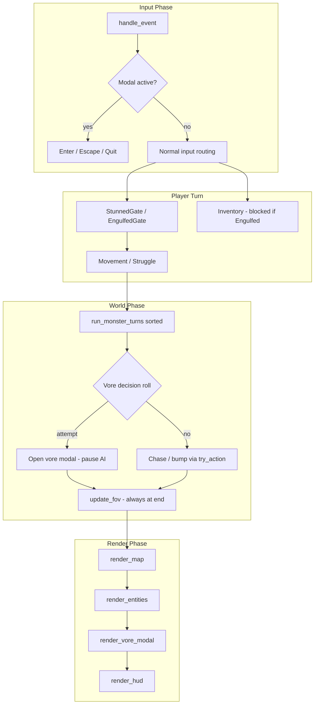
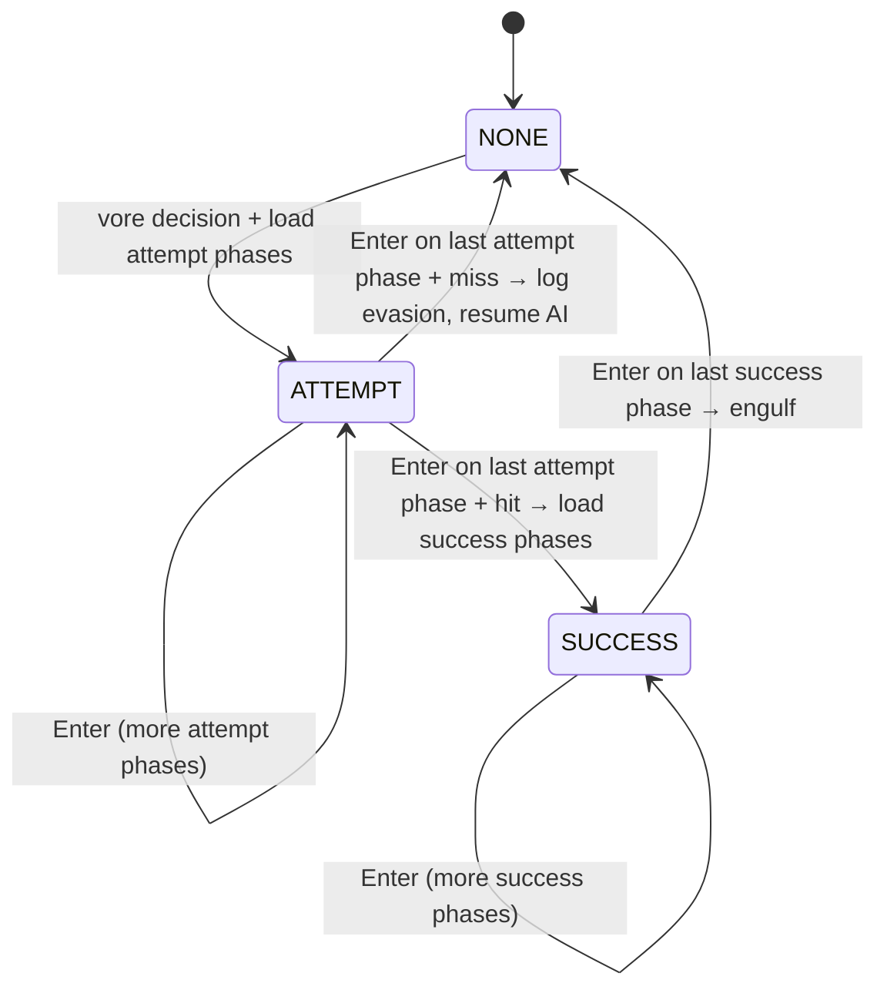

# Design: Basic Vore Mechanics (v1)

| Field | Value |
|-------|-------|
| **Author** | Systems Design |
| **Date** | 2026-06-29 |
| **Status** | Approved (design review 2026-06-29; clarified 2026-06-29 post Enhancements 1) |
| **Change** | `openspec/changes/add-vore-mechanics/` |
| **Spec target** | `openspec/specs/vore/spec.md` |

---

## Overview

This design adds the first **vore domain** layer on top of the shipped core-roguelike and **Enhancements 1** (wait, natural regen, stunned movement/wait pass-turn). Monsters that have line of sight to a weakened player may **decide** each turn to attempt a vore attack instead of a normal chase step (or **chase closer** when not adjacent at 0 HP). Attempts surface a **center-screen modal narrative queue** — variable phase count per monster and narrative type — advanced with **Enter** (and **Escape** to quit). Modal text **never** copies to the scrolling log. On a miss, the modal dismisses and the log reports evasion; remaining monsters finish the current world phase. On a hit, success narrative phases play before the player enters **engulfed** state: co-located with the predator, visually blind, able to struggle (directional move) for probabilistic escape while dealing damage to the predator. **v1 scope**: vore moves, narrative modals, and escapes only — no digestion damage.

Core movement, FOV, inventory, and stunned semantics remain stable except where engulfed struggle or wait-in-belly routing overrides them. Vore attaches via optional ECS tags/components, a small engine phase machine, and new event hooks—matching the extension boundary documented in `openspec/specs/core-roguelike/spec.md`.

---

## Background & Motivation

### Current state

The game at `src/` implements a complete turn loop. Directionally:

```text
Input → ModalGate → EngulfedGate / StunnedGate / Wait → Movement/BumpCombat → Pickup → LetterUse → MonsterAI → FOV → Render
```

Enhancements 1 (shipped): stunned movement and wait **consume a player turn** with *"You're too tired to move."*; natural regen (+1 HP / 8 turns) runs via `on_player_turn_consumed` and **continues while engulfed**.

> **Authoritative ordering** is in `GameEngine.handle_event` and `_run_world_turn` (`src/engine.py`), not this diagram alone:
> - **Pickup** runs inside the movement-key handler immediately after a successful `try_action`, not as a separate top-level phase.
> - **Inventory** (`a`–`z`) calls `_run_world_turn` directly on successful use, bypassing the movement path.
> - **`defeat_cleanup`** exists in `combat.py` but is **not** called from the engine today.
> - **FOV** runs at the end of `_run_world_turn` (or on `new_game`), after monster AI completes or pauses.

Key files:

| Area | File | Notes |
|------|------|-------|
| Turn loop | `src/engine.py` | `handle_event`, `_run_world_turn`, `render` |
| Monster AI | `src/systems/ai.py` | `run_monster_turns` — LOS chase via `try_action` |
| Combat | `src/systems/combat.py` | Bump damage; player `Stunned` at 0 HP; `_fighter_at` returns first match |
| Movement | `src/systems/movement.py` | `BlocksMovement` prevents tile sharing |
| Rendering | `src/systems/render.py` | Map + entities on `game_map.visible` |
| Events | `src/events.py` | `on_entity_defeated`, `on_player_stunned`, `on_item_used` |
| Messages | `src/messages.py` | Terminology policy enforced |

Monsters are anonymous (`"The monster hits you…"`). Spawn uses a single glyph `o` with no name component (`src/spawn.py`). **v1 vore POC** retags spawn as **`wolf`** with wolf narrative packs in `src/vore_content.py`.

The core spec **explicitly deferred** vore to a separate domain and reserved hooks for optional components. Ten acceptance tests pass in `tests/test_acceptance.py`. `test_ac8_no_vore_module` scans **top-level** `src` packages only (`hasattr(src, "vore")` + `pkgutil.iter_modules`); a new `src/systems/vore.py` submodule does **not** fail it. Core spec AC8 wording ("zero vore modules present") will need a semantic update after vore ships (see PR 8).

### Pain points / user needs

1. Low-HP combat should create **predator pressure** beyond bump damage, with randomized vore attempts.
2. Vore needs **narrative pacing** (modal UI), not instant state changes.
3. Successful vore is a **distinct player state** (engulfed) with blindness, struggle, and immunity—not instant digestion.
4. Implementation must be **incrementally testable** (miss path, escape vs damaged-predator escape, debug helpers).

---

## Goals & Non-Goals

### Goals

- Implement monster **vore attempt eligibility** (HP ≤ 50% max, progressive random decision, 100% at 0 HP).
- Implement **hit/miss resolution** with HP-scaled success chance; miss consumes predator turn only.
- **Modal narrative UI** centered on the map; **dynamic phase queue** (variable length per monster/type); **Enter** advances one phase; **Escape** quits; all other gameplay keys no-op while modal active. Modal text never appears in the scrolling log.
- **Engulfed state**: tile-sharing with predator, blindness rendering, struggle moves with escape chance + predator damage, immediate escape on predator defeat.
- **Immunity**: engulfed player cannot be bump-attacked by other monsters; co-tile bumps target the predator deterministically.
- Clarify **stunned ∩ engulfed** behavior (0 HP stunned player is always vore-targeted; engulfed overrides stunned movement gate for struggle).
- Add **tunable constants**, **`GameEngine.rng`**, and **automated tests** for probability boundaries and state transitions.
- Add **debug key `F2`** to set all monster HP to 1 (escape-vs-defeat testing), available from PR 1.
- Produce `openspec/specs/vore/spec.md` and `openspec/changes/add-vore-mechanics/` artifacts.
- **Narrative content types** as an extensible **string list** (`OV`, `CV`, `AV` in v1) with equal-weight random selection among enabled types; user-toggle filtering deferred to a future main menu (all types on by default in v1 constants).
- **Wolf proof-of-concept** spawn with wolf-specific multi-phase narrative packs.

### Non-Goals (v1 vore)

- **Digestion** timer, stomach phases, or player defeat via digestion (reserved terminology; future change).
- Main menu content toggles (constants default all narrative types enabled until menu ships).
- Digestion foreshadowing or stomach-phase UI (digestion is a separate near-term enhancement).
- **Stunned pass-turn behavior** ("You don't have enough energy to move." consumes a turn on any action while stunned) — deferred to a separate module/change; v1 stunned gate unchanged except where engulfed struggle overrides movement.
- Save/load of engulfed state.
- Sound, animation, or multi-page branching narrative trees.
- Inventory use, pickup, or item effects while engulfed (blocked by default—see Key Decisions).
- Multi-prey stacking (one engulfed player, one predator).
- Predator movement while holding prey (predator is frozen; see Key Decisions).

---

## Proposed Design

### High-level architecture



Vore logic lives primarily in **`src/systems/vore.py`** (new). The engine owns **`VoreModalState`** because input and render must gate globally. Components extend **`src/components.py`**; constants extend **`src/constants.py`**.

### RNG ownership

`GameEngine` owns a single gameplay RNG, seeded from `new_game`:

```python
class GameEngine:
    def __init__(self) -> None:
        self.rng = random.Random()
        ...

    def new_game(self, *, seed: int | None = None) -> None:
        self.rng = random.Random(seed)
        ...
        spawn_monsters(self.world, self.game_map, pos.x, pos.y, rng=self.rng)
```

Thread `self.rng` through `run_monster_turns`, `resolve_vore_hit`, `should_attempt_vore`, and `try_struggle`. Map generation may keep its own `Random(seed)` internally; combat/vore tests pass `seed=` to `new_game` for reproducibility.

### Probability formulas

Let `f = clamp(hp / max_hp, 0.0, 1.0)` be the player's HP fraction.

**Eligibility gate** (hard):

```python
def is_vore_eligible(fighter: Fighter) -> bool:
    return fighter.hp / fighter.max_hp <= VORE_HP_THRESHOLD  # default 0.5
```

**Decision chance** (monster chooses vore *instead of* chase this turn):

```python
def vore_decision_chance(hp_fraction: float) -> float:
    if hp_fraction > VORE_HP_THRESHOLD:
        return 0.0
    if hp_fraction <= 0.0:
        return 1.0
    return (VORE_HP_THRESHOLD - hp_fraction) / VORE_HP_THRESHOLD
```

| Player HP (max 30) | `f` | Decision chance |
|--------------------|-----|-----------------|
| 30 | 1.00 | 0% (ineligible) |
| 16 | 0.53 | 0% (ineligible) |
| 15 | 0.50 | 0% (eligible but 0% decision at boundary) |
| 14 | 0.47 | 6% |
| 8 | 0.27 | 46% |
| 1 | 0.03 | 94% |
| 0 | 0.00 | 100% |

**Hit chance** (after decision to attempt; independent roll):

```python
def vore_hit_chance(hp_fraction: float) -> float:
    if hp_fraction > VORE_HP_THRESHOLD:
        return 0.0
    if hp_fraction <= 0.0:
        return 1.0
    t = (VORE_HP_THRESHOLD - hp_fraction) / VORE_HP_THRESHOLD
    return VORE_HIT_MIN + t * (VORE_HIT_MAX - VORE_HIT_MIN)
```

Default constants (`src/constants.py`):

| Constant | Default | Meaning |
|----------|---------|---------|
| `VORE_HP_THRESHOLD` | `0.5` | Above this: never attempt |
| `VORE_HIT_MIN` | `0.25` | Hit chance at 50% HP (eligible floor) |
| `VORE_HIT_MAX` | `1.0` | Hit chance at 0 HP |
| `VORE_ESCAPE_BASE` | `0.15` | Initial escape chance per struggle move |
| `VORE_ESCAPE_PER_FAIL` | `0.05` | Added per failed struggle **during current engulfment** |
| `VORE_STRUGGLE_DAMAGE` | `2` | Flat damage to predator per struggle move (ignores `compute_damage`) |
| `VORE_ADJACENCY_REQUIRED` | `True` | Predator must be adjacent to attempt |

### ECS components and tags

Add to `src/components.py`:

```python
# Tags
VoreCapable: Final = "VoreCapable"
Engulfed: Final = "Engulfed"

@attrs.define(frozen=True)
class DisplayName:
    name: str

@attrs.define(frozen=True)
class VoreNarratives:
    """Extensible narrative type ID list (strings). v1 uses OV/CV/AV; must include OV."""
    types: tuple[str, ...]

@attrs.define
class Predator:
    prey: Entity
    failed_struggles: int = 0  # escape escalation; reset on release_engulfed
```

**Spawn changes** (`src/spawn.py`): all v1 monsters receive `VoreCapable`, `DisplayName(name="wolf")`, and `VoreNarratives(types=("OV", "CV", "AV"))` (wolf POC; full type set for filter testing; only enabled types surface in play).

**Engulfed player entity changes**:

| Component/Tag | While engulfed |
|---------------|----------------|
| `Engulfed` tag | Added on successful vore |
| `Position` | Forced to predator tile each world-phase start |
| `BlocksMovement` | **Removed** (allows co-occupancy) |
| `Stunned` | Unchanged if HP is 0; struggle still allowed |
| `Predator` on monster | Points to player entity |

### Vore attempt preconditions

`should_attempt_vore(monster, player, game_map, rng)` is the **single source of truth** for headless tests. Returns `True` only when **all** hold:

1. `VORE_ENABLED` is `True`.
2. Monster has `AI`, `VoreCapable`, and `Position`; player has `Fighter`.
3. **`can_see(game_map, monster_pos, player_pos)`** — line of sight required.
4. Player `is_vore_eligible(player_fighter)`.
5. Player does **not** have `Engulfed`.
6. Monster is **adjacent** to player (Chebyshev distance 1).
7. `rng.random() < vore_decision_chance(hp_fraction)`.
8. `pick_narrative_type(monster.types, prefs, rng)` is not `None` — at least one user-enabled narrative type exists on this monster (with OV forced enabled, v1 spawn always satisfies this via `"OV"` on every monster).

If adjacent but decision roll fails, or any precondition fails except adjacency, monster **chases normally** (`_choose_chase_direction` + `try_action`). Vore does not replace distant pursuit.

**At 0 HP** (stunned): monsters SHALL **always** pursue vore — attempt when adjacent, otherwise **chase closer** (never prefer bump over closing distance). Accidental bump-attack while closing is acceptable edge-case behavior, not intended primary AI.

### Combat target resolution (co-tile)

Engulfed play removes player `BlocksMovement` and co-occupies the predator tile. Current `_fighter_at` returns the **first** `Fighter` at a position tag with no tie-breaking—non-deterministic with two fighters on one tile.

**Rule**: `_fighter_at` (and any bump target lookup) **never selects an `Engulfed` player** as the bump defender. When multiple non-engulfed fighters share a tile, prefer the entity with a `Predator` component (the engulfing monster). Immunity means "engulfed player is never the bump target," not "attacks on that tile whiff."

```python
def _fighter_at(world, x, y, *, exclude=None) -> Entity | None:
    target = Position(x, y)
    candidates = [
        e for e in world.Q.all_of(tags=[target], components=[Fighter])
        if e is not exclude and Engulfed not in e.tags
    ]
    if not candidates:
        return None
    # Prefer predator holding prey on co-tile
    for entity in candidates:
        if entity.components.get(Predator) is not None:
            return entity
    return candidates[0]
```

**Struggle damage** bypasses `_fighter_at` entirely: `apply_struggle_damage(predator, amount)` subtracts flat `VORE_STRUGGLE_DAMAGE` directly from the predator's `Fighter.hp`, then runs defeat/escape logic.

### Engine modal state machine

Single consolidated type on `GameEngine`. Narrative pacing uses a **dynamic phase queue** (not a fixed two-beat ATTEMPT/SWALLOW). At attempt open, load attempt-phase strings for the picked narrative type into a one-time list; on hit, append (or replace with) success-phase strings; iterate with Enter until the list is exhausted.

```python
class VoreModalSegment(Enum):
    NONE = auto()
    ATTEMPT = auto()   # attempt cinematic phases (shown regardless of hit outcome)
    SUCCESS = auto()   # success-only phases (only if hit=True)

@attrs.define
class VoreModalState:
    segment: VoreModalSegment = VoreModalSegment.NONE
    phases: list[str] = attrs.field(factory=list)   # current queue; released on reset()
    phase_index: int = 0
    predator: Entity | None = None
    predator_name: str = ""
    hit: bool = False                    # rolled when modal opens
    narrative_type: str = ""             # picked at open (equal weight among enabled)
    resume_monster_index: int = 0
    pending_monsters: list[Entity] = attrs.field(factory=list)

    @property
    def active(self) -> bool:
        return self.segment is not VoreModalSegment.NONE

    def current_line(self) -> str:
        return self.phases[self.phase_index] if self.phases else ""

    def open_attempt(
        self,
        predator: Entity,
        name: str,
        narrative_type: str,
        attempt_phases: list[str],
        hit: bool,
        pending: list[Entity],
        index: int,
    ) -> None:
        self.segment = VoreModalSegment.ATTEMPT
        self.predator = predator
        self.predator_name = name
        self.narrative_type = narrative_type
        self.phases = list(attempt_phases)
        self.phase_index = 0
        self.hit = hit
        self.pending_monsters = pending
        self.resume_monster_index = index

    def reset(self) -> None:
        self.segment = VoreModalSegment.NONE
        self.phases = []
        self.phase_index = 0
        self.predator = None
        self.predator_name = ""
        self.hit = False
        self.narrative_type = ""
        self.resume_monster_index = 0
        self.pending_monsters = []
```

`GameEngine` holds `self.vore_modal: VoreModalState`. Modal transitions on Enter are handled by **`GameEngine._advance_vore_modal`**.

**Phase advance rules**:

| Step | Action |
|------|--------|
| Enter while more attempt phases remain | `phase_index += 1` |
| Enter on **last** attempt phase + `hit=False` | Dismiss modal; log *"You evaded the {name}'s vore attempt."*; miss-resume AI |
| Enter on **last** attempt phase + `hit=True` | Load success phases from content; `segment = SUCCESS`; `phase_index = 0` |
| Enter while more success phases remain | `phase_index += 1` |
| Enter on **last** success phase | `engulf_player(...)`; `reset()`; end world phase |

**Modal vs log (hard)**: Text shown in the center modal **never** copies to the scrolling message log. The log receives only type-agnostic outcome lines (evasion on miss; struggle/escape/pack-blocked lines during engulfed play).

**`reset()` call sites**:

| When | Caller |
|------|--------|
| Success narrative completes | `_advance_vore_modal` after `engulf_player` |
| Miss-resume finishes (`run_monster_turns` returns `False`) | `_advance_vore_modal` after single resume call |
| `new_game` | `GameEngine.new_game` at world reset |



**Input gating** (`engine.handle_event`):

```python
match event:
    case tcod.event.Quit():
        return True
    case tcod.event.KeyDown(sym=tcod.event.KeySym.ESCAPE):
        return True  # always allowed, including during modal
    case _ if self.vore_modal.active:
        if isinstance(event, tcod.event.KeyDown) and event.sym == tcod.event.KeySym.RETURN:
            self._advance_vore_modal()
        return False  # block movement, inventory, debug; Enter handled above
    case ...:  # normal routing
```

**Event timing** (`fire_vore_attempt`):

| Moment | Action |
|--------|--------|
| Modal opens (`open_attempt`) | Roll `hit`; load attempt phases; store in `VoreModalState`; **do not** fire event yet |
| Enter through attempt phases + miss on last | Log evasion; `fire_vore_attempt(predator, prey, hit=False)`; resume AI |
| Enter through attempt phases + hit on last | Load success phases; continue modal (no event yet) |
| Enter on last success phase | `engulf_player(...)` (fires `fire_player_engulfed` internally); `fire_vore_attempt(predator, prey, hit=True)`; `vore_modal.reset()` |

**Render** (`render.py`): `render_vore_modal(console, lines=...)` draws a centered box over the map region (not HUD).

**`_advance_vore_modal`** (`GameEngine`) — authoritative Enter handler. Miss-resume runs in the **same** world phase and does **not** consume a player turn:

```python
def _advance_vore_modal(self) -> None:
    modal = self.vore_modal
    if modal.segment is VoreModalSegment.ATTEMPT:
        if modal.phase_index < len(modal.phases) - 1:
            modal.phase_index += 1
            return
        # Last attempt phase consumed
        if not modal.hit:
            self.message_log.add(messages.vore_attempt_evaded(modal.predator_name))
            fire_vore_attempt(modal.predator, self.player, hit=False)
            modal.segment = VoreModalSegment.NONE
            modal.resume_monster_index += 1
            if run_monster_turns(..., modal=modal):
                return
            modal.reset()
            self._update_fov()
            return
        success = get_narrative_phases(
            modal.predator_name, modal.narrative_type, "success"
        )
        modal.phases = success
        modal.phase_index = 0
        modal.segment = VoreModalSegment.SUCCESS
        return

    if modal.segment is VoreModalSegment.SUCCESS:
        if modal.phase_index < len(modal.phases) - 1:
            modal.phase_index += 1
            return
        engulf_player(self.world, self.player, modal.predator, self.message_log)
        fire_vore_attempt(modal.predator, self.player, hit=True)
        modal.reset()
        self._update_fov()
```

**Chained modal handling** (miss-resume interrupted by a second vore attempt):

During miss-resume, `run_monster_turns` is called **once** per Enter. If a later monster opens a new vore modal, `run_monster_turns` returns `True` and calls `open_attempt`. `_advance_vore_modal` **returns immediately**—no `reset()`, no `_update_fov()`. The player must press Enter again to resolve the new modal.

```text
Monster A misses → Enter → resume from i+1
  → Monster B opens modal → run_monster_turns returns True → return (wait)
  → Enter advances B's attempt/success phases
  → If B misses and no further modal → reset() + _update_fov()
```

Do **not** use `while run_monster_turns(...): pass`—that re-enters AI while a modal is active, the resume guard sees non-`NONE` segment, and `start_index` falls back to `0`, restarting the sorted list under an active modal.

**Initial modal interrupt** (player action triggered world phase):

```python
def _run_world_turn(self) -> None:
    if run_monster_turns(..., rng=self.rng, modal=self.vore_modal):
        pass  # modal opened mid-phase; _advance_vore_modal handles miss-resume later
    self._update_fov()
```

On first interrupt, `run_monster_turns` returns `True` and `_run_world_turn` updates FOV at current positions. Miss-resume is **not** in `_run_world_turn`; it runs inside `_advance_vore_modal` when the player presses Enter.

### Turn order and mid-phase interrupt

**Deterministic monster order**: Before iterating, sort monsters by `(position.y, position.x, id(entity))` so resume snapshots are stable across runs and tests.

```python
def _sorted_monsters(world: Registry) -> list[Entity]:
    monsters = list(world.Q.all_of(components=[AI, Position]))
    return sorted(
        monsters,
        key=lambda m: (m.components[Position].y, m.components[Position].x, id(m)),
    )

def run_monster_turns(..., *, modal: VoreModalState | None = None, rng: Random) -> bool:
    monsters = _sorted_monsters(world)
    # Resume only when miss-path left a snapshot (phase NONE, pending non-empty).
    # After reset(), pending_monsters is [] → start_index 0 for fresh world phases.
    if modal and modal.segment is VoreModalSegment.NONE and modal.pending_monsters:
        start_index = modal.resume_monster_index  # already i+1 after engine miss handling
    else:
        start_index = 0

    for i in range(start_index, len(monsters)):
        monster = monsters[i]
        ...
        if should_attempt_vore(monster, player, game_map, rng):
            narrative_type = pick_narrative_type(monster.types, prefs, rng)
            attempt_phases = get_narrative_phases(name, narrative_type, "attempt")
            hit = resolve_vore_hit(player, rng)
            modal.open_attempt(
                monster, name, narrative_type, attempt_phases, hit, monsters, i
            )
            return True
        try_action(...)
    return False
```

**Resume index convention** (single source of truth):

1. `open_attempt` stores the attempting monster's index **`i`** in `resume_monster_index`.
2. On miss (`_advance_vore_modal`), engine sets `resume_monster_index = i + 1` before re-calling `run_monster_turns`.
3. `run_monster_turns` uses `start_index = modal.resume_monster_index` with **no additional `+ 1`**.

**Miss path**: Enter through attempt phases with `hit=False` → `_advance_vore_modal` logs evasion, sets index to `i+1`, calls `run_monster_turns` **once**. If it returns `True` (chained modal), return and wait for next Enter. If `False`, `reset()` → `_update_fov()`. Same world phase; no new player turn.

**Hit path**: Enter through attempt phases with `hit=True` → load success phases. Enter through success phases → `engulf_player(...)` → `reset()` → skip remaining monsters this world phase (predator already acted).

**When to roll hit**: At modal open (stored in `VoreModalState.hit`).

**FOV during modal pause**: When `run_monster_turns` returns `True` (modal opened mid-phase), `_run_world_turn` still calls `_update_fov()` before returning. Positions are unchanged at interrupt time; FOV reflects pre-interrupt layout. No partial-AI position drift. On miss resume, FOV updates again at end of completed world phase.

### Predator AI while holding prey

Monsters with a `Predator` component **do not move or chase** on subsequent world phases. `run_monster_turns` skips AI movement/`try_action` for them; only `sync_engulfed_position` keeps the player co-located. The predator is frozen in place while the player struggles—simplest model, avoids dragging the player across the map, item pickup on the predator tile, and escape geometry churn.

```python
for monster in monsters[i:]:
    if monster.components.get(Predator) is not None:
        sync_engulfed_position(world, monster.components[Predator].prey)
        continue
    ...
```

### Engulfed gameplay

**Apply on successful swallow** (`engulf_player`):

1. Add `Engulfed` to player; add `Predator(prey=player)` on monster.
2. Remove `BlocksMovement` from player.
3. Set `player.Position` to `predator.Position`.
4. Fire `fire_player_engulfed(player, predator)` — **only** dispatch site for this event (modal advance calls `engulf_player`, not the hook directly).

**Each world-phase tick**: `sync_engulfed_position` copies predator position onto engulfed player.

**Struggle (player move while engulfed)** — engine routing:

```python
case tcod.event.KeyDown(sym=sym) if sym in DIRECTION_KEYS:
    if Engulfed in self.player.tags:
        if try_struggle(self.world, self.game_map, self.player, DIRECTION_KEYS[sym],
                        self.message_log, self.rng):
            self._run_world_turn()  # always after struggle (turn consumed)
    elif Stunned not in self.player.tags:
        if try_action(...):
            pickup_items_at(...)
            self._run_world_turn()
```

`try_struggle` always returns `True` (turn consumed) even when escape roll fails. Struggle passes the **entered direction** to `release_engulfed` on successful escape.

**Wait while engulfed** (`H`, numpad 5, `.`): allowed; calls `_consume_player_turn()` and `_run_world_turn()` like normal wait. Does **not** deal struggle damage, increment escape-fail counter, or roll escape. Log is silent when conscious; stunned engulfed wait uses Enhancements 1 tired message.

**Struggle resolution** (`try_struggle`):

1. `apply_struggle_damage(predator, VORE_STRUGGLE_DAMAGE)` — flat 2 HP, no `compute_damage`.
2. If predator `hp <= 0`: `release_engulfed(...)` then `fire_entity_defeated` / `entity.clear()`.
3. Else compute `escape_chance = VORE_ESCAPE_BASE + failed_struggles * VORE_ESCAPE_PER_FAIL` (capped at 1.0), where `failed_struggles` is tracked on the active engulfment (resets to 0 on `release_engulfed`). Roll `rng.random() < escape_chance` → on success: `release_engulfed(...)`; on failure: increment `failed_struggles`.

**Unit test anchor**: player `power=4`, predator `defense=0`, `VORE_STRUGGLE_DAMAGE=2` → one struggle deals exactly 2 HP; predator at 1 HP is defeated and player escapes immediately.

**`release_engulfed` full cleanup** (accepts `escape_direction: tuple[int, int] | None` from struggle):

```python
def release_engulfed(
    world, player, predator, game_map, message_log, *, escape_direction
) -> None:
    player.tags.discard(Engulfed)
    predator.components.pop(Predator, None)
    player.tags.add(BlocksMovement)
    predator_pos = predator.components[Position]

    dest = _tile_in_direction(predator_pos, escape_direction)
    if dest is None or not _is_valid_escape_tile(dest, game_map, world, exclude={predator}):
        dest = pick_random_adjacent_free_tile(game_map, world, predator_pos, exclude={predator})
    if dest is None:
        dest = pick_random_direction_tile(game_map, world, predator_pos)
        occupant = entity_at(world, dest)
        if occupant is not None:
            teleport_to_random_floor_tile(occupant, game_map, world, rng)

    player.components[Position] = dest
    message_log.add(messages.vore_escaped(name))
    fire_player_escaped_engulf(player, predator)
```

**HP on escape**: player HP is **unchanged** — escape at 0 HP leaves the player stunned until regen or potion. Future ally rescue is out of scope.

Never leave the player on the predator tile while the predator is alive without `Engulfed` state.

**Immunity**: Engulfed player is excluded from `_fighter_at`. `run_monster_turns` skips vore/chase against engulfed prey tiles except via the predator entity. Third monsters bumping the predator tile hit the predator (test in PR 5).

### Stunned ∩ engulfed interaction

Vore does **not** change stunned rules. Being stunned while monsters close in or while engulfed is very dangerous and likely precedes defeat (future allies may intervene — out of scope).

| State | Movement keys | Wait keys | Inventory keys | Vore target |
|-------|---------------|-----------|----------------|-------------|
| Stunned only | Pass turn + tired message (Enhancements 1) | Pass turn + tired message | Allowed (core spec) | Eligible at 0 HP — **can be vored while stunned** |
| Engulfed only | Struggle (`try_struggle`) | Pass turn (not struggle) | **Blocked** | Not eligible (already engulfed) |
| Stunned + Engulfed | Struggle allowed | Pass turn + tired message | **Blocked** | N/A |

**Recovery**: Escape does not auto-clear stunned if HP still 0. Natural regen via `on_player_turn_consumed` **continues while engulfed** until game over.

### Deferred: stunned pass-turn on non-movement actions

Future change: inventory and other actions while stunned may consume turns with energy messages. Enhancements 1 already covers movement and wait. Engulfed struggle and wait-in-belly routing override stunned movement gate as specified above.

### Rendering: engulfed blindness

| Subsystem | Normal | Engulfed |
|-----------|--------|----------|
| `render_map` | Full explored/visible | **Skip tile drawing** (black/empty) |
| `render_entities` | All visible entities | **Only player `@`** |
| `update_fov` | Standard radius 10 | Still run (explored memory) |
| HUD | Normal | Add `** ENGULFED **` |

### Narrative content types (extensible string list)

Narrative type IDs are **plain strings** in an open-ended list. v1 ships `"OV"`, `"CV"`, and `"AV"` as the first three entries; future types append without schema changes. Types label distinct narrative content packs — not mechanics. Wolf POC registers `("OV", "CV", "AV")`.

**User content preferences** (`VoreContentPreferences` in constants until main menu ships):

| Type | v1 policy |
|------|-----------|
| `OV` | **Always enabled** — cannot be disabled |
| `CV` | Toggleable (future menu); **default on** in v1 constants |
| `AV` | Toggleable (future menu); **default on** in v1 constants |

Main menu toggles are **deferred**; v1 hard-codes all types enabled in `VoreContentPreferences`.

**Filtering rule (hard):** Disabled types are **gone** from gameplay. No modal lines, log messages, or UI references to a disabled type.

**Selection at attempt open** — **equal weight** among enabled types on the monster:

```python
def pick_narrative_type(monster_types, prefs, rng) -> str | None:
    pool = enabled_narrative_types(monster_types, prefs)  # OV forced on
    if not pool:
        return None
    return rng.choice(pool)  # uniform among pool
```

Store the picked type on `VoreModalState.narrative_type` for the full encounter.

**Content tables** (`src/vore_content.py`):

```python
# Key: (display_name, narrative_type, segment) → tuple of modal phase lines
# segment: "attempt" | "success"
NARRATIVE_PACKS: dict[tuple[str, str, str], tuple[str, ...]] = {
    ("wolf", "OV", "attempt"): (
        "The wolf leaps toward you with its jaws open wide!",
    ),
    ("wolf", "OV", "success"): (
        "The wolf starts swallowing you.",
        "The wolf swallows you more.",
        "The wolf has almost completely swallowed you.",
        "You are completely inside the wolf's belly now.",
    ),
    ("wolf", "CV", "attempt"): (...),
    ("wolf", "CV", "success"): (...),  # variable phase count per pack
    ...
}

def get_narrative_phases(name: str, narrative_type: str, segment: str) -> list[str]:
    key = (name, narrative_type, segment)
    if key in NARRATIVE_PACKS:
        return list(NARRATIVE_PACKS[key])
    return list(NARRATIVE_PACKS.get(("wolf", narrative_type, segment), ()))
```

Phase count is **dynamic** per `(name, type, segment)` — the modal iterates `len(phases)` Enter presses. The phase list is held only for the active modal and cleared on `reset()`.

Fallback when a wolf-specific pack is missing: generic `("wolf", type, segment)` lines — never reference a disabled type.

### Monster naming for messages

```python
def entity_display_name(entity: Entity) -> str:
    dn = entity.components.get(DisplayName)
    return dn.name if dn else "wolf"
```

Modal copy comes from `get_narrative_phases` (modal only). Log copy for miss is type-agnostic: *"You evaded the {name}'s vore attempt."* Escape/struggle lines use content lookup where applicable.

### Inventory while engulfed

Blocked. Log: `"You cannot reach your pack while engulfed."`

### Debug support

| Key | Behavior |
|-----|----------|
| `S` (existing) | Toggle stunned |
| `R` (existing) | New dungeon |
| `F2` (new) | Set every monster `Fighter.hp = 1` |

`F2` is unbound in `INVENTORY_KEYS` and `DIRECTION_KEYS`. Handle **before** inventory routing in `handle_event`:

```python
case tcod.event.KeyDown(sym=tcod.event.KeySym.F2):
    debug_weaken_all_monsters(self.world, self.message_log)
```

Log: `"Debug: all monsters weakened."` Available from **PR 1** for incremental struggle testing in PR 6.

### Future digestion path (out of v1)

v1 ends at **engulfed + escape struggle**. Digestion deferred.

---

## API / Interface Changes

### `GameEngine` (`src/engine.py`)

| Before | After |
|--------|-------|
| No gameplay RNG | `self.rng: random.Random`, reseeded in `new_game(seed=...)` |
| `handle_event` routes all keys immediately | Modal gate blocks gameplay keys; **Escape/Quit always work** |
| `_run_world_turn` always completes AI | Initial AI pass may pause for modal; miss-resume in `_advance_vore_modal` |
| `new_game` | Calls `vore_modal.reset()` |
| `render` | Calls `render_vore_modal` when `vore_modal.active` |

New fields: `vore_modal: VoreModalState`, `_advance_vore_modal()` for Enter-driven transitions and single-call miss-resume (early return on chained modal).

### `run_monster_turns` (`src/systems/ai.py`)

```python
def run_monster_turns(
    world, game_map, player, message_log, *,
    rng: random.Random,
    modal: VoreModalState | None = None,
) -> bool
```

Inserts vore decision before chase; skips `Predator`-holding monsters; uses `_sorted_monsters`.

### `combat.py`

- Replace `_fighter_at` with co-tile resolution (skip `Engulfed`, prefer `Predator`).
- Add `apply_struggle_damage(predator, amount: int)` — flat subtraction.

### New module `src/systems/vore.py`

```python
def vore_decision_chance(hp_fraction: float) -> float: ...
def vore_hit_chance(hp_fraction: float) -> float: ...
def is_vore_eligible(fighter: Fighter) -> bool: ...
def should_attempt_vore(monster, player, game_map, rng) -> bool: ...
def resolve_vore_hit(player, rng) -> bool: ...
def engulf_player(world, player, predator, message_log) -> None: ...
def release_engulfed(world, player, predator, game_map, message_log, *, escape_direction) -> None: ...
def get_narrative_phases(name: str, narrative_type: str, segment: str) -> list[str]: ...
def try_struggle(world, game_map, player, direction, message_log, rng) -> bool: ...
def sync_engulfed_position(world, player) -> None: ...
def debug_weaken_all_monsters(world, message_log) -> None: ...
def find_adjacent_free_tile(...) -> Position: ...
```

### Events (`src/events.py`)

```python
on_vore_attempt: list[Callable[[Entity, Entity, bool], None]]
on_player_engulfed: list[Callable[[Entity, Entity], None]]
on_player_escaped_engulf: list[Callable[[Entity, Entity], None]]
```

See **Event timing** table in modal section for `fire_vore_attempt` dispatch points.

### Render (`src/systems/render.py`)

```python
def render_vore_modal(console, *, lines: list[str], ...) -> None: ...
def render_entities(..., *, blind: bool = False, player: Entity | None = None): ...
```

---

## Data Model Changes

| Addition | Type | Attached to |
|----------|------|-------------|
| `VoreCapable` | Tag | Monsters (spawn) |
| `Engulfed` | Tag | Player |
| `DisplayName` | Component | Monsters |
| `VoreNarratives` | Component | Monsters — `types: tuple[str, ...]` |
| `VoreContentPreferences` | Config | Engine/constants — enabled type set (OV forced) |
| `Predator` | Component | Engulfing monster |
| `VoreModalState` | Engine field | `GameEngine` |
| `GameEngine.rng` | Field | `GameEngine` |

---

## Alternatives Considered

### 1. Dedicated `src/vore/` package vs `src/systems/vore.py`

**Choice**: `src/systems/vore.py`. `test_ac8_no_vore_module` does not fail on `src.systems.vore`. Extend coverage in PR 8: assert `movement` and `inventory` modules do not import `vore` at load time (`test_core_systems_no_vore_import`). Update **core spec AC8** to clarify behavioral modularity vs physical absence.

### 2. Synchronous vore (no modal)

**Choice**: Modal state machine (user requirement).

### 3. Engulfed tile model

**Choice**: Co-tile + blindness + explicit `_fighter_at` tie-breaking.

### 4. Inventory while engulfed

**Choice**: Blocked.

### 5. Predator carry vs freeze

| Option | Pros | Cons |
|--------|------|------|
| Predator keeps chasing | Dynamic gameplay | Drags player, pickup bugs, escape geometry changes |
| **Predator frozen (chosen)** | Simple; stable struggle arena | Predator is a stationary threat |

---

## Security & Privacy Considerations

Single-player local game. `VoreModalState.reset()` on `new_game`, after swallow complete, and when miss-resume `run_monster_turns` returns `False`—prevents stale `pending_monsters` from corrupting the next world phase. Debug `F2` is dev-only.

---

## Observability

| Signal | Mechanism |
|--------|-----------|
| Vore attempt / hit / miss | `MessageLog` + `fire_vore_attempt` on Enter resolve |
| Engulf / escape | `messages.*` + event hooks |
| Debug | `F2` / `S` keys |

---

## Rollout Plan

1. **Phase A**: PR 1–2 — components, RNG, headless rolls, `F2` debug.
2. **Phase B**: PR 3–4 — modal + turn-order resume.
3. **Phase C**: PR 5–7 — engulf, struggle, render.
4. **Phase D**: PR 8 — OpenSpec + core AC8 update + import-boundary tests.

**Rollback (`VORE_ENABLED = False`)**: Disables vore **behavior** in AI (no attempts, no modal). Vore code, components on monsters, and engine imports may still be present. This is intentional: rollback means "no vore gameplay," not "no vore code on disk." Document in vore spec modular-boundary scenario.

---

## OpenSpec: `openspec/specs/vore/spec.md` structure

```markdown
### Requirement: Vore Modal Narrative
#### Scenario: Enter advances modal
#### Scenario: Escape quits during modal
#### Scenario: Movement and inventory blocked during modal

### Requirement: Modular Boundary
#### Scenario: VORE_ENABLED false disables vore behavior
#### Scenario: Core movement and inventory unchanged
```

PR 8 also updates `openspec/specs/core-roguelike/spec.md` AC8 / Requirement: Modular Vore Boundary to reference `systems/vore.py` and behavioral disable semantics.

---

## Open Questions

1. ~~**Escape while `Escape` key**~~ **Resolved**: Allow `Quit` and `Escape` during modal.
2. ~~**Escape chance scaling**~~ **Resolved**: 15% base + 5% per failed struggle during the current engulfment; resets on escape.
3. ~~**Adjacent-only attempts**~~ **Resolved**: Yes.
4. ~~**Per-monster `VoreCapable`**~~ **Resolved**: All spawned monsters in v1.
5. ~~**Narrative types OV/CV/AV**~~ **Resolved**: Full v1 set; string labels per type; user may disable CV/AV; OV forced enabled; disabled types absent from gameplay entirely.
6. ~~**Vore while stunned**~~ **Resolved**: Yes — stunned player remains vore-eligible at 0 HP.
7. ~~**Stunned pass-turn**~~ **Deferred**: Separate future module for non-movement stunned actions; Enhancements 1 covers movement/wait.
8. ~~**Multi-phase narrative queue**~~ **Resolved**: Dynamic phase list per attempt/success pack; Enter iterates until exhausted.
9. ~~**Modal vs log**~~ **Resolved**: Modal never copies to scrolling log; miss logs evasion only.
10. ~~**Wolf POC spawn**~~ **Resolved**: `DisplayName(name="wolf")` with wolf narrative packs.
11. ~~**Escape direction**~~ **Resolved**: Preferred direction → random adjacent → random tile with occupant teleport.
12. ~~**Wait in belly**~~ **Resolved**: Passes turn; not a struggle.
13. ~~**Regen in belly**~~ **Resolved**: Intended; regen never stops until game over.
14. ~~**Content toggles**~~ **Resolved**: All on by default; main menu deferred.
15. ~~**Digestion foreshadowing**~~ **Resolved**: None in v1 vore.

---

## References

- `openspec/specs/core-roguelike/spec.md`
- `src/engine.py`, `src/systems/ai.py`, `src/systems/combat.py`
- `tests/test_acceptance.py`

---

## Risks

| Risk | Severity | Mitigation |
|------|----------|------------|
| Mid-AI resume bugs | High | Sorted monster list; `i` / `i+1` convention; `reset()` after swallow and miss-complete; PR 4 tests |
| Stale modal snapshot after swallow | High | `reset()` on swallow, miss-complete, `new_game`; PR 4 swallow→next-turn test |
| Co-tile `_fighter_at` ambiguity | High | Prefer `Predator`; skip `Engulfed`; PR 5 third-monster bump test |
| `release_engulfed` tile placement | Medium | Adjacent required; BFS fallback; PR 5/6 tests |
| Modal + stunned confusion | Medium | HUD shows `STUNNED` + `ENGULFED` |
| Core spec AC8 semantic drift | Low | Update core spec + import-boundary test in PR 8 |

---

## Key Decisions

| Decision | Rationale |
|----------|-----------|
| **Linear HP-scaled decision and hit formulas** | Meets progressive 50%→0% and 100% at 0 HP |
| **`src/systems/vore.py` module** | Matches `systems/` layout; does not fail `test_ac8` top-level scan |
| **Single `VoreModalState` type** | One object for phase, context, `open_attempt`, `advance` — no naming split |
| **`GameEngine.rng` seeded in `new_game`** | Reproducible PR 2/6 probability tests without monkeypatching |
| **Roll hit at modal open; fire event on Enter resolve** | Clean UX; event reflects committed outcome |
| **Sorted monster iteration `(y, x, id)`** | Deterministic miss-resume for tests and play |
| **`resume_monster_index`: store `i`, resume at `i+1`** | `open_attempt` stores `i`; engine increments on miss; no double `+1` in AI |
| **`VoreModalState.reset()` after swallow and miss-complete** | Prevents stale snapshot skipping/duplicating monster turns |
| **Miss-resume: one `run_monster_turns` per Enter** | Returns early if new modal opens; `reset()` only when `False`; avoids inverted `while True` bug |
| **FOV always at end of `_run_world_turn`** | Consistent render during modal; positions unchanged at pause |
| **`_fighter_at` skips `Engulfed`, prefers `Predator`** | Co-tile bumps always hit predator, never whiff |
| **Flat `VORE_STRUGGLE_DAMAGE` (no `compute_damage`)** | Simple v1 balance; predictable 1-HP predator escape test |
| **Escalating escape chance per engulfment** | 15% base + 5% per failed struggle; resets on escape (not permanent) |
| **Predator frozen while holding `Predator`** | Avoids drag, pickup, and geometry bugs; matches struggle focus |
| **`release_engulfed` removes `Predator`, restores `BlocksMovement`, places adjacent** | No incoherent co-tile without engulf state |
| **Escape/Quit allowed during modal** | No quit regression on blocking UI |
| **Debug `F2` (not `M`)** | `M` is inventory slot `m`; `F2` unbound |
| **`VORE_ENABLED` = behavioral rollback** | Fair modularity story; code may remain imported |
| **Block inventory while engulfed** | Struggle is primary agency |
| **Escape-only v1** | Digestion deferred |
| **OV/CV/AV string narrative types** | Distinct content lanes; user filters CV/AV; OV forced on |
| **Disabled narrative types are gone** | No gameplay references to filtered-out content |
| **Vore while stunned allowed** | 0 HP stunned player is vore-targeted; struggle overrides stunned movement |
| **Stunned pass-turn deferred (inventory etc.)** | Enhancements 1 covers movement/wait pass-turn |
| **Dynamic narrative phase queue** | Variable-length attempt/success packs; modal-only text |
| **Equal-weight narrative type pick** | `rng.choice` among enabled types on monster |
| **Miss log: evasion wording** | *"You evaded the {name}'s vore attempt."* — cinematic modal first |
| **Wolf POC spawn** | Proof-of-concept predator with multi-phase wolf content |
| **Directional escape + displacement teleport** | Struggle direction honored; fallback chain for blocked tiles |
| **Wait in belly legal** | Pass turn without struggle side effects |
| **Regen continues while engulfed** | `on_player_turn_consumed` unchanged |
| **0 HP: chase to vore** | Always close/adjacent for vore; accidental bump OK |
| **All narrative types on by default** | Main menu toggles deferred |
| **Extensible string narrative types** | OV/CV/AV are first entries, not a closed enum |

---

## PR Plan

### PR 1: Vore foundation — components, constants, messages, events, RNG, debug

**Dependencies**: None

**Files**:
- `src/components.py` — `VoreCapable`, `Engulfed`, `DisplayName`, `VoreNarratives`, `Predator`
- `src/constants.py` — vore tuning constants, `VORE_ENABLED`, `VoreContentPreferences` (OV forced)
- `src/vore_content.py` (new) — `NARRATIVE_PACKS` keyed by `(name, type, segment)` → phase tuples; wolf POC content
- `src/messages.py` — type-agnostic templates (evasion, pack blocked); modal lines from content lookup only
- `src/events.py` — engulf/attempt/escape hooks
- `src/spawn.py` — `VoreCapable`, `DisplayName(name="wolf")`, `VoreNarratives(types=("OV","CV","AV"))`
- `src/systems/vore.py` (new) — probability helpers, `pick_narrative_type`, `get_narrative_phases`, `debug_weaken_all_monsters`
- `src/engine.py` — `GameEngine.rng`; `F2` debug handler (before inventory keys)
- `tests/test_vore_constants.py` (new) — formula boundary tests

**Description**: Land data model, `vore_decision_chance` / `vore_hit_chance` / `is_vore_eligible`, gameplay RNG, and `F2` weaken-all-monsters. No AI vore behavior until PR 2.

---

### PR 2: Monster vore decision and hit resolution (headless)

**Dependencies**: PR 1

**Files**:
- `src/systems/vore.py` — `should_attempt_vore` (includes LOS), `resolve_vore_hit`
- `src/systems/ai.py` — sorted iteration; vore check before chase; temporary direct log on hit/miss
- `src/engine.py` — pass `self.rng` to `run_monster_turns`; `spawn_monsters(..., rng=self.rng)`
- `tests/test_vore_ai.py` (new) — seeded tests for decision/hit at HP boundaries

**Description**: Wire AI with deterministic sort. Temporary direct logging validates probabilities. Feature-flagged.

---

### PR 3: Modal narrative UI and engine phase machine

**Dependencies**: PR 2

**Files**:
- `src/engine.py` — `VoreModalSegment`, `VoreModalState` (phase queue), input gating, `_advance_vore_modal`
- `src/systems/render.py` — `render_vore_modal` (single current line from queue)
- `src/systems/ai.py` — return `True` when opening modal; load attempt phases at open
- `src/systems/vore.py` — `get_narrative_phases(name, type, segment)`

**Description**: Replace instant resolve with dynamic attempt/success phase queues. Miss logs evasion (not modal text). Escape quits.

---

### PR 4: Mid-monster-phase resume and turn-order correctness

**Dependencies**: PR 3

**Files**:
- `src/engine.py` — `VoreModalState.reset()`; `_advance_vore_modal` single-call miss-resume with chained-modal early return; `_run_world_turn` initial interrupt only
- `src/systems/ai.py` — `open_attempt` stores `i`; `start_index = resume_monster_index` when resuming
- `tests/test_vore_turn_order.py` (new) — miss resumes next sorted monster (`i+1` convention); hit skips remainder; swallow → `reset()` → next player turn runs all monsters from index 0; **A misses → B opens second modal → no further AI until second Enter**

**Description**: Exact turn-order semantics via `_advance_vore_modal` single-call resume. Highest-risk PR.

---

### PR 5: Engulfed state — apply, co-tile, combat resolution, immunity, predator freeze

**Dependencies**: PR 4

**Files**:
- `src/systems/vore.py` — `engulf_player`, `release_engulfed`, `sync_engulfed_position`, tile finders
- `src/systems/combat.py` — `_fighter_at` co-tile rules; `apply_struggle_damage` stub
- `src/systems/ai.py` — skip `Predator`-holding monsters; skip vore on engulfed prey
- `src/engine.py` — apply engulf after swallow modal
- `tests/test_vore_engulfed.py` (new) — co-tile, immunity, third-monster bumps predator not player

**Description**: Successful swallow enters engulfed state. Predator frozen. No player struggle yet.

---

### PR 6: Engulfed struggle, escape, and stunned override

**Dependencies**: PR 5

**Files**:
- `src/systems/vore.py` — `try_struggle`, directional `release_engulfed`, displacement teleport
- `src/engine.py` — struggle routing → `_run_world_turn`; wait-in-belly routing; block inventory
- `tests/test_vore_struggle.py` (new) — flat 2 damage; directional escape; blocked-tile fallback; 0 HP stays stunned after escape

**Description**: Struggle consumes turns; wait in belly passes turn without struggle. Uses `F2` from PR 1 for defeat-path testing.

---

### PR 7: Engulfed blindness rendering and HUD indicator

**Dependencies**: PR 6

**Files**:
- `src/systems/render.py` — blind map/entity rendering; `ENGULFED` HUD flag
- `src/engine.py` — pass `blind` flag into render
- `tests/test_vore_render.py` (new)

**Description**: Only `@` visible during engulfed.

---

### PR 8: OpenSpec vore spec, core AC8 update, acceptance tests

**Dependencies**: PR 7

**Files**:
- `openspec/specs/vore/spec.md` (new)
- `openspec/specs/core-roguelike/spec.md` — update AC8 / modular boundary wording
- `openspec/changes/add-vore-mechanics/proposal.md`, `design.md`, `tasks.md`, `testing-checklists.md` (new)
- `tests/test_acceptance.py` — add `test_core_systems_no_vore_import`; vore smoke test
- `README.md` — vore controls (`F2` debug) optional

**Description**: Land spec artifacts and import-boundary tests. Debug already in PR 1.

---