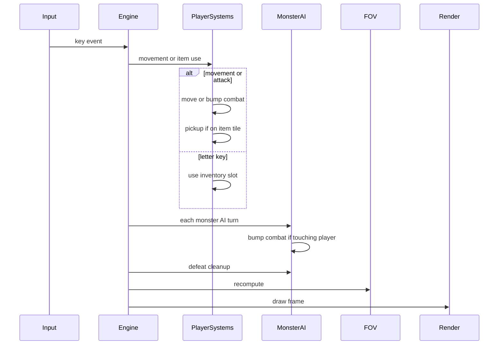

# Design: Implement Core Roguelike

## Context

Greenfield Python/libtcod project. The behavioral contract lives in `openspec/specs/core-roguelike/spec.md`. This design covers the first implementation: minimal architecture that satisfies all requirements while keeping vore as a future plug-in layer.

## Goals / Non-Goals

**Goals**

- Runnable turn-based dungeon crawler matching every spec scenario
- Clear ECS separation so systems are small and testable by inspection
- Stunned recovery via potion use without soft-locking the player
- Extension hooks (events, component conventions) for future vore domain

**Non-Goals**

- Vore attacks, digestion, predator/prey mechanics
- Save/load, multiple floors, procedural loot tables
- Unit/integration test harness (v1 is manually verified)
- Fancy UI beyond tilemap + text HUD

## Decisions

### Decision: `tcod.ecs` for entity management

Use libtcod's built-in ECS (`tcod.ecs.Entity`, `tcod.ecs.World`) rather than a custom registry. Rationale: maintained alongside libtcod, integrates with tutorial patterns, and supports tag components via `tcod.ecs.components` or plain Python classes on entities.

### Decision: `GameEngine` owns the turn loop

A single `GameEngine` class in `engine.py` orchestrates:

1. Wait for keyboard event
2. Resolve player action (movement, item use, or no-op)
3. If action consumed a turn → run world phase
4. Recompute FOV and render

Player actions that do **not** consume a turn: invalid keys, movement blocked by wall, movement/attack while stunned.

Player actions that **do** consume a turn: successful move, bump attack, item use (including while stunned), standing still is **not** a turn (no wait key in v1).

### Decision: Stunned gate applies to movement and bump only

When the player has the `Stunned` tag:

- Movement and bump-attack keys are ignored (no turn advance)
- Letter keys `a`–`z` still resolve item use and advance a turn
- After potion heals HP above 0, `Stunned` tag is removed before monster phase

This matches the spec scenarios and avoids an unwinnable stunned state with potions in inventory.

### Decision: Room-and-corridor map generation

Follow the classic Roguelike Tutorial approach:

- Map size: 80×44 tiles (fits default console with HUD rows reserved)
- 30 rooms max, random width/height within bounds
- L-shaped tunnels between room centers
- Spawn player in first room center; spawn monsters and items in later rooms

`GameMap` is a dataclass with a 2D numpy array of tile enums (`WALL`, `FLOOR`). Walkability and transparency are methods on `GameMap`, not separate wall entities, to keep v1 simple. Dynamic blockers (monsters) use `BlocksMovement` on entities.

### Decision: Combat is deterministic bump damage

Damage formula (v1): `max(0, attacker.power - defender.defense)`.

Defaults:

| Combatant | HP | Power | Defense |
|-----------|-----|-------|---------|
| Player | 30 | 4 | 1 |
| Monster | 10 | 2 | 0 |

Monster attacks when its AI step moves into the player tile (same bump resolution). On monster defeat, entity is deleted and `on_entity_defeated` callback fires (no-op in v1). On player reaching 0 HP, add `Stunned` tag and fire `on_player_stunned`.

### Decision: Inventory as ordered slot dict

`Inventory` component holds `dict[str, ItemType | None]` with keys `a`–`z` (pre-filled with `None`). Pickup assigns the lowest alphabetical empty slot. Item use reads slot by key; empty slot logs a message.

Floor items are entities with `Position`, `Renderable` (`!`), and `Item`. Pickup deletes the entity and copies type into inventory.

### Decision: Message log as deque

`MessageLog` stores up to 5 recent strings rendered below the map. Combat and inventory events append messages using spec terminology ("The monster was defeated.", "You are stunned.", etc.).

### Decision: Input mapping

| Input | Action |
|-------|--------|
| Arrow keys / numpad / vi-keys | 8-direction move (or bump) |
| `a`–`z` | Use inventory slot |
| `Escape` | Quit |

Movement keys while stunned: ignored. Item keys while stunned: allowed.

### Decision: Vore extension points (stubs only)

`src/events.py` defines optional callback lists:

- `on_entity_defeated(entity)`
- `on_player_stunned(entity)`
- `on_item_used(entity, item_type)`

No vore module imports these yet; core systems call them at the right moments so a future `vore` package can subscribe without editing combat code.

## Architecture

```text
main.py
  └── GameEngine (engine.py)
        ├── GameMap (map_gen.py)
        ├── tcod.ecs.World
        ├── MessageLog
        └── systems/
              movement.py   — player move, diagonal rule, wall check
              combat.py     — bump attack, stunned tag, defeat cleanup
              inventory.py  — pickup on walk-over, letter use
              ai.py         — monster chase one step
              fov.py        — recompute visible/explored
              render.py     — draw map, entities, HUD
```

### Turn sequence (player action consumed)



## File Plan

| File | Responsibility |
|------|----------------|
| `pyproject.toml` | Project metadata, `libtcod` dependency |
| `src/main.py` | `tcod.context`, window title, run engine |
| `src/engine.py` | `GameEngine`, new game setup, main loop |
| `src/map_gen.py` | `Tile`, `GameMap`, room-and-corridor generator |
| `src/components.py` | Component dataclasses and `ItemType` enum |
| `src/input_handlers.py` | Key → action mapping |
| `src/message_log.py` | Deque-backed log |
| `src/events.py` | Vore extension callback stubs |
| `src/systems/movement.py` | Movement and blocking |
| `src/systems/combat.py` | Damage, stunned, defeat |
| `src/systems/inventory.py` | Pickup and use |
| `src/systems/ai.py` | Chase toward player |
| `src/systems/fov.py` | Visibility arrays |
| `src/systems/render.py` | Console draw |

## Risks / Trade-offs

| Risk | Mitigation |
|------|------------|
| libtcod install issues on Windows | Document `pip install libtcod`; pin version in `pyproject.toml` |
| Stunned without potions soft-locks run | Acceptable for v1; vore/floor design can add recovery later. Spec allows stunned state without game-over. |
| Spec line 161 says "cannot use items" but scenarios allow it | Implementation follows scenarios (items allowed). Spec correction tracked as follow-up if needed. |
| No automated tests | Manual acceptance checklist; add tests in a later change |

## Spec Alignment Notes

Implementation follows the **stunned item-use scenarios** (lines 191–196) as authoritative over the summary sentence at line 161, which predates the recovery scenarios.