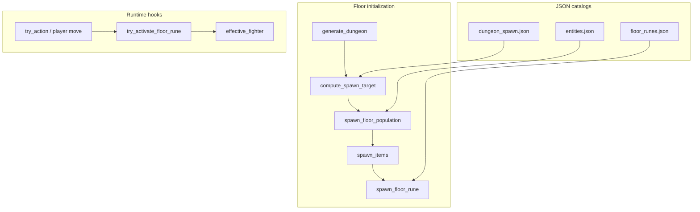
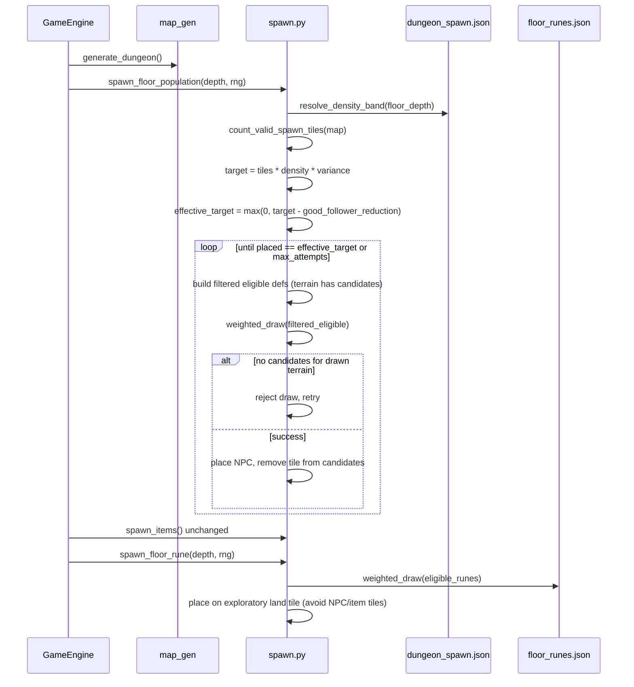

# Design: Dungeon Progression Pass

| Field | Value |
|-------|-------|
| **Author** | *(TBD — promote to named author in PR0)* |
| **Date** | 2026-07-01 |
| **Status** | Draft → **Approved** after review revision (set in PR0 `openspec/changes/.../design.md`) |
| **Change name** | `add-dungeon-progression-pass` |
| **Artifacts** | `openspec/changes/add-dungeon-progression-pass/{proposal.md, design.md, tasks.md, testing-checklist-prN.md}` |
| **Spec targets** | `openspec/specs/dungeon/spec.md`, `openspec/specs/npc-data/spec.md`, new `openspec/specs/floor-runes/spec.md` |

---

## Overview

This change replaces the current **weight-sum spawn pool** (which always places `min(sum(weights), candidates)` NPCs with fixed species counts) with a **density-driven, species-agnostic gumball dispenser**, and adds **three floor runes per level** that grant permanent player progression when stepped on.

Spawn becomes: generate map → count valid spawn tiles → look up **average density for `floor_depth`** from JSON → apply random variance → compute **`effective_target`** (after good-follower reduction) → perform **`effective_target` independent weighted draws** from `entities.json` eligibility filters → place each draw on a random valid tile for that entity's terrain/mobility. NPCs spawn **once per floor** at `new_game()` and `descend_floor()` only (existing invariant; explicitly preserved).

Floor runes become: after map + NPC spawn + items, place **exactly three** weighted-random runes from `data/floor_runes.json` on distinct exploratory land tiles; stepping on one (player only) applies a permanent buff, **single-frame** screen flash, log message, and removes that rune entity immediately. All runes render as glyph **`0`**; **`fg` color** signals effect type.

---

## Background & Motivation

### Current spawn behavior (`src/spawn.py`)

Today's `spawn_floor_population()`:

1. Filters `EntityDefinition`s by depth, terrain (`land` / `water`), and `spawn_requires_water`.
2. Builds a **literal pool**: each definition repeated `floor(spawn.weight)` times (`_build_weighted_pool`).
3. Shuffles pool and candidates; places `count = min(len(pool), len(candidates))`.
4. Runs land and water pools **separately** via `_place_spawn_pool`.

Consequences:

| Issue | Evidence |
|-------|----------|
| **Spawn count ≡ weight sum**, not map size | `expected_floor_npc_count()` in `src/data/spawn_counts.py` sums weights (misleading name). Stock floor always yields **17** land + **2** sharks when water exists. |
| **Implicit species quotas** | Tests assert `species.count("wolf") == spawn_weight("wolf")` (`tests/test_npc_data_pr2.py`). Spec mandates 6/5/6/2 parity (`openspec/specs/npc-data/spec.md`, `openspec/specs/dungeon/spec.md`). |
| **Species-coupled follower deduction** | `engine.py` uses `min(len(followers), spawn_weight("knight"))`; spec references knight weight cap. |
| **No depth difficulty scaling** | `openspec/specs/dungeon/spec.md` lists "Difficulty or challenge scaling by depth" and "Spawn table variance by depth" as out of scope. |
| **Dead constants** | `MIN_MONSTERS` / `MAX_MONSTERS` in `src/constants.py` are unused. |

On an **80×44** map (`MAP_WIDTH` × `MAP_HEIGHT` = **3,520** cells), valid spawn tile counts must be **measured**, not guessed — see §1.1 measurement note. PR1 adds a distribution test over `generate_dungeon(80, 44)` seeds to tune `density_pct`.

### Floor runes (greenfield)

No rune types, loaders, components, or step-on handlers exist. Player combat stats live on `Fighter` plus **transient** equipment overlays via `effective_fighter()` (`src/systems/inventory.py`). Permanent stat growth requires a new progression layer that composes with equipment without mutating `PLAYER_*` constants.

### Testing policy (user directive)

The user edits JSON frequently. Tests must **not** assert stock catalog counts (wolf=6, knight=5, etc.). Follow `tests/item_test_helpers.py`: isolated fixtures, parse via `parse_entity_registry()` / new helpers, assert **mechanics** only.

---

## Goals & Non-Goals

### Goals

1. **Density-driven NPC count** from `data/dungeon_spawn.json`, keyed by `floor_depth`, with per-floor random variance.
2. **Species-agnostic spawning**: code never targets minimum/maximum counts per `id`; only weighted random draws from eligible definitions.
3. **One-time floor population** at generation/descent; no mid-level respawn.
4. **Aquatic placement resilience**: if a water draw cannot place (no free water tile), reject and re-draw (bounded retries).
5. **Alignment-agnostic good-follower deduction** on descent (no `spawn_weight("knight")` coupling).
6. **Three guaranteed floor runes per level** on distinct tiles, data-driven effects, player-only, single-use per rune, exploratory placement; glyph **`0`** for all runes.
7. **Permanent rune buffs** that stack across floors and compose with equipment in combat.
8. Update normative specs; migrate tests to fixture-based behavior checks.

### Non-Goals

- Classic XP / character levels (`experience_points` remains stored, ignored).
- Mid-level monster respawn.
- Guaranteed specific rune types (always 3 per floor; weighted random which).
- Guaranteed aquatic NPC counts (sharks are weight-driven, not additive).
- Rune "use" action or inventory item — step-on only.
- NPC rune interaction / activation.
- Item spawn rule overhaul (`spawn_min` potions unchanged); **exception:** PR3 adds rune-tile exclusion when placing runes after items.
- Stairs up, loot scaling, or broader HUD redesign.
- Hot-reload of JSON mid-run.

---

## Proposed Design

### Architecture overview



### Sequence: new floor lifecycle



---

## Part 1 — Weighted Spawning Overhaul

### 1.0 Behavioral delta (old vs new)

| Aspect | **Old** (`src/spawn.py` today) | **New** (this change) |
|--------|--------------------------------|------------------------|
| **Count model** | `land_placed + water_placed` (additive pools) | `placed ≤ effective_target` (unified draws) |
| **Land NPCs** | Up to `land_spawn_weight_total()` (=17 stock) | Share of `effective_target` via weighted draws |
| **Aquatic NPCs** | Up to `aquatic_spawn_weight_total()` (=2 stock) **in addition** to land | Compete for same `effective_target` slots; **not guaranteed** |
| **Sharks on water floors** | Always exactly 2 when water exists (stock weights) | 0–N sharks; probability = `shark.weight / sum(eligible weights)` per draw |
| **Total on water floor** | Up to **19** (17+2) | Up to `effective_target` (typically ~15–20 at depth 1 after tuning) |
| **Species counts** | Implicit quotas (= weights) | Emergent from RNG only |
| **Good followers** | Remove good entries from pool → **total count drops** | `effective_target = target - good_reduction` → **total count drops** (no backfill) |
| **Specs/tests** | "exactly two sharks", 6/5/6 parity | Updated in PR5; fixture behavior tests in PR2 |

**Intentional per user requirements:** unified land+water pool with no species minimums. Aquatic NPCs are no longer additive guarantees.

### 1.1 Density configuration (`data/dungeon_spawn.json`)

New file loaded at startup (pattern: `src/data/dungeon_spawn_loader.py` → frozen `DungeonSpawnConfig`).

**Proposed schema:**

```json
{
  "schema_version": 1,
  "defaults": {
    "density_pct": 0.02,
    "density_variance": 0.25,
    "min_npcs": 0,
    "max_npcs": 120
  },
  "depth_bands": [
    { "min_depth": 1,  "max_depth": 4,  "density_pct": 0.012, "density_variance": 0.35 },
    { "min_depth": 5,  "max_depth": 9,  "density_pct": 0.018, "density_variance": 0.30 },
    { "min_depth": 10, "max_depth": 19, "density_pct": 0.025, "density_variance": 0.25 },
    { "min_depth": 20, "max_depth": 1000, "density_pct": 0.035, "density_variance": 0.20 }
  ]
}
```

| Field | Type | Meaning |
|-------|------|---------|
| `density_pct` | float | Fraction of **valid spawn tiles** expected to hold an NPC (e.g. `0.02` = 2%). |
| `density_variance` | float | Multiplier jitter range: `rng.uniform(1 - v, 1 + v)`. |
| `min_npcs` / `max_npcs` | int | Optional global safety clamps on target (not per-species). |
| `depth_bands` | array | Inclusive `min_depth`/`max_depth`; first matching band wins; else `defaults`. |

**Band field inheritance (loader merge rules):**

Each `depth_bands[]` entry is merged over `defaults` field-by-field. Omitted band fields inherit from `defaults` (same pattern as item spawn partial overrides in `item_loader.py`).

```python
@attrs.define(frozen=True)
class DensityBand:
    min_depth: int
    max_depth: int
    density_pct: float      # required on band or inherited
    density_variance: float
    min_npcs: int
    max_npcs: int | None
```

**Loader validation (PR1 tests):**

- `min_depth ≤ max_depth` per band.
- Bands must not overlap (fail load on overlap).
- `density_pct ≥ 0`, `0 ≤ density_variance < 1`, `min_npcs ≥ 0`, `max_npcs ≥ min_npcs` when set.
- Invalid-config test cases in `tests/test_dungeon_spawn_config.py`.

**Target count formula:**

```python
def compute_target_npc_count(
    valid_tile_count: int,
    floor_depth: int,
    config: DungeonSpawnConfig,
    rng: random.Random,
) -> int:
    band = config.resolve_band(floor_depth)  # merged band + defaults
    multiplier = rng.uniform(1.0 - band.density_variance, 1.0 + band.density_variance)
    raw = valid_tile_count * band.density_pct * multiplier
    target = max(band.min_npcs, round(raw))
    if band.max_npcs is not None:
        target = min(target, band.max_npcs)
    return min(target, valid_tile_count)  # cannot exceed candidates
```

**Tuning from measured data (not guesses):**

PR1 adds `tests/test_dungeon_spawn_config.py::test_valid_spawn_tile_distribution` — generate **50** dungeons (`generate_dungeon(80, 44, seed=i)`), compute median land+water candidate count, print/log distribution. Tune `density_pct` on band 1–4 so `median_tiles * 0.012 ≈ 17` at depth 1 (soft continuity with old **land-only** count, acknowledging unified pool may yield fewer sharks).

**Illustrative counts** (replace constants after measurement test runs):

| Depth band | density_pct | Approx. NPCs @ median tiles |
|------------|-------------|----------------------------|
| 1–4 | 1.2% | ~17 (tune to measured median) |
| 5–9 | 1.8% | ~25 |
| 10–19 | 2.5% | ~35 |
| 20+ | 3.5% | ~49 |

### 1.2 Valid spawn tile counting

```python
def valid_spawn_tiles(
    game_map: GameMap,
    player_x: int,
    player_y: int,
) -> tuple[list[tuple[int, int]], list[tuple[int, int]]]:
    """Return (land_candidates, water_candidates)."""
    land = _candidate_tiles(game_map, player_x, player_y, mobility_kind=MobilityType.GROUND)
    water = _water_candidate_tiles(game_map, player_x, player_y)
    return land, water

def count_valid_spawn_tiles(land: list, water: list) -> int:
    return len(land) + len(water)
```

**Inclusion rules:**

- Land: `can_enter_tile(..., GROUND)` — `FLOOR` and `STAIRS_DOWN`.
- Water (density counting): distance-filtered aquatic tiles from `_water_candidate_tiles` only.
- Both exclude tiles within `MONSTER_SPAWN_MIN_DISTANCE` (6) of player spawn position.
- **No** per-species min/max; water counts toward density even on mostly-dry floors.

**`map_has_water` vs candidate lists (do not conflate):**

| Variable | Source | Used for |
|----------|--------|----------|
| `map_has_water` | `bool(water_positions(game_map))` | `_eligible_definitions()` / `spawn_requires_water` gate (stock shark) |
| `land_cands` | Distance-filtered land tiles | Density count + land placement pool |
| `water_cands` | Distance-filtered water tiles | Density count + primary water placement pool |

`map_has_water` is **independent** of whether `water_cands` is empty. Maps with all water near `enter_xy` still have aquatic defs in the eligible pool.

**Water min-distance fallback (explicit decision):**

| Phase | Behavior |
|-------|----------|
| **Density counting** | Use distance-filtered `water_cands` only. No fallback. If all water is near entrance, water tile count = 0 for density. |
| **Placement pool** | `_water_placement_pool(game_map, water_cands)` returns `water_cands` if non-empty, else all aquatic-valid water tiles (ignoring min-distance) when `map_has_water` — preserves today's `src/spawn.py:280–285` fallback. **Same list is mutated** across draws (`remove` on place) so multiple aquatic NPCs can use fallback tiles. |

This avoids aquatic NPCs failing to place on water-near-entrance maps while not inflating density targets artificially.

### 1.3 Gumball-dispenser placement algorithm

Replace `_build_weighted_pool` + `_place_spawn_pool` with **filtered-union weighted draws**:

```python
def _water_placement_pool(
    game_map: GameMap,
    water_cands: list[tuple[int, int]],
) -> list[tuple[int, int]]:
    """Mutable placement pool: distance-filtered water, or all-water fallback."""
    if water_cands:
        return water_cands
    if not water_positions(game_map):
        return []
    return [
        (x, y) for x, y in water_positions(game_map)
        if can_enter_tile(game_map, x, y, MobilityType.AQUATIC)
    ]


def _eligible_for_terrain(
    reg: EntityRegistry,
    *,
    floor_depth: int,
    terrain: str,
    map_has_water: bool,
) -> list[EntityDefinition]:
    return _eligible_definitions(reg, floor_depth=floor_depth, terrain=terrain, map_has_water=map_has_water)


def _filtered_eligible(
    land_defs: list[EntityDefinition],
    water_defs: list[EntityDefinition],
    *,
    land_cands: list[tuple[int, int]],
    water_place_pool: list[tuple[int, int]],
    map_has_water: bool,
) -> list[EntityDefinition]:
    """Union of terrain lists that still have placement candidates."""
    eligible: list[EntityDefinition] = []
    if land_cands:
        eligible.extend(land_defs)
    if map_has_water and water_place_pool:
        eligible.extend(water_defs)
    return eligible


def _weighted_choice(definitions: list[EntityDefinition], rng: random.Random) -> EntityDefinition:
    # int() truncation matches existing _build_weighted_pool pattern
    weights = [max(0, int(d.spawn.weight)) for d in definitions]
    if not definitions or sum(weights) == 0:
        raise ValueError("empty weighted choice")
    return rng.choices(definitions, weights=weights, k=1)[0]


def spawn_floor_population(...) -> list[Entity]:
    land_cands, water_cands = valid_spawn_tiles(...)
    map_has_water = bool(water_positions(game_map))  # NOT bool(water_cands)

    land_defs = _eligible_for_terrain(reg, floor_depth=floor_depth, terrain="land", map_has_water=map_has_water)
    water_defs = _eligible_for_terrain(reg, floor_depth=floor_depth, terrain="water", map_has_water=map_has_water)

    # Mutable placement pool; may equal water_cands or expanded fallback list
    water_place_pool = _water_placement_pool(game_map, water_cands)

    valid_count = len(land_cands) + len(water_cands)  # density: distance-filtered only
    target = compute_target_npc_count(valid_count, floor_depth, config, rng)
    effective_target = max(0, target - good_follower_reduction)

    placed: list[Entity] = []
    attempts = 0
    max_attempts = max(effective_target * 30, 50)

    while len(placed) < effective_target and attempts < max_attempts:
        attempts += 1
        eligible = _filtered_eligible(
            land_defs, water_defs,
            land_cands=land_cands,
            water_place_pool=water_place_pool,
            map_has_water=map_has_water,
        )
        if not eligible:
            break  # no terrain left with both defs and candidates

        definition = _weighted_choice(eligible, rng)
        terrain = definition.spawn.terrain
        pool = land_cands if terrain == "land" else water_place_pool

        if not pool:
            continue  # reject draw, retry (e.g. land draw but land full)

        x, y = rng.choice(pool)
        pool.remove((x, y))  # mutates land_cands or water_place_pool in place
        placed.append(spawn_from_definition(world, definition, x, y))

    if len(placed) < effective_target:
        log_debug("spawn_shortfall", placed=len(placed), target=effective_target, attempts=attempts)

    return placed
```

**Worked example (normal water distribution):**

- `valid_count = 1000`, `target = 17`, `good_follower_reduction = 1` → `effective_target = 16`.
- `map_has_water = True`, `land_cands = 900`, `water_cands = 100`, `water_place_pool` aliases `water_cands`.
- Eligible union includes wolf(6), knight(5), rabbit(6), shark(2) weights.
- Draw 1: shark → place on water tile (`water_place_pool` shrinks).
- Draw 2: wolf → land tile.
- … continues until `len(placed) == 16` or `max_attempts`.
- **Not** 17 placements with an extra evil backfill for the skipped good slot — total is 16.

**Worked example (all water near entrance):**

- `water_cands = []` (density), `map_has_water = True`, `water_place_pool = [all 12 aquatic tiles]`.
- `water_defs` (shark) remain in eligible union because `map_has_water and water_place_pool`.
- Multiple shark draws each `remove` from `water_place_pool` — not limited to one fallback placement.

**Weight truncation:** fractional `spawn.weight` values use `int()` (existing pattern). Document in `data/SCHEMA.md`; designers should use integers.

**Properties:**

| Requirement | How met |
|-------------|---------|
| No species minimums/maximums | Only `spawn.weight` affects draw probability. |
| Agnostic to catalog | New entity in `entities.json` requires zero spawn code changes. |
| Aquatic retry | Empty `pool` → `continue`; `_water_placement_pool` supplies fallback list mutated across draws. |
| One-time spawn | Only `GameEngine.new_game()` and `descend_floor()`. |
| No mid-level respawn | Static allowlist test (see §Testing). |
| Good followers reduce total | `effective_target = max(0, target - good_follower_reduction)` — **no backfill**. |

**Deprecate / remove:**

- `_build_weighted_pool` as placement driver.
- `_place_spawn_pool` zip-shuffle placement.
- `_reduce_good_spawns` pool-mutation.
- `expected_floor_npc_count()` — replace with `compute_target_npc_count()` + fixtures.

### 1.4 Good follower deduction (decouple from knight)

**Before** (`src/engine.py:267`):

```python
good_reduction = min(len(followers), spawn_weight("knight"))
```

**After:**

```python
def good_aligned_weight_at_depth(
    registry: EntityRegistry,
    floor_depth: int,
    *,
    map_has_water: bool,
) -> int:
    """Species-agnostic cap: sum int(spawn.weight) for eligible good-aligned defs (land + water)."""
    total = 0
    for terrain in ("land", "water"):
        for d in _eligible_definitions(registry, floor_depth=floor_depth, terrain=terrain, map_has_water=map_has_water):
            if d.alignment == Alignment.GOOD:
                total += max(0, int(d.spawn.weight))
    return total

# engine.descend_floor():
map_has_water = bool(water_positions(self.game_map))
good_reduction = min(
    len(followers),
    good_aligned_weight_at_depth(reg, self.floor_depth, map_has_water=map_has_water),
)
```

**Semantics:**

- `good_follower_reduction` reduces **`effective_target`**, not per-draw skips. Matches `_reduce_good_spawns()` **total spawn budget** reduction (fewer NPCs on the new floor), not per-species quotas.
- **Does not** guarantee a fixed count of fresh good-aligned NPCs. Under gumball spawning, good/evil/neutral counts are probabilistic; only **total** `len(placed) == effective_target` is deterministic (given sufficient candidates and attempts).
- **No-op** when eligible pool has zero good-aligned entries at this depth (`good_reduction` capped at 0 weight → no effect).
- Species-agnostic cap replaces knight-only cap; with 6 followers and good weight 5, only 5 reductions apply (same cap behavior as today).

**PR2 follower test strategy (mechanical, not stock parity):**

Replace `len(_good_npcs) == spawn_weight("knight")` assertions in `tests/test_dungeon_pr3.py`, `tests/test_npc_data_pr4.py`, etc. with:

| Assertion | Example |
|-----------|---------|
| Total spawn budget reduced | `len(spawned) == effective_target` for fixture map + config + fixed seed |
| Reduction magnitude | `effective_target == target - min(len(followers), good_aligned_weight_at_depth(...))` |
| Followers preserved | Followers on new floor; not double-counted in spawn budget |
| Good pool cap | `good_reduction <= good_aligned_weight_at_depth(...)` |
| Optional fixture isolation | Registry with single good species + fixed RNG → count good spawns from return value, not stock weight |

Do **not** assert exact fresh knight count (e.g. 4) or total good count (e.g. 5) against stock `entities.json` weights.

### 1.5 `entities.json` role

Unchanged schema. `spawn.weight` is **relative probability**, not implicit count. Density JSON controls how many draws occur.

### 1.6 Items spawn (explicitly unchanged)

`spawn_items()` keeps weighted cap (`MAX_FLOOR_ITEM_PLACEMENTS = 5`) and potion `spawn_min`. **Spawn order:** NPCs → items → runes. Items do not need rune awareness because runes spawn last and exclude item-occupied tiles.

---

## Part 2 — Floor Runes

### 2.1 Data model (`data/floor_runes.json`)

```json
{
  "schema_version": 1,
  "runes": [
    {
      "id": "vitality_rune",
      "display_name": "rune of vitality",
      "glyph": "0",
      "fg": [80, 220, 120],
      "examine": "A faint green sigil pulses on the stone.",
      "weight": 4,
      "min_depth": 1,
      "max_depth": 12,
      "effect": { "type": "max_hp", "amount": 5 }
    },
    {
      "id": "striking_rune",
      "display_name": "rune of striking",
      "glyph": "0",
      "fg": [220, 180, 60],
      "examine": "A golden mark promises sharper blows.",
      "weight": 3,
      "min_depth": 3,
      "max_depth": 1000,
      "effect": { "type": "accuracy", "amount": 0.15 }
    },
    {
      "id": "striking_rune_major",
      "display_name": "rune of ruin",
      "glyph": "0",
      "fg": [255, 100, 40],
      "examine": "A blazing sigil — power and precision together.",
      "weight": 1,
      "min_depth": 15,
      "max_depth": 1000,
      "effect": { "type": "accuracy_damage", "accuracy": 0.2, "min_damage": 1, "max_damage": 1 }
    },
    {
      "id": "warding_rune",
      "display_name": "rune of warding",
      "glyph": "0",
      "fg": [120, 160, 255],
      "examine": "A blue sigil wards the body.",
      "weight": 3,
      "min_depth": 1,
      "max_depth": 1000,
      "effect": { "type": "natural_ac", "amount": 1 }
    }
  ]
}
```

**Glyph rules:** stock runes all use **`0`** (numeral zero) as the consistent rune marker; **`fg`** color distinguishes effect. Glyphs must not be `#` (walls in `render_map`). Loader validates glyph ∉ `{'#'}` and length == 1.

**Effect types (v1):**

| `type` | Behavior |
|--------|----------|
| `max_hp` | See §2.5 source-of-truth rules. |
| `accuracy` | `PlayerProgression.bonus_accuracy += amount`. |
| `accuracy_damage` | Adds accuracy and min/max damage bonuses. |
| `natural_ac` | `PlayerProgression.bonus_ac += amount`. |

All effects permanent for the run. Activation message includes numeric bonus (e.g. *"+5 max HP"*) for playtest verification (HUD does not show combat stats in v1).

### 2.2 ECS components

```python
@attrs.define(frozen=True)
class FloorRune:
    rune_id: str


@attrs.define
class PlayerProgression:
    """Authoritative permanent rune bonuses for this run."""
    bonus_max_hp: int = 0
    bonus_accuracy: float = 0.0
    bonus_min_damage: int = 0
    bonus_max_damage: int = 0
    bonus_ac: int = 0
```

**Rune entity components/tags:**

- `Position`, `Renderable`, `ExamineDescription`, `FloorRune`
- **`BlocksMovement` tag present** — NPCs cannot enter rune tile
- **No** `AI`, `Fighter`, `Item`

**Player movement exception** (`src/systems/movement.py`):

```python
def _is_blocked_by_entity(world, x, y, mover) -> bool:
    for entity in world.Q.all_of(tags=[Position(x, y), BlocksMovement]):
        if entity is mover:
            continue
        if Player in mover.tags and entity.components.get(FloorRune) is not None:
            continue  # player may step onto rune
        return True
    return False
```

NPCs path around runes; player steps on to activate. Resolves unreachable-rune risk (review Issue #9).

### 2.3 Rune spawning (`spawn_floor_rune`)

**Floor init order:** `spawn_floor_population` → `spawn_items` → `spawn_floor_rune` (runes last).

**Rules:**

1. **Exactly three** runes per floor on distinct tiles (`RUNES_PER_FLOOR = 3`).
2. Weighted random among runes where `min_depth ≤ floor_depth ≤ max_depth`.
3. Placement tile must be:
   - **`FLOOR` only** (not `STAIRS_DOWN`).
   - Not `enter_xy` (player start).
   - No `BlocksMovement` entity (NPCs).
   - No floor item entity at tile (query `Item` without `Fighter`).
4. **Minimum path distance** from `enter_xy`: at least `RUNE_SPAWN_MIN_DISTANCE` **movement steps** (see below). **No maximum distance** — any far tile that satisfies the threshold is eligible.

**Distance metric — BFS path steps (not Euclidean):**

"Movement spaces" means **shortest walk distance** from `enter_xy` over **`FLOOR` tiles only**, using **4-directional** cardinal steps (same cost as ground movement). Compute once per spawn:

```python
RUNE_SPAWN_MIN_DISTANCE = 30  # src/constants.py — significant exploration required
```

**Placement algorithm (threshold relaxation, no retry loop):**

Build the candidate list with precomputed distances, then pick the **highest achievable threshold** — no shuffle-and-fail loop:

```python
def _rune_candidates_with_path_distance(
    game_map: GameMap,
    world: Registry,
    enter_xy: tuple[int, int],
) -> list[tuple[int, int, int]]:
    """Return (x, y, path_distance) for every valid FLOOR placement tile."""
    distances = bfs_path_distance_from(
        game_map,
        enter_xy,
        tile_filter=lambda x, y: game_map.tiles[y, x] == Tile.FLOOR,
        cardinal_only=True,
    )
    blocked = occupied_rune_blocked_tiles(world)  # BlocksMovement entities + floor items
    ex, ey = enter_xy
    out: list[tuple[int, int, int]] = []
    for (x, y), dist in distances.items():
        if (x, y) == (ex, ey):
            continue
        if (x, y) in blocked:
            continue
        out.append((x, y, dist))
    return out


def choose_rune_placement(
    candidates: list[tuple[int, int, int]],
    *,
    min_distance: int,
    rng: random.Random,
) -> tuple[int, int, int]:
    """Return (x, y, achieved_distance). Raises if no candidates."""
    if not candidates:
        raise RunePlacementError("no valid rune tiles")

    # Count down from desired minimum; first non-empty pool = best achievable separation
    for threshold in range(min_distance, -1, -1):
        pool = [(x, y, d) for x, y, d in candidates if d >= threshold]
        if pool:
            x, y, achieved = rng.choice(pool)
            if achieved < min_distance:
                log_warning(
                    "rune_placement_relaxed",
                    wanted=min_distance,
                    placed=achieved,
                )
            return x, y, achieved

    raise RunePlacementError("unreachable")  # only if candidates empty
```

**Why this instead of a frustration counter:** one BFS + one downward scan is **O(tiles + min_distance)** and deterministic. Threshold `30 → 29 → … → 0` is exactly the user-described relaxation without random retries or infinite loops. The first hit uses the **maximum** min-distance the map can support.

**Examples:**

| Map situation | `max` path dist among candidates | Result |
|---------------|----------------------------------|--------|
| Normal 80×44 floor | ≥ 30 | Random tile with `path_distance ≥ 30` |
| Cramped annex | 18 | Warning logged; random tile with `path_distance ≥ 18` |
| Tiny test map | 3 | Warning logged; random tile with `path_distance ≥ 3` |

**Co-tile policy:** runes **exclusive** with items and NPCs. Items spawn before runes; rune placement reads item positions. No `spawn_items` code changes required.

### 2.4 Activation (step-on)

**Engine move order** (`src/engine.py` move branch) — explicit:

```python
elif try_action(...):
    pos = self.player.components[Position]
    pickup_all_items_at(...)       # 1. items first
    try_activate_floor_rune(...)   # 2. rune second
    self._consume_player_turn()    # 3. turn
```

**PR3:** no engine move hook (placement + render only). **PR4** adds hook + `PlayerProgression` together.

`try_activate_floor_rune()`:

1. Query entities at tile with `FloorRune`.
2. Actor must have `Player` tag.
3. `apply_rune_effect()` → update `PlayerProgression` (+ sync `Fighter` for HP — see §2.5).
4. Log message with numeric bonus.
5. Set `screen_flash.active = True` (single frame).
6. `entity.clear()` — rune vanishes.

**Engulfed / stunned:** no activation (player cannot move onto tile).

### 2.5 Combat integration and HP source of truth

**Authoritative store:** `PlayerProgression` holds all permanent bonus fields.

**`apply_rune_effect` for `max_hp`:**

```python
prog.bonus_max_hp += amount
fighter.max_hp = PLAYER_MAX_HP + prog.bonus_max_hp  # sync HUD display
fighter.hp = min(fighter.max_hp, fighter.hp + amount)  # heal by amount
```

**`effective_fighter()`:**

```python
prog = player.components.get(PlayerProgression) or PlayerProgression()
# weapon/armor from equipment unchanged
return Fighter(
    hp=base.hp,
    max_hp=base.max_hp,  # already synced from progression on max_hp apply
    accuracy=accuracy + prog.bonus_accuracy,
    evade=base.evade,
    ac=ac + prog.bonus_ac,
    min_damage=min_damage + prog.bonus_min_damage,
    max_damage=max_damage + prog.bonus_max_damage,
)
```

**Rule:** only `apply_rune_effect()` mutates `PlayerProgression` and syncs `Fighter.max_hp/hp`. `bonus_max_hp` mirrors applied HP bonus for audit/future HUD; never diverge outside `apply_rune_effect`.

**HUD:** `render_hud` reads `Fighter` — max HP updates visible after vitality rune. Accuracy/damage/AC buffs **not** shown in HUD v1; playtest via combat feel + activation message.

### 2.6 Rendering

- Runes render in entity pass (glyph **`0`** for all; `fg` color distinguishes effect; never `#`).
- **Screen flash:** **single-frame** full-map background tint on activation frame.

```python
@attrs.define
class ScreenFlashState:
    active: bool = False
    color: tuple[int, int, int] = (40, 80, 40)
```

`render_screen_flash()` draws one `draw_rect` over map area when `active`; cleared at end of render pass (or start of next). Compatible with `src/main.py` render → present → wait(event) loop **without** main-loop changes.

### 2.7 Examine mode

`inspectable_at()` (`src/systems/examine.py`) precedence:

1. `Fighter` (NPC/player combatant)
2. `Item`
3. Any `ExamineDescription` (runes hit here)

If a fighter or item shares the tile, rune description is hidden. Co-tile exclusion (§2.3) prevents this in normal play.

---

## API / Interface Changes

### `spawn_floor_population` (signature stable, semantics change)

```python
def spawn_floor_population(
    world: Registry,
    game_map: GameMap,
    player_x: int,
    player_y: int,
    floor_depth: int,
    *,
    rng: random.Random | None = None,
    good_follower_reduction: int = 0,
    registry: EntityRegistry | None = None,
    spawn_config: DungeonSpawnConfig | None = None,
) -> list[Entity]:
```

### New public APIs

| Symbol | Module | Purpose |
|--------|--------|---------|
| `load_dungeon_spawn_config()` | `src/data/dungeon_spawn_loader.py` | Load frozen config |
| `compute_target_npc_count(...)` | `src/data/dungeon_spawn_config.py` | Density math |
| `good_aligned_weight_at_depth(...)` | `src/spawn.py` or `src/data/spawn_counts.py` | Follower cap |
| `load_floor_rune_registry()` | `src/data/floor_rune_loader.py` | Load rune catalog |
| `spawn_floor_rune(...)` | `src/systems/floor_runes.py` | Place `RUNES_PER_FLOOR` runes |
| `try_activate_floor_rune(...)` | `src/systems/floor_runes.py` | Step-on handler |
| `apply_rune_effect(...)` | `src/systems/floor_runes.py` | Effect dispatcher |

### `GameEngine` hooks

| Location | Change |
|----------|--------|
| `new_game()` | `spawn_floor_rune` after `spawn_items` |
| `descend_floor()` | Same; `good_reduction` via `good_aligned_weight_at_depth` |
| `_spawn_player()` | Attach `PlayerProgression()` (PR4) |
| `handle_event()` move branch | `try_activate_floor_rune` after `pickup_all_items_at` (PR4) |
| `render()` | `render_screen_flash` when active (PR4) |

### Removed / deprecated

| Symbol | Action |
|--------|--------|
| `expected_floor_npc_count()` | Remove; tests use `compute_target_npc_count` + fixtures |
| `_reduce_good_spawns()` | Remove |
| `spawn_weight("knight")` in engine | Remove |

---

## Data Model Changes

| File | Change |
|------|--------|
| `data/dungeon_spawn.json` | **New** |
| `data/floor_runes.json` | **New** |
| `data/SCHEMA.md` | Both schemas + glyph rules |
| `src/components.py` | `FloorRune`, `PlayerProgression` |
| `src/systems/movement.py` | Player/run `BlocksMovement` exception |
| `src/constants.py` | `RUNE_SPAWN_MIN_DISTANCE`; remove `MIN_MONSTERS`/`MAX_MONSTERS` |

---

## Alternatives Considered

### Alt A — Keep pool-size model, only add density multiplier

**Rejected:** preserves implicit species counts.

### Alt B — Separate land/water density percentages

**Rejected for v1:** user asked for unified total-tile percentage. Documented in §1.0 delta.

### Alt C — Rune as map tile type

**Rejected:** entity pattern preferred.

### Alt D — Rune as inventory consumable

**Rejected:** user requires step-on.

### Alt E — Mutate `PLAYER_*` constants

**Rejected:** breaks equipment composition.

### Alt F — Non-blocking rune (no `BlocksMovement`)

**Rejected:** NPCs can stand on rune and block player. §2.2 player-only passthrough chosen.

### Alt G — Multi-frame screen flash

**Rejected for v1:** incompatible with input-driven render loop without main-loop rework. Single-frame tint used.

---

## Security & Privacy Considerations

| Threat | Severity | Mitigation |
|--------|----------|------------|
| Malformed JSON | Low | Strict loader validation |
| Extreme density | Medium | `max_npcs` clamp; `max_attempts` |
| Invalid effect amounts | Low | Load-time caps |
| Player data | N/A | Local ECS only |

---

## Observability

| Signal | Mechanism |
|--------|-----------|
| Spawn shortfall | DEBUG when `placed < effective_target` |
| Aquatic placement fallback | DEBUG when min-distance bypass used |
| Rune placement fallback | Warning when `achieved_distance < RUNE_SPAWN_MIN_DISTANCE` after threshold scan |
| Candidate distribution | PR1 measurement test |

---

## Rollout Plan

1. **PR0:** OpenSpec bootstrap (required before any code).
2. **PR1–PR4:** implementation slices per PR plan below.
3. **PR5:** live spec sync + archive.

**Rollback:** reverting spawn behavior requires reverting **PR2 code + PR2 test migrations + PR5 spec updates** together. Rune PRs (PR3–PR4) revert independently.

---

## Open Questions

| # | Question | Status |
|---|----------|--------|
| 1 | Depth-1 density tuning | **Resolve in PR1** via measured tile distribution test |
| 2 | `RUNE_SPAWN_MIN_DISTANCE` = 30 path steps; threshold relaxation fallback | **Resolved** (user 2026-07-01) |
| 3 | Runes on stairs? | **Resolved: FLOOR only** |
| 4 | `accuracy_damage` combined type | **Resolved** for v1 |
| 5 | HUD for combat buffs | **Deferred**; PR4 playtest uses combat + log message |
| 6 | Terrain-first vs filtered union | **Resolved: filtered union** (§1.3) |
| 7 | Good skip backfill? | **Resolved: no backfill** via `effective_target` reduction |

---

## References

| Resource | Path |
|----------|------|
| OpenSpec workflow | `openspec/WORKFLOW.md` |
| Current spawn | `src/spawn.py` |
| Engine | `src/engine.py` |
| Movement blocking | `src/systems/movement.py` |
| Examine precedence | `src/systems/examine.py` |
| Render loop | `src/main.py` |
| Tests to migrate (PR2) | `tests/test_npc_data_pr2.py`, `tests/test_dungeon_pr2.py`, `tests/test_dungeon_pr3.py`, `tests/test_dungeon_pr4.py`, `tests/test_acceptance.py`, `tests/test_enhancements_3.py`, `tests/test_vore_constants.py`, `tests/map_test_helpers.py` |

---

## Testing strategy

### Spawn call-site guard (production `src/` only)

Tests call `spawn_floor_population()` directly — that must remain allowed. Guard **production lifecycle only**:

```python
# tests/test_spawn_density_pr2.py
def test_spawn_floor_population_only_called_from_engine_in_src():
    """AST scan src/ (excl. spawn.py definition): call sites only in engine.new_game / engine.descend_floor."""
    # Scan src/**/*.py except src/spawn.py (definition site)
    # Assert every Call to spawn_floor_population is in src/engine.py
    # and appears only inside new_game() or descend_floor()
```

**Invariant tested:** no spawn in `_run_world_turn`, AI defeat handlers, or regen paths under `src/systems/`. Tests under `tests/` are excluded from the scan.

### Fixture helpers (`tests/spawn_test_helpers.py`)

- `install_spawn_config(config)` / fixture JSON
- `expected_spawn_target(map, depth, config, rng_seed)` — deterministic target for assertions
- Replaces `expected_ai_count()` in `tests/map_test_helpers.py`

### Rune placement tests (PR3)

- `choose_rune_placement`: normal map → `achieved_distance >= 30`
- Cramped fixture map (max path dist 12) → `achieved_distance == 12`, relaxation warning
- Empty candidate list → `RunePlacementError`

### PR4 playtest (non-HP buffs)

- Use debug weaken + bump combat before/after accuracy rune
- Confirm activation message shows numeric bonus
- Descend — bonuses persist

---

## Key Decisions

| Decision | Rationale |
|----------|-----------|
| **`effective_target = max(0, target - good_follower_reduction)`** | Matches `_reduce_good_spawns` total reduction; no evil/neutral backfill. |
| **Unified land+water pool** | User requirement; documented delta in §1.0. |
| **`map_has_water = bool(water_positions(game_map))`** | Independent of `water_cands`; preserves `spawn_requires_water` gate. |
| **Filtered-union eligible list** | Land when `land_cands`; water when `map_has_water and water_place_pool`. |
| **`_water_placement_pool` mutable fallback** | Fallback tiles consumed across draws; not ephemeral per-attempt list. |
| **Water fallback: placement only** | Preserves aquatic spawns near entrance without inflating density. |
| **`good_reduction` capped by `good_aligned_weight_at_depth`** | Species-agnostic replacement for knight cap. |
| **PR0 before code** | `openspec/WORKFLOW.md` Rule 1 compliance. |
| **Spawn order: NPC → items → rune** | Avoids `spawn_items` changes; rune excludes item tiles. |
| **Rune `BlocksMovement` + player passthrough** | NPCs cannot steal rune tile; player can activate. |
| **Single-frame screen flash** | Works with current render loop. |
| **All rune glyphs `0` not `#`** | Consistent rune marker; color shows effect; avoids wall glyph collision. |
| **`RUNES_PER_FLOOR = 3`** | User ad-hoc PR4: three distinct runes per level. |
| **Rune min distance = 30 BFS path steps** | Significant exploration; no max distance cap. |
| **Threshold relaxation placement** | Count down min distance until candidate pool non-empty; no shuffle retry loop. |
| **`PlayerProgression` authoritative; `Fighter` synced on apply** | Single mutation path; HUD works for HP. |
| **PR3: placement only, no activation hook** | Clean bisect for PR4. |

---

## PR Plan

Ordered for **one-PR-at-a-time** workflow. Targeted `pytest` per PR; full suite on PR5 only.

### PR0 — OpenSpec bootstrap (required first)

| | |
|--|--|
| **Title** | `docs(openspec): bootstrap add-dungeon-progression-pass change` |
| **Files** | `openspec/changes/add-dungeon-progression-pass/proposal.md`, `design.md` (this doc), `tasks.md`, `testing-checklist-pr0.md` … `testing-checklist-pr5.md` (stubs), update `openspec/WORKFLOW.md` active change pointer |
| **Dependencies** | None |
| **Description** | Create change folder **before any code**. `tasks.md` checkboxes for PR0–PR5. Status → Approved. **No gameplay code.** |

### PR1 — Dungeon spawn config loader

| | |
|--|--|
| **Title** | `feat(spawn): add dungeon_spawn.json loader and target count API` |
| **Files** | `data/dungeon_spawn.json`, `src/data/dungeon_spawn_config.py`, `src/data/dungeon_spawn_loader.py`, `data/SCHEMA.md`, `tests/test_dungeon_spawn_config.py` |
| **Dependencies** | PR0 |
| **Description** | Loader with band inheritance + overlap validation. `compute_target_npc_count()`. Tile distribution measurement test over 50 seeds (use `map_has_water = bool(water_positions(...))` when reporting water-aware stats). **No gameplay change.** |

### PR2 — Density-driven NPC spawning

| | |
|--|--|
| **Title** | `feat(spawn): density-driven floor population and good-follower decoupling` |
| **Files** | `src/spawn.py`, `src/engine.py`, `src/data/spawn_counts.py`, `tests/spawn_test_helpers.py`, `tests/test_spawn_density_pr2.py`, **all stock-count tests:** `tests/test_npc_data_pr2.py`, `tests/test_npc_data_pr4.py`, `tests/test_dungeon_pr2.py`, `tests/test_dungeon_pr3.py`, `tests/test_dungeon_pr4.py`, `tests/test_acceptance.py`, `tests/test_enhancements_3.py`, `tests/test_vore_constants.py`, `tests/map_test_helpers.py` |
| **Dependencies** | PR1 |
| **Description** | Filtered-union draws, `effective_target`, `_water_placement_pool`, `map_has_water` from `water_positions`. Production-only spawn call-site guard. Replace weight parity / exact good-count assertions with mechanical follower tests (§1.4). **Playtest:** density feel, follower dedup (total count, not knight quota). |

### PR3 — Floor rune data model and placement

| | |
|--|--|
| **Title** | `feat(runes): floor rune catalog, spawn, render, NPC blocking` |
| **Files** | `data/floor_runes.json`, `src/data/floor_rune_registry.py`, `src/data/floor_rune_loader.py`, `src/components.py` (`FloorRune` only), `src/systems/floor_runes.py`, `src/systems/movement.py` (player passthrough), `src/engine.py` (spawn hook after items), `src/systems/render.py`, `src/constants.py`, `tests/rune_test_helpers.py`, `tests/test_floor_runes_pr3.py`, `data/SCHEMA.md` |
| **Dependencies** | PR2 |
| **Description** | Three runes/floor on distinct tiles, FLOOR-only, after items, `BlocksMovement` for NPCs, glyph `0`. **No engine move hook; no activation.** **Playtest:** see runes on floor; NPCs do not stand on them. |

### PR4 — Rune activation, progression, and screen flash

| | |
|--|--|
| **Title** | `feat(runes): step-on activation, permanent buffs, single-frame flash` |
| **Files** | `src/components.py` (`PlayerProgression`), `src/systems/floor_runes.py`, `src/systems/inventory.py`, `src/engine.py` (move hook after pickup), `src/systems/render.py`, `src/messages.py`, `tests/test_floor_runes_pr4.py` |
| **Dependencies** | PR3 |
| **Description** | `apply_rune_effect`, progression sync, single-frame flash, numeric log messages. Ad-hoc: 3 runes/floor, all glyphs `0`. **Playtest:** step on rune; HP in HUD; combat buff via bump test; descend persists. |

### PR5 — Spec sync and acceptance

| | |
|--|--|
| **Title** | `docs(openspec): dungeon progression pass specs and archive` |
| **Files** | `openspec/specs/dungeon/spec.md`, `openspec/specs/npc-data/spec.md`, `openspec/specs/floor-runes/spec.md`, `README.md`, `acceptance-report.md`, archive to `openspec/changes/archive/2026-07-01-add-dungeon-progression-pass/` |
| **Dependencies** | PR4 |
| **Description** | Remove fixed 6/5/6/2 and "exactly two sharks" scenarios; add density + rune requirements. Full `pytest tests/`. Final playtest checklist. |

---

*End of design document.*