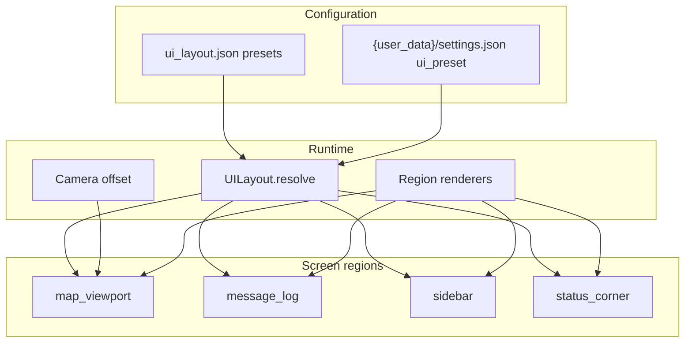

# Design: UI Overhaul

| Field | Value |
|-------|-------|
| **Date** | 2026-07-02 |
| **Status** | Draft — **user decisions locked** (2026-07-02) |
| **Change name** | `add-ui-overhaul` |
| **Artifacts** | `openspec/changes/add-ui-overhaul/{proposal.md, design.md, tasks.md, testing-checklist-prN.md}` |
| **Spec targets** | new `openspec/specs/ui-layout/spec.md`, `openspec/specs/core-roguelike/spec.md`, `openspec/specs/main-menu/spec.md` |

---

## Overview

Replace the monolithic 80×50 console layout (full map + bottom HUD) with a **region-based UI** driven by JSON config. The dungeon stays 80×44 logically; rendering uses a **camera** so only a subset of tiles appears in the map region. Text readability comes from **`tile_scale=2`** on the existing `Alloy_curses_12x12.png` tileset.



---

## Background: Current State

| Constant | Value | Role |
|----------|-------|------|
| `SCREEN_WIDTH` / `SCREEN_HEIGHT` | 80 × 50 | Root tcod console |
| `MAP_WIDTH` / `MAP_HEIGHT` | 80 × 44 | Dungeon grid; also map draw extent |
| `HUD_MESSAGE_LINES` | 5 | Message log in `render_hud()` |
| `HP_BAR_WIDTH` | 18 | ASCII bar in status line |
| Tileset | 12×12 px | `data/Alloy_curses_12x12.png` |

`render_map()` and `render_entities()` draw at **world coordinates** `(x, y)` on the root console. `render_hud()` fills `y >= MAP_HEIGHT`. Modals center using `MAP_HEIGHT` and `SCREEN_WIDTH`. Many tests assert row `MAP_HEIGHT` content.

**FOV / sidebar visibility:** `entity_visible_to_player()` already gates log messages on `game_map.visible`. Sidebar NPC list SHALL use the same rule.

---

## Goals & Non-Goals

### Goals

1. ~2× glyph height for maximum readability.
2. Up to 8 message-log lines in a dedicated region.
3. JSON-driven region dimensions with named presets.
4. Smaller map viewport centered on player.
5. Right sidebar: player status + capped FOV-visible NPC list (evil under player, good at bottom).
6. Status corner (depth + ailments/buffs) bottom-right; remove redundant bottom status line.
7. Incremental PRs — each merge leaves the game playable.

### Non-Goals

- TTF fonts, Unicode beyond CP437 safe subset.
- Live window drag-resize (defer; see open question).
- Sidebar for out-of-FOV or remembered NPCs.
- Equipment stats panel, hunger, XP.

---

## Proposed Design

### 1. Layout configuration

**File:** `data/ui_layout.json`

```json
{
  "tile_px": 12,
  "tile_scale": 2,
  "presets": {
    "standard": {
      "root_cols": 80,
      "root_rows": 50,
      "regions": {
        "map_viewport": { "x": 0, "y": 0, "w": 52, "h": 38 },
        "sidebar": { "x": 52, "y": 0, "w": 28, "h": 38 },
        "message_log": { "x": 0, "y": 38, "w": 72, "h": 8 },
        "status_corner": { "x": 72, "y": 38, "w": 8, "h": 8 }
      },
      "map_viewport_tiles": { "w": 48, "h": 34 },
      "message_log_lines": 8,
      "sidebar": {
        "hp_bar_width": 20,
        "max_evil": 4,
        "max_good": 3
      }
    },
    "wide_sidebar": {
      "...": "alternate proportions — wider sidebar, narrower map"
    }
  },
  "default_preset": "standard"
}
```

**Units:** All region bounds are in **character cells** (tcod console coordinates). `tile_px * tile_scale` converts to pixels for documentation only — e.g. sidebar width 28 cells → 672 px at scale 2. Changing `"w": 28` to `"w": 32` is the one-line tweak the user described.

**Validation rules (loader):**

- Regions must tile the root rectangle without overlap or gaps.
- `map_viewport.w/h` must equal `map_viewport_tiles.w/h` (viewport shows one cell per dungeon tile).
- `message_log.h >= message_log_lines`.
- `sidebar.w >= hp_bar_width + 4` (name margin).

**Module:** `src/ui/layout.py`

- `UILayout` frozen dataclass with `region(name) -> Rect`, `map_viewport_tiles`, caps, etc.
- `load_ui_layout(preset: str | None = None) -> UILayout`
- `UILayout.camera_origin(player_x, player_y, map_w, map_h) -> (cam_x, cam_y)` — center player, clamp.

**Persistence:** Extend `SettingsStore` with `ui_preset: str` (default from JSON). Options menu adds preset cycle or list.

### 2. Display scale

In `src/main.py` (tcod 21+ — `tile_scale` kwarg removed from `context.new`):

```python
pixel_w = console_w * layout.tile_px * layout.tile_scale
pixel_h = console_h * layout.tile_px * layout.tile_scale
with tcod.context.new(
    console=console,
    tileset=tileset,
    title=GAME_TITLE,
    width=pixel_w,
    height=pixel_h,
) as context:
    context.present(console, integer_scaling=True)
```

Root console **cell count** comes from the active preset via `runtime_console_dimensions()` in `src/ui/bootstrap.py`. Until PR5 migrates the HUD into layout regions, console height is `max(layout.root_rows, MAP_HEIGHT + LEGACY_HUD_ROWS)` so the legacy bottom HUD is not clipped. `SCREEN_WIDTH`/`SCREEN_HEIGHT` in `constants.py` remain 80×50 for menu/HUD code until later PRs.

Tests that construct `Console(80, 50)` migrate to a helper `test_console()` using default layout dims.

### 3. Region rendering pipeline

**New:** `src/ui/regions.py` — thin wrappers:

- `blit_region(root: Console, region: Rect, draw_fn: Callable[[Console], None])`
- Or hold sub-consoles on `Engine`: `self.consoles: dict[str, Console]`

**Refactor order:**

1. `Engine.render()` clears root, blits each region background color.
2. Map region: clear sub-console, apply camera, call adapted `render_map_camera()`, `render_entities_camera()`, overlays.
3. Sidebar region: `render_sidebar_player()`, `render_sidebar_npcs()`.
4. Message log: `render_message_log()` — port from `render_hud()` message loop.
5. Status corner: `render_status_corner(floor_depth, player_effects)`.

**Camera transform:**

```python
screen_x = world_x - cam_x
screen_y = world_y - cam_y
if 0 <= screen_x < viewport_w and 0 <= screen_y < viewport_h:
    console.print(screen_x, screen_y, ...)
```

World positions unchanged in ECS; only rendering transforms.

**Modal placement (PR10, superseded by PR11):** PR10 centered modals on the map viewport sub-console. **PR11** restores **root-console centering** (full playfield overlay) per playtest feedback — see § PR11 item 3.

**Screen flash / engulfed overlay:** Apply camera offset; clip to viewport.

### 4. Sidebar content

#### Player block (top of sidebar)

PR6–PR10 (single-line HP). **PR11** adds vertical spacing and splits NPC lines — see § PR11 item 2.

```
DisplayName
HP 24/30  [##########--------]
```

Uses `cp437_safe(player_name)`, `effective_fighter()` or raw `Fighter` for HP display (match existing HUD semantics).

**Stunned / engulfed / future buffs** do **not** appear in the sidebar text block — they render in the **status corner** (see §6).

#### NPC list

**Source:** All entities with `Fighter`, not `Player`, where `entity_visible_to_player(game_map, entity)`.

**Partition:**

| Alignment | Sort | Placement |
|-----------|------|-----------|
| EVIL | ascending Chebyshev distance to player | Immediately below player block, top-down |
| GOOD | ascending distance | Bottom of sidebar, listed upward (nearest good closest to bottom edge) |
| NEUTRAL | — | **Not shown** in sidebar (user decision) |

**Caps:** `max_evil: 4`, `max_good: 3` (JSON-configurable). Overflow: `+k evil` / `+k good` summary lines when capped.

**Per row:** `name truncated` + compact HP bar (`sidebar.hp_bar_width` may differ from player bar).

**Empty slots:** Do not collapse good section to evil; reserve layout bands so good entries always anchor to sidebar bottom (see tasks PR7).

### 5. Message log

- `MESSAGE_LOG_CAPACITY` may stay 10 internally; display `message_log_lines` (8).
- Region width sets truncation (`region.w - 2` margin).
- No status line above messages.

### 6. Status corner (bottom-right)

Dedicated panel for **run context + player effects** — future-proofed for buffs, enchantments, and ailments.

**v1 contents (top to bottom, clipped to region):**

```
Depth 12
STUN
ENGLF
```

- **Depth** always shown.
- **STUN** when `Stunned` tag on player.
- **ENGLF** when `Engulfed` tag on player (abbreviated to fit narrow corner).
- Future rune buffs / equipment proc ailments append rows here (design leaves extensible `player_effects` list in renderer).

Corner is independent of sidebar so effects remain visible while scrolling NPC lists.

### 7. Options: layout presets

Options menu row: **UI Layout: Standard ► Wide**

- Left/Right toggles preset id.
- Saves to `{user_data}/settings.json`; applied on next `Engine` construction (new game or return from menu).
- Mid-run switch deferred (would require console recreate) — document in checklist.

### 8. Menu screens

Apply same `tile_scale` and root dimensions to main menu, name entry, options, quit confirm so text size is consistent. Menu content may use centered layout in root console (no sidebar) — full width available.

---

## Resolved Decisions

| # | Decision | Rationale |
|---|----------|-----------|
| 1 | `tile_scale=2` on existing 12×12 tileset | ~2× readability without new art |
| 2 | Layout units = character cells in JSON | tcod-native; tune widths in one JSON field |
| 3 | Logical map stays 80×44; camera decouples view | No dungeon-gen churn |
| 4 | Sidebar visibility = current FOV (`game_map.visible`) | Matches log gating |
| 5 | Evil below player, good at bottom of sidebar | User directive |
| 6 | **Neutral NPCs omitted** from sidebar | User decision |
| 7 | Caps: **evil 4, good 3** + overflow lines | User decision; JSON-configurable |
| 8 | Layout presets in Options + `{user_data}/settings.json` | User directive |
| 9 | **v1 presets only**; JSON structured for future dynamic resize hook | User decision |
| 10 | **Viewport size JSON-only** — initial `48×34` starting point, tune after playtest | User decision |
| 11 | **Status corner** for depth + ailments/buffs (not sidebar flags) | User decision — future-proof |
| 12 | **Windowed by default**; no forced fullscreen | PR2 playtest — regression from fixed 1920×1200 px window |
| 13 | **Min practical resolution ~1366×768**; map expands on larger displays | CyberStorm-style; deferred to dynamic-layout PR |
| 14 | **Fullscreen toggle** in Options (off by default) | User preference; deferred to PR13 |
| 15 | **PR11** — dynamic window resize (grow + shrink) | Playtest: UI shrinks with window but does not grow back when enlarged |
| 16 | **PR11** — sidebar NPC two-line layout + coarse 6-wide HP estimate | Playtest spacing + roguelike “condition guess” UX |
| 17 | **PR11** — modals centered on root console (not map viewport) | Playtest preference after PR10 |
| 18 | **PR11** — status corner +2 cells wide; standard player bar shortened | Playtest clipping + depth/ailment readability |
| 19 | **PR11** — quit confirm ignores bare Shift | Bug: Shift-before-Y shows invalid-key message |

---

## PR11 — UI visualization polish (design, 2026-07-02)

Playtest-driven pass before acceptance. **No implementation until user approves this section.**

### Scope summary

| # | Topic | Intent |
|---|--------|--------|
| 1 | Dynamic window resize | Root console tracks window pixels in both directions (grow and shrink) |
| 2 | Sidebar NPC layout | Name on one row, bar below, blank row between entities |
| 3 | Modal placement | Center on **full root console** (screen), not map viewport only |
| 4 | Standard player HP bar | Shorten so line does not clip in `standard` sidebar |
| 5 | Sidebar padding | One row above player name; 1–2 rows below good-NPC band |
| 6 | Status corner width | +2 character cells (8 → 10); message log −2 to keep 80-col tiling |
| 7 | NPC HP display | ~6-wide coarse estimate bar; player keeps exact numeric HP + full bar |
| 8 | Quit confirm Shift | Bare Shift (modifier-only) must not show invalid-key error |

**Moved from PR13 into PR11:** item 1 (resize). **PR13** is reduced to fullscreen toggle (+ any follow-up display policy).

---

### 1. Dynamic window resize (bidirectional)

**Problem today:** Root console size is fixed at preset `root_cols × root_rows` (80×42). `integer_scaling` letterboxes/shrinks when the OS window is smaller, but enlarging the window does not increase cell count — the UI “stops” at the preset size.

**Target behavior:**

- Window is **resizable** (`SDL_WINDOW_RESIZABLE` or tcod equivalent).
- On `WINDOWRESIZED` (and once at startup from usable display bounds):
  - `cell_w = floor(pixel_w / (tile_px * tile_scale))`
  - `cell_h = floor(pixel_h / (tile_px * tile_scale))`
  - Clamp to **floor** (~1366×768 usable → ~57×32 cells at 2×) and optional **ceiling** (no artificial cap below monitor size).
- **Resolve layout** from active preset **floors** + available cells:
  - **Fixed chrome** (from preset, minimum sizes): `sidebar.w`, `message_log.h`, `status_corner.w`, `message_log_lines`.
  - **Flexible:** `map_viewport` — absorbs shrink first, absorbs growth first (CyberStorm model).
- Shrink order: map viewport → (at floor) clamp window / show minimum map size.
- Grow order: map viewport expands until cells exhausted; sidebar/message_log/status_corner stay at preset widths/heights unless preset defines “wide_sidebar” wider sidebar.
- `Engine`, `App`, and `RegionBundle` must receive the **live** `UILayout` after each resize (recreate or resize root `Console`, refresh sub-consoles).

**New code (planned):**

- `src/ui/dynamic_layout.py` — `resolve_layout(preset: UILayout, root_cols, root_rows) -> UILayout`
- `main.py` — resize event handler; thread layout into `app` / `engine.ui_layout`
- Tests: grow/shrink cell counts, map viewport absorbs delta, chrome minimums preserved

**Not in PR11:** fullscreen toggle (PR13).

---

### 2. Sidebar entity spacing (two-line entries)

**Problem today:** Each entity is one row: `wolf [####----]`. Player name row 0, HP row 1, evil rows packed with no gaps; good NPCs sit flush against the bottom edge of the sidebar (visually against message log / status corner).

**Target layout (per entity):**

```
wolf
[######]
          ← blank row before next entity
```

**Player block:**

```
          ← 1 row top padding (item 5)
Hero
HP 30/30 [##########]
          ← 1 row gap before evil band
```

**Good band (bottom-anchored):**

```
knight
[######]
          ← 1–2 rows padding above message_log row (item 5)
```

**Implementation notes:**

- Replace `_npc_row_text()` single-line format with `_draw_npc_entry(console, row, entity)` printing **name row** then **bar-only row** on the next line.
- `PLAYER_BLOCK_ROWS` becomes a computed band height (pad + name + hp + gap), not hard-coded `2`.
- Evil/good row budgeting uses **`rows_per_npc = 3`** (name, bar, spacer). Effective caps may show fewer NPCs than `max_evil` / `max_good` when sidebar height is tight — acceptable; overflow lines unchanged.
- Update `tests/test_ui_sidebar.py` for multi-line layout and spacing.

---

### 3. Modal placement — root console center

**Revert PR10 map-viewport modal path** for narrative/UI modals:

- `render_modal`, `render_game_over`, inventory/ground-pickup/examine description, vore/digestion: draw on **root console** centered in `console.width × console.height`.
- Modal may visually cover sidebar and message log (user preference).
- **Exception:** evoke target **cursor** and examine **cursor** remain on map sub-console with camera (not modals).
- Quit confirm: center on **root console** (remove map-viewport-only centering from PR10).

---

### 4. Standard preset — player HP bar clip

**Cause:** `standard` sidebar `w=32`, `hp_bar_width=20`. Line `HP 30/30 [####################]` exceeds `line_limit` (~30) and truncates.

**Fix:** Reduce **player** `hp_bar_width` in `standard` preset (e.g. **18**). Widen validation to allow separate widths:

- `sidebar.hp_bar_width` — player exact bar
- `sidebar.npc_hp_bar_width` — NPC estimate bar (item 7)

`wide_sidebar` may keep a longer player bar if line fits.

---

### 5. Sidebar padding

JSON-driven padding (defaults for PR11):

| Field | Rows | Placement |
|-------|------|-----------|
| `player_top_pad` | 1 | Blank rows above player name |
| `player_bottom_pad` | 1 | Blank row after player HP before evil band |
| `good_bottom_pad` | 2 | Blank rows below lowest good NPC (above bottom panel edge) |

Evil band starts after player block + `player_bottom_pad`.

---

### 6. Status corner +2 cells

**Preset geometry change (both presets):**

| Region | Before | After |
|--------|--------|-------|
| `message_log.w` | 72 | **70** |
| `status_corner.x` | 72 | **70** |
| `status_corner.w` | 8 | **10** |

`root_cols` stays 80; regions still tile. Depth/ailment text has more room; update `render_status_corner` clipping tests.

---

### 7. NPC coarse condition bar (~6 cells)

**Player:** unchanged — `HP {hp}/{max_hp}` + full-width exact `_hp_bar`.

**NPCs:** no numeric HP in sidebar. Show name + **estimate bar only** on the line below.

- `npc_hp_bar_width: 6` in JSON.
- New `_npc_condition_bar(fighter, width=6)` — maps HP ratio to **exactly one of seven fill counts** `0…6` `#` chars (no skipped counts). Concept: player’s **best guess** of condition without revealing exact HP.

**Fill rule (equal spacing along HP ratio):**

```python
if fighter.hp <= 0 or fighter.max_hp <= 0:
    filled = 0
else:
    filled = min(6, round(6 * fighter.hp / fighter.max_hp))
```

Each fill count `n ∈ {0,1,2,3,4,5,6}` is reachable (e.g. at `max_hp = 6`, `hp ∈ {0,1,2,3,4,5,6}` yields all seven bars). Bar string: `"[" + "#" * filled + "-" * (6 - filled) + "]"`.

| `#` count | Example bar | Typical ratio band (max_hp large) |
|-----------|-------------|-----------------------------------|
| 0 | `[------]` | 0% |
| 1 | `[#-----]` | ~1–16% |
| 2 | `[##----]` | ~17–33% |
| 3 | `[###---]` | ~34–50% |
| 4 | `[####--]` | ~51–66% |
| 5 | `[#####-]` | ~67–83% |
| 6 | `[######]` | ~84–100% |

Document this rule in `ui-layout` spec at PR12 acceptance. Tests must assert all seven appearances are producible.

---

### 8. Quit confirm — ignore bare Shift

**Bug:** Pressing **Shift** before **Y** emits a `KeyDown` for Shift alone → invalid-key branch runs → error message appears before confirm.

**Fix:** In `handle_quit_confirm_event`, return `NONE` **without** setting `error_message` for modifier-only keys (`LSHIFT`, `RSHIFT`, `LCTRL`, `RCTRL`, `LALT`, `RALT`, `CAPSLOCK`). Still require `Shift+Y` for confirm and `n` for cancel.

Test: Shift alone → no error text; Shift+Y → confirm.

---

### PR11 test plan (targeted)

- `tests/test_ui_dynamic_layout.py` — resize grow/shrink, map viewport flex
- `tests/test_ui_sidebar.py` — two-line NPC rows, padding rows, 6-wide NPC bar, player bar width
- `tests/test_ui_modals.py` — modal box centered on root, not only in map region
- `tests/test_flow_pr4.py` — quit confirm Shift no-error
- `tests/test_ui_status_corner.py` — 10-wide region
- Update `data/SCHEMA.md` sidebar + region notes

---

## Playtest feedback (PR2, 2026-07-02)

| Observation | Cause today | Planned fix |
|---------------|-------------|-------------|
| Text size good, not blurry | `tile_scale=2` via pixel window + `integer_scaling` | Keep |
| Message log ~3.5 lines, bottom clipped | Legacy HUD still uses `MAP_HEIGHT` + 6 rows; 2× scale needs 1200 px height on 80×50 console — exceeds many displays | **PR5** dedicated 8-line `message_log` region; **PR3** region blit |
| Starts fullscreen / maximized | PR2 sets window to 1920×1200 px (80×50 × 24 px/cell); OS maximizes when larger than display | **PR3+** clamp/fit to display; **resizable** window; optional **PR9** fullscreen toggle |
| Want map to use extra space on large monitors | Layout regions exist in JSON but render still full-map + fixed console | **PR4** camera viewport; **post-PR11 dynamic layout** — expand `map_viewport` cells when window grows |

### Target display policy (locked from playtest)

- **Default:** windowed, resizable; fit within primary display usable bounds on startup.
- **Floor:** design for **1366×768** (~57×32 cells at 2× scale) — compact preset or dynamic shrink; message log and sidebar remain usable.
- **Ceiling:** no hard cap; extra pixels go to **map viewport** first (CyberStorm model), not letterboxing.
- **Fullscreen:** optional toggle in Options; never forced.

---

## Migration & Test Impact

| Area | Impact |
|------|--------|
| `tests/test_vore_render.py` | HUD row assertions → region-based helpers |
| `tests/test_dungeon_pr3.py`, `test_inventory_items_pr3.py` | `MAP_HEIGHT` row checks → message_log region |
| `tests/test_floor_runes_pr4.py` | Flash coordinates → camera-relative |
| New `tests/test_ui_layout.py` | JSON validation, camera clamp, region tiling |
| New `tests/test_ui_sidebar.py` | NPC partition, caps, overflow |
| New `tests/test_ui_camera.py` | Center + clamp |

Provide `tests/ui_test_helpers.py` with `default_layout()`, `make_console()`, `render_engine_frame(engine)`.

---

## Risks & Mitigations

| Risk | Mitigation |
|------|------------|
| Modal/cursor misalignment after camera | PR3 dedicated; examine + evoke tests |
| Test churn from `MAP_HEIGHT` HUD coupling | PR1 helpers; migrate tests per PR |
| Sidebar too narrow at 2× scale | Preset tuning; `wide_sidebar` preset |
| Performance blitting sub-consoles | Negligible at roguelike scale; profile if needed |
| Good NPCs not at visual bottom | Fixed band layout with anchor rows in PR7 |

---

## PR Plan

### PR0 — OpenSpec bootstrap

- Change folder artifacts, testing checklist stubs, `WORKFLOW.md` pointer.
- No gameplay code.

### PR1 — Layout config loader

- `data/ui_layout.json`, `src/ui/layout.py`, `tests/test_ui_layout.py`
- Region validation, camera math, preset loading.
- No visible render change.

### PR2 — Tile scale + root console sizing

- `main.py` `tile_scale` from layout; root console dims from preset.
- `SettingsStore` stub field `ui_preset` (read only).
- Visual: larger text, same layout geometry.

### PR3 — Region sub-console infrastructure

- `src/ui/regions.py`; `Engine.render()` blits regions.
- Map still full 80×44 in map region (camera offset 0,0 until PR4).
- Port message drawing to region without changing line count yet.

### PR4 — Camera viewport

- Centered player view; clamped camera.
- Update map, entities, flash, engulfed, examine cursor, evoke target.
- `tests/test_ui_camera.py`.

### PR5 — Message log panel (8 lines)

- Dedicated region; `HUD_MESSAGE_LINES` → config `message_log_lines`.
- Remove status text from bottom panel.

### PR6 — Sidebar player block

- Name, HP, bar, stunned/engulfed in sidebar.
- Empty NPC area below.

### PR7 — Sidebar NPC list

- FOV filter, alignment bands, distance sort, caps, overflow lines.

### PR8 — Status corner panel

- `render_status_corner()` — depth, stunned, engulfed; extensible effect rows.
- Delete redundant `render_hud()` status line.

### PR9 — Layout presets in Options

- Toggle preset, persist, apply on new run.

### PR10 — Menu / modal layout pass

- Menus at new scale; modals centered on map viewport. *(Modal placement revised in PR11.)*

### PR11 — UI visualization polish (ad-hoc)

- See **§ PR11 — UI visualization polish** above (resize, sidebar layout, modals, padding, status corner, NPC estimate bars, quit Shift fix).

### PR12 — Spec sync and acceptance

- `ui-layout/spec.md`, update `core-roguelike`, `main-menu`.
- Full pytest, archive change.

### PR13 — Fullscreen toggle (stretch)

- Fullscreen toggle in Options (persisted); off by default.
- *(Dynamic resize moved to PR11.)*

---

## Key Decisions (summary)

1. **Cell-based JSON layout** — tcod-native; pixel tuning via `tile_px * tile_scale`.
2. **`tile_scale=2`** — doubles readability without new art.
3. **Camera decoupling** — dungeon logic unchanged; render-only transform.
4. **Incremental region migration** — sub-consoles before camera before sidebar.
5. **FOV-gated sidebar** — consistent with message log visibility policy.