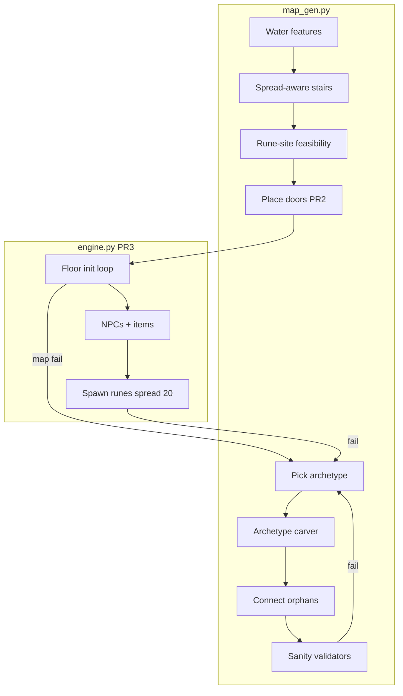
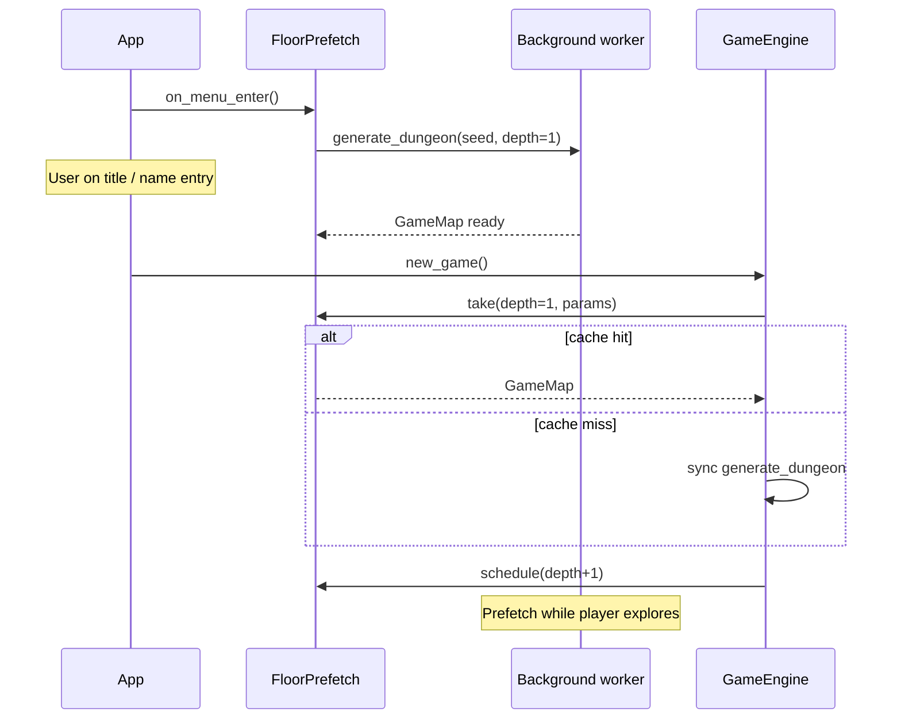

# Design: add-dungeon-layout-overhaul

**Change id:** `add-dungeon-layout-overhaul`  
**Status:** Draft — awaiting user sign-off before PR0  
**Depends on:** `dungeon`, `floor-runes`, `core-roguelike`  
**Supersedes in part:** `openspec/specs/dungeon/spec.md` (chaotic mixed generation, validation, tile types)

---

## Overview

This change overhauls procedural dungeon generation and adds door gameplay. Five incremental PRs:

| PR | Deliverable |
|----|-------------|
| PR0 | Reject-and-retry sanity pipeline; spread-aware stairs; debug logging; giant fallback room |
| PR1 | Modular layout archetypes (boxy / organic / hybrid) with debug 100% force modes |
| PR2 | Doors: generation, player open/close, movement/FOV/render |
| PR3 | Unified floor init regen loop; rune spread + item-blocker fix; live spec; archive |
| PR4 | Background floor prefetch (hide map-gen latency on menu and descent) |

**Terminology:** defeated, stunned, digested — never kill/die/death (`openspec/config.yaml`).

---

## Resolved decisions

| # | Topic | Decision |
|---|-------|----------|
| D1 | Archetype mix | 40% boxy / 40% organic / 20% hybrid after per-style validation via debug 100% modes |
| D2 | Organic shape | 4–6 large open areas; narrow choke corridors between; 1–2 rooms may get a large lake |
| D3 | Irregular shapes | Nice-to-have; keep generators modular so weak styles can be removed |
| D4 | Depth scaling | Depth-independent |
| D5 | Map size | 80×44 unchanged |
| D6 | Closed doors | Block movement **and** FOV (DCSS normal doors) |
| D7 | Open doors | Walkable + transparent; glyph `-` |
| D8 | Opening | Walk into closed door → opens, turn consumed, player stays on near tile |
| D9 | Closing | **`c`** then direction (8-way); prompt *"Close door — choose a direction."*; no open door → *"There's no open door there."*, no turn |
| D10 | NPC doors | NPCs cannot open or close; closed doors block all NPC movement |
| D11 | Door density | ~50% of corridor mouths (normal distribution around mean); not room corners; no adjacent door pairs after dedup pass |
| D12 | Door glyphs | `+` closed, `-` open |
| D13 | Min land area | Absolute `MIN_LAND_TILE_COUNT` + `MIN_SPAWN_CANDIDATE_COUNT` = 3× current (10→30) |
| D14 | Stair spread | Pairwise BFS path distance ≥ 20 on land tiles; impossible → reject map |
| D15 | Rune spread | Same ≥ 20 BFS between each pair of runes; impossible → reject map / regen floor |
| D16 | Rune vs doors | Runes placed before doors in gen pipeline; feasibility checks ignore door blocking |
| D17 | Retry budget | 50 attempts, then one giant fallback room |
| D18 | Discard logging | `print(..., flush=True)` to PowerShell (same pattern as good swap debug) |
| D19 | Rune-cluster bug | Fold into PR3: items must not block rune candidate tiles |
| D20 | new_game / descend / R | All use the same validated floor pipeline |
| D21 | Tests | Deterministic seed tests for validators + statistical multi-seed suites |
| D22 | Floor prefetch | Background worker pre-generates **map geometry only** (`GameMap`); NPC/item/rune spawn stays on main thread |
| D23 | Prefetch triggers | Main menu idle + after each floor load (anticipate next descent); cancel/restart on debug regen toggles |
| D24 | Prefetch fallback | If prefetch not ready at consume time, synchronous `generate_dungeon` (current behavior) — no soft-lock |
| D25 | Prefetch worker | `ProcessPoolExecutor(max_workers=1)` in production — thread prefetch caused GIL stalls during gameplay (2026-07-03 playtest) |

---

## Background & motivation

### Current behavior (`src/map_gen.py`)

- Per-room roll: 38% rect, 34% blob, 28% cellular cavern — each connected by L-shaped `tunnel_between` corridors.
- Visual result: corridors dominate; organic rooms are small islands in a tunnel graph (user reports never seeing organic-dominant floors).
- Validation: land connectivity, `_spawn_candidate_count >= 10`, stairs reachable — **no** land-tile minimum, **no** stair/rune spread.
- Stairs: `rng.sample` from reachable land — no spread constraint (empirical: ~50% of seeds have pairwise stair BFS &lt; 20).
- Rune spawn (`floor_runes.py`): `RUNE_SPAWN_MIN_DISTANCE = 30` from entrance but **relaxes to 0**; items and NPCs block candidates → clustering near entrance on cramped maps.
- No door tile types.

### Empirical baselines (100 seeds, 80×44)

| Metric | Min | Median | Notes |
|--------|-----|--------|-------|
| Land tiles | 176 | 482 | No explicit floor gate today |
| Spawn candidates (≥6 from entrance) | 134 | 436 | Gate at 10 is never binding |
| Min pairwise stair BFS | 1 | 22 | 25/50 seeds fail ≥ 20 threshold |

---

## Goals & non-goals

### Goals

| # | Goal |
|---|------|
| G1 | Majority of generations pass sanity without dozens of discards; obvious failures (tiny maps, clustered stairs/runes) are rejected |
| G2 | Distinct boxy, organic, and hybrid floor **silhouettes** visible in play |
| G3 | Debug modes to force 100% of one archetype for layout QA |
| G4 | Doors at corridor mouths; player-only interaction |
| G5 | Floor runes ≥ 20 BFS apart; no item-blocker false clustering |
| G6 | Incremental PRs with manual playtest after each |
| G7 | Descent and new-game map swaps feel instant when prefetch hits (PR4) |

### Non-goals

| # | Non-goal |
|---|----------|
| N1 | Map resize, depth scaling, locked/transparent doors |
| N2 | NPC door use |
| N3 | Mid-level map regen (only new floor / new game / debug R) |
| N4 | Guaranteed specific room shapes (L/T/U) — modular only |
| N5 | Prefetching entity/rune placement (depends on live ECS; PR3 `initialize_floor` boundary) |
| N6 | Prefetching multiple floors ahead (one queued job at a time) |

---

## Architecture



### New / touched modules

| Path | Role |
|------|------|
| `src/map_gen.py` | Archetype carvers, validators, stairs, doors, debug logging |
| `src/map_gen_layouts/` (new package) | One module per archetype + shared choke/tunnel helpers |
| `src/constants.py` | Sanity thresholds, door rate, layout debug flags |
| `src/systems/movement.py` | Door traversal rules |
| `src/systems/combat.py` | Player bump-open closed door before move |
| `src/engine.py` | Ctrl+C close-door chord; `initialize_floor()` loop |
| `src/systems/render.py` | Door glyphs |
| `src/systems/floor_runes.py` | Item exclusion fix; inter-rune spread enforcement |
| `src/systems/fov.py` | Closed door opacity |
| `openspec/specs/dungeon/spec.md` | PR3 |

---

## Constants (proposed — tunable in `src/constants.py`)

```python
# Sanity / regeneration
MAX_GEN_ATTEMPTS = 50
MIN_SPAWN_CANDIDATE_COUNT = 30          # was implicit 10 (3×)
MIN_LAND_TILE_COUNT = 400               # absolute floor; ~bottom quartile of tiny-feeling maps
MIN_PAIRWISE_SPREAD_BFS = 20            # stairs + runes
STAIRS_PER_FLOOR = 3
RUNES_PER_FLOOR = 3                     # existing

# Doors (PR2)
DOOR_CORRIDOR_MOUTH_CHANCE = 0.50
DOOR_CHANCE_STDDEV = 0.10               # per-floor roll clipped to [0.25, 0.75]

# Layout archetypes (PR1)
LAYOUT_ARCHETYPE_BOXY_WEIGHT = 0.40
LAYOUT_ARCHETYPE_ORGANIC_WEIGHT = 0.40
LAYOUT_ARCHETYPE_HYBRID_WEIGHT = 0.20
# Debug: LAYOUT_ARCHETYPE_FORCE = "boxy" | "organic" | "hybrid" | None
# Runtime toggle: F4 cycles force mode (mirrors F3 water_testing pattern)
```

**`MIN_LAND_TILE_COUNT` note:** User asked for 3× stricter sizing. Explicit code gate today is spawn candidates ≥ 10 → **30**. Absolute land minimum starts at **400** (empirical: rejects ~176–350 tile “two-room” feel without discarding a majority). Tune after PR0 playtest; constant is single-knob adjustable.

---

## Feature 1: Sanity validation & regeneration (PR0)

### Validators

| Check | Function | When |
|-------|----------|------|
| Land tile count | `validate_min_land_tiles(map) >= MIN_LAND_TILE_COUNT` | After connect + before water |
| Spawn candidates | `_spawn_candidate_count >= MIN_SPAWN_CANDIDATE_COUNT` | Same |
| Connectivity | `validate_land_connectivity` (existing) | After water + after doors (PR2) |
| Stair count | Exactly 3, all reachable | After stair placement |
| Stair spread | `validate_pairwise_spread(stairs, bfs_land) >= MIN_PAIRWISE_SPREAD_BFS` | After stair placement |
| Rune-site feasibility | `validate_rune_sites_feasible(map)`: ∃ 3 `FLOOR` tiles pairwise BFS ≥ 20 | After stairs, before doors |

`bfs_land`: cardinal BFS over `FLOOR` + `STAIRS_DOWN` (stairs count as land for pathing).

### Spread-aware stair placement

Replace `rng.sample(candidates, 3)` with greedy / backtracking placement:

1. BFS distances from `enter_xy` over land.
2. Pick first stair farthest from entrance (among top quartile).
3. Pick next stair maximizing min distance to prior stairs (BFS).
4. Repeat; fail if cannot reach ≥ 20 for all pairs.

### Regeneration loop

```python
for attempt in range(1, MAX_GEN_ATTEMPTS + 1):
    dungeon = _attempt_generate_dungeon(...)
    if dungeon is None:
        _debug_log_map_reject(attempt, reason)
        continue
    return dungeon
return _fallback_giant_room(map_width, map_height)
```

### Debug logging

```python
def _debug_log_map_reject(attempt: int, reason: str) -> None:
    print(f"[map_gen] rejected attempt {attempt}: {reason}", flush=True)
```

Reasons: `too_few_land_tiles`, `too_few_spawn_candidates`, `disconnected_land`, `stairs_unreachable`, `stairs_too_clustered`, `rune_sites_infeasible`, `layout_carve_failed`, etc.

### Fallback giant room

Single carved rectangle covering most of the map (e.g. inset margin 4: floor `(4, 4)` to `(width-5, height-5)`), entrance at center, three stairs at spread corners. Signals generation failure without infinite loop.

### Tests (PR0)

- Deterministic: seed that fails old spread passes after regen (or mock small map → reject).
- `validate_pairwise_spread` unit tests.
- Statistical: 100 seeds → all pass validators; 0 pairwise stair BFS &lt; 20.
- Fallback triggers when all attempts mocked to fail.

---

## Feature 2: Layout archetypes (PR1)

### Why organic “doesn’t appear” today

Per-room blob/cavern carving is overwritten visually by the **global tunnel graph** connecting every region center-to-center. Organic needs **whole-floor** generation where open areas are primary and connectors are sparse.

### Modular package: `src/map_gen_layouts/`

| Module | Responsibility |
|--------|----------------|
| `boxy.py` | Rect rooms + varied corridor widths (1–3); optional small blobs |
| `organic.py` | 4–6 large caverns (cellular automata or disk+blob growth, radius 8–14); 1-wide choke tunnels between selected pairs; optional lake in 1–2 caverns |
| `hybrid.py` | 2–3 large organic zones + 2–4 rect rooms; mixed connectors |
| `common.py` | Region struct, intersection tests, choke carving, corridor-mouth detection for doors (PR2) |

### Archetype selection

```python
def pick_layout_archetype(rng, *, force: str | None) -> str:
    if force:
        return force
    roll = rng.random()
    if roll < 0.40: return "boxy"
    if roll < 0.80: return "organic"
    return "hybrid"
```

### Organic algorithm (sketch)

1. Roll `n_caverns` ∈ {4, 5, 6}.
2. Place non-overlapping cavern seeds (cellular automata in 14×18 bounding box each).
3. Build minimum spanning tree over cavern centers; carve **1-tile-wide** choke between MST edges (not full L-tunnels between all pairs).
4. Optionally replace 1–2 cavern floors with lake (`_grow_lake`) if connectivity holds.
5. Set `enter_xy` in largest cavern.

### Debug 100% modes

- `LAYOUT_ARCHETYPE_FORCE` constant (dev default `None`).
- **F4** runtime toggle cycles: `None → boxy → organic → hybrid → None` (log to message log or console).
- PR1 manual QA: force each 100%, descend 3–5 floors, confirm silhouette before enabling 40/40/20.

### Tests (PR1)

- Force `boxy` / `organic` / `hybrid` with fixed seeds → assert metrics (e.g. organic: ≥4 floor components before MST connect, median room area &gt; boxy).
- Statistical: 30 seeds default weights → each archetype appears (not 0%).

---

## Feature 3: Doors (PR2)

### Tile types

```python
class Tile(IntEnum):
    WALL = 0
    FLOOR = 1
    DEEP_WATER = 2
    STAIRS_DOWN = 3
    DOOR_CLOSED = 4
    DOOR_OPEN = 5
```

| Tile | Ground walk | Transparent | FOV |
|------|-------------|-------------|-----|
| `DOOR_CLOSED` | blocked | no | blocked |
| `DOOR_OPEN` | yes | yes | yes |

Flyers: closed doors block movement (same as walls for fly pathing). Aquatic: irrelevant on land doors.

### Procedural placement

After layout + stairs + feasibility, scan **corridor mouths**: floor tiles with ≥1 wall neighbor and ≥2 floor neighbors where one side is “room interior” and one is “corridor”. Roll per mouth with floor chance ~`Normal(0.50, 0.10)` clipped. Place `DOOR_CLOSED` on the corridor tile adjacent to the mouth (canonical side: tile closer to room center).

All doors start **closed**.

### Player open

In `try_action` / movement path for player:

1. If destination is `DOOR_CLOSED`: set tile to `DOOR_OPEN`, log short message (e.g. *"You open the door."*), return **True** (turn consumed), **do not** move player.

### Player close

Engine handler: `KeyDown` with `Modifier.CTRL` + `sym in DIRECTION_KEYS`:

1. Target tile = player pos + direction.
2. If `DOOR_OPEN` → `DOOR_CLOSED`, log *"You close the door."*, consume turn.
3. Else → log *"There's no open door there."*, **no** turn.

Blocked while engulfed/stunned same as movement? **Closing consumes turn when successful**; failed close does not consume turn (user: "cancel the close command").

Modals: door close blocked when inventory/vore modals active (same as movement).

### NPCs

`can_enter_tile` / `can_move_to` return False for `DOOR_CLOSED`. NPC AI does not attempt door interaction. Pathfinding treats closed doors as walls.

### Render

`_tile_glyph_and_fg`: `+` / `-` with wood-toned fg (provisional).

### Tests (PR2)

- Closed blocks player movement and FOV.
- Bump opens, turn consumed, player position unchanged.
- Ctrl+C direction closes; wrong direction messages without turn.
- NPC cannot traverse closed door.

---

## Feature 4: Floor init & rune fix (PR3)

### Rune candidate fix

`occupied_rune_blocked_tiles`: **remove floor items** from blocked set. NPCs still block (runes spawn after NPCs). Rationale: player walks over items; todo bug.

For **pre-gen feasibility**, ignore all entities — pure map geometry.

### Inter-rune spread

`spawn_floor_rune` changes:

1. Place first rune with entrance min-distance (relax threshold loop for entrance only).
2. Place each subsequent rune requiring BFS ≥ `MIN_PAIRWISE_SPREAD_BFS` from **every** already-placed rune on `FLOOR` tiles.
3. If pool empty → raise `RunePlacementError` → floor init regen.

Do **not** relax inter-rune distance below 20.

### `initialize_floor()` (engine)

Unified helper used by `new_game()`, `descend_floor()`, and debug **R**:

```python
def initialize_floor(self, *, seed, followers=..., depth=...) -> None:
    for attempt in range(1, MAX_GEN_ATTEMPTS + 1):
        self.game_map = generate_dungeon(...)
        if not map passes: continue
        clear / place player / followers
        spawn NPCs + items
        try:
            spawn_floor_rune(..., min_pairwise=20)
        except RunePlacementError:
            print(f"[floor_init] rejected attempt {attempt}: rune_placement_failed", flush=True)
            continue
        return
    # fallback map + best-effort rune placement with log warning
```

Generation happens **before** first render frame of the new floor (existing engine flow already assigns map before draw).

### Todo resolution

Remove or mark resolved `openspec/changes/todo/spec.md` rune-cluster item when PR3 lands.

### Spec updates (`openspec/specs/dungeon/spec.md`)

Add requirements:

- **Map sanity regeneration** (land count, spread, feasibility, debug log, giant fallback)
- **Layout archetypes** (boxy / organic / hybrid weights)
- **Doors** (tile types, generation, player interaction, NPC block)
- Amend **Chaotic Mixed Map Generation** to reference archetype system
- Amend **Downstairs Placement** with spread rule

### Tests (PR3)

- Items on floor tiles do not remove tile from rune candidates.
- Three runes pairwise BFS ≥ 20 on 50 seeds.
- `initialize_floor` regens when rune placement would fail (mock).

---

## Feature 5: Background floor prefetch (PR4)

### Problem

Map generation (layout carve, validators, door scan, connectivity retries) runs synchronously in `GameEngine.new_game()` and `descend_floor()`. With stricter validation and door placement, first-frame pauses are noticeable. Generation complexity will grow in future PRs.

### Scope

Prefetch **only** `generate_dungeon(...)` → `GameMap`. Entity spawn, rune placement, and FOV init remain on the main thread after the map is adopted (same split as today; PR3's `initialize_floor` becomes the single consume site).

### Architecture



### Module: `src/floor_prefetch.py`

| Type / function | Role |
|-----------------|------|
| `PrefetchParams` | Frozen snapshot: `map_width`, `map_height`, `water_testing`, `layout_archetype_force`, optional `seed` |
| `FloorPrefetch` | Owns at most one in-flight job; thread-safe `take()` / `schedule()` |
| `_generate_worker(params) -> GameMap` | Top-level callable invoking `generate_dungeon` (must be importable for optional process pool) |

### Worker model

| Approach | When |
|----------|------|
| `ProcessPoolExecutor(max_workers=1)` | **Default (PR4)** — generation runs in a child process on another core; main gameplay thread avoids GIL contention |
| `ThreadPoolExecutor(max_workers=1)` | Test-only fallback (`use_process=False`); patches apply in-process |

Main thread never blocks on the worker except at `take()` consume time; UI render loop continues while prefetch runs.

### Triggers & invalidation

| Event | Action |
|-------|--------|
| `AppPhase.MENU` entered | `schedule(PrefetchParams(depth=FLOOR_DEPTH_START, seed=random))` |
| `new_game()` / `descend_floor()` completes map + spawns | `schedule(PrefetchParams(depth=floor_depth+1, seed=random))` |
| Debug **R** regen, F3 water toggle, F4 layout force | `cancel()` then `schedule()` with updated params |
| Return to menu | `cancel()`; menu trigger restarts depth-1 prefetch |
| `take()` on consume | Pop cached map **only** when `PrefetchParams` matches (water, layout force, dimensions); depth is advisory — mismatch → discard and sync gen |

### Integration points

| File | Change |
|------|--------|
| `src/app.py` | Call `floor_prefetch.on_menu_enter()` when phase → `MENU`; pass shared `FloorPrefetch` into `GameEngine` |
| `src/engine.py` | `new_game` / `descend_floor` call `prefetch.take_or_generate(...)` instead of direct `generate_dungeon`; kick `schedule_next` after floor ready |
| `src/floor_prefetch.py` | New — worker + cache |

`GameEngine.__init__` today calls `new_game()` immediately; PR4 may defer first sync gen if menu prefetch finished during name entry (common case).

### UX guarantees

- **No loading spinner required** for PR4 — silent overlap; optional debug log `[prefetch] ready` / `[prefetch] miss → sync`.
- Consume-time miss uses existing sync path; player sees same result, only latency unchanged for that transition.
- Worker exceptions logged; cache cleared; sync fallback on next consume.

### Tests (PR4)

- Unit: `take()` returns `None` when empty; returns map when job done; params mismatch discards cache.
- Unit: `cancel()` prevents stale map from being taken after F3/F4 toggle (mock params).
- Integration (optional): menu dwell → `new_game` does not call `generate_dungeon` when prefetch hit (mock/spy).
- Manual: time descent with/without prefetch; confirm no pause when prefetch wins.

### Risks

| Risk | Mitigation |
|------|------------|
| Stale map after debug toggle | Params equality check on `take()`; cancel on toggle |
| Double memory (two `GameMap` arrays) | Single slot cache; ~80×44 tiles negligible |
| Thread safety / TCOD | Worker never touches `tcod` or ECS — pure Python + numpy map build |
| GIL limits thread speedup | Profile; escalate to process pool if needed |

---

## PR plan summary

### PR0 — Sanity validation & regeneration

**Files:** `map_gen.py`, `constants.py`, `tests/test_dungeon_layout_pr0.py`  
**Manual:** Descend many floors; watch PowerShell for discard lines; confirm no obvious stair clusters; confirm fallback is giant room if forced.

### PR1 — Layout archetypes

**Files:** `src/map_gen_layouts/*`, `map_gen.py`, `engine.py` (F4), `constants.py`, tests  
**Manual:** F4 force boxy/organic/hybrid 100%; screenshot mental model of each; then restore default 40/40/20.

### PR2 — Doors

**Files:** `map_gen.py`, `movement.py`, `combat.py`, `engine.py`, `render.py`, `fov.py`, tests  
**Manual:** Open by walking; close with Ctrl+C; verify FOV; verify monsters don't follow through closed doors.

### PR3 — Floor init, runes, spec, archive

**Files:** `engine.py`, `floor_runes.py`, `dungeon/spec.md`, todo spec, acceptance artifacts  
**Manual:** Full regression descend + new game; runes well spread; knights following no longer collapse runes.

### PR4 — Background floor prefetch

**Files:** `src/floor_prefetch.py` (new), `app.py`, `engine.py`, tests  
**Manual:** Linger on main menu → new game should feel snappy; descend twice — second descent should not hitch if prefetch won.

---

## Risks & mitigations

| Risk | Mitigation |
|------|------------|
| High discard rate with tight thresholds | Tunable constants; log discard reasons; PR0 playtest first |
| Organic caverns disconnect | MST choke carving + existing orphan connect as safety net |
| Doors seal player in | All doors openable; generation only at corridor mouths; connectivity validated before doors |
| 50 attempts insufficient with doors + spread | Monitor logs; increase `MAX_GEN_ATTEMPTS` if needed |
| FOV perf with door opacity | Doors are sparse; reuse existing TCOD FOV |

---

## Open questions

None — all clarifications resolved in chat (2026-07-03).