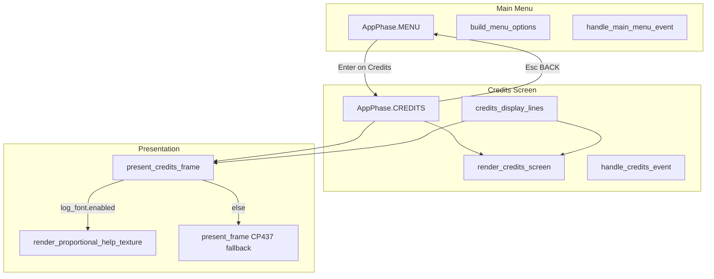
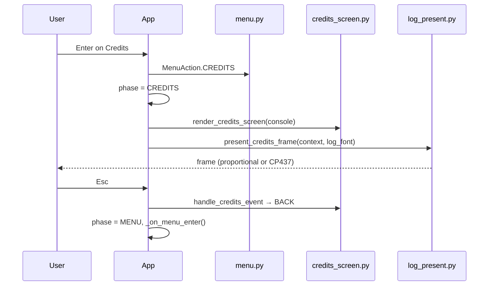

# Design: Credits Page

**Author:** (agent)  
**Date:** 2026-07-05  
**Status:** Draft

---

## Overview

Add a **Credits** main-menu option (above **Exit**) that opens a static, full-screen informational page. The screen reuses the visual language of the in-game **help overlay** (`src/ui/help_overlay.py`) and **message log** (`MESSAGE_LOG_BACKGROUND`, proportional Source Sans 3 when available). **Esc** returns to the main menu using the same `AppPhase` pattern as **Past Runs** and **Options**.

Scope is intentionally small: one new UI module, three touch points in existing menu/app/present code, and targeted tests. No scrolling, no new dependencies, no in-game overlay.

---

## Background & Motivation

### Current state (before this change)

The main menu (`src/menu.py`) builds **3–5** options via `build_menu_options()` and ends with `["Options", "Exit"]`. **Load Game** and **Past Runs** are conditional on probe results; there is no **Credits** option and no attribution surface in the application.

### Target state (after this change)

`build_menu_options()` will produce **4–6** options. The suffix is always `["Options", "Credits", "Exit"]` — **Credits** is unconditional (unlike Load Game / Past Runs). Minimum menu: New Game, Options, Credits, Exit.

Comparable screens already exist:

| Screen | Module | Phase | Presentation | Input |
|--------|--------|-------|--------------|-------|
| Help (F1) | `help_overlay.py` | In-game overlay | Proportional TTF via `present_help_overlay_frame()` | Esc closes |
| Past Runs | `past_runs_screen.py` | `AppPhase.PAST_RUNS` | CP437 only (`present_frame` fallback) | Esc back, scroll |
| Options | `options_menu.py` | `AppPhase.OPTIONS` | CP437 menu | Esc back |

The user wants Credits to **look like** help/message log (dark background, colored lines, proportional font) but behave like a **main-menu sub-screen** (dedicated `AppPhase`, Esc → menu).

### Pain points

- No in-app authorship or support links
- Font and library licenses are not surfaced to players
- Future contributors lack a documented pattern for static info pages on the main menu

---

## Goals & Non-Goals

### Goals

1. **Credits** menu option always visible, immediately above **Exit**
2. Full-screen page with title **"KD's Vore Roguelike"**, K.D. credit line, plain-text URLs, font and library attributions
3. Visual parity with help overlay: `MESSAGE_LOG_BACKGROUND`, section/body colors, centered **"Esc: close"** footer
4. Proportional Source Sans 3 rendering when `App.log_font` is loaded (same condition as help overlay)
5. CP437 fallback when TTF unavailable (identical degradation path to help)
6. Automated tests mirroring `test_help_overlay.py` and `test_past_runs_menu_pr4.py`
7. Live spec update to `openspec/specs/main-menu/spec.md` on acceptance

### Non-Goals

- Clickable links or `webbrowser.open()`
- Scroll support (content is 21 lines + footer; fits 44-row stock layout with margin)
- In-game credits hotkey
- New fonts, dependencies, or `attrs` added to `pyproject.toml`
- Alloy_curses tileset license research (user specified "CP437 tile font via libtcod" attribution only)

---

## Proposed Design

### Architecture



### Sequence: open and close



### New module: `src/ui/credits_screen.py`

Mirror `help_overlay.py` structure (static lines, no state object needed beyond scroll-free render).

```python
"""Full-screen credits page (main menu)."""

from __future__ import annotations

from enum import Enum, auto

import tcod.console
import tcod.event
from tcod.event import KeySym

from src.systems.render import MESSAGE_LOG_BACKGROUND
from src.text import cp437_safe
from src.ui.help_overlay import (
    HELP_BODY_FG,
    HELP_FOOTER_FG,
    HELP_SECTION_FG,
    HELP_TITLE_FG,
    HELP_OVERLAY_FOOTER,
    HelpTextLine,
)

CREDITS_TITLE = "KD's Vore Roguelike"


class CreditsAction(Enum):
    NONE = auto()
    BACK = auto()


def credits_display_lines() -> tuple[HelpTextLine, ...]:
    """Curated credits rows for proportional or CP437 rendering."""
    ...


def handle_credits_event(event: tcod.event.Event) -> CreditsAction:
    if isinstance(event, tcod.event.KeyDown) and event.sym == KeySym.ESCAPE:
        return CreditsAction.BACK
    return CreditsAction.NONE


def render_credits_screen(console: tcod.console.Console) -> None:
    """Draw full-screen credits (CP437 path / console blit source)."""
    ...
```

**Reuse `HelpTextLine`** rather than introducing `CreditsTextLine` — `render_proportional_help_texture()` in `proportional_log.py` (wrapping `render_proportional_help_image()`) already accepts `tuple[HelpTextLine, ...]`. `present_credits_frame()` calls the texture entry point, same as `present_help_overlay_frame()`.

### Curated content (`credits_display_lines()`)

Exact copy for implementation and tests:

| Row | Text | FG constant |
|-----|------|-------------|
| Title | `KD's Vore Roguelike` | `HELP_TITLE_FG` |
| blank | `` | — |
| Section | `Credits` | `HELP_SECTION_FG` |
| Body | `K.D. — Curator of Voracious Beasts` | `HELP_BODY_FG` |
| blank | `` | — |
| Section | `Links` | `HELP_SECTION_FG` |
| Body | `patreon.com/KD_Dragon` | `HELP_BODY_FG` |
| Body | `furaffinity.net/user/kd` | `HELP_BODY_FG` |
| blank | `` | — |
| Section | `Fonts` | `HELP_SECTION_FG` |
| Body | `Source Sans 3 (data/fonts/SourceSans3-Regular.ttf)` | `HELP_BODY_FG` |
| Body | `Licensed under the SIL Open Font License 1.1` | `HELP_BODY_FG` |
| Body | `CP437 tile font via libtcod (map, sidebar, menu title)` | `HELP_BODY_FG` |
| blank | `` | — |
| Section | `Libraries` | `HELP_SECTION_FG` |
| Body | `Python 3.11+ — PSF License Agreement` | `HELP_BODY_FG` |
| Body | `libtcod / tcod (>=16.0) — BSD 3-Clause License` | `HELP_BODY_FG` |
| Body | `tcod-ecs (>=5.0) — MIT License` | `HELP_BODY_FG` |
| Body | `numpy (>=1.26) — BSD License` | `HELP_BODY_FG` |
| Body | `Pillow (>=10.0) — HPND License` | `HELP_BODY_FG` |
| Body | `attrs — MIT License (transitive dependency)` | `HELP_BODY_FG` |

**Footer:** reuse `HELP_OVERLAY_FOOTER` (`"Esc: close"`) and `HELP_FOOTER_FG`.

**Em dash:** Use `—` (U+2014) in proportional mode; `cp437_safe()` will substitute for CP437 fallback (same as other UI strings).

**Line count:** **21** `HelpTextLine` entries from `credits_display_lines()` plus **1** footer row rendered separately (22 total drawn rows), matching the help overlay pattern. Tests asserting `len(credits_display_lines())` should expect **21**. On stock layout (`root_rows=44` per `data/ui_layout.json` standard/wide presets; viewport = `console.height - 1` = **43**), ~21 rows of margin remain — no scroll required. Prefer `load_ui_layout().root_rows` or `runtime_console_dimensions(layout)` in tests rather than hardcoding legacy `SCREEN_HEIGHT` (50). `render_*` clips overflow identically to `render_help_overlay()` if the window is extremely short.

### Main menu changes (`src/menu.py`)

```python
_ALL_MENU_OPTION_LABELS: tuple[str, ...] = (
    "New Game",
    "Load Game",
    "Past Runs",
    "Options",
    "Credits",   # NEW — always last before Exit
    "Exit",
)

def build_menu_options(...) -> tuple[str, ...]:
    options: list[str] = ["New Game"]
    if load_available:
        options.append("Load Game")
    if past_runs_available:
        options.append("Past Runs")
    options.extend(["Options", "Credits", "Exit"])  # Credits before Exit
    return tuple(options)
```

- Add `MenuAction.CREDITS`
- Handle `"Credits"` in `handle_main_menu_event()` (Enter / modal advance keys)
- `MENU_LINE_WIDTH` auto-recomputes from `_ALL_MENU_OPTION_LABELS`

**Menu option order examples:**

| Probes | Options |
|--------|---------|
| No save, no past runs | New Game, Options, **Credits**, Exit |
| Save only | New Game, Load Game, Options, **Credits**, Exit |
| Both | New Game, Load Game, Past Runs, Options, **Credits**, Exit |

Credits is **never conditional** (unlike Load Game / Past Runs).

### App integration (`src/app.py`)

```python
class AppPhase(Enum):
    MENU = auto()
    NAME_ENTRY = auto()
    OPTIONS = auto()
    PAST_RUNS = auto()
    CREDITS = auto()   # NEW
    PLAY = auto()
```

**`handle_event()` — MENU branch:**

```python
elif action is MenuAction.CREDITS:
    self.phase = AppPhase.CREDITS
```

**`handle_event()` — CREDITS branch** (mirror `PAST_RUNS`, without scroll):

```python
if self.phase is AppPhase.CREDITS:
    if is_ctrl_q(event):
        return False
    if handle_credits_event(event) is CreditsAction.BACK:
        self.phase = AppPhase.MENU
        self._on_menu_enter()
    return False
```

**`render()`:**

```python
if self.phase is AppPhase.CREDITS:
    render_credits_screen(console)
    return
```

No persistent state object is required (static content). Unlike Past Runs, no `reset()` on enter.

### Presentation (`src/ui/log_present.py`)

Add `present_credits_frame()` parallel to `present_help_overlay_frame()`:

```python
def present_credits_frame(
    context: tcod.context.Context,
    console: tcod.console.Console,
    *,
    layout: UILayout,
    log_font: LogFontState | None = None,
    integer_scaling: bool = True,
    align: tuple[float, float] = (0, 0),
    clear_color: tuple[int, int, int] = (0, 0, 0),
) -> None:
    use_proportional = log_font is not None and log_font.enabled and log_font.font is not None
    renderer = context.sdl_renderer
    if use_proportional and renderer is not None:
        # Same viewport math as present_help_overlay_frame
        help_tex = render_proportional_help_texture(
            renderer,
            credits_display_lines(),
            font=log_font.font,
            layout=layout,
            footer_text=HELP_OVERLAY_FOOTER,
            footer_fg=HELP_FOOTER_FG,
        )
        renderer.copy(help_tex, dest=(dest_x, dest_y, dest_w, dest_h))
        renderer.present()
        return
    context.present(console, ...)
```

**`App.present()` addition** (before the generic `present_frame` fallback):

```python
if self.phase is AppPhase.CREDITS:
    present_credits_frame(
        context,
        console,
        layout=self.active_layout(),
        log_font=self.log_font,
        integer_scaling=True,
        align=(0, 0),
    )
    return
```

**Note:** `log_font` is loaded in `main.py` via `load_log_font_state()` at startup — same font as message log and help. Credits gets proportional presentation on the main menu even though Past Runs does not; this matches the user's visual requirement.

**Optional refactor (same PR, low risk):** Extract shared body from `present_help_overlay_frame` and `present_credits_frame` into `_present_static_overlay_frame(lines, footer_text, footer_fg)`. Not required for correctness.

---

## API / Interface Changes

### `src/menu.py`

| Symbol | Change |
|--------|--------|
| `_ALL_MENU_OPTION_LABELS` | Add `"Credits"` before `"Exit"` |
| `build_menu_options()` | Always append `"Credits"` before `"Exit"` |
| `MenuAction` | Add `CREDITS` |
| `handle_main_menu_event()` | Map `"Credits"` → `MenuAction.CREDITS` |

### `src/app.py`

| Symbol | Change |
|--------|--------|
| `AppPhase` | Add `CREDITS` |
| `handle_event()` | CREDITS phase branch; MENU → CREDITS transition |
| `render()` | CREDITS → `render_credits_screen()` |
| `present()` | CREDITS → `present_credits_frame()` |

### New `src/ui/credits_screen.py`

| Symbol | Purpose |
|--------|---------|
| `credits_display_lines()` | Static content factory |
| `CreditsAction` | `NONE`, `BACK` |
| `handle_credits_event()` | Esc → `BACK` |
| `render_credits_screen()` | CP437 console draw |

### `src/ui/log_present.py`

| Symbol | Change |
|--------|--------|
| `present_credits_frame()` | Proportional + CP437 present for credits |

---

## Data Model Changes

None. No persistence, no settings, no save snapshot fields.

---

## Alternatives Considered

### 1. Reuse Past Runs scrollable screen pattern

**Approach:** Put credits text in `build_past_runs_display_lines`-style string list with scroll.

**Pros:** Reuses scroll infrastructure; safe on tiny windows.

**Cons:** Unnecessary complexity for 21 static content lines; footer would say "Esc: back | Arrows: line"; visual mismatch with help.

**Rejected** — content fits without scroll; help-style static page is the explicit UX target.

### 2. In-game help overlay reuse (toggle `HelpOverlayState` on main menu)

**Approach:** Open `HelpOverlayState` with alternate content while `AppPhase.MENU`.

**Pros:** Zero new present path.

**Cons:** Conflates in-game and menu UX; help handler has F1/?/Ctrl+P interactions; `Engine` owns help state today.

**Rejected** — main-menu-only feature deserves its own `AppPhase` (consistent with Past Runs / Options).

### 3. Generalize help into a shared `static_overlay.py` module

**Approach:** Move `HelpTextLine`, colors, render, and present into a shared module used by help and credits.

**Pros:** DRY for future about/license pages.

**Cons:** Refactors working help code; larger diff for a small feature.

**Deferred** — credits imports from `help_overlay.py`; generalize only if a third static page appears.

---

## Risks

| Risk | Severity | Mitigation |
|------|----------|------------|
| **Stale dependency or license text** | Low | PR3 verifies curated copy against `pyproject.toml` and upstream LICENSE files (libtcod, tcod-ecs, PSF, OFL) before spec acceptance |
| **Test suite breakage from menu tuple changes** | Medium | PR2 audits all `build_menu_options` assertions in `tests/` (confirmed: `test_main_menu.py`, `test_past_runs_menu_pr4.py`, `test_save_menu_pr4.py`); update every hardcoded tuple to insert `"Credits"` before `"Exit"` |
| **Proportional vs CP437 visual drift** | Low | Manual checklist in PR2 verifies Source Sans 3 on Credits when TTF loads; CP437 fallback covered by `render_credits_screen` unit tests; optional mock test asserts proportional branch selection (see Observability) |
| **Tiny-window content clip** | Low | Accepted degradation — same clip behavior as `render_help_overlay()`; no scroll added |
| **Missed manual checklists** | Low | Each PR creates/extends `testing-checklist-prN.md` per `openspec/WORKFLOW.md` Rule 3; listed in PR Plan file lists below |

---

## Security & Privacy Considerations

| Threat | Severity | Mitigation |
|--------|----------|------------|
| Malicious URL injection via content | None | Static hardcoded strings in source; no user input |
| Network exfiltration via links | None | Plain text only; no `http` requests |
| License text inaccuracy | Low | Copy derived from `pyproject.toml` and official license files; review in PR |
| Path disclosure (`data/fonts/...`) | Low | Informational only; path already on disk in repo |

No auth, PII, or external network calls.

---

## Observability

- **No new logging** — Esc/back is silent (same as Past Runs)
- **No metrics**
- **Manual verification** per PR checklists in `tasks.md` (required by `openspec/WORKFLOW.md` Rule 3)

If proportional font fails to load, existing `LogFontState` one-shot warning in `log_font.py` covers credits automatically (shared font).

### Proportional presentation test strategy

The proportional Credits path (`present_credits_frame()` → `render_proportional_help_texture()`) is the main visual differentiator vs Past Runs. **No existing test** calls `present_help_overlay_frame()` or `present_credits_frame()` — help overlay tests (`test_help_overlay.py`) and Past Runs menu tests only exercise CP437 console rendering and phase transitions, consistent with the rest of the repo.

**Chosen approach (PR2):**

1. **Manual (primary):** `testing-checklist-pr2.md` includes items to open Credits from the main menu and confirm Source Sans 3 proportional text when the bundled TTF loads (same visual check as F1 help). Also verify CP437 fallback by temporarily renaming/missing the font file.
2. **Automated (branch guard):** Add `tests/test_credits_present_pr2.py` with `unittest.mock` — patch `render_proportional_help_texture` and assert it is called when `log_font.enabled` and `context.sdl_renderer` is non-`None`; patch `context.present` and assert it is called when `log_font.enabled` is `False`. Does not pixel-compare textures (same scope gap as help overlay today).

Full pixel/regression tests for SDL texture upload remain out of scope unless a shared present-test harness is added project-wide.

---

## Rollout Plan

1. Implement PR1–PR2 behind no feature flag (always-on menu option)
2. No migration or data backfill
3. **Rollback:** Revert PR2 (menu + app wiring) to hide entry point; PR1 module is inert without wiring

Staged rollout not needed — low risk, menu-only, no gameplay impact.

---

## Open Questions

| # | Question | Proposed default |
|---|----------|------------------|
| 1 | Footer text: `"Esc: close"` (help) vs `"Esc: back"` (Past Runs)? | **`Esc: close`** — user cited help footer explicitly |
| 2 | Include Alloy_curses tileset (`data/Alloy_curses_12x12.png`) attribution? | **No** — user specified libtcod CP437 only |
| 3 | List `attrs` despite not being in `pyproject.toml`? | **Yes** — one line noting transitive MIT use |
| 4 | Refactor `present_help_overlay_frame` / `present_credits_frame` shared helper in PR2? | **Optional** — only if diff stays readable |

---

## References

- `src/menu.py` — menu option building and `MenuAction`
- `src/app.py` — `AppPhase`, Past Runs integration pattern
- `src/ui/help_overlay.py` — static colored lines, footer, Esc handling
- `src/ui/past_runs_screen.py` — main-menu full-screen phase pattern
- `src/ui/log_present.py` — `present_help_overlay_frame()`
- `src/ui/proportional_log.py` — `render_proportional_help_texture()`
- `src/ui/log_font.py` — Source Sans 3 path and load fallback
- `pyproject.toml` — direct dependency versions
- `openspec/specs/main-menu/spec.md` — live spec to extend
- `openspec/WORKFLOW.md` — one PR at a time, terminology rules
- [libtcod LICENSE](https://github.com/libtcod/libtcod/blob/main/LICENSE.txt) — BSD 3-Clause
- [tcod-ecs LICENSE](https://github.com/HexDecimal/python-tcod-ecs/blob/main/LICENSE) — MIT
- [Source Sans 3 OFL](https://openfontlicense.org/) — SIL OFL 1.1

---

## Key Decisions

| # | Decision | Rationale |
|---|----------|-----------|
| 1 | **Dedicated `AppPhase.CREDITS`** | Matches Past Runs / Options; keeps in-game `HelpOverlayState` separate |
| 2 | **Help-style static lines, not scroll** | 21 content lines + footer fit stock 44-row layout; user asked for help-like simplicity |
| 3 | **Reuse `HelpTextLine` and help color constants** | `render_proportional_help_texture()` already typed for this; avoids duplicate render code |
| 4 | **Proportional presentation on main menu** | User wants message-log/help look; Past Runs CP437-only path is insufficient |
| 5 | **`present_credits_frame()` mirrors help present** | Minimal new code; reuses `render_proportional_help_texture()` unchanged |
| 6 | **Credits always visible above Exit** | Informational page has no gating predicate (unlike Load Game / Past Runs) |
| 7 | **Plain-text URLs, no click handler** | User requirement; avoids platform browser dependencies |
| 8 | **Footer `"Esc: close"`** | Visual consistency with F1 help overlay |
| 9 | **Attribution copy from `pyproject.toml` + verified licenses** | Legal accuracy without bloating the screen |
| 10 | **`attrs` noted as transitive MIT** | Used widely in code; honest attribution without pyproject change |

---

## PR Plan

### PR1 — Credits screen module

**Title:** `feat(ui): add credits screen module with static content`

**Files/components:**
- `src/ui/credits_screen.py` (new)
- `tests/test_credits_screen.py` (new)
- `openspec/changes/add-credits-page/testing-checklist-pr1.md` (new)

**Dependencies:** None

**Description:** Implement `credits_display_lines()`, `render_credits_screen()`, `handle_credits_event()`, and `CreditsAction`. Import `HelpTextLine` and color constants from `help_overlay.py`. Tests assert title, K.D. line, both URLs, font/library attribution strings (including Python PSF), `len(credits_display_lines()) == 21`, footer, and Esc → `BACK`. No menu or app wiring yet — module is testable in isolation. Deliver manual checklist per WORKFLOW Rule 3.

---

### PR2 — Main menu and app integration

**Title:** `feat(menu): wire Credits option and proportional presentation`

**Files/components:**
- `src/menu.py` — option list, `MenuAction.CREDITS`, handler
- `src/app.py` — `AppPhase.CREDITS`, render/handle/present branches
- `src/ui/log_present.py` — `present_credits_frame()`
- `tests/test_main_menu.py` — Credits option order and action
- `tests/test_credits_menu_pr2.py` (new) — app phase open/close
- `tests/test_credits_present_pr2.py` (new) — mock-based proportional vs CP437 branch selection
- `tests/test_past_runs_menu_pr4.py` — update hardcoded `build_menu_options()` tuples
- `tests/test_save_menu_pr4.py` — update hardcoded `build_menu_options()` tuples
- `openspec/changes/add-credits-page/testing-checklist-pr2.md` (new)

**Dependencies:** PR1

**Description:** Add **Credits** above **Exit** in `build_menu_options()`. Selecting Credits sets `AppPhase.CREDITS`; Esc returns to menu via `_on_menu_enter()`. `App.present()` calls `present_credits_frame()` with `log_font` for proportional rendering when enabled. Integration tests mirror `test_past_runs_menu_pr4.py`.

**Test audit (`grep build_menu_options tests/`):** Three modules assert exact menu tuples and must be updated in this PR:

| File | Current expectation | Updated expectation |
|------|---------------------|---------------------|
| `test_past_runs_menu_pr4.py` | `("New Game", "Options", "Exit")` | `("New Game", "Options", "Credits", "Exit")` |
| `test_past_runs_menu_pr4.py` | `(..., "Past Runs", "Options", "Exit")` | `(..., "Past Runs", "Options", "Credits", "Exit")` |
| `test_save_menu_pr4.py` | `("New Game", "Options", "Exit")` | `("New Game", "Options", "Credits", "Exit")` |

**PR2 pytest command:** `pytest tests/test_credits_screen.py tests/test_main_menu.py tests/test_credits_menu_pr2.py tests/test_credits_present_pr2.py tests/test_past_runs_menu_pr4.py tests/test_save_menu_pr4.py -q`

**Proportional verification:** Manual checklist (primary) + `test_credits_present_pr2.py` mock branch test (see Observability).

---

### PR3 — Spec update and acceptance

**Title:** `docs(openspec): main-menu Credits requirement and acceptance`

**Files/components:**
- `openspec/specs/main-menu/spec.md` — Credits requirement + scenarios
- `openspec/changes/add-credits-page/acceptance-report.md` (new)
- `openspec/changes/add-credits-page/testing-checklists.md` (new, consolidated from pr1–pr3)
- `openspec/changes/add-credits-page/testing-checklist-pr3.md` (new)
- Archive move to `openspec/changes/archive/2026-07-05-add-credits-page/`

**Dependencies:** PR2

**Description:** Document Credits placement (above Exit, always visible), screen content expectations, Esc back behavior, and proportional/CP437 presentation. Re-verify license attribution strings against `pyproject.toml` and upstream LICENSE files. Run full pytest suite. Write acceptance report, consolidate manual checklists, and archive the change per `openspec/WORKFLOW.md`.

**`main-menu/spec.md` option-count updates (explicit):** Revise all menu option-count language from **three-to-five** / **four-or-five** to **four-to-six**:

| Location (current spec) | Before | After |
|-------------------------|--------|-------|
| Main Menu Presentation — option list intro | "three to five options" | "four to six options" |
| Scenario: Title and options visible | "four or five per save-load probe" | "four to six per probe results" |
| Acceptance Criteria #1 | "four or five options per autosave probe" | "four to six options per probe results" |

Also add a **Credits** requirement block with scenarios:

- Credits always listed above Exit regardless of `SaveStore.probe()` / `PastRunsStore.probe()` results
- Selecting Credits opens the credits screen; Esc returns to main menu