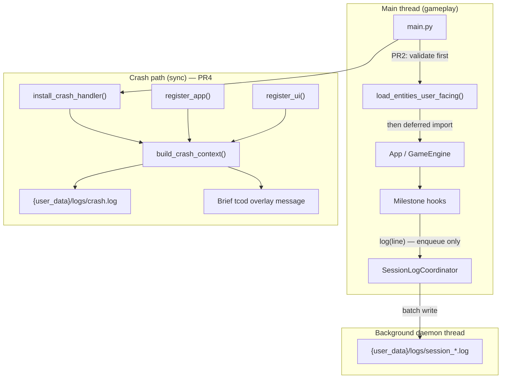
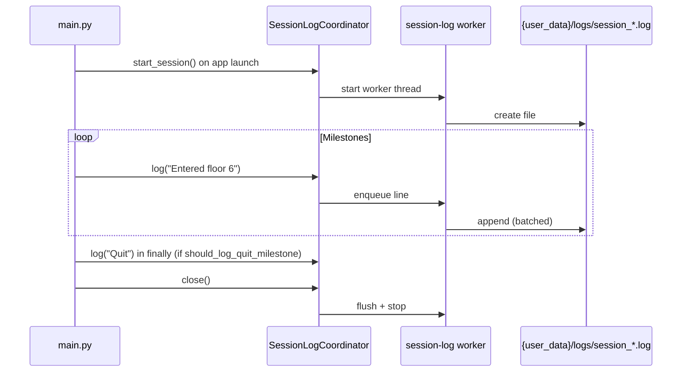

# Design: Debug Support Module

| Field | Value |
|-------|-------|
| **Author** | Systems Design |
| **Date** | 2026-07-06 |
| **Status** | Approved — OpenSpec change `add-debug-support` |
| **Proposed change id** | `add-debug-support` |
| **Spec targets** | New `openspec/specs/debug-support/spec.md` (on final acceptance) |
| **Depends on** | Shipped save coordinator (`SaveCoordinator`), entity loader (`EntityLoadError`), event hooks (`src/events.py`) |

**Note (post-archive):** User-writable paths (`saves/`, `settings.json`, `logs/`) now live under the per-user application data directory via `src/user_data.py` (`{user_data}/`). Shipped `data/*.json` assets remain in the install directory.

---

## Summary

Introduce a lightweight, always-on diagnostics layer for an indie roguelike: **crash reports**, **milestone session logs**, and **friendlier `entities.json` validation errors**. The module prioritizes helping **players** reproduce bugs without requiring source access or internet connectivity. **Official modding is not in scope** — see `openspec/changes/deferred-add-modding-support/`.

**Design principles:**

- **Negligible gameplay cost** — session logging enqueues plain strings on the main thread; a background daemon thread performs all file I/O (same pattern as `SaveCoordinator` in `src/save/coordinator.py`).
- **Fail gracefully** — if logging or directory creation fails, swallow errors and continue; never crash the game because diagnostics failed.
- **Always on** — no setting, no opt-out (user decision, final).
- **Local only** — logs under `{user_data}/logs/` (via `src/user_data.py`); no telemetry, no network.

`src/debug_log.py` remains unchanged: `DEBUG_STDOUT` env-gated developer prints are orthogonal to player-facing diagnostics.

---

## Problem statement

| Issue | Detail |
|-------|--------|
| No crash capture | `src/main.py` runs `run_loop()` with no `sys.excepthook` or `try/except`; unhandled exceptions exit with a console traceback only. |
| No session trail | No persistent record of what happened during a play session (seed, floors, pickups, defeats) for bug reports. |
| Opaque data errors | `EntityLoadError` messages like `entity 'wolf': missing or invalid integer 'max_hp'` help developers but players editing stock data still see tracebacks — especially because `src/spawn.py` loads `entities.json` at **import time** (line 47: `_registry = load_entity_registry()` plus lines 48–62). |
| Import-order trap | `main.py` top-level `from src.app import App` (line 10) imports `GameEngine` → `src.spawn` before `main()` body runs, so pre-window validation in `main()` alone cannot intercept broken `entities.json` without **deferred `App` import** and **full lazy `spawn.py`**. |
| No game version constant | `pyproject.toml` has `version = "0.1.0"` but no `GAME_VERSION` in code for crash headers. |

---

## Goals and non-goals

### Goals (v1)

1. Write `{user_data}/logs/crash.log` on any unhandled exception with rich game context.
2. Write one `{user_data}/logs/session_YYYY-MM-DD_HH-MM-SS.log` per application launch with milestone-only lines.
3. Format hard `entities.json` load failures as plain-English, multi-line messages (no traceback for the user-facing path).
4. Show a brief in-window tcod message on crash before exit.
5. Keep unknown abilities as **soft warnings** via existing `LoadWarnings` / `filter_known_abilities()` — do not upgrade to hard errors.

### Non-goals (v1)

- Validating loaders other than `entities.json` (weapons, items, macguffins, etc.).
- Per-movement or per-turn logging.
- Remote crash reporting, analytics, or log upload.
- Replacing or merging with `DEBUG_STDOUT` dev logging.
- External mod packages (crash context reserves `loaded_mods: []` → `Loaded mods: (none)` until `deferred-add-modding-support`).
- Log rotation, retention policy, or user-facing log viewer UI.
- Calling `SaveCoordinator.close()` from `main()` (daemon worker today; optional symmetry deferred).

---

## Current implementation (verified)

### Entry point and event loop

`src/main.py`:

- Top-level `from src.app import App` (line 10) — triggers `spawn.py` eager load before `main()` runs.
- `main()` loads settings, creates `App`, opens tcod context, calls `run_loop()`.
- No global exception handler; `SystemExit` raised from quit paths in `run_loop()` (lines 93, 119).
- No pre-flight data validation before window creation.
- `SaveCoordinator.close()` is never called from `main()` today (daemon thread exits with process).

### Existing debug utilities

`src/debug_log.py`:

- `debug_stdout_enabled()` / `debug_print()` — gated on `DEBUG_STDOUT` env var.
- Used by `SaveCoordinator`, floor init, autosave failures — developer-only.

### Background I/O pattern (reuse target)

`src/save/coordinator.py` — `SaveCoordinator`:

- Daemon worker thread (`name="save-coordinator"`).
- `threading.Condition` + coalesced pending work.
- `close()` / `flush()` for shutdown and tests.
- Main thread only enqueues immutable snapshots; worker writes to disk.

### Entity loading and errors

`src/data/entity_loader.py`:

- `EntityLoadError(ValueError)` with messages like `entity '{id}': ...` and `duplicate entity id '{id}'`.
- `LoadWarnings` (`src/data/warnings.py`) collects soft warnings; `filter_known_abilities()` warns on unknown abilities and **silently ignores** them.
- `_read_entity_registry()` calls `json.load()` — `json.JSONDecodeError` propagates uncaught as traceback.
- Module-level eager load in `src/spawn.py:47–62` triggers validation before `main()` can intercept.

### Engine state available for crash context

`GameEngine` (`src/engine.py`):

| Field | Use in crash report |
|-------|---------------------|
| `player_turn_count` | Current turn number |
| `rng` | RNG state via `encode_rng_state()` from `src/save/codec.py` |
| `floor_depth` | Current dungeon floor (not `game_map.depth`) |
| `player` + `Position` | Player coordinates |
| `player.components[Fighter].hp` | Current player HP |
| Active modal | `active_modal_label(app)` — see § Active modal detection |
| `macguffin_discovery` | Optional **game-state** field only (`active` is run-level flag, not a modal) |

### App-level state

`App` (`src/app.py`):

- `phase: AppPhase` — `MENU`, `NAME_ENTRY`, `OPTIONS`, `PAST_RUNS`, `CREDITS`, `PLAY`.
- Menu overlays: `new_game_confirm`, `quit_confirm`.
- Play-phase engine modals: `game_over`, `digestion_modal`, `vore_modal`, `ground_pickup_modal`, `inventory_modal`, `macguffin_victory_confirm`, `help_overlay`, `log_overlay`, `examine_state`.
- `macguffin_discovery.active` (`src/macguffin_discovery.py`) — `bool(self.macguffin_id)`; persists for rest of run; **not** a blocking UI overlay.

### Milestone hook points (verified)

| Milestone | Hook location |
|-----------|---------------|
| Started new game | `App._start_new_game()` — **before** `_enter_play()` |
| Seed | `GameEngine._initialize_floor_new()` when `log_session_milestones=True` |
| Entered floor N | `initialize_floor()` → `_initialize_floor_new()` / `_initialize_floor_descend()` when `log_session_milestones=True` (default; `descend_floor()` uses default) |
| Load game | `App._load_saved_game()` on success |
| Quit to menu | `App._return_to_menu()` |
| Quit (process exit) | `main()` `finally` block (menu EXIT, window X, normal shutdown) |
| Game over | `GameOverState.open()` in `src/systems/digestion.py` |
| Item pickup | `src/systems/inventory.py` — `_add_instance_to_inventory()` |
| Enemy defeated | `RunStats.record_monster_defeated(defeated_entity=...)` — all player-caused defeat paths |
| Debug regen (R) | `GameEngine._handle_gameplay_event()` KeySym.R — `Dungeon regenerated` only; not a v1 player milestone |

### Paths and version

- `PROJECT_ROOT` / `DATA_DIR` in `src/constants.py` (lines 112–113).
- Saves: `{user_data}/saves/` via `src/save/store.py` (`src/user_data.py`).
- Settings: `{user_data}/settings.json` via `src/settings_store.py` (`src/user_data.py`).
- Version: `pyproject.toml` → `version = "0.1.0"`; no runtime constant yet.

---

## Target architecture

### Module layout

```
src/debug/
  __init__.py           # session_log singleton; crash API exports
  paths.py              # LOGS_DIR, crash_log_path(), session_log_path()
  version_info.py       # GAME_VERSION, collect_platform_info()
  session_log.py        # SessionLogCoordinator; skip_quit_milestone() API
  crash_report.py       # CrashContext, install_crash_handler(), register_*
  modal_snapshot.py     # active_modal_label(app) -> str | None
  context.py            # build_crash_context(app, exc) -> CrashContext

src/data/
  entity_validation.py  # format_entity_load_error(), load_entities_user_facing()
```

`LOGS_DIR = USER_DATA_DIR / "logs"` (from `src/user_data.py`; separate from shipped `data/` assets).

### Crash handler API (explicit split)

```python
# src/debug/crash_report.py

def install_crash_handler() -> None:
    """Install sys.excepthook early. No App required; handles pre-window crashes."""

def register_app(app: App | None) -> None:
    """Called after App construction; updates crash context source."""

def register_ui(console: tcod.console.Console, context: tcod.context.Context) -> None:
    """Called inside tcod.context.new(); enables in-window crash message."""

def unregister_ui() -> None:
    """Clear UI refs when context exits (optional cleanup)."""
```

- **`install_crash_handler()`** — PR4 only; safe to call before `App` exists.
- **`register_app(app)`** — PR4; call immediately after `App(...)` construction; pass `None` on shutdown if desired.
- **`register_ui(console, context)`** — PR4; call inside `with tcod.context.new(...)`.
- Excepthook reads latest registered `app` / `ui` refs; pre-window crashes get stderr-only UX.

### Component diagram



### `main.py` wiring by PR (non-overlapping hunks)

| PR | `main.py` changes only |
|----|------------------------|
| **PR1** | `session_log.start_session()` at top of `main()`; `session_log.close()` in `finally` |
| **PR2** | Remove top-level `from src.app import App`; add `load_entities_user_facing()` before deferred `from src.app import App`; `skip_quit_milestone(reason="startup_validation")` before `sys.exit(1)` on error |
| **PR3** | No `main.py` changes (milestones in app/engine/systems) |
| **PR4** | `install_crash_handler()` after session start; `register_app(app)` after `App(...)`; `register_ui(console, context)` inside context manager; `try/except BaseException` around `run_loop`; `log("Quit")` in `finally` only when `should_log_quit_milestone()` (see § Shutdown contract) |

Each PR extends `main()` in order; no out-of-sequence `main()` edits.

### Session log lifecycle



### Crash report lifecycle

```mermaid
sequenceDiagram
    participant Loop as run_loop / main
    participant Hook as excepthook
    participant Ctx as crash_report
    participant Disk as {user_data}/logs/crash.log
    participant UI as tcod console

    Loop->>Hook: unhandled exception
    Hook->>Ctx: build_crash_context(registered app, exc)
    Ctx->>Disk: overwrite crash.log (sync)
    Ctx->>UI: render brief message + present
    Note over UI: 1.0s sleep when UI registered; skip sleep on stderr fallback
    Hook->>Loop: sys.exit(1)
```

**Note:** Crash writes are **synchronous** on the crashing thread. This is an intentional exception to the background-thread rule: the process may terminate before a worker flushes.

---

## Capability 1 — Crash reports

### Trigger (PR4)

1. `install_crash_handler()` at start of `main()` (after `start_session()`, before validation/App).
2. Wrap `run_loop(...)` body in `try/except BaseException` calling the same handler (belt-and-suspenders).

`SystemExit` and `KeyboardInterrupt` are **not** crash reports — pass through without writing `crash.log`.

Before `sys.exit(1)`, the excepthook calls `session_log.skip_quit_milestone(reason="crash")` so `main()` `finally` does not append a spurious `Quit` line (see § Shutdown contract).

### Output file

- Path: `{user_data}/logs/crash.log` (overwrite on each crash; single latest crash file).
- Encoding: UTF-8.
- On write failure: swallow `OSError`; optionally `debug_print` if `DEBUG_STDOUT` is set.

### Crash log contents

```
=== Crash Report ===
Timestamp: 2026-07-06T14:32:01Z
Game version: 0.1.0
Python: 3.11.9 (tags/v3.11.9:...)
Platform: Windows-10-10.0.19045
OS: Windows 10

--- Exception ---
ValueError: something went wrong

--- Stack trace ---
Traceback (most recent call last):
  ...

--- Game state ---
App phase: PLAY
Active modal: digestion_modal
Floor: 6
Turn: 142
RNG seed: 4839204
RNG state: [3, (...), None]
Player position: (34, 18)
Player HP: 12/30
Macguffin discovered: yes
Loaded mods: (none)

--- Session ---
Session log: {user_data}/logs/session_2026-07-06_14-28-15.log
```

| Field | Source |
|-------|--------|
| Game version | `GAME_VERSION` from `src/debug/version_info.py` |
| OS / Python / platform | `platform` module |
| Timestamp | UTC ISO-8601 |
| Exception + traceback | `traceback.format_exception()` |
| Floor | `engine.floor_depth` if `engine` exists |
| Turn | `engine.player_turn_count` |
| RNG seed | `engine.run_seed` (new field; see below) |
| RNG state | `encode_rng_state(engine.rng.getstate())` when engine exists |
| Player position | `player.components[Position]` |
| Player HP | `Fighter.hp` / `Fighter.max_hp` |
| Active modal | `active_modal_label(app)` — **not** `modal_blocks_quit()` |
| Macguffin discovered | `engine.macguffin_discovery.active` → `yes` / `no` (game state, not modal) |
| App phase | `app.phase.name` |
| Loaded mods | Reserved stub `[]` → render `(none)` — not official modding support |
| Session log path | current `SessionLogCoordinator.session_path` |

### RNG seed tracking (new engine field)

Today `_initialize_floor_new()` does `self.rng = random.Random(seed)` with `seed=None` for normal new games — the effective seed is not recorded. Add:

```python
# GameEngine
run_seed: int | None = None

# _initialize_floor_new
resolved_seed = seed if seed is not None else random.randint(0, 2_147_483_647)
self.run_seed = resolved_seed
self.rng = random.Random(resolved_seed)
```

On load-from-save, restore `run_seed` from snapshot if present; otherwise log RNG state only. (Optional v1: add `run_seed` to save schema in a follow-up; crash report can use RNG state from loaded save.)

### Crash UX (tcod message)

Before `sys.exit(1)`:

1. If `register_ui` refs are set:
   - Overlay centered message: `A crash was logged to {user_data}/logs/crash.log` (full path at runtime).
   - `context.present(console)` once.
   - `time.sleep(1.0)` — brief; may not process redraw events during sleep (acceptable v1).
2. If window not yet open: print same message to **stderr**; **skip sleep**.

**Manual testing (PR4 / PR5 checklists):** verify crash message visible over PLAY, main menu, and representative modals (`game_over`, `digestion_modal`, `help_overlay`).

### `active_modal_label(app)` priority

**Important:** Crash modal snapshot is **intentionally broader** than `GameEngine.modal_blocks_quit()` (`engine.py:1170–1179`). Do **not** reuse `modal_blocks_quit()` — it omits `help_overlay`, `log_overlay`, `examine_state`, and `rest`, which matter for crash reproduction.

`modal_blocks_quit()` covers only: `vore_modal`, `digestion_modal`, `game_over`, `ground_pickup_modal`, `inventory_modal`, `macguffin_victory_confirm`. The table below is the **authoritative** crash snapshot list.

| Label | Condition |
|-------|-----------|
| `new_game_confirm` | `app.new_game_confirm is not None` |
| `quit_confirm` | `app.quit_confirm is not None` |
| `name_entry` | `app.phase == NAME_ENTRY` |
| `options` | `app.phase == OPTIONS` |
| `past_runs` | `app.phase == PAST_RUNS` |
| `credits` | `app.phase == CREDITS` |
| `game_over` | `engine.game_over.active` |
| `digestion_modal` | `engine.digestion_modal.active` |
| `vore_modal` | `engine.vore_modal.active` |
| `ground_pickup_modal` | `engine.ground_pickup_modal.active` |
| `inventory_modal` | `engine.inventory_modal.active` |
| `macguffin_victory_confirm` | `engine.macguffin_victory_confirm.active` |
| `help_overlay` | `engine.help_overlay.active` |
| `log_overlay` | `engine.log_overlay.active` |
| `examine` | `engine.examine_state.active` or `showing_description` |
| `rest` | `engine.rest_in_progress()` |
| `None` | normal gameplay / menu with no overlay |

`macguffin_discovery` is **excluded** from this table — it is not a modal (see crash log game-state field above).

---

## Capability 2 — Session log

### File naming and location

- Directory: `{user_data}/logs/` (created at `SessionLogCoordinator.start_session()` if missing).
- Filename: `session_YYYY-MM-DD_HH-MM-SS.log` using local time at session start.
- One file per **application launch** (from `main()` through process exit).
- Lines are plain text, **no per-line timestamps** (matches user examples). The filename carries session start time.

### Always on

`session_log.start_session()` at top of `main()` — before PR2 validation and before deferred `App` import. No settings flag.

### Milestone lines (v1 — authoritative)

**7 event categories, 9 line formats** (Seed and floor are distinct from "new game"):

| Event category | Log line format | When |
|----------------|-----------------|------|
| New game | `Started new game` | Once per run start from menu |
| Seed | `Seed: {run_seed}` | First `_initialize_floor_new` with `log_session_milestones=True` |
| Floor change | `Entered floor {N}` | New game floor 1; each successful descend |
| Load game | `Loaded game` | Successful save load |
| Quit to menu | `Quit to menu` | Ctrl+Q confirm → `_return_to_menu()` |
| Process exit | `Quit` | `main()` `finally` when `should_log_quit_milestone()` — menu EXIT, window close (X), normal shutdown; **not** on crash or validation failure |
| Game over | `Game over` | `GameOverState.open()` |
| Item pickup | `Collected {display_name}` | Successful `_add_instance_to_inventory()` |
| Enemy defeated | `Defeated {name}` | `RunStats.record_monster_defeated(defeated_entity=...)` |

### Canonical new-game line order

```
Started new game
Seed: 4839204
Entered floor 1
```

**Wiring:**

1. `App._start_new_game()` logs `Started new game` **first** (before `_enter_play()`).
2. `_enter_play()` → `GameEngine.__init__` → `new_game()` → `_initialize_floor_new()` logs `Seed:` then `Entered floor 1`.

### Debug hotkey `R` (dungeon regeneration)

`GameEngine._handle_gameplay_event()` KeySym.R calls `self.new_game()` then `messages.dungeon_regenerated()` (`engine.py:1020–1022`). This is dev-only but appears in always-on session logs.

**v1 behavior:**

- `new_game(*, log_session_milestones: bool = True)` forwards to `initialize_floor(..., log_session_milestones=...)` — debug path calls `self.new_game(log_session_milestones=False)`.
- KeySym.R handler logs `Dungeon regenerated` (parity with player-visible message).
- No duplicate `Seed:` / `Entered floor 1` from debug regen.

### Integration points (concrete)

| File | Function | Action |
|------|----------|--------|
| `src/main.py` | `main()` | PR1: `start_session()` / `close()` in `finally`. PR2: `skip_quit_milestone(reason="startup_validation")` before `sys.exit(1)`. PR4: conditional `log("Quit")` via `should_log_quit_milestone()`. **No crash wiring until PR4.** |
| `src/app.py` | `_start_new_game()` | `log("Started new game")` **before** `_enter_play()` |
| `src/app.py` | `_load_saved_game()` | `log("Loaded game")` on success |
| `src/app.py` | `_return_to_menu()` | `log("Quit to menu")` |
| `src/engine.py` | `new_game()` | Pass `log_session_milestones` through to `initialize_floor()` |
| `src/engine.py` | `initialize_floor()` | Add `log_session_milestones: bool = True`; forward to `_initialize_floor_new` / `_initialize_floor_descend` |
| `src/engine.py` | `descend_floor()` | Calls `initialize_floor(mode="descend")` — default `True` logs `Entered floor N` |
| `src/engine.py` | `_initialize_floor_new()` | If `log_session_milestones`: `log(f"Seed: {self.run_seed}")` then `log(f"Entered floor {self.floor_depth}")` |
| `src/engine.py` | `_initialize_floor_descend()` | If `log_session_milestones`: `log(f"Entered floor {self.floor_depth}")` after depth assignment |
| `src/engine.py` | KeySym.R handler | `new_game(log_session_milestones=False)`; `log("Dungeon regenerated")` |
| `src/systems/digestion.py` | `GameOverState.open()` | `log("Game over")` — single choke point |
| `src/systems/inventory.py` | `_add_instance_to_inventory()` | `log(f"Collected {display}")` on successful add |
| `src/run_stats.py` | `record_monster_defeated()` | Accept optional `defeated_entity`; `log(f"Defeated {entity_log_name(...)}")` |

**Defeat paths (all call `record_monster_defeated(defeated_entity=defender)`):**

| File | Function | Notes |
|------|----------|-------|
| `src/systems/combat.py` | Melee/ranged defeat path (~lines 301–303) | `Player in attacker.tags` gate today |
| `src/systems/combat.py` | `perform_wand_attack` defeat path (~lines 503–504) | Player always attacker; no `Player` tag check |
| `src/systems/vore.py` | Struggle defeat path (~lines 799–800) | `record_monster_defeated` when predator defeated |

Centralizing session log in `RunStats.record_monster_defeated()` ensures new defeat paths cannot miss logging if they increment the counter.

Access pattern: `from src.debug.session_log import session_log` (module singleton).

### SessionLogCoordinator design

Mirror `SaveCoordinator` structure:

```python
class SessionLogCoordinator:
    def __init__(self) -> None:
        self._condition = threading.Condition()
        self._pending_lines: list[str] = []
        self._stop = False
        self._in_flight = False
        self._session_path: Path | None = None
        self._worker_started = False
        self._worker = threading.Thread(
            target=self._worker_loop,
            name="session-log",
            daemon=True,
        )

    def start_session(self) -> None:
        """Create {user_data}/logs/ and session file; start worker once. Idempotent — second call no-op."""
        if self._session_path is not None:
            return
        self._session_path = _new_session_path()
        if not self._worker_started:
            self._worker.start()
            self._worker_started = True
        # enqueue header or create file via worker

    def log(self, line: str) -> None:
        """Enqueue one line; never raises; no-op if session not started."""

    def close(self) -> None:
        """Flush queue and stop worker (call from main() finally)."""

    def flush(self, *, timeout: float = 2.0) -> None:
        """Test helper — wait for queue drain."""
```

Worker loop: wait on condition → drain `_pending_lines` → single `open(append)` per batch → on `OSError`, drop batch and continue.

`log()` on main thread: strip newlines, ignore empty strings, append to list under lock, `notify()`. **No file I/O on main thread.**

### Shutdown contract — when to skip `Quit` milestone

Python runs `finally` before `SystemExit` propagates. Because validation failure (`sys.exit(1)` in PR2) and crash exit (`sys.exit(1)` in PR4 excepthook) both pass through the same `main()` `finally`, the design uses an explicit skip API — **not** an undefined `_crash_exit_flag`.

**Module:** `src/debug/session_log.py` (module-level state on the session-log singleton).

```python
_skip_quit_milestone: bool = False
_skip_quit_reason: str | None = None  # diagnostic only; not written to session log

def skip_quit_milestone(*, reason: str) -> None:
    """Suppress the process-exit Quit milestone. Call before sys.exit(1)."""

def should_log_quit_milestone() -> bool:
    """True unless skip_quit_milestone() was called this process lifetime."""

def reset_quit_milestone_state() -> None:
    """Test helper — clear skip flag between test cases."""
```

| Caller | When | `reason` value |
|--------|------|----------------|
| `crash_report` excepthook | Before `sys.exit(1)` on unhandled exception | `"crash"` |
| `main()` validation block (PR2) | After printing friendly error, before `sys.exit(1)` | `"startup_validation"` |

**Who does not call `skip_quit_milestone`:** normal menu EXIT, window close (X), and `Quit to menu` (that path logs `Quit to menu` separately and does not exit the process).

State is set once per process lifetime; no reset in production code. Tests call `reset_quit_milestone_state()` in fixtures.

### Process exit `Quit` logging

Window close (`tcod.event.Quit` → `App.handle_event` returns `True` → `SystemExit` in `run_loop`) does **not** log today. **Single choke point:** `main()` `finally`:

```python
finally:
    if session_log.should_log_quit_milestone():
        session_log.log("Quit")
    session_log.close()
```

Do **not** also log `Quit` from `MenuAction.EXIT` — avoids duplicate lines. `Quit to menu` remains only in `_return_to_menu()`.

### Consolidated `main()` lifecycle (fully wired — end state after PR4)

```python
def main() -> None:
    from src.debug.session_log import session_log

    session_log.start_session()
    install_crash_handler()  # PR4 — no App required
    try:
        from src.data.entity_validation import load_entities_user_facing

        _, err = load_entities_user_facing()
        if err is not None:
            print(err, file=sys.stderr)
            session_log.skip_quit_milestone(reason="startup_validation")
            sys.exit(1)

        from src.app import App  # deferred

        settings = SettingsStore.load()
        ...
        app = App(...)
        register_app(app)  # PR4

        with tcod.context.new(...) as context:
            register_ui(console, context)  # PR4
            try:
                run_loop(console, context, app)
            except BaseException:
                session_log.skip_quit_milestone(reason="crash")
                raise  # excepthook also sets skip; belt-and-suspenders
    finally:
        if session_log.should_log_quit_milestone():
            session_log.log("Quit")
        session_log.close()
```

**Acceptance:** session file after validation failure or crash must **not** end with `Quit`. Normal exit must include `Quit`.

---

## Capability 3 — Better JSON validation (`entities.json` only)

### Scope (v1)

Hard failures only:

- Malformed JSON syntax (`json.JSONDecodeError`)
- Duplicate entity IDs
- Missing required fields / wrong types
- Invalid numeric ranges (e.g. `min_damage > max_damage`)
- Invalid enums (alignment, mobility, spawn.terrain)
- Structural ability issues that already raise `EntityLoadError` (e.g. `abilities` not a string array; invalid `Summon` target id)
- Deprecated keys (`_DEPRECATED_OFFSCREEN_KEYS`)

**Explicitly excluded from hard errors:**

- Unknown abilities (`filter_known_abilities` → `LoadWarnings.warn_unknown_ability`) — remain warn-and-ignore.
- Unknown / reserved traits — remain `LoadWarnings`.

### User-facing message format

Plain English, no Python traceback on the **user-facing path**:

```
entities.json

Entity: wolf

Problem:
spawn.min_depth cannot exceed spawn.max_depth
```

For JSON syntax errors:

```
entities.json

Problem:
Invalid JSON near line 42 column 8 — unexpected comma
```

**Do not** use the aspirational "Unknown ability: Range55" block as a hard-error template — unknown abilities stay in warning channel only.

### Implementation: `src/data/entity_validation.py`

```python
def format_entity_load_error(
    exc: EntityLoadError,
    *,
    path: Path = ENTITIES_PATH,
) -> str:
    """Map EntityLoadError.message to multi-line user text."""

def format_json_decode_error(
    exc: json.JSONDecodeError,
    *,
    path: Path,
    source: str | None = None,
) -> str:
    """Friendly syntax error with line/column when available."""

def load_entities_user_facing(
    path: Path | None = None,
) -> tuple[EntityRegistry | None, str | None]:
    """Returns (registry, error_message). Never raises."""
```

`format_entity_load_error` parses existing message patterns:

| Pattern | Display |
|---------|---------|
| `entity 'wolf': ...` | Entity: wolf / Problem: ... |
| `duplicate entity id 'wolf'` | Entity: wolf / Problem: duplicate... |
| `entities[N] must be an object` | Problem: entities[N] ... |
| `entities file: ...` | Problem: ... (no entity line) |

Keep raising `EntityLoadError` inside `entity_loader.py` — formatter is a **presentation layer**, not a validator rewrite.

**Formatter contract (v1):** Golden-file tests cover **every** `EntityLoadError` raise template in `entity_loader.py` (grep `raise EntityLoadError` — one test case per distinct message pattern). Formatter tests are the contract; optional structured fields on `EntityLoadError` (`entity_id`, `field`, `code`) deferred to follow-up.

`load_entities_user_facing` wraps `_read_entity_registry` / `json.load` in try/except for both `EntityLoadError` and `JSONDecodeError`.

### Startup flow change (PR2)

**Problem:** `main.py` line 10 `from src.app import App` and `spawn.py` lines 47–62 eager-load before `main()` runs.

**v1 fix (all required):**

1. **Deferred `App` import** — remove top-level `from src.app import App`; import inside `main()` after validation.
2. **Full lazy `spawn.py`** — see enumeration below.
3. **Pre-window validation** in `main()`:

See **Consolidated `main()` lifecycle** under Capability 2 for the fully wired end state. **PR2-specific additions** (builds on PR1 `start_session` / `finally`):

1. Remove top-level `from src.app import App`.
2. Call `load_entities_user_facing()` before deferred `App` import.
3. On validation error: `skip_quit_milestone(reason="startup_validation")` then `sys.exit(1)`.

PR3 adds milestones without touching `main()`. PR4 extends `main()` with crash handler and conditional `Quit`.

### `spawn.py` lazy-load scope (complete enumeration)

| Location | Current eager access | Lazy strategy |
|----------|---------------------|---------------|
| Line 47 | `_registry = load_entity_registry()` | `@functools.lru_cache` `_get_registry()` |
| Lines 48–51 | `WOLF_EXAMINE_DESCRIPTION`, `KNIGHT_*`, `RABBIT_*`, `SHARK_*` | PEP 562 `module.__getattr__` delegating to `_get_registry().get(...)` |
| Lines 54–56 | `renderable_for()` uses `_registry` | `renderable_for()` calls `_get_registry()` |
| Lines 59–62 | `WOLF_RENDERABLE`, etc. | PEP 562 `__getattr__` calling `renderable_for("wolf")`, etc. |
| Lines 74, 316 | `registry or load_entity_registry()` | Unchanged (already lazy at call time) |

**Regression test:** `import src.spawn` does **not** open `entities.json` — monkeypatch `Path.open` or assert `ENTITIES_PATH` unread using tmp fixture path until an attribute like `WOLF_RENDERABLE` is accessed.

**Subprocess integration test (PR2) — chosen strategy: tmp project copy (no env var in v1)**

`ENTITIES_PATH` is hardcoded (`entity_loader.py:21` → `DATA_DIR / "entities.json"`). `PROJECT_ROOT` resolves from `src/constants.py` location, not process `cwd`. v1 does **not** add `KDS_ENTITIES_PATH` — avoids new configuration surface.

| Test type | Strategy |
|-----------|----------|
| **Unit** | `load_entities_user_facing(path=fixture_path)` with broken JSON in `tmp_path` — no subprocess |
| **Subprocess** | Copy minimal runnable project tree to `tmp_path` (`src/`, `data/`, `pyproject.toml`, tileset if needed); replace `tmp_path/data/entities.json` with broken fixture; `subprocess.run([sys.executable, "-m", "src.main"], cwd=tmp_path, ...)` |

Assertions for subprocess test:

- Exit code `1`
- stderr contains friendly multi-line format (e.g. `entities.json`, `Problem:`)
- Session log under `tmp_path/logs/` exists (from `start_session`) but does **not** contain `Quit` (`skip_quit_milestone` fired)

**Deferred:** `KDS_ENTITIES_PATH` env override — evaluate under `deferred-add-modding-support`, not debug support.

Warnings after successful load: if `registry.warnings` non-empty, continue startup — **do not** block. Mirror to `debug_print` only in v1 (not session log).

### Error display channel

On hard `entities.json` failure at startup (`report_startup_json_error` in `src/debug/startup_error.py`):

1. **stderr** — full text: fixed heading + formatted detail (PowerShell / terminal).
2. **Dialog** — tkinter modal: bold heading **"Unable to start the game due to JSON error."** plus scrollable detail (same body as stderr, minus repeated heading in text area). Fails gracefully if UI unavailable.
3. **`{user_data}/logs/startup_error.log`** — **append** (never overwrite); each entry prefixed with local timestamp like `7/6/2026 9:56 AM`, then heading + detail, blank line between entries.

Fixed heading (always first line of player-facing output):

```
Unable to start the game due to JSON error.
```

Tests set `KDS_SKIP_STARTUP_DIALOG=1` to avoid opening a window in CI.

- Exit code 1 — no tcod gameplay window.
- **In-game hot-reload** (future): not in v1 scope.

---

## GAME_VERSION placement

Add `src/debug/version_info.py`:

```python
from importlib.metadata import version, PackageNotFoundError
from pathlib import Path
import tomllib

from src.constants import PROJECT_ROOT

def get_game_version() -> str:
    # 1. Installed package (editable install)
    try:
        return version("kds-vore-roguelike")
    except PackageNotFoundError:
        pass
    # 2. Uninstalled source workflow (python -m src.main)
    try:
        pyproject = PROJECT_ROOT / "pyproject.toml"
        data = tomllib.loads(pyproject.read_text(encoding="utf-8"))
        return str(data["project"]["version"])
    except (OSError, KeyError, tomllib.TOMLDecodeError):
        pass
    return "dev"

GAME_VERSION = get_game_version()
```

Fallback chain: **metadata → `pyproject.toml` → `"dev"`**. Supports the common `python -m src.main` workflow without editable install.

Re-export `GAME_VERSION` from `src/constants.py` if other modules need it.

---

## Relationship to existing `debug_log.py`

| Concern | `debug_log.py` | Debug Support Module |
|---------|----------------|----------------------|
| Audience | Developers | Players / bug reports |
| Enablement | `DEBUG_STDOUT` env | Always on |
| Output | stdout | `{user_data}/logs/*.log` files |
| Performance | sync print when enabled | async session log; sync crash only |

No merge in v1; cross-reference in docstrings only.

---

## Alternatives considered

### 1. Synchronous session logging (no worker thread)

**Rejected** — user requirement prioritizes negligible gameplay impact; `SaveCoordinator` validates the worker pattern.

### 2. Python `logging` stdlib module

**Rejected** — overkill for ~9 milestone line formats.

### 3. Third-party crash reporter (e.g. Sentry, Bugsnag)

**Rejected** — requires internet; violates local-only requirement.

### 4. Upgrade unknown abilities to hard errors

**Rejected** — user decision: keep warn-and-ignore.

### 5. Deferred `App` import (companion to lazy spawn)

**Approach:** Move `from src.app import App` inside `main()` after `load_entities_user_facing()`.

| Pros | Cons |
|------|------|
| Enables friendly stderr before any gameplay import | Slightly non-idiomatic import placement |
| Minimal change surface in `main.py` | Must ensure no other `main.py` top-level import pulls `spawn` |

**Accepted** — paired with full `spawn.py` lazy init in PR2.

### 6. Centralized milestone event bus

**Approach:** `on_session_milestone` callbacks in `src/events.py` instead of explicit `session_log.log()` at each site.

| Pros | Cons |
|------|------|
| Fewer direct imports | Harder to grep milestone coverage; opaque for PR review |

**Rejected for v1** — explicit call sites preferred for grep-ability and OpenSpec checklist alignment.

---

## Log interpretation documentation

Players will attach `{user_data}/logs/` long after the implementing conversation is forgotten. Agents triaging those reports need a **standalone** reference — not the design doc alone.

### Deliverable: `log-interpretation-guide.md`

Lives in the change folder now; archived with the change; linked from live spec and README (PR5).

**Must include:**

| Section | Purpose |
|---------|---------|
| Quick start ("message in a bottle") | Steps for an agent with zero prior context |
| `crash.log` field glossary | Every header and game-state line, source, how to use it |
| Active modal label table | What each label means in player terms |
| Session line glossary | Every milestone format + when `Quit` is absent |
| Triage workflow | Correlate crash ↔ session; reproduction from Seed/Floor/Turn |
| Limitations | SIGKILL, no per-move log, overwritten crash.log, mod stub |
| Grok Build prompt template | What to paste alongside logs in a new chat |
| Source code map | Where format is implemented if docs drift |

**Maintenance rule:** Any PR that changes log format or modal labels **updates the guide in the same PR** (not deferred to PR5 only). PR5 verifies guide matches shipped output.

---

## Security and privacy

| Topic | Handling |
|-------|----------|
| Data location | All files under `{user_data}/logs/` — same trust boundary as `{user_data}/saves/`. |
| Network | No transmission; no DNS; no third-party SDKs. |
| PII | v1 milestones do not log player name. Crash log includes position/HP, not name. |
| Save data | Crash report references session log **filename**, not save file contents. |
| Tampering | Logs are write-only diagnostics; game does not read them back. |

---

## Risks and mitigations

| Risk | Impact | Mitigation |
|------|--------|------------|
| Worker thread fails silently | Missing session lines | `flush()` in `main()` `finally`; unit tests assert lines on disk |
| Crash during crash handler | No log / secondary traceback | Minimal logic in excepthook; nested `try/except`; fallback stderr dump |
| `spawn.py` lazy-load regression | Import-order test breaks | PEP 562 `__getattr__`; `import src.spawn` does-not-read-json test |
| Log directory not writable | Silent no-op | Graceful degradation; optional one-line stderr on `start_session` failure |
| Disk fill | Large logs | Milestone-only keeps files small; crash.log overwritten each time |
| Terminology in logs | "Defeated" vs "killed" | Use `entity_log_name` patterns; review log strings in PR |
| RNG seed `None` on old saves | Incomplete crash context | Log `RNG state:` always; `run_seed` when known |
| SIGKILL / OOM / power loss | No session flush or crash log | Acceptable v1; `finally` covers normal exit; document limitation |
| Session `close()` vs `SaveCoordinator` asymmetry | Session flushes; save worker may not | Document; optional `save_coordinator.close()` deferred |

---

## Testing strategy

| Area | Tests |
|------|-------|
| Session log coordinator | `tests/test_session_log.py` — start, log, close, flush, worker writes file, **`log()` no-op before `start_session()`** |
| Session milestones | `tests/test_session_log_milestones.py` — canonical new-game order; quit in `finally`; debug R logs `Dungeon regenerated` only; **`Quit` skip on validation failure and crash** |
| Crash report | `tests/test_crash_report.py` — `format_crash_report()` fields; excepthook writes `crash.log` in tmp `LOGS_DIR` |
| Modal snapshot | `tests/test_modal_snapshot.py` — priority ordering; assert broader than `modal_blocks_quit()`; **no** `macguffin_discovery` as modal |
| Entity validation formatter | `tests/test_entity_validation.py` — **golden-file tests for every `EntityLoadError` template**; JSON syntax; duplicate id |
| Spawn lazy import | `tests/test_spawn_lazy_registry.py` — `import src.spawn` does not read `entities.json` |
| Startup integration | `tests/test_entity_validation_startup.py` — tmp project copy subprocess; stderr format + exit 1 + session log without `Quit` |
| Regression | `tests/test_npc_data_pr1.py` loader tests still pass — formatter does not alter raise sites |
| `DEBUG_STDOUT` | `tests/test_debug_log.py` unchanged |

Use `monkeypatch` / `tmp_path` to redirect `LOGS_DIR` for hermetic tests.

---

## Key Decisions

| Decision | Choice | Rationale |
|----------|--------|-----------|
| Log location | `{user_data}/logs/` | User decision; separate from `{user_data}/saves/` |
| Always on | No opt-out | User decision |
| Session I/O | Background daemon thread | Matches `SaveCoordinator` |
| Crash I/O | Synchronous overwrite | Process may exit before worker flushes |
| Crash API | `install_crash_handler` + `register_app` + `register_ui` | Pre-window crashes lack `App`; split API avoids `None` app_ref at install |
| Unknown abilities | Soft warnings only | User decision |
| Validation scope v1 | `entities.json` only | User decision |
| Startup validation | Deferred `App` import + full lazy `spawn.py` | Required for friendly pre-window errors |
| PR order | PR1 → PR2 → PR3 → PR4 → PR5 | Sequential: core → validation → milestones → crash → acceptance |
| Session milestones | 7 categories / 9 line formats | Matches authoritative table; avoids spec drift |
| New-game log order | `Started` → `Seed` → `Entered floor 1` | Log `Started` before `_enter_play` |
| Process quit | `main()` `finally` + `should_log_quit_milestone()` | Covers menu EXIT and window X; skip on crash / validation failure |
| Quit skip API | `skip_quit_milestone()` in `session_log.py` | Prevents spurious `Quit` when `finally` runs before `sys.exit(1)` |
| Defeat logging | `RunStats.record_monster_defeated(defeated_entity=...)` | Single hook; covers melee, wand, vore paths |
| Game over logging | `GameOverState.open()` | Single choke point with save wipe |
| Debug R regen | `Dungeon regenerated`; skip seed/floor milestones | Avoids noise in always-on logs |
| Crash modal snapshot | Full priority table | Intentionally ≠ `modal_blocks_quit()` |
| `GAME_VERSION` | metadata → pyproject.toml → `"dev"` | Supports uninstalled `python -m src.main` |
| Formatter contract | Golden tests per `EntityLoadError` template | Fragile regex mapping acceptable in v1 with test lock |
| `debug_log.py` | Unchanged | Orthogonal dev tooling |
| Mod list in crash | Stub `(none)` | Forward-compatible |

---

## PR Plan

**Sequential order:** PR1 → PR2 → PR3 → PR4 → PR5

| PR | Title | Depends on | Files (primary) | Description |
|----|-------|------------|-----------------|-------------|
| **PR1** | Debug paths, version, and session log core | — | `src/debug/paths.py`, `src/debug/version_info.py`, `src/debug/session_log.py`, `src/debug/__init__.py`, `src/main.py` (session `finally` only), `tests/test_session_log.py` | `LOGS_DIR`, `GAME_VERSION` fallback chain, `SessionLogCoordinator` with `worker.start()` in `start_session()`. Wire `start_session()` / `close()` in `main()`. **No crash handler. No milestones. No validation.** |
| **PR2** | Friendly entities.json validation + lazy spawn | PR1 | `src/data/entity_validation.py`, `src/spawn.py`, `src/debug/session_log.py` (`skip_quit_milestone`), `src/main.py` (deferred `App` import + validation + skip on failure), `tests/test_entity_validation.py`, `tests/test_spawn_lazy_registry.py`, `tests/test_entity_validation_startup.py` | Formatter + golden tests; `load_entities_user_facing`; PEP 562 lazy `spawn.py`; pre-window validation; `skip_quit_milestone(reason="startup_validation")` before `sys.exit(1)`; tmp-copy subprocess test. |
| **PR3** | Session milestone hooks | PR1, PR2 | `src/app.py`, `src/engine.py`, `src/run_stats.py`, `src/systems/inventory.py`, `src/systems/combat.py`, `src/systems/vore.py`, `src/systems/digestion.py`, `tests/test_session_log_milestones.py` | `run_seed`; `initialize_floor(log_session_milestones=...)` forwarding; all v1 milestones; canonical ordering; debug R handling; `GameOverState.open()` log; centralized defeat log. **No `main.py` changes.** |
| **PR4** | Crash reports and modal context | PR1, PR2 | `src/debug/context.py`, `src/debug/modal_snapshot.py`, `src/debug/crash_report.py`, `src/main.py` (excepthook + register_* + conditional Quit), `tests/test_crash_report.py`, `tests/test_modal_snapshot.py` | `install_crash_handler`, `register_app`, `register_ui`, sync `crash.log`, `skip_quit_milestone(reason="crash")` in excepthook, conditional `Quit` in `finally`. |
| **PR5** | Spec, log guide, acceptance | PR1–PR4 | `log-interpretation-guide.md`, `openspec/specs/debug-support/spec.md`, `README.md`, `acceptance-report.md`, archive | Finalize log guide vs shipped format; spec + README pointers; archive includes guide. Full test suite on this PR only. |

### Change folder

`openspec/changes/add-debug-support/` — `proposal.md`, `design.md`, `tasks.md`, `testing-checklist-pr*.md` (ordered PR1 → PR5).

---

## Open Questions

None — user decisions in the feature brief are final. Deferred items (save `run_seed`, structured `EntityLoadError`, other JSON loaders, log rotation UI) are documented under non-goals.