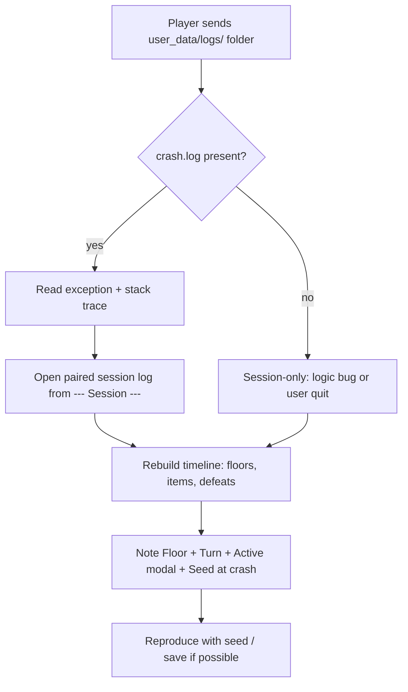

# Log interpretation guide — debug support

**Audience:** Developers and AI agents triaging player bug reports **without** prior conversation context.

**Module:** `add-debug-support` — spec: `openspec/specs/debug-support/spec.md`.  
**Implementation:** `src/debug/` — archived design: `openspec/changes/archive/2026-07-06-add-debug-support/design.md`.

If a player sends logs weeks after a crash, **read this file first**, then open the paired `crash.log` and `session_*.log`.

**User data directory** (`KD's Vore Roguelike`, via `src/user_data.py`): Windows `%LOCALAPPDATA%\KD's Vore Roguelike\`; Linux `~/.local/share/KD's Vore Roguelike/`; macOS `~/Library/Application Support/KD's Vore Roguelike/`. Diagnostic logs live under `{user_data}/logs/`.

---

## Quick start (message in a bottle)

1. **Locate files** — `{user_data}/logs/`:
   - `crash.log` — latest crash only (overwritten each crash).
   - `session_YYYY-MM-DD_HH-MM-SS.log` — one file per game launch; filename = local session start time.
2. **Open `crash.log`** — note **Game version**, **Exception**, **stack trace**, **Floor**, **Turn**, **RNG seed**, **Active modal**, **Session log** path.
3. **Open the referenced session log** — reconstruct what the player did before the crash (floors, pickups, defeats, game over, load).
4. **Reproduce** — use **RNG seed** + floor/turn/modal from crash state; stack trace points at the code path.
5. **Ignore noise** — `Dungeon regenerated` = debug hotkey R, not normal play. `Macguffin discovered: yes` is a run flag, not an open window.

**Terminology in logs:** defeated / stunned / digested — never kill / die / death.

---

## File layout

| Path | When written | Retention |
|------|----------------|-----------|
| `{user_data}/logs/crash.log` | Unhandled exception (not quit, not Ctrl+C) | Overwritten on each new crash |
| `{user_data}/logs/session_*.log` | Every launch (`python -m src.main`) | One file per launch; empty until milestones |
| `{user_data}/logs/startup_error.log` | `entities.json` hard failure at startup | **Append**; timestamped entries (`7/6/2026 9:56 AM` local) |

Logs are **local only** — no upload, no network. Same trust boundary as `{user_data}/saves/`.

**Not logged:** player display name, save file contents, per-movement/per-turn events, message log text, full entity positions on map.

---

## `crash.log` — section reference

Example shape (field order may match this; exact wording is stable per spec):

```
=== Crash Report ===
Timestamp: ...
Game version: ...
Python: ...
Platform: ...
OS: ...

--- Exception ---
<ExceptionType>: <message>

--- Stack trace ---
Traceback (most recent call last):
  ...

--- Game state ---
App phase: ...
Active modal: ...
Floor: ...
Turn: ...
RNG seed: ...
RNG state: ...
Player position: (x, y)
Player HP: current/max
Macguffin discovered: yes|no
Loaded mods: (none)

--- Session ---
Session log: {user_data}/logs/session_....log
```

### Header fields

| Field | Meaning | How to use |
|-------|---------|------------|
| **Timestamp** | UTC ISO-8601 when crash was written | Correlate with session filename (local time vs UTC). |
| **Game version** | From `pyproject.toml` / package metadata (`GAME_VERSION`) | Match to git tag or commit; `"dev"` if version could not be resolved. |
| **Python** | Interpreter version | Repro environment. |
| **Platform / OS** | `platform` module strings | OS-specific bugs (paths, tcod, threading). |

### Exception + stack trace

| Field | Meaning | How to use |
|-------|---------|------------|
| **Exception** | Type and message of the unhandled error | Primary symptom. |
| **Stack trace** | Full Python traceback | **Start here for code location.** Deepest frame in `src/` is usually the bug or trigger. |

**Not a crash:** normal quit (`SystemExit`), Ctrl+C (`KeyboardInterrupt`) — no `crash.log`.

### Game state fields

Captured from live `App` / `GameEngine` at crash time. May be partial if crash happened before PLAY (e.g. during menu).

| Field | Source | Meaning |
|-------|--------|---------|
| **App phase** | `app.phase.name` | `MENU`, `NAME_ENTRY`, `OPTIONS`, `PAST_RUNS`, `CREDITS`, `PLAY`. |
| **Active modal** | `active_modal_label(app)` | Topmost UI overlay (see table below). Rendered as `(none)` when no overlay is active. |
| **Floor** | `engine.floor_depth` | Dungeon depth (1-based). Not `game_map` tile layer. |
| **Turn** | `engine.player_turn_count` | Player turns consumed this run. |
| **RNG seed** | `engine.run_seed` | Seed used when current run/floor init started; use to reproduce RNG-heavy bugs. May be missing on old saves until save schema adds it. |
| **RNG state** | `encode_rng_state(rng.getstate())` | Full PRNG state at crash — more precise than seed alone after many turns. |
| **Player position** | `(x, y)` tile coords | Where the player stood. |
| **Player HP** | `current/max` | Combat/vore context. |
| **Macguffin discovered** | `macguffin_discovery.active` | **`yes`** = player found a victory object this run (even if they declined victory). **Not** an open modal — do not read as "macguffin window open". |
| **Loaded mods** | Reserved v1 field | Always `(none)` — official modding is not supported; field reserved for a future modding module. |

### Session cross-reference

| Field | Meaning |
|-------|---------|
| **Session log** | Relative path to the session file for **this launch**. Open it for the timeline leading to the crash. |

---

## Active modal labels (`Active modal:`)

Priority-ordered snapshot — **broader** than quit-blocking modals. First match wins.

| Label | Player-visible situation |
|-------|---------------------------|
| `new_game_confirm` | "Overwrite save?" when starting new game |
| `quit_confirm` | Quit confirmation (menu or in-game) |
| `name_entry` | Entering character name |
| `options` | Options screen |
| `past_runs` | Past runs list |
| `credits` | Credits screen |
| `game_over` | Game over screen |
| `digestion_modal` | Digestion / struggle UI |
| `vore_modal` | Engulfment-related modal |
| `ground_pickup_modal` | Pick up items from floor |
| `inventory_modal` | Inventory open |
| `macguffin_victory_confirm` | Y/n victory prompt after stepping on macguffin |
| `help_overlay` | Help (F1) |
| `log_overlay` | Full message log (Ctrl+P) |
| `examine` | Examine / description overlay |
| `rest` | Rest-until-healed animation in progress |
| `(none)` | No overlay detected — plain menu or gameplay |

**Common misread:** `macguffin_discovery` never appears here; use **Macguffin discovered: yes/no** instead.

---

## `startup_error.log` — append-only startup failures

Written when `entities.json` fails hard validation **before** the game window opens. **Appended**, not overwritten — multiple failed launches accumulate.

```
7/6/2026 9:56 AM
Unable to start the game due to JSON error.

entities.json

Entity: wolf

Problem:
spawn.min_depth cannot exceed spawn.max_depth


7/6/2026 10:02 AM
Unable to start the game due to JSON error.
...
```

| Part | Meaning |
|------|---------|
| First line | Local timestamp (`month/day/year hour:minute AM/PM`) |
| Second block | Fixed heading + same detail text as stderr/dialog |

Not written on crash or normal quit — only JSON startup validation failures.

---

## `session_*.log` — line glossary

Plain text, **one milestone per line**, **no per-line timestamps**. Order = chronological order of events.

| Line pattern | Meaning |
|--------------|---------|
| `Started new game` | New run from menu (before floor init completes). |
| `Seed: {n}` | RNG seed for this run (`run_seed`). **Use for reproduction.** |
| `Entered floor {n}` | Player on dungeon depth `n` (new game floor 1 or after descend). |
| `Loaded game` | Autosave load succeeded. |
| `Collected {name}` | Item added to inventory (`display_name` from item data). |
| `Defeated {name}` | Player caused an enemy defeat (melee, wand, or vore struggle). Name from `entity_log_name`. |
| `Game over` | Run ended (`GameOverState.open()` — defeat, digestion, macguffin victory, etc.). |
| `Quit to menu` | Ctrl+Q confirm returned to main menu (run may continue in same process). |
| `Quit` | Process exiting normally (menu Exit or window X). **Absent** after crash or bad `entities.json` startup. |
| `Dungeon regenerated` | Debug hotkey **R** — regen dungeon; **not** normal player flow. |

**Debug crash test:** hotkey **F6** during PLAY raises `ForceCrashError: F6 debug force-crash` to exercise the crash path (destructive — use a throwaway run).

### Canonical new-game opening

```
Started new game
Seed: 4839204
Entered floor 1
```

### Session end patterns

| Ending | Typical last lines |
|--------|-------------------|
| Normal exit | … `Quit` |
| Crash | No `Quit` (skipped); `crash.log` exists |
| Broken `entities.json` at startup | Session file may exist; no `Quit`; stderr + dialog + `startup_error.log` with heading **Unable to start the game due to JSON error.**; window never opened |
| Quit to menu only | `Quit to menu` then later `Quit` on full exit |

---

## How to triage a player report



### Checklist for agents

- [ ] Game version matches codebase you are debugging?
- [ ] Stack trace frame in `src/` — which system? (combat, vore, digestion, inventory, UI, save)
- [ ] **Active modal** — bug in modal input/render path?
- [ ] **Turn / floor** — late-game only? Deep floor spawn issue?
- [ ] **RNG seed** — can you start a new game with same seed and reach turn/floor?
- [ ] Session log: last events before crash (pickup, defeat, descend, game over)?
- [ ] Missing `Quit` — confirms abnormal termination?
- [ ] `Dungeon regenerated` — discard as primary repro path unless player used R?

---

## Limitations (v1)

| Topic | Limitation |
|-------|------------|
| SIGKILL / OOM / power loss | No `crash.log`; session may be incomplete |
| Loaded game `run_seed` | May be absent until save schema stores it; use **RNG state** from crash |
| Mods | Not supported — crash log always `(none)` until `deferred-add-modding-support` |
| Other JSON files | Friendly validation only for `entities.json` |
| Movement / combat detail | Not in session log — only milestones |
| Multiple crashes per session | Only **latest** `crash.log` kept |

---

## Source code map

| Concern | Location |
|---------|----------|
| Crash report format | `src/debug/crash_report.py` |
| Crash context fields | `src/debug/context.py` |
| Modal label priority | `src/debug/modal_snapshot.py` |
| Session log worker | `src/debug/session_log.py` |
| Log paths | `src/debug/paths.py` |
| Game version | `src/debug/version_info.py` |
| Milestone call sites | `src/app.py`, `src/engine.py`, `src/run_stats.py`, `src/systems/*.py` |
| Force-crash debug key (F6) | `src/debug/force_crash.py`, `src/engine.py` |
| RNG encode | `src/save/codec.py` (`encode_rng_state`) |

---

## Providing logs to Grok Build

When pasting logs into a new session, include:

1. This guide’s path: `openspec/changes/archive/2026-07-06-add-debug-support/log-interpretation-guide.md`
2. Full `crash.log` (if any)
3. Full referenced `session_*.log`
4. Optional: player description of what they were doing
5. Game version line from `crash.log`

Suggested prompt prefix:

> Interpret these KD's Vore Roguelike debug logs using `log-interpretation-guide.md`. Identify likely code area, reproduction steps from Seed/Floor/Turn, and what the session timeline shows before the crash.

---

## Changelog

| Date | Note |
|------|------|
| 2026-07-06 | Initial guide at OpenSpec bootstrap for `add-debug-support` |
| 2026-07-06 | PR5 acceptance — `(none)` modal label, F6 force-crash, archived paths |