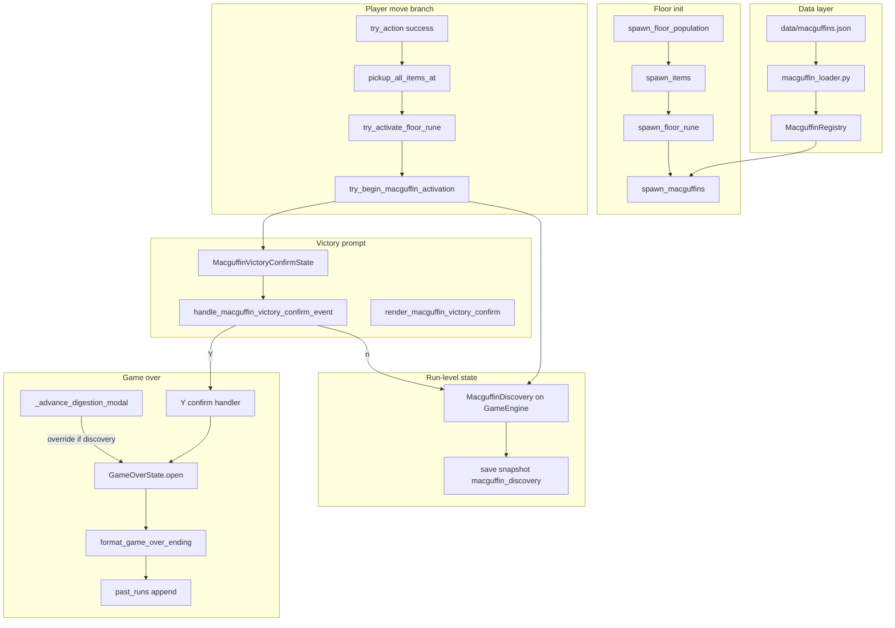

# Design: Victory Objects (Macguffins)

## Overview

Macguffins are **optional victory floor objects**: data-driven entities the player activates by stepping on them (like floor runes, not like items). Activation opens a **Y/n victory prompt**. Confirming ends the run immediately with a macguffin ending; declining removes the tile but records the discovery so a later digestion still credits the macguffin ending (e.g. **`found The Sword of Freedom!`**) in game over recap and Past Runs instead of `Digested by {predator}`.

Builds on floor-rune placement/movement patterns, quit-confirm input enforcement, and the existing `GameOverState.open()` hook used by digestion.

---

## Architecture



---

## Key Decisions

| # | Decision | Rationale |
|---|----------|-----------|
| 1 | **Separate `Macguffin` component** — do not reuse `FloorRune` | Different spawn rule (one per eligible definition, not weighted random), no `effect`/`weight`, different activation (modal + optional game over), different run-level persistence |
| 2 | **`ending_kind="macguffin"`** for both victory Y and digestion override | Past-runs spec already reserves this kind; same display string for both paths |
| 3 | **Display string (formatter default):** if `detail.startswith("The ")` → `found {detail}!`; else → `found the {detail}!` | Avoids `found the The Sword…`; preserves title-case `display_name` from JSON |
| 4 | **`ending_detail`** = macguffin `display_name` | Formatter builds the phrase; Past Runs stores structured kind + detail |
| 5 | **Discovery recorded when modal opens** (step-on), before Y/n | Ensures save/load mid-prompt and digestion override are consistent; entity removed at same moment |
| 6 | **Multiple discoveries: last found wins** for digestion override | Simple chronological rule; see Open Questions for alternatives |
| 7 | **`score` stored in JSON and optionally on `PastRunRecord`; not shown in recap v1** | Future sort/display without UI churn now |
| 8 | **Spawn after floor runes**; macguffin candidates exclude rune tiles | Keeps rune behavior unchanged; distinct tile pools composed via shared `placed_positions` |
| 9 | **Reuse placement helpers from `floor_runes.py`** (import, no duplication) | `bfs_path_distance_from`, `rune_candidates_with_path_distance`, spread filters, `choose_rune_placement` — pass cumulative `placed_positions` including rune coords |
| 10 | **Victory modal lives on `GameEngine`** (not `App`) | Gameplay-triggered; mirrors digestion/vore modal ownership |
| 11 | **Y/n enforcement** copied from `quit_confirm.py` | Capital **Y** confirms, lowercase **n** cancels; same invalid-key message pattern |
| 12 | **No new recap counter in v1** for macguffins found/declined | Discovery is ending metadata, not a run stat line item unless user approves |
| 13 | **Macguffin spawn failure raises `RunePlacementError`** | Reuses existing floor-init regen loop in `engine.py` without renaming in v1 |
| 14 | **Map pre-validation uses worst-case tile count** | `validate_rune_sites_feasible(count=RUNES_PER_FLOOR + MACGUFFINS_PER_FLOOR_MAX)` where `MACGUFFINS_PER_FLOOR_MAX = len(registry.macguffins)` (stock: 3) |
| 15 | **Zero eligible macguffins at depth** → `spawn_macguffins` returns `[]` silently | No error when `eligible_at_depth` is empty (e.g. depth 20) |
| 16 | **Partial macguffin spawn not allowed** | If any eligible definition cannot place, raise `RunePlacementError` and regen floor (match rune strictness) |
| 17 | **Engulfed players cannot activate macguffins v1** | Engine engulfed branch calls `try_struggle`, not the pickup → rune → macguffin chain |
| 18 | **`macguffin_score` on both victory Y and digestion override** | Stored on `PastRunRecord`, not displayed in recap v1 |
| 19 | **PR3 stubs CONFIRM; PR4 wires game over** | Option B: PR3 compiles without `_complete_macguffin_victory`; PR4 adds CONFIRM → game over wiring |

---

## Data model

### `data/macguffins.json`

```json
{
  "schema_version": 1,
  "macguffins": [
    {
      "id": "sword_of_freedom",
      "display_name": "The Sword of Freedom",
      "glyph": "/",
      "fg": [220, 220, 255],
      "examine": "A blade that hums with the promise of escape.",
      "min_depth": 1,
      "max_depth": 8,
      "score": 100
    }
  ]
}
```

| Field | Type | Notes |
|-------|------|-------|
| `id` | string | Unique key; stored in component and discovery state |
| `display_name` | string | Shown in prompt and ending (formatter applies article rule — see **Game over ending format**) |
| `glyph` | string (1 char) | Must not be `#`; distinct per stock item |
| `fg` | [r, g, b] | Render + optional examine highlight |
| `examine` | string | `ExamineDescription` text |
| `min_depth` / `max_depth` | int inclusive | Eligibility gate per floor |
| `score` | int ≥ 0 | Victory weight for future sort/recap; **not displayed v1** |

No `weight` field — spawn is deterministic: **one entity per eligible definition per floor**.

### Loader / registry

Mirror floor-rune layout:

| File | Role |
|------|------|
| `src/data/macguffin_loader.py` | Load `data/macguffins.json`, validation, `MacguffinLoadError` |
| `src/data/macguffin_registry.py` | Frozen `MacguffinDefinition`, `MacguffinRegistry.eligible_at_depth(depth)` |

Validation rules (align with `floor_rune_loader.py`):

- `schema_version` must be `1`
- Unique `id` values
- `min_depth <= max_depth`
- Glyph exactly one character, not `#`
- `score` non-negative integer

Document fields in `data/SCHEMA.md`.

### Stock macguffins (confirmed 2026-07-06)

| id | display_name | glyph | fg | min_depth | max_depth | score |
|----|--------------|-------|-----|-----------|-----------|-------|
| `sword_of_freedom` | The Sword of Freedom | `/` | [220, 220, 255] | 1 | 8 | 100 |
| `shield_of_justice` | The Shield of Justice | `[` | [180, 200, 255] | 4 | 12 | 150 |
| `cup_that_heals` | The Cup that Heals | `"` | [255, 220, 120] | 6 | 16 | 200 |

Depth bands stagger appearances; deeper cups score higher for future ranking.

---

## ECS component

```python
# src/components.py
@attrs.define(frozen=True)
class Macguffin:
    macguffin_id: str
```

Entity composition (same as floor runes):

- `Position`, `Renderable`, `ExamineDescription`, `Macguffin`
- `BlocksMovement` tag

**Not** added to inventory; **not** a permanent player component.

---

## Spawn system (`src/systems/macguffins.py`)

### `spawn_macguffins(...)`

```python
def spawn_macguffins(
    world: Registry,
    game_map: GameMap,
    floor_depth: int,
    *,
    rng: random.Random | None = None,
    registry: MacguffinRegistry | None = None,
    placed_positions: list[tuple[int, int]] | None = None,  # rune tiles pre-seeded
    min_distance: int = RUNE_SPAWN_MIN_DISTANCE,
    min_pairwise: int = MIN_PAIRWISE_SPREAD_BFS,
) -> list[Entity]:
```

**Early exit:** if `registry.eligible_at_depth(floor_depth)` is empty, return `[]` immediately (no error).

Algorithm per eligible definition (in stable JSON order):

1. Build candidates via `rune_candidates_with_path_distance` (exclude `enter_xy`, NPC-blocked tiles).
2. Exclude all tiles in `placed_positions` (runes + prior macguffins this floor).
3. Apply `filter_candidates_by_entrance_distance(minimum=min_pairwise)`.
4. First macguffin on floor: `choose_rune_placement` (prefer 30, relax to 20).
5. Subsequent macguffins: `filter_candidates_by_pairwise_spread` against full `placed_positions`, then `rng.choice`.
6. `spawn_macguffin_entity(world, definition, x, y)`; append position to `placed_positions`.

If no candidates remain for **any** eligible definition, raise `RunePlacementError` (triggers map regen). **No partial spawn** — all eligible definitions must place or the floor regens.

### Engine hook

Extend `_spawn_floor_population_and_runes` (rename optional in PR5):

```python
# src/engine.py — after spawn_floor_rune(...)
rune_positions = [(e.components[Position].x, e.components[Position].y) for e in runes]
spawn_macguffins(
    self.world,
    self.game_map,
    floor_depth,
    rng=self.rng,
    placed_positions=rune_positions,
)
```

**Spawn order:** NPCs → items → floor runes → macguffins.

### Map generation feasibility

Update `validate_rune_sites_feasible` call site in `src/map_gen.py`:

```python
# Worst case: all macguffins + all runes on one floor
MACGUFFINS_PER_FLOOR_MAX = len(default_macguffin_registry().macguffins)  # stock: 3
validate_rune_sites_feasible(dungeon, count=RUNES_PER_FLOOR + MACGUFFINS_PER_FLOOR_MAX)
```

**Depth overlap (stock table) — placement pressure:**

| Depth | Eligible macguffins | Total spread objects |
|-------|---------------------|----------------------|
| 1–3 | Sword only | 4 (3 runes + 1) |
| 4–5 | Sword + Shield | 5 |
| **6–8** | **Sword + Shield + Cup** | **6** |
| 9–12 | Shield + Cup | 5 |
| 13–16 | Cup only | 4 |

PR2 fixture test: arena placing 3 runes + 3 macguffins at depth 7 (mirror `rune_test_helpers.py`).

---

## Movement passthrough

Extend `src/systems/movement.py` `_blocking_entity_at`:

```python
if Player in mover.tags and entity.components.get(FloorRune) is not None:
    continue
if Player in mover.tags and entity.components.get(Macguffin) is not None:
    continue
```

NPCs remain blocked by `BlocksMovement` on macguffin entities.

---

## Engine move branch (deferred turn consumption)

Today (`engine.py` ~1088–1105) the branch unconditionally calls `_consume_player_turn()` after `try_activate_floor_rune`. Macguffins require **conditional** consumption:

```python
elif try_action(...):
    pos = self.player.components[Position]
    pickup_all_items_at(
        self.world,
        self.player,
        pos.x,
        pos.y,
        self.message_log,
    )
    try_activate_floor_rune(
        self.world,
        self.player,
        pos.x,
        pos.y,
        self.message_log,
        screen_flash=self.screen_flash,
        run_stats=self.run_stats,
    )
    if try_begin_macguffin_activation(
        self,
        self.player,
        pos.x,
        pos.y,
    ):
        pass  # turn consumed when modal resolves (n) or on game over (Y, PR4)
    else:
        self._consume_player_turn()
```

**Engulfed / stunned players** never reach this branch (engulfed → `try_struggle`; stunned → log + consume). Macguffin activation is unavailable v1 for engulfed players — intentional.

---

## Activation flow

### `MacguffinVictoryConfirmState`

```python
# src/macguffin_victory_confirm.py
@attrs.define
class MacguffinVictoryConfirmState:
    display_name: str = ""
    macguffin_id: str = ""
    score: int = 0
    error_message: str = ""

    @property
    def active(self) -> bool:
        return bool(self.macguffin_id)

    def open(self, *, macguffin_id: str, display_name: str, score: int) -> None:
        self.macguffin_id = macguffin_id
        self.display_name = display_name
        self.score = score
        self.error_message = ""

    def reset(self) -> None:
        self.macguffin_id = ""
        self.display_name = ""
        self.score = 0
        self.error_message = ""
```

On `GameEngine`: `self.macguffin_victory_confirm = MacguffinVictoryConfirmState()`.

### Step-on entry (`try_begin_macguffin_activation`)

Called from engine move branch **after** `try_activate_floor_rune`:

```python
try_begin_macguffin_activation(
    engine,  # or world + discovery + modal state
    player,
    x, y,
) -> bool  # True if modal opened
```

Guard conditions:

- Player tag only
- No macguffin if `macguffin_victory_confirm.active` already
- Query `world.Q.all_of(tags=[Position(x,y)], components=[Macguffin])`

On success:

1. Resolve definition from registry.
2. **`discovery.record(definition)`** — see run state below.
3. **Remove macguffin entity** (`entity.clear()`).
4. Call `macguffin_victory_confirm.open(macguffin_id=..., display_name=..., score=...)`.
5. Return `True` (caller skips `_consume_player_turn()` — see **Engine move branch**).

### Turn consumption

While victory confirm is active, **block further movement** (same as inventory modal). Turn is **not** consumed at step-on:

| Resolution | Turn consumption |
|------------|------------------|
| **n** (PR3) | `_consume_player_turn()` when modal closes |
| **Y** (PR4) | Game over opens; no separate consume needed |
| **Save during modal** | Blocked via `modal_blocks_quit()` / idle gate; turn count unchanged at step-on |
| **Load during modal** | Modal reset; discovery persisted; player resumes with **same turn count** as step-on (generous but acceptable — note in PR4 checklist) |

### Victory prompt module

New file `src/macguffin_victory_confirm.py` (parallel to `quit_confirm.py`):

```python
MACGUFFIN_VICTORY_INVALID = "Please type capital 'Y' or lowercase 'n' only."

def victory_prompt(display_name: str) -> str:
    return f"You have found {display_name}! Would you like to end your run in victory? (Y/n)"
```

| Input | Action |
|-------|--------|
| Shift+Y | `CONFIRM` → game over (PR4 wires handler; PR3 stub only) |
| n (no shift) | `CANCEL` → close modal, continue run |
| Other keys | Set `error_message`, `NONE` |

Render centered on root console (gold prompt, orange error) — same layout as `render_quit_confirm`. Wrap prompt text with `cp437_safe()` (including `display_name`).

### Engine event integration

**PR3** — modal handling without game over (CONFIRM stubbed):

```python
if self.macguffin_victory_confirm.active:
    action = handle_macguffin_victory_confirm_event(
        self.macguffin_victory_confirm, event
    )
    if action is CONFIRM:
        pass  # PR4: self._complete_macguffin_victory()
    elif action is CANCEL:
        self.macguffin_victory_confirm.reset()
        self._consume_player_turn()
    return EngineEventResult.CONTINUE
```

**PR4** — replace CONFIRM stub with `self._complete_macguffin_victory()`.

Add to `modal_blocks_quit()` (PR3):

```python
or self.macguffin_victory_confirm.active
```

Render in `GameEngine.render` when active (root console overlay). **No screen flash** on macguffin step-on v1 (deliberate omission vs runes).

### Y — victory game over (PR4)

```python
def _complete_macguffin_victory(self) -> None:
    confirm = self.macguffin_victory_confirm
    self.macguffin_victory_confirm.reset()
    save_store = ...
    if self.save_coordinator is not None:
        self.save_coordinator.prepare_for_game_over_wipe()
        save_store = self.save_coordinator.store
    self.game_over.open(
        player_name=self.player_name,
        ending=GameOverEnding(
            kind="macguffin",
            detail=confirm.display_name,
        ),
        monsters_defeated=self.run_stats.monsters_defeated,
        runes_collected=self.run_stats.runes_collected,
        depth=self.floor_depth,
        save_store=save_store,
        past_runs_store=self.past_runs_store,
        macguffin_score=confirm.score,  # optional PR4 field
    )
```

Same recap → Enter → menu flow as digestion (`EngineEventResult.RECAP_DISMISSED`).

### n — decline

- Close modal.
- Discovery already recorded; tile already removed.
- **No** message-log line on decline (user decision 2026-07-06).
- Run continues normally.

---

## Run-level discovery state

```python
# src/macguffin_discovery.py
@attrs.define
class MacguffinDiscovery:
    macguffin_id: str = ""
    display_name: str = ""
    score: int = 0

    @property
    def active(self) -> bool:
        return bool(self.macguffin_id)

    def record(self, definition: MacguffinDefinition) -> None:
        self.macguffin_id = definition.id
        self.display_name = definition.display_name
        self.score = definition.score

    def reset(self) -> None:
        ...
```

On `GameEngine`:

- `self.macguffin_discovery = MacguffinDiscovery()` — reset in `new_game()`.
- **Overwrite on each new discovery** (last-found-wins).

### Digestion override (PR4)

In `_advance_digestion_modal`, replace unconditional digested ending:

```python
if self.macguffin_discovery.active:
    ending = GameOverEnding(
        kind="macguffin",
        detail=self.macguffin_discovery.display_name,
    )
    macguffin_score = self.macguffin_discovery.score
else:
    ending = GameOverEnding(kind="digested", detail=digested_by)
    macguffin_score = None

self.game_over.open(
    player_name=self.player_name,
    ending=ending,
    monsters_defeated=self.run_stats.monsters_defeated,
    runes_collected=self.run_stats.runes_collected,
    depth=self.floor_depth,
    save_store=save_store,
    past_runs_store=self.past_runs_store,
    macguffin_score=macguffin_score,
)
```

Predator digestion still completes mechanically; only the **recorded ending** changes. Recap and Past Runs show **macguffin ending only** — no mention of predator (moral victory despite digestion). Same `macguffin_score` wiring as victory Y.

---

## Game over ending format (PR4)

Update `src/game_over_ending.py`:

```python
case "macguffin":
    detail = ending.detail
    if detail.startswith("The "):
        return f"found {detail}!"
    return f"found the {detail}!"
```

Examples:

- Victory Y on Sword (`detail="The Sword of Freedom"`): `found The Sword of Freedom!`
- Shield: `found The Shield of Justice!`
- Hypothetical `detail="golden chalice"`: `found the golden chalice!`
- Digestion override after declining Cup: same macguffin string instead of `Digested by wolf`.

Update `tests/test_game_over_ending.py` — replace stub; use `GameOverEnding(kind="macguffin", detail="The Sword of Freedom")`.

### `GameOverState.open()` signature (PR4)

Extend `open()` with optional kwarg:

```python
def open(
    self,
    *,
    player_name: str,
    ending: GameOverEnding,
    monsters_defeated: int,
    runes_collected: int,
    depth: int,
    save_store: object | None = None,
    past_runs_store: object | None = None,
    macguffin_score: int | None = None,
) -> None:
```

Pass `macguffin_score` into `PastRunRecord` on append.

### Past Runs record (PR4)

Extend `PastRunRecord` with optional `macguffin_score: int | None = None` for storage only. Update `record_to_dict` / `parse_record`. Omit from Past Runs screen lines in v1. Backward-compatible decode (missing → `None`). Populated on **both** victory Y and digestion override paths.

**Interim spec note:** update `past-runs/spec.md` macguffin display row in PR4 when formatter lands (do not wait for PR5).

---

## Save / load

### Entity codec

In `src/save/codec.py`, mirror `FloorRune`:

```python
# encode
if Macguffin in entity.components:
    components["Macguffin"] = {"macguffin_id": entity.components[Macguffin].macguffin_id}

# decode
if "Macguffin" in components:
    entity.components[Macguffin] = Macguffin(macguffin_id=str(...))
```

Unpicked macguffins on the floor round-trip. Consumed macguffins are gone from entities; discovery state covers “already found”.

### Run snapshot

Add to `build_run_snapshot` / `apply_run_snapshot`:

```json
"macguffin_discovery": {
  "macguffin_id": "sword_of_freedom",
  "display_name": "The Sword of Freedom",
  "score": 100
}
```

Omit key or use empty strings when no discovery (`decode` → inactive `MacguffinDiscovery`).

**Do not** persist `macguffin_victory_confirm` modal — on load, modal is closed; discovery + absent entity reflect post-step-on state.

### Lifecycle reset matrix

| Hook | `macguffin_discovery` | `macguffin_victory_confirm` |
|------|----------------------|------------------------------|
| `new_game()` | `reset()` | `reset()` |
| `descend_floor()` | **preserve** (run-level) | `reset()` |
| `apply_run_snapshot()` | **decode from `macguffin_discovery` key** | `reset()` (never restore modal) |
| `build_run_snapshot()` | **encode** via `encode_macguffin_discovery()` | not serialized |

Concrete `apply_run_snapshot` additions (PR3):

```python
engine.macguffin_discovery = decode_macguffin_discovery(run.get("macguffin_discovery"))
engine.macguffin_victory_confirm.reset()
```

Add `macguffin_victory_confirm` to save-load spec **ephemeral UI not persisted** list in PR5.

---

## Interaction summary

| Scenario | Tile | Discovery state | Game over ending |
|----------|------|-----------------|------------------|
| Step on, press Y | Removed | Recorded | `macguffin` / `found The …!` |
| Step on, press n | Removed | Recorded | (continue) |
| Later digested after decline | — | Still recorded | `macguffin` override, not digested |
| Step on, save during prompt | Removed | In snapshot | Load resumes without modal; override intact; same turn count |
| Never found macguffin | — | Empty | `digested` as today |
| Find A, decline, find B, decline, digested | — | B (last wins) | `found The Cup that Heals!` |
| Engulfed on macguffin tile | — | Unchanged | Cannot step on (v1) |

---

## Tests strategy (per PR)

| PR | Automated tests | Focus |
|----|-----------------|-------|
| PR1 | `tests/test_macguffins_pr1.py` | JSON load/validation; `eligible_at_depth`; stock ids |
| PR2 | `tests/test_macguffins_pr2.py` | Spawn count per depth; distinct tiles; spread vs runes; NPC block; player passthrough; codec round-trip; depth-7 fixture (3 runes + 3 macguffins) |
| PR3 | `tests/test_macguffins_pr3.py` | Step-on opens modal; Y/n key enforcement; entity removed; discovery recorded; modal blocks quit; **deferred turn** (n consumes, Y stub no-op); **apply_run_snapshot** decode; **no** ending-string assertions |
| PR4 | `tests/test_macguffins_pr4.py` | CONFIRM → `game_over.active` + ending; digestion override + `macguffin_score`; `format_game_over_ending`; past run append; mid-modal load turn count |
| PR5 | Extend `tests/test_acceptance.py` if needed | Full suite green; spec sync |

Fixture helpers: `tests/macguffin_test_helpers.py` (mirror `rune_test_helpers.py`).

---

## PR Plan

### PR0 — OpenSpec bootstrap

- `proposal.md`, `design.md`, `tasks.md`
- `testing-checklist-pr0.md` … stubs for PR1–PR5
- No gameplay code

### PR1 — Data catalog

- `data/macguffins.json` (stock three)
- `macguffin_loader.py`, `macguffin_registry.py`
- `data/SCHEMA.md`
- `tests/test_macguffins_pr1.py`

### PR2 — Spawn and render

- `Macguffin` component; `spawn_macguffins()`; `spawn_macguffin_entity()`
- Engine hook after `spawn_floor_rune`; pass rune positions
- Movement passthrough; save codec
- `MACGUFFINS_PER_FLOOR_MAX` + map_gen feasibility bump
- `tests/test_macguffins_pr2.py`

### PR3 — Step-on, modal, discovery (no game over yet)

- `macguffin_victory_confirm.py` + `MacguffinVictoryConfirmState`
- `MacguffinDiscovery` + `encode/decode` + `build_run_snapshot` / **`apply_run_snapshot`** (lifecycle matrix)
- `try_begin_macguffin_activation`; engine move branch with **deferred turn**
- `handle_event` / render / `modal_blocks_quit` — **CONFIRM stubbed** (`pass`)
- `tests/test_macguffins_pr3.py` — modal, discovery, turn deferral only

### PR4 — Game over, digestion override, formatter

- Wire CONFIRM → `_complete_macguffin_victory()`
- `format_game_over_ending` with article rule
- Digestion path override + **`macguffin_score` on both paths**
- Extend `GameOverState.open`, `PastRunRecord`, `record_to_dict`, `parse_record`
- Interim `past-runs/spec.md` macguffin row update
- Update `tests/test_game_over_ending.py`, `tests/test_macguffins_pr4.py`

### PR5 — Spec sync and acceptance

- `openspec/specs/macguffins/spec.md`
- Update floor-runes, past-runs, save-load specs
- `README.md` mention; `acceptance-report.md`
- Archive change folder
- Full `pytest tests/`

---

## Open Questions

All items resolved (user sign-off 2026-07-06). See **Resolved decisions** below.

---

## Risks

| Risk | Mitigation |
|------|------------|
| **Tighter placement** — up to 6 spread objects per floor (3 runes + 3 macguffins) on depths 6–8 | Bump `validate_rune_sites_feasible` count; stagger depth bands; PR2 depth-7 fixture test |
| **NPC blocking not in map validation** | `occupied_rune_blocked_tiles` excludes NPCs at spawn time but `validate_rune_sites_feasible` does not — pre-existing; worse with 6 objects. Expect more runtime `RunePlacementError` than validation suggests |
| **Validation heuristic ≠ spawn heuristic** | Map gen uses chebyshev-quartile greedy (`_can_select_spread_positions`); runtime uses BFS entrance filter + `choose_rune_placement` preferring 30. Pre-existing rune mismatch amplified by six-object floors |
| **All-or-nothing macguffin spawn** | Third macguffin failure regens entire floor even if 2+3 runes fit — document regen cost; no partial spawn v1 |
| **Modal + turn edge cases** — saving or quitting during prompt | Modal not persisted; discovery + entity removal at open; quit blocked via `modal_blocks_quit`; load resumes with same turn count |
| **PR3/PR4 compile dependency** | Option B: PR3 stubs CONFIRM; PR4 wires game over |
| **Circular imports** if macguffins and floor_runes cross-import | Macguffins imports placement helpers from `floor_runes`; floor_runes does not import macguffins |
| **Test flakiness** on spread placement | Use fixture arenas (`macguffin_test_helpers.py`) like floor-rune tests |
| **Past-runs spec drift** | PR4 interim spec row update; PR5 full sync |

---

## Resolved decisions

| # | Decision | Status |
|---|----------|--------|
| 1 | Stock macguffin table (depths, glyphs, fg, examine, score) | **Resolved** — user approved as proposed |
| 2 | Multiple finds → last found wins digestion override | **Resolved** |
| 3 | `score` not shown in recap or Past Runs v1 | **Resolved** |
| 4 | No decline counter in v1 | **Resolved** |
| 5 | Spawn after runes; shared `placed_positions` | **Resolved** |
| 6 | Formatter article rule | **Resolved** |
| 7 | `ending_kind="macguffin"` | **Resolved** |
| 8 | **No** log message on decline | **Resolved** — user 2026-07-06 |
| 9 | Engulfed players cannot activate macguffins v1 | **Resolved** |
| 10 | No partial macguffin spawn | **Resolved** |
| 11 | `macguffin_score` on digestion override path | **Resolved** |
| 12 | Digestion override recap shows macguffin ending only (no predator line) | **Resolved** — user 2026-07-06 |
| 19 | PR3 stubs CONFIRM; PR4 wires game over (Option B) | **Resolved** |