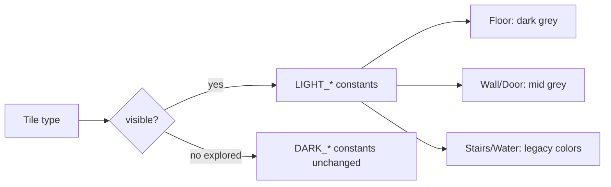
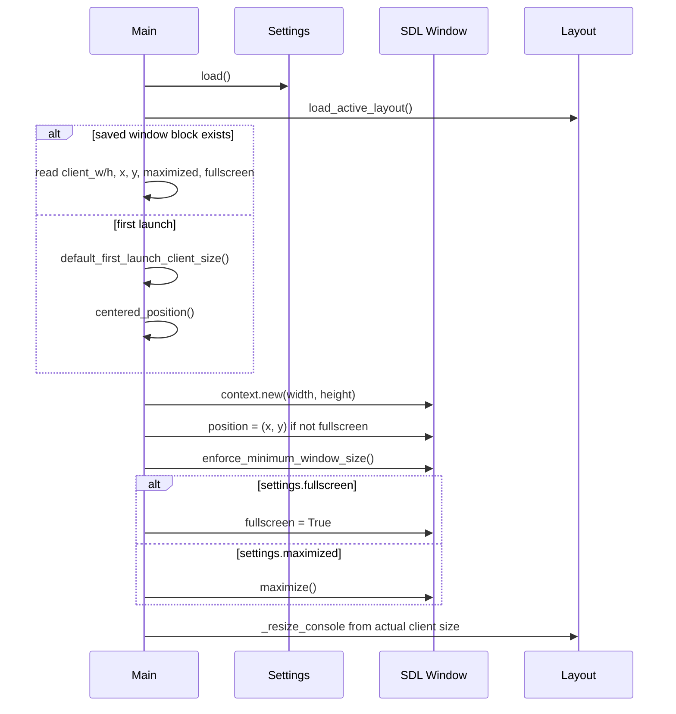

# Design: Map Colors & Window Handling

| Field | Value |
|-------|-------|
| **Date** | 2026-07-06 |
| **Status** | Draft — **user decisions locked** |
| **Change name** | `tweak-map-colors-and-window` |
| **Artifacts** | `openspec/changes/tweak-map-colors-and-window/{proposal.md, design.md, tasks.md, testing-checklist-prN.md}` |
| **Spec targets** | `openspec/specs/core-roguelike/spec.md`, `openspec/specs/ui-layout/spec.md`, `openspec/specs/main-menu/spec.md` |
| **Depends on** | `src/user_data.py` (`SETTINGS_PATH`), `SaveCoordinator` / `SessionLogCoordinator` threading patterns |

---

## Summary

Two independent tweaks shipped as one OpenSpec change:

1. **Palette** — Replace gold/brown **visible** floor, wall, and door foreground colors in `src/systems/render.py` with dark grey (floor) and mid grey (walls, doors). Leave `DARK_*` explored-memory colors, stairs, and water unchanged.
2. **Window lifecycle** — Persist window client geometry and mode to `{user_data}/settings.json`, compute a sensible first-launch size from the primary display, restore maximized state, and add an immediate fullscreen toggle in Options using borderless desktop fullscreen via tcod's SDL window.

---

## Background: Current State

### Map colors (`src/systems/render.py`)

```python
LIGHT_WALL = (130, 110, 50)
LIGHT_FLOOR = (200, 180, 50)
LIGHT_DOOR = (160, 120, 60)
# DARK_* use blue tint for explored-only memory — unchanged
```

`_tile_glyph_and_fg()` selects `LIGHT_*` when `game_map.visible`, else `DARK_*`.

### Window startup (`src/main.py`)

```python
pixel_w, pixel_h = window_pixel_size(baseline, baseline.root_cols, baseline.root_rows)
# Always design root → 80×50 × 12×2 = 1360×768 client pixels
with tcod.context.new(..., width=pixel_w, height=pixel_h) as context:
    enforce_minimum_window_size(context, baseline)
```

No read of saved geometry. No display-size query. `context.sdl_window` exposes `size`, `position`, `flags` (incl. `MAXIMIZED`), and `fullscreen` (wraps `SDL_SetWindowFullscreen`).

### Settings (`src/settings_store.py`)

`settings.json` today:

```json
{
  "vore_content": { "enabled": ["AV", "CV", "OV"] },
  "ui_preset": "standard"
}
```

No window block. Saves are synchronous on the main thread when Options changes vore/UI prefs.

### Deferred work

`openspec/changes/archive/2026-07-02-add-ui-overhaul/tasks.md` **PR13** listed a fullscreen toggle but was never implemented. This change absorbs that scope plus persistence and first-launch sizing.

---

## Goals & Non-Goals

### Goals

1. Neutral grey visible terrain (floor dark, walls/doors mid).
2. Persist window client width/height, screen position, maximized, fullscreen preference.
3. First launch: windowed, display minus 48 px/edge, ≥ minimum.
4. Restore maximized when user closed maximized.
5. Options fullscreen toggle with session-correct restore semantics.
6. Resize persistence on a **background worker** (never block main thread on disk I/O during drag-resize).

### Non-Goals

- Stairs/water/explored palette changes
- Exclusive fullscreen
- Multi-monitor picker
- Settings migration from old project-dir copies
- Lowering the 1360×768 minimum

---

## Proposed Design

### 1. Map tile colors (PR1)

**File:** `src/systems/render.py`

| Constant | Current (visible) | Proposed (visible) | Rationale |
|----------|-------------------|--------------------|-----------|
| `LIGHT_FLOOR` | `(200, 180, 50)` | `(72, 72, 72)` | Dark grey floor |
| `LIGHT_WALL` | `(130, 110, 50)` | `(140, 140, 140)` | Mid grey walls |
| `LIGHT_DOOR` | `(160, 120, 60)` | `(140, 140, 140)` | Mid grey doors (same as walls) |
| `DARK_FLOOR` | `(50, 50, 150)` | *unchanged* | Blue explored memory |
| `DARK_WALL` | `(0, 0, 100)` | *unchanged* | |
| `DARK_DOOR` | `(70, 50, 30)` | *unchanged* | |
| `LIGHT_STAIRS`, `DARK_STAIRS`, `LIGHT_WATER`, `DARK_WATER` | *unchanged* | *unchanged* | Per user scope |

**Tests:** `tests/test_map_tile_colors.py` — assert `_tile_glyph_and_fg` returns expected RGB for visible floor/wall/door; stairs/water still use gold/blue visible colors.

No JSON or spec data changes for colors.



---

### 2. Settings schema extension (PR2)

Add optional `window` object to `settings.json`:

```json
{
  "vore_content": { "enabled": ["AV", "CV", "OV"] },
  "ui_preset": "standard",
  "window": {
    "client_width": 1600,
    "client_height": 900,
    "x": 120,
    "y": 80,
    "maximized": false,
    "fullscreen": false
  }
}
```

**`WindowPreferences` dataclass** (in `src/settings_store.py` or `src/ui/window_state.py`):

| Field | Type | Default | Notes |
|-------|------|---------|-------|
| `client_width` | int | from first-launch helper | Client area pixels |
| `client_height` | int | from first-launch helper | |
| `x` | int | centered | Screen position |
| `y` | int | centered | |
| `maximized` | bool | `false` | Last non-fullscreen chrome state |
| `fullscreen` | bool | `false` | User preference; default off |

**Validation on load:**

- Missing `window` key → synthesize defaults via first-launch sizing helper (not persisted until first resize or quit).
- Clamp `client_width` / `client_height` to ≥ `DESIGN_PIXEL_WIDTH` / `DESIGN_PIXEL_HEIGHT` (1360×768).
- Negative positions allowed (multi-monitor); no clamp unless SDL restore fails (best-effort).

**`SettingsStore` changes:**

- Add `window: WindowPreferences` field.
- `from_dict` / `to_dict` round-trip `window` block.
- `set_window(...)` updates in-memory state (does not write disk — coordinator handles persistence).
- `set_fullscreen(enabled: bool)` for Options toggle (updates preference + triggers immediate SDL + enqueue persist).

Existing `set_vore_content` / `set_ui_preset` remain synchronous save **or** migrate all saves through coordinator in PR2. **Decision:** keep vore/UI preset saves synchronous (infrequent); only window geometry uses the async coordinator to satisfy the resize requirement without refactoring unrelated paths.

---

### 3. First-launch client size (PR2)

**Module:** `src/ui/window_state.py`

```python
DISPLAY_INSET_PX = 48  # per edge

def primary_desktop_pixel_size() -> tuple[int, int]:
    """SDL primary display desktop mode (full display resolution)."""

def default_first_launch_client_size(layout: UILayout) -> tuple[int, int]:
    display_w, display_h = primary_desktop_pixel_size()
    w = max(minimum_window_pixels(layout)[0], display_w - 2 * DISPLAY_INSET_PX)
    h = max(minimum_window_pixels(layout)[1], display_h - 2 * DISPLAY_INSET_PX)
    return w, h

def centered_position(client_w: int, client_h: int) -> tuple[int, int]:
    """Center window on primary display."""
```

**SDL access:** use `tcod.cffi.lib` — `SDL_GetPrimaryDisplay()`, `SDL_GetDesktopDisplayMode(display, mode)` — wrapped in a small helper with fallback to design minimum if SDL call fails (headless tests).

**First launch detection:** `window` key absent from loaded settings (not merely default-valued fields after failed parse).

---

### 4. Startup sequence (PR2)

**File:** `src/main.py`



**Order matters:**

1. Create context at clamped client size (even if maximizing/fullscreen will follow).
2. Set `position` before `show` if possible (tcod context is open).
3. Apply `enforce_minimum_window_size` (SDL min client size).
4. If `fullscreen` preference: set `window.fullscreen = True` (captures no session snapshot — fresh launch).
5. Else if `maximized`: call `window.maximize()`.
6. Derive initial console from **actual** `window.size` after mode application.

---

### 5. Resize persistence — background worker (PR2)

**New module:** `src/settings_coordinator.py`

Mirror `SessionLogCoordinator` / `SaveCoordinator`:

- Daemon thread `settings-coordinator`.
- `threading.Condition` + coalesced pending snapshot (`dict` from `SettingsStore.to_dict()`).
- `enqueue(settings: SettingsStore)` — main thread copies `to_dict()` under lock; notify worker.
- Worker: `json.dumps` + atomic write to `SETTINGS_PATH` (write temp + replace, or direct write matching existing `SettingsStore.save()`).
- `close()` / `flush()` for shutdown and tests.

**Hook:** `src/main.py` `_handle_loop_event` on `WindowResized`:

1. Existing resize → `_resize_console` path unchanged.
2. After clamp, read `context.sdl_window`: `size`, `position`, `flags & MAXIMIZED`.
3. Update `app.settings.window` fields (skip if `fullscreen` active — do not overwrite stored windowed client size with fullscreen dimensions).
4. `settings_coordinator.enqueue(app.settings)`.

Also enqueue on:

- Quit / `SystemExit` from `main()` `finally` (flush coordinator).
- Fullscreen toggle off (after restore completes).
- Fullscreen toggle on (persist preference `fullscreen: true`).

**While fullscreen:** do not update `client_width`/`client_height`/`maximized` from resize events (fullscreen owns dimensions). Still persist `fullscreen: true` when toggled on.

---

### 6. Fullscreen & maximized state machine (PR2)

**Session-only snapshot** (`WindowSessionState` in `src/ui/window_state.py`):

```python
@attrs.define
class WindowSessionState:
    client_width: int
    client_height: int
    x: int
    y: int
    maximized: bool
```

Held on `App` or a small `WindowController` owned by `App`. **Not** written to disk as a separate file.

**Enter fullscreen** (Options toggle On, or launch with saved `fullscreen: true` without snapshot):

1. If not already fullscreen: capture `WindowSessionState` from current SDL window (size, position, `flags & MAXIMIZED`).
2. `window.fullscreen = True`.
3. `settings.window.fullscreen = True`; enqueue persist.

**Exit fullscreen** (Options toggle Off):

1. `window.fullscreen = False`.
2. Restore from `WindowSessionState`:
   - If `maximized`: `window.maximize()` (SDL handles geometry).
   - Else: set `window.size` and `window.position` to snapshot values; run through `enforce_minimum_window_size`.
3. `settings.window.fullscreen = False`; update persisted `maximized` from snapshot; enqueue persist.
4. Re-resolve console from resulting client size.

**Chain example (user requirement):**

`Windowed → Maximized → Fullscreen → Not Fullscreen → Maximized`

- Snapshot taken at fullscreen entry records `maximized=True`.
- Exit fullscreen calls `maximize()`, not raw size.

**Launch with `fullscreen: true`:** no session snapshot exists; exit fullscreen restores to persisted `client_*`, `x`, `y`, `maximized` from settings (last saved non-fullscreen state).

**Maximized close / reopen:**

- On resize events while maximized, persist `maximized: true` and also persist last known **restored** client size (from unmaximized geometry if available; otherwise keep previous stored windowed size).
- Implementation: when `MAXIMIZED` flag set, still persist `maximized: true`; update `client_width`/`client_height` only when not maximized and not fullscreen (keeps stable restore size for when user un-maximizes).

---

### 7. Options menu (PR2)

**File:** `src/options_menu.py`

Add row after UI Layout:

```
Fullscreen:  Off ► On
```

- Row index: `FULLSCREEN_ROW_INDEX = UI_LAYOUT_ROW_INDEX + 1`
- `option_row_count()` += 1
- Left/Right or Enter toggles `settings.set_fullscreen(not current)` which:
  1. Runs state machine (§6)
  2. If `console` and `context` available (via `app.handle_event` callback), re-resolves layout immediately
  3. Enqueues settings persist

**`src/app.py`:** extend options handler to pass `context` into fullscreen toggle (same pattern as `ui_preset` layout refresh).

Display: highlighted row shows `[Off]` or `[On]` bracket style matching UI layout row.

---

### 8. API summary

| Symbol | Module | Role |
|--------|--------|------|
| `LIGHT_FLOOR`, `LIGHT_WALL`, `LIGHT_DOOR` | `render.py` | New grey RGB |
| `WindowPreferences` | `window_state.py` | Settings block |
| `WindowSessionState` | `window_state.py` | Pre-fullscreen snapshot |
| `default_first_launch_client_size` | `window_state.py` | Display − inset |
| `apply_startup_window` | `window_state.py` | SDL restore after context open |
| `capture_window_state` | `window_state.py` | Read SDL → preferences |
| `toggle_fullscreen` | `window_state.py` | Enter/exit with session rules |
| `SettingsCoordinator` | `settings_coordinator.py` | Async settings.json writer |

---

## Alternatives Considered

| Alternative | Why rejected |
|-------------|--------------|
| SDL usable bounds for first launch | User chose full display minus fixed 48 px/edge |
| Persist only on quit | User requires every resize event |
| Synchronous settings write on resize | Blocks main thread during drag; violates user requirement |
| Store fullscreen dimensions as windowed size | Breaks restore when exiting fullscreen |
| Separate `window.json` file | User expects AppData `settings.json`; one file is simpler |
| Exclusive fullscreen | User chose borderless desktop |

---

## Testing Strategy

### PR1

- `tests/test_map_tile_colors.py` — unit tests on `_tile_glyph_and_fg` visible colors.

### PR2

- `tests/test_window_state.py` — first-launch size formula (mock display), clamp to minimum, centered position math.
- `tests/test_settings_coordinator.py` — coalescing, worker writes, `flush()`.
- `tests/test_settings_store_window.py` — schema round-trip, missing `window` defaults, clamp invalid sizes.
- `tests/test_options_fullscreen.py` — row count, toggle updates `settings.window.fullscreen` (mock SDL window).

Manual playtest checklists per PR (see `testing-checklist-prN.md`).

---

## Resolved Decisions

| Topic | Decision |
|-------|------------|
| Visible floor color | Dark grey `(72, 72, 72)` — adjustable |
| Visible wall/door color | Mid grey `(120, 120, 120)` (tuned during PR1 playtest) |
| Explored dimming | Unchanged blue `DARK_*` |
| Persist timing | Every resize and move (`WindowMoved`); quit syncs SDL position; background `settings-coordinator` thread |
| First-launch formula | `desktop − 96` per axis, clamp ≥ 1360×768 |
| Fullscreen API | `tcod.sdl.video.Window.fullscreen` (borderless desktop) |
| Exit fullscreen | Session snapshot; maximized restored when applicable |
| vore/ui_preset saves | Stay synchronous; window block async |

---

## PR Plan

### PR0 — OpenSpec bootstrap

- This folder, WORKFLOW pointer, checklist stubs, user review.

### PR1 — Grey map tile colors

- `src/systems/render.py` constants
- `tests/test_map_tile_colors.py`
- Manual checklist PR1

### PR2 — Window persistence & fullscreen

- `src/ui/window_state.py`
- `src/settings_coordinator.py`
- `src/settings_store.py` window block
- `src/main.py` startup + resize hooks + coordinator lifecycle
- `src/options_menu.py`, `src/app.py` fullscreen row
- Tests listed above
- Manual checklist PR2

### PR3 — Spec sync & acceptance

- Update `core-roguelike`, `ui-layout`, `main-menu` specs
- `README.md` brief note under User data / Options
- `acceptance-report.md`
- Archive to `openspec/changes/archive/2026-07-06-tweak-map-colors-and-window/`
- Full `pytest tests/`
- Final manual checklist PR3

---

## Key Decisions

1. **Grey palette only for visible floor/walls/doors** — preserves stair/water affordances and explored-memory blue tint without re-tuning FOV readability.
2. **Window geometry in `settings.json`** — single AppData file aligned with existing Options persistence; no migration.
3. **Async coordinator only for window-driven saves** — satisfies resize-frequency requirement without refactoring vore/UI preset paths.
4. **Session snapshot for fullscreen exit** — implements the Windowed→Maximized→Fullscreen→Maximized chain; persisted settings hold long-term preference and last windowed geometry.
5. **First-launch inset of 48 px/edge on full desktop display** — simple cross-platform rule; clamped to existing 1360×768 minimum.
6. **Two implementation PRs** — map colors independently shippable; window work bundles deferred ui-overhaul PR13.