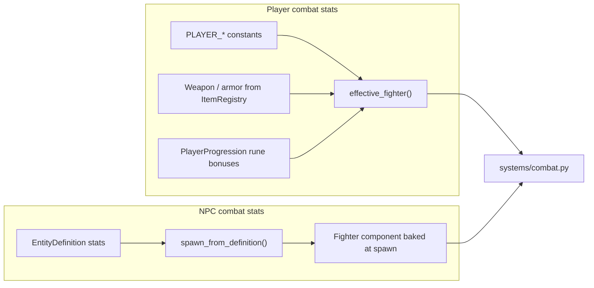
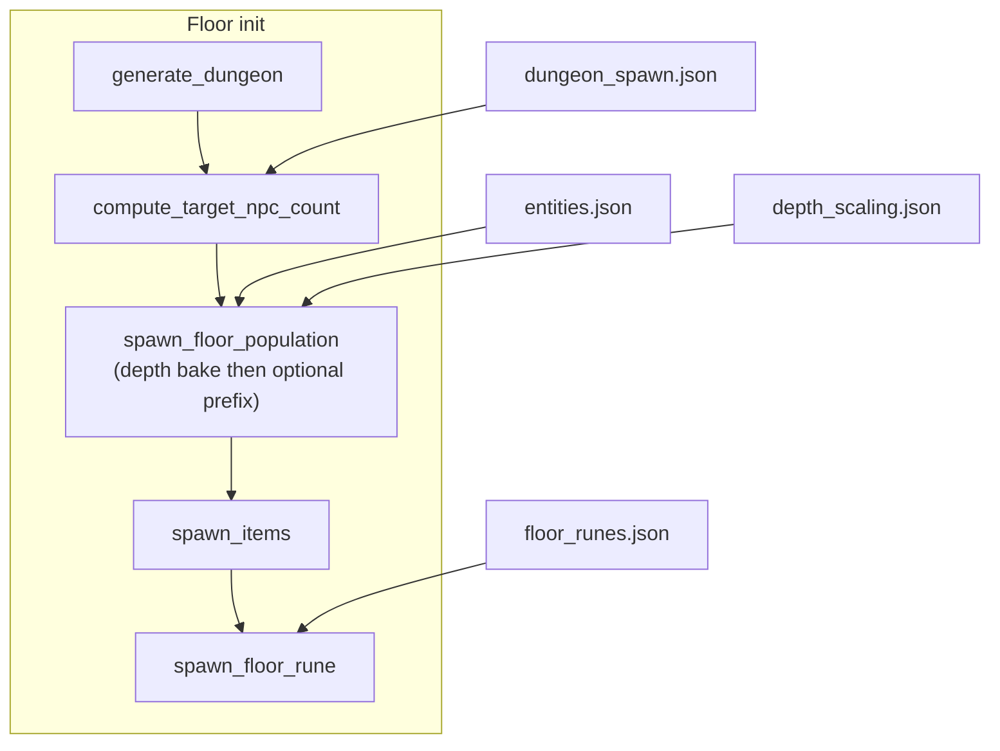
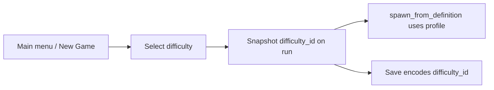
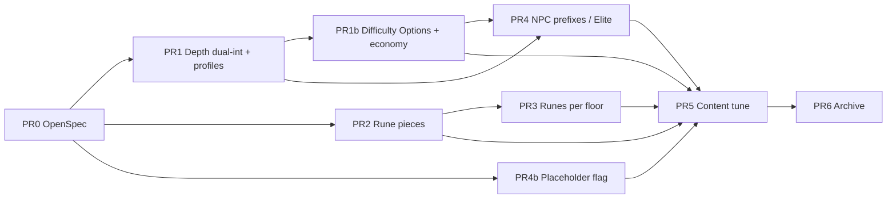

# Design: Data-Driven Balance Knobs

| Field | Value |
|-------|-------|
| **Author** | *(TBD — promote to named author when opening OpenSpec change)* |
| **Date** | 2026-07-09 |
| **Status** | Draft (revised — prefixes/Elite, Past Runs difficulty, rejections) |
| **Suggested change name** | `add-balance-knobs` |
| **Artifacts (when opened)** | `openspec/changes/add-balance-knobs/{proposal.md, design.md, tasks.md, testing-checklist-prN.md}` |
| **Spec targets** | new `openspec/specs/balance/spec.md`; extend `floor-runes`, `npc-data`, `dungeon`, `modding`; `data/SCHEMA.md` |

---

## Overview

Early content has only five species (`bat`, `wolf`, `knight`, `rabbit`, `shark`) and coarse balance levers: per-entity stats and spawn ranges, floor density bands, gear depth windows, and whole-integer floor-rune buffs. The player gains permanent power from runes and equipment faster than the dungeon escalates, so game-over risk collapses after a few floors.

This design proposes a **small, orthogonal package** of data-driven balance systems:

1. **Difficulty presets** — named profiles (Normal / Hard / Nightmare / …) in global tuning JSON. Each profile owns the full depth-scaling curve (and optional related knobs). Harder modes mainly **steepen the per-floor curve**, not slap a huge flat bonus on floor 1.
2. **Global depth scaling** — cumulative combat + **digestion damage** bonuses baked into NPCs at spawn from the run’s chosen difficulty profile. Integer stats use a dual-knob schedule (per-floor + Zelda floor-bank) so fractions are approximated with integers only.
3. **Threshold / piece-based rune progression** — Zelda heart-piece style accumulation; integer combat stats stay integers. Accuracy and damage progression are **separable**.
4. **NPC name prefixes (Elite first)** — dynamic modifiers on normal entities (not new species ids): display as `Elite Wolf`, data-driven combat bonuses, generic prefix system for future titles.
5. **Placeholder entities** — thin species workflow (flag + docs first; weighted fillers in content PR).
6. **Supporting knobs** — data-driven `runes_per_floor`; past-runs shows difficulty.

**Progression philosophy:** exploration-based. Player power comes from **equipment** and **floor runes**, not XP / kill-leveling. XP remains out of scope permanently for this design direction.

Stock **Normal** (or zero-effect schedules) can match current feel until the content tune; harder presets may ship with real curves in the same change.

---

## Background & Motivation

### What designers can tune today

| Lever | Location | Code path |
|-------|----------|-----------|
| Per-entity combat / digestion | `data/entities.json` | `spawn_from_definition()` → `Fighter` / `DigestionStats` |
| Species spawn weights & depth | `entities.json` → `spawn` | `_eligible_definitions()`, `_weighted_choice()` in `src/spawn.py` |
| Floor NPC density | `data/dungeon_spawn.json` | `compute_target_npc_count()` in `src/data/dungeon_spawn_config.py` |
| Gear depth / weight | `weapons.json`, `armor.json`, `potions.json`, `wands.json` | `spawn_items()` in `src/spawn.py` |
| Floor rune effects | `data/floor_runes.json` | `apply_rune_effect()` in `src/systems/floor_runes.py` |
| Good-follower spawn reduction | derived from eligible good weights | `good_aligned_weight_at_depth()` |

### Pain points

1. **Variety bottleneck** — evil species need heavy multi-type vore text (`vore_narratives`, `digestion_complete`, `npc_vore_*`, `offscreen_*`, `digestion_player_modal`). Adding a true new threat is expensive; the spawn table stays shallow.
2. **No global depth curve** — stock wolves and bats keep base stats at every depth (`spawn.max_depth: 1000`). Density rises (`dungeon_spawn.json` bands at 1–4 / 5–9 / 10–19 / 20+), but individual threats do not. Player `PlayerProgression` + better gear compounds while NPC `Fighter` does not.
3. **Rune steps are coarse** — stock `warding_rune` grants `natural_ac` amount `1` immediately. `PlayerProgression.bonus_ac` and combat AC are integers (`effective_fighter()` in `src/systems/inventory.py`). Early `+1 AC` is large relative to `PLAYER_AC = 1` and robes `ac_bonus: 1`.
4. **Rune count is a Python constant** — `RUNES_PER_FLOOR = 3` in `src/constants.py`, not JSON. Both **placement** (`spawn_floor_rune`) and **map feasibility** (`validate_rune_sites_feasible`, `spread_object_count` in `src/map_gen.py`) read this constant.
5. **XP is inert** — `experience_points` is loaded and stored on `EntityDefinition` but ignored in gameplay (`openspec/specs/npc-data/spec.md` out of scope).

### Combat composition (current)



NPCs use the baked `Fighter` component directly (no equipment layer). The player recomposes via `effective_fighter()` each combat resolution. Depth bonuses should therefore either:

- **Bake into `Fighter` at spawn** (matches NPC model, zero per-turn cost), or
- **Recompute at combat time** (needs base stats + depth stored separately).

**Recommendation: bake at spawn** — see Proposed Design §A.

---

## Goals & Non-Goals

### Goals

1. Give the designer **named difficulty presets** and **global depth curves** without editing every entity id.
2. Support **fractional / threshold progression** for runes while combat math stays integer (except accuracy, which is already float).
3. Unblock **more species** via a documented placeholder content bar that still validates against the entity schema.
4. Prefer **O(1) or once-at-spawn** work; no per-frame scaling.
5. **Default stock data = current feel** until an explicit content-tuning PR: zero depth bonuses; `pieces_per_bonus: 1`; **no new positive-weight stock species** in mechanics PRs (placeholder *flag* only until PR5).
6. Soft-drop / additive saves; no entity-id hardcoding; mods can replace or layer new catalogs.
7. Pin tests with **fixtures**, never live balance numbers from stock `data/`.

### Non-Goals (this change)

- **XP / kill-based leveling** (explicit non-direction; exploration progression only).
- Per-entity depth curves in `entities.json` (global curve first; per-species overrides later if needed).
- Mid-floor respawn or dynamic re-scaling of already-spawned NPCs each turn.
- Equipment enchantment system (does not exist; ranked later).
- Changing AV content scope or narrative quality standards for *finished* species.
- Hot-reload of balance JSON mid-run (same as other catalogs).
- **`bands` schedule mode** for depth scaling (LATER — dual-int schedule covers designer needs).
- Scaling **`digest_time`** (digestion strike count) — out of scope; only `digestion_damage_per_tick` scales.

---

## Proposed Design

### Package shape (difficulty + depth + pieces + prefixes + placeholders)

| System | Primary data file | Primary code touchpoints |
|--------|-------------------|--------------------------|
| **A. Difficulty presets + depth scaling** | `data/depth_scaling.json` (or `data/balance.json` — see design) | New-game difficulty pick; snapshot on run; bake **inside** `spawn_from_definition`; summon path; save field |
| **B. Piece-based runes** | `data/floor_runes.json` (extend) | Separable accuracy/damage banks; `PlayerProgression`; status corner; save codec |
| **C. Placeholder flag + docs** | `data/entities.json` schema only | optional `placeholder` field; SCHEMA checklist |
| **D. Rune count in data** (SHOULD) | `floor_runes.json` top-level `runes_per_floor` | Spawn **and** map feasibility |
| **E. Per-difficulty density + rune economy** | same difficulty profile | `density_multiplier`, rune overrides |
| **F. NPC prefixes (Elite)** | `data/npc_prefixes.json` (new) | Spawn roll + DisplayName + stat bake; save prefix id |

These are **orthogonal**: density still controls *how many* NPCs; depth scaling controls *how hard each is*; runes control *player power curve*; placeholders control *species variety*; gear JSON still controls loot.



Bake is **not** a post-pass over the floor: each NPC receives depth bonuses inside `spawn_from_definition()` at materialization time.

---

## A) Global depth-scaling monster bonuses

### Intent

With every floor descended, eligible NPCs gain a **small cumulative** bonus derived from a **global** schedule, not from per-entity fields. Example: every four depth levels, `+1 AC`.

### Application point: spawn-time bake (chosen)

| Option | Pros | Cons |
|--------|------|------|
| **Bake into `Fighter` / `DigestionStats` at spawn** | O(1) per NPC at floor gen; combat paths unchanged; save already persists `Fighter` | Changing JSON mid-run does not affect living NPCs; followers keep spawn-depth stats |
| Runtime `effective_npc_fighter(entity, depth)` | Re-tune without respawn; single source of truth | Extra work every combat; must store *base* stats + depth; save complexity |

**Decision: bake at spawn** into the existing `Fighter` (and optionally `DigestionStats`) **inside** `spawn_from_definition()`, with `floor_depth` passed in.

```python
# Conceptual — spawn_from_definition gains floor_depth + scaling config
bonuses = depth_scaling.resolve(floor_depth, alignment=definition.alignment)
fighter = Fighter(
    hp=definition.max_hp + bonuses.max_hp,
    max_hp=definition.max_hp + bonuses.max_hp,
    accuracy=definition.accuracy + bonuses.accuracy,
    evade=definition.evade + bonuses.evade,
    ac=definition.ac + bonuses.ac,
    min_damage=definition.min_damage + bonuses.min_damage,
    max_damage=definition.max_damage + bonuses.max_damage,
    ranged_accuracy=...,  # see Ranged stats rule below
    ranged_min_damage=...,
    ranged_max_damage=...,
)
```

### Call sites (v1 rules)

| Call site | `floor_depth` rule |
|-----------|-------------------|
| `spawn_from_definition()` | Primary bake site; required kwarg with default `floor_depth: int = 1` for tests |
| `spawn_floor_population()` | Pass the floor’s `floor_depth` (already available) |
| **`spawn_entity_by_id()` / summon abilities** | **Must pass current run `floor_depth`**. Production path: engine → `src/systems/ai.py` (both `try_summon_on_first_sight` call sites) → `src/systems/abilities.py` → `spawn_entity_by_id(...)`. Summons on deep floors bake with that floor’s depth so they match floor spawns |
| Debug / F-key spawns | Pass `engine.floor_depth` when available |
| Unit tests that omit depth | Keep default `1` (no accidental deep buffs) |
| Descent followers | **Do not re-bake** on descend; keep original spawn-depth combat stats |

**Summon detail:** Thread `floor_depth` through the full AI call stack (not only `abilities.py`). Visit helpers that currently lack `floor_depth` must gain it so they cannot silently fall back to default `1`.

### Who scales

| Group | Default | Rationale |
|-------|---------|-----------|
| `evil` | **Yes** | Primary threat curve |
| `neutral` | **No** (designer decision 2026-07-09) | Neutrals stay at base stats so depth pressure is predator-focused; enable via JSON if wanted later |
| `good` | **No** | Allies already follow; scaling them with threats can dominate the floor; use a future ally curve if needed |

Configured via data (`apply_to_alignments: ["evil"]` stock default), not hardcoded species ids.

### Schedule model — dual integer knobs (Zelda floor-bank)

Designer requirement: **integer stats must not depend on float amounts** for depth bonuses. Approximate fractions with two integer knobs that **add**:

| Field | Meaning |
|-------|---------|
| `per_floor` | Whole units granted **per depth step** after `start_depth` (may be `0`) |
| `every_n_floors` | Zelda bank: every N depth steps, grant `bank_amount` more (may be `0` / off) |
| `bank_amount` | Units granted when the every-N bank completes (default **1**) |
| `start_depth` | First depth at which steps begin counting (default **1**) |

**Depth steps** at floor depth `d`:

```
steps = max(0, d - start_depth)   # depth 1 with start_depth 1 → steps 0 → no bonus
bonus = per_floor * steps + floor(steps / every_n_floors) * bank_amount
  # if every_n_floors <= 0: bank term is 0 (bank off)
```

**Example — average +1.25 per depth step** (`per_floor: 1`, `every_n_floors: 4`, `bank_amount: 1`, `start_depth: 1`):

| Depth | steps | per_floor part | bank part | **total bonus** |
|-------|-------|----------------|-----------|-----------------|
| 1 | 0 | 0 | 0 | **0** |
| 2 | 1 | 1 | 0 | **1** |
| 5 | 4 | 4 | 1 | **5** (= 1.25 × 4 steps) |
| 9 | 8 | 8 | 2 | **10** |

**Example — pure Zelda fraction (~0.25/step)** (`per_floor: 0`, `every_n_floors: 4`, `bank_amount: 1`):

| Depth | bonus |
|-------|-------|
| 1–4 | 0 |
| 5–8 | +1 |
| 9–12 | +2 |

This matches “floor 1 barely harder”: with `start_depth: 1` and modest knobs, depth 1 has **zero** depth bonus; pressure accumulates on descent.

#### Accuracy (float exception)

`accuracy` (and ranged accuracy when scaled) may use the **same dual-knob integer formula** applied to a **fixed unit**, e.g. designer thinks in “+0.01 accuracy”:

```json
"accuracy": {
  "per_floor": 0,
  "every_n_floors": 3,
  "bank_amount": 1,
  "unit": 0.01,
  "start_depth": 1
}
```

`bonus_accuracy = (dual_int_bonus) * unit`. Default `unit: 0.01` if omitted for accuracy-only schedules. No free-floating `amount_per_depth` float rate in v1.

#### Stats that use dual-int schedules

| Stat key | Type | Notes |
|----------|------|-------|
| `max_hp` | int | `final = max(1, base + bonus)` for max_hp / hp at spawn |
| `ac` | int | `max(0, base + bonus)` |
| `evade` | int | `max(0, base + bonus)` |
| `min_damage` | int | separable from max; clamp so min ≤ max after bake |
| `max_damage` | int | separable from min |
| `accuracy` | float via unit | see above |
| `digestion_damage_per_tick` | int | **included**; harder when positive |
| ~~`digest_time`~~ | — | **not scaled** (strike count out of scope) |

**Accuracy vs damage are fully separable** at the depth-scaling layer: independent schedule keys. Scaling only accuracy, only min/max damage, or any mix is pure JSON.

#### JSON shape (per difficulty profile)

```json
{
  "schema_version": 1,
  "default_difficulty_id": "normal",
  "difficulties": {
    "easy": {
      "display_name": "Easy",
      "apply_to_alignments": ["evil"],
      "density_multiplier": 0.9,
      "stats": {}
    },
    "normal": {
      "display_name": "Normal",
      "apply_to_alignments": ["evil"],
      "stats": {
        "ac": { "per_floor": 0, "every_n_floors": 0, "bank_amount": 1, "start_depth": 1 },
        "max_hp": { "per_floor": 0, "every_n_floors": 0, "bank_amount": 1, "start_depth": 1 },
        "accuracy": { "per_floor": 0, "every_n_floors": 0, "bank_amount": 1, "unit": 0.01, "start_depth": 1 },
        "min_damage": { "per_floor": 0, "every_n_floors": 0, "bank_amount": 1, "start_depth": 1 },
        "max_damage": { "per_floor": 0, "every_n_floors": 0, "bank_amount": 1, "start_depth": 1 },
        "evade": { "per_floor": 0, "every_n_floors": 0, "bank_amount": 1, "start_depth": 1 },
        "digestion_damage_per_tick": { "per_floor": 0, "every_n_floors": 0, "bank_amount": 1, "start_depth": 1 }
      }
    },
    "hard": {
      "display_name": "Hard",
      "apply_to_alignments": ["evil"],
      "stats": {
        "ac": { "per_floor": 0, "every_n_floors": 4, "bank_amount": 1, "start_depth": 1 },
        "max_hp": { "per_floor": 0, "every_n_floors": 3, "bank_amount": 1, "start_depth": 1 },
        "min_damage": { "per_floor": 0, "every_n_floors": 5, "bank_amount": 1, "start_depth": 1 },
        "max_damage": { "per_floor": 0, "every_n_floors": 5, "bank_amount": 1, "start_depth": 1 },
        "digestion_damage_per_tick": { "per_floor": 0, "every_n_floors": 4, "bank_amount": 1, "start_depth": 1 }
      }
    },
    "nightmare": {
      "display_name": "Nightmare",
      "apply_to_alignments": ["evil"],
      "stats": {
        "ac": { "per_floor": 0, "every_n_floors": 3, "bank_amount": 1, "start_depth": 1 },
        "max_hp": { "per_floor": 1, "every_n_floors": 4, "bank_amount": 1, "start_depth": 1 },
        "min_damage": { "per_floor": 0, "every_n_floors": 3, "bank_amount": 1, "start_depth": 1 },
        "max_damage": { "per_floor": 0, "every_n_floors": 3, "bank_amount": 1, "start_depth": 1 },
        "digestion_damage_per_tick": { "per_floor": 0, "every_n_floors": 2, "bank_amount": 1, "start_depth": 1 }
      }
    }
  }
}
```

Omitted stat keys mean **no bonus** (same as all zeros). `every_n_floors: 0` disables the bank term. Stock **Normal** may ship all-zero (current feel) while Hard/Nightmare hold real curves — or Normal gets mild curves after playtest (PR5).

**Stacking:** `final = max(0, base + bonus)` for HP/damage/AC/evade floors as appropriate; `digest_time` is **never** modified by depth scaling.

### Stock defaults (preserve current feel)

Ship difficulties where **Normal** has all-zero schedules (current feel). Hard / Nightmare may ship with non-zero curves in PR5 (required content tune). Missing difficulty id on old saves → Normal.

Optional comment-like documentation belongs in `data/SCHEMA.md`, not JSON comments.

### Digestion damage only

Scale **`digestion_damage_per_tick`** with the dual-int schedule. Do **not** scale `digest_time` (strike count at 0 HP). If wiring a no-op field is somehow cheaper, skip it — do not document or expose `digest_time` in depth-scaling JSON.

### Loader / registry pattern

Mirror `dungeon_spawn` (whole-file replace for mods — same class as density config, not per-id merge):

| Piece | Path |
|-------|------|
| Loader | `src/data/depth_scaling_loader.py` |
| Config types | `src/data/depth_scaling_config.py` (`DepthScalingConfig`, `StatSchedule`, `resolve(depth, alignment) -> DepthBonuses`) |
| Cache | `@lru_cache(maxsize=1)` on a `default_depth_scaling_config()` helper (same pattern as `default_spawn_config()` in `src/spawn.py`) plus `reset_depth_scaling_cache()` |
| Startup / mods | Wire into `load_all_layered()` in `src/mods/pipeline.py` via `layer_whole_file_catalog` (same path as `load_dungeon_spawn_layered`); call reset on reload |
| SCHEMA | Document file fully; add to **Whole file replace** mod table next to `dungeon_spawn.json` |

`resolve` is pure and unit-testable with fixture JSON; production spawn calls it once per NPC.

**Fingerprint:** `src/mods/fingerprint.py` currently persists **enabled mod folder names in load order only** — it does **not** content-hash catalogs. PR1 does **not** change fingerprint.py. Depth scaling participates in mod load order only through whole-file replace of `depth_scaling.json` when a mod ships that file.

### Save / load implications

| Approach | Implication |
|----------|-------------|
| **Bake (chosen)** | No new save fields for depth bonuses. Existing `Fighter` / `DigestionStats` in `src/save/codec.py` already serialize full combat stats. Old saves remain valid. |
| Mid-run data change | Living NPCs keep old baked values until the player leaves the floor (expected). |
| Soft-drop | N/A for scaling catalog; missing file or all-off = zero bonuses. |

Do **not** bump `save_format_version` for depth scaling alone.

### Performance

- `resolve(...)`: O(number of scheduled stats) ≈ O(1) (fixed ~8 keys).
- Called once per spawned NPC (including summons) at materialization — same order as today for floor pop (`effective_target` often 10–30 NPCs).
- No per-turn or per-frame work.

### Risks

| Risk | Severity | Mitigation |
|------|----------|------------|
| Allies feel weak vs scaled evils | Medium | Default good out of `apply_to_alignments` |
| Digestion mis-tuned via positive `digest_time` | Medium | SCHEMA polarity docs; default schedules `off` |
| Summons under-scaled if depth omitted | High if missed | Explicit thread of `floor_depth` through abilities summon path; tests |
| Double application if both definition and scaling raise AC | Low | Designer ownership; scaling is additive by design |
| Debug spawns at depth 1 understate deep-floor threats | Low | Debug tools pass `engine.floor_depth` when available |

---

## A2) Difficulty presets (MUST)

### Intent

Named difficulties (Normal, Hard, Nightmare, …) are **data**, not code branches. Each difficulty is a full profile of depth-scaling stats (and optional future multipliers). Choosing Hard should make the **descent** steeper, not turn floor 1 into a brick wall.

### Why curve-first (not flat openers)

At depth 1 the player has no runes and weak gear. Flat “+3 AC to all monsters on Hard” punishes the opening more than the late game. **Primary lever:** higher `per_floor` / lower `every_n_floors` / higher `bank_amount` on harder profiles so pressure compounds with exploration depth.

Optional mild floor-1 differences (e.g. density multiplier 1.0 vs 1.1) are allowed as secondary knobs if present in the profile, but the design center is the curve.

### Run lifecycle



| Concern | Rule |
|---------|------|
| Selection | At **new game** (required). Optional: Options “default difficulty” for next new game only |
| Mid-run change | **Forbidden** — snapshot like `vore_content_prefs` / `ui_preset` |
| Load | Use saved `difficulty_id`; if unknown id soft-fallback to `default_difficulty_id` + notice |
| Descend / summons | Always resolve schedule from **run snapshot**, not live Options |
| Past runs | Record difficulty id / display name for history (if past-runs already stores run metadata) |

### UI (minimal v1) — designer decision 2026-07-09

- **Options only:** difficulty is a global setting (like UI preset / vore prefs), chosen in Options.
- **New Game** snapshots the **current Options difficulty** into the run (immutable mid-run). No separate New Game difficulty screen.
- Options list comes from JSON `display_name` in file order (or `sort_order` if needed).
- Stock ids: **`easy`**, **`normal`**, **`hard`**, **`nightmare`**.
- In-run display optional; past-runs should record difficulty.

### File placement

Prefer **one whole-file catalog** that holds presets + schedules:

- **`data/depth_scaling.json`** as shown above, **or** rename to **`data/balance.json`** if we also hang density multipliers there later.

v1 recommendation: keep filename **`depth_scaling.json`** (schedules are the payload); difficulty is the top-level grouping. Whole-file mod replace (same class as `dungeon_spawn.json`). No `fingerprint.py` change.

### Per-difficulty economy knobs (v1 — designer: curves + density + rune economy)

| Knob | Purpose | Default if omitted |
|------|---------|-------------------|
| `stats` | Dual-int depth schedules (primary lever) | all zero |
| `density_multiplier` | Scale `compute_target_npc_count` (still clamped by min/max npcs) | `1.0` |
| `runes_per_floor_override` | If set, overrides global `runes_per_floor` for this run | use global / constant |
| `rune_pieces_multiplier` (optional) | Multiply effective `pieces_per_bonus` at activation so Hard needs more pieces for same bonus | `1` |

Curves remain the **main** story; density and rune economy are first-class JSON fields.

**Note:** economy knobs apply from the **run snapshot**, not live Options mid-run. **`rune_pieces_multiplier` is whole integers only** (`1`, `2`, `3`, …); loader rejects non-integers / values &lt; 1.

## A3) NPC prefixes (Elite and future modifiers)

### Intent

**Elites are not new entity ids.** They are a **dynamic modifier** on a normal species: same definition, abilities, and vore text, but tougher stats and a visible name so the player can tell — e.g. **`Elite Wolf`**, **`Elite Bat`**.

Implement elites as the first instance of a **generic prefix system** so future modifiers (`Ancient Wolf`, `Vile Bat`, …) reuse the same machinery without special-casing `"elite"` in Python.

### Display rule

```
display_name = "{display_prefix}{base_display_name}"
```

Stock elite: `display_prefix` = `"Elite "` (trailing space included in data).  
Result: `Elite Wolf`, `Elite Bat`. Examine text may stay base or optionally get a short prefix line later (v1: name only is enough; examine can remain the base species text).

**Not** a separate `entities.json` row. Soft-drop of unknown **prefix ids** on load: clear prefix, keep base species (same spirit as soft-drop content).

### Data model — `data/npc_prefixes.json`

Whole-file catalog (mod replace like density), schema sketch:

```json
{
  "schema_version": 1,
  "prefixes": [
    {
      "id": "elite",
      "display_prefix": "Elite ",
      "apply_to_alignments": ["evil"],
      "min_depth": 1,
      "max_depth": 1000,
      "weight": 1,
      "stat_bonuses": {
        "max_hp": 4,
        "ac": 1,
        "evade": 0,
        "accuracy": 0.05,
        "min_damage": 1,
        "max_damage": 1,
        "digestion_damage_per_tick": 1
      }
    }
  ]
}
```

| Field | Meaning |
|-------|---------|
| `id` | Stable id for save + future content (`elite`) |
| `display_prefix` | Literal prepended to base `display_name` |
| `apply_to_alignments` | Who may roll this prefix (default evil for elite) |
| `min_depth` / `max_depth` | Eligibility window |
| `weight` | Relative weight among eligible prefixes when a prefix roll succeeds |
| `stat_bonuses` | **Flat** additives applied at spawn (integers / accuracy float). No `digest_time`. Omitted keys = 0 |

Future prefixes are new rows with different `id`, `display_prefix`, and `stat_bonuses` — no code change for new titles that only need flat combat deltas.

### When a prefix is rolled

Spawn path (floor population only in v1; summons **do not** get random prefixes unless a later design says so):

1. Choose species as today (weights, depth, terrain).
2. Resolve depth-scaling bake from run difficulty (base definition → depth bonuses).
3. **Prefix roll** (see chance below). If success, weighted-pick among eligible prefixes for this alignment/depth.
4. Apply `stat_bonuses` on top of depth-baked `Fighter` / digestion damage.
5. Set `DisplayName` to `display_prefix + base_display_name`.
6. Attach component `NpcPrefix { prefix_id, display_prefix }` for save/UI.

**Order:** depth scale first, then prefix flats — so elites are “depth-appropriate wolf **plus** elite extras,” not double depth.

### Chance (data-driven, per difficulty)

On each difficulty profile in `depth_scaling.json` (or balance file):

```json
"prefix_chance": {
  "per_floor": 0,
  "every_n_floors": 0,
  "bank_amount": 0,
  "base_chance_pct": 0,
  "max_chance_pct": 25
}
```

**v1 simpler form (preferred if dual-int on chance is awkward):**

```json
"prefix_spawn": {
  "base_chance_pct": 0,
  "chance_pct_per_depth_step": 1,
  "max_chance_pct": 20,
  "start_depth": 3
}
```

```
steps = max(0, depth - start_depth)
chance = min(max_chance_pct, base_chance_pct + chance_pct_per_depth_step * steps)
# roll 0–99 < chance → apply a prefix
```

- **Easy / Normal:** low or zero `base_chance_pct` (no elites until PR5 tunes).
- **Hard / Nightmare:** higher chance and/or earlier `start_depth`.

Only prefixes whose alignment/depth match are in the weight pool. If pool empty, no prefix.

**v1:** at most **one** prefix per NPC (no stacking). LATER: multi-prefix if ever desired.

### Who

| Group | Elite (stock) |
|-------|----------------|
| evil | Yes (default pool) |
| neutral / good | No unless a prefix lists them |

Configurable per prefix row, not hardcoded `"wolf"`.

### Save / load

| Concern | Rule |
|---------|------|
| Encode | `npc_prefix_id` (or null) on NPC entity payload |
| Decode missing | No prefix (legacy saves) |
| Unknown prefix id | Soft-drop prefix; keep species; restore base display name from definition; optional notice |
| DisplayName | Prefer stored display string **or** recompute from species + prefix on load |

Recommend: persist both `prefix_id` and final `DisplayName.name` (already stored if DisplayName is saved) so old clients and soft-drop stay simple.

### Narrative / vore

Prefixes **do not** change vore narrative selection. Templates still use predator display name tokens where applicable — so logs may say **Elite Wolf** if the token is the DisplayName. That is desirable.

### Performance

O(1) per NPC at spawn (one RNG + dict lookup). No per-turn cost.

### Out of scope for prefixes v1

- Visual glyph/color change (name is the tell; color LATER)
- Separate vore text for elites
- Prefix on player or items
- Multi-prefix stacking
- Summoned NPCs rolling elite (unless free with same helper)

### Risks

| Risk | Mitigation |
|------|------------|
| Elites too opaque | Mandatory `Elite ` name prefix |
| Too many elites early | `start_depth` + low chance on Normal |
| New content = new ids | Prefixes avoid entity proliferation |

## B) Finer-grained rune bonuses (piece / threshold model)

### Intent

Whole `+1 AC` is too strong early. Want Zelda heart-piece behavior: partial collection has **no combat effect** until the threshold is met, then grant a full integer (or float for accuracy) step.

### Model (chosen): pieces toward a full bonus unit

Each rune effect may declare how many **pieces** are required to grant one full bonus application of that effect.

```json
{
  "id": "warding_rune",
  "display_name": "rune of warding",
  "effect": {
    "type": "natural_ac",
    "amount": 1,
    "pieces_per_bonus": 4,
    "pieces_granted": 1
  }
}
```

| Field | Meaning |
|-------|---------|
| `pieces_per_bonus` | Pieces needed to grant one full bonus application. Default **`1`** (current behavior). |
| `pieces_granted` | Pieces this rune awards. Default **`1`**. |
| `amount` / damage fields | Full units applied when a threshold completes (may complete multiple times if overshoot) |

### Piece banks by effect type (v1 — separable accuracy / damage)

Designer requirement: **accuracy and damage must be independently tunable** (scale only one, or both). Piece banks follow combat dimensions, not a forced combo.

| Effect `type` | Behavior |
|---------------|----------|
| `max_hp` | Bank `pieces_max_hp`; on complete `bonus_max_hp += amount` (+ fighter sync / heal completed amount only) |
| `accuracy` | Bank `pieces_accuracy`; on complete `bonus_accuracy += amount` |
| `natural_ac` | Bank `pieces_ac`; on complete `bonus_ac += amount` |
| `accuracy_damage` | **Split grant:** for each sub-field that is “active”, add `pieces_granted` to that field’s bank independently (see below) |
| `damage` (optional alias) | Same as `accuracy_damage` with accuracy treated inactive; pure min/max damage |

**Active sub-fields for `accuracy_damage`:**

| Sub-field | Active when | Piece bank | On complete |
|-----------|-------------|------------|-------------|
| accuracy | `accuracy` present and ≠ 0 | `pieces_accuracy` | `bonus_accuracy += accuracy` |
| min damage | `min_damage` ≠ 0 | `pieces_min_damage` | `bonus_min_damage += min_damage` |
| max damage | `max_damage` ≠ 0 | `pieces_max_damage` | `bonus_max_damage += max_damage` |

**Rules:**

1. A rune with `accuracy: 0.03`, `min_damage: 0`, `max_damage: 0` progresses **accuracy only**.
2. A rune with `accuracy: 0`, `min_damage: 1`, `max_damage: 1` progresses **damage banks only**.
3. A rune with both accuracy and damage fields non-zero adds pieces to **each** active bank (same `pieces_granted` per bank, independent thresholds).
4. Completing one bank never auto-grants another bank’s bonus.
5. Pure `accuracy` effect type and the accuracy half of `accuracy_damage` share **`pieces_accuracy`** (same combat dimension).

Stock striking/ruin runes can keep `accuracy_damage` shape; zero either side in data to make single-stat runes without a new type if preferred. Optional explicit `damage` type is sugar only.

### Algorithm (`apply_rune_effect`)

```
bank = bank_for(effect.type)
# Sticky freeze: do NOT use (pieces == 0) — remainder is 0 after every full cycle.
if not bank.need_frozen:
    bank.need = effect.pieces_per_bonus
    bank.need_frozen = True
elif effect.pieces_per_bonus != bank.need:
    # keep bank.need; optional debug warn once
bank.pieces += effect.pieces_granted
completed = 0
while bank.pieces >= bank.need:
    bank.pieces -= bank.need
    apply full effect amounts to bonus_* (and max_hp fighter sync if applicable)
    completed += 1
return runtime_outcome_string(...)  # NOT definition-only _effect_bonus_text
```

### Denominator freeze (v1)

**Fixed denominator per bank for the run** = `pieces_per_bonus` from the grant that **first freezes** that bank this run. Freeze is sticky:

| Rule | Detail |
|------|--------|
| When to set need | Only when `need_frozen` is **false** (bank has never received a grant this run / never been frozen on this save) |
| After freeze | `need_frozen = true`; later grants **never** reassign `pieces_need_*`, even when `pieces` returns to 0 after completing a threshold |
| Mismatch | Optional one-time debug warn if a later grant’s `pieces_per_bonus != pieces_need_*` |

**Do not** treat `pieces == 0` as “first grant.” After a complete cycle the remainder is often 0; re-reading need from the next rune would un-freeze the denominator.

- Stock convention: all runes that feed a given bank use the same `pieces_per_bonus`.
- Save encodes `pieces_*`, `pieces_need_*`, and **`pieces_*_need_frozen`** (bool, default false) so UI/thresholds and freeze state survive reload. After load, if `need_frozen` is true, never reassign need.
- Mid-run edits to `floor_runes.json` do **not** rewrite already-collected piece banks, freeze flags, or completed `bonus_*`.

### Invariants

- Partial pieces **never** affect `Fighter` or `effective_fighter()`.
- Only completed `bonus_*` fields enter combat composition.
- `max_hp` completion still syncs `fighter.max_hp = PLAYER_MAX_HP + prog.bonus_max_hp` and increases current HP by the **completed** amount only (capped at new max), matching current behavior for whole-unit grants.
- **Legacy log substring** (bare definition-style text such as `+1 AC` with no “complete” / `n/m` suffix) **only** when the **activating effect** has `pieces_per_bonus == 1` and after apply the bank remainder is 0. Completing a multi-piece bank with remainder 0 is **not** legacy (see Log messages).

### Why not store pure floats on AC?

Combat and armor use **integer AC** (`Fighter.ac`, `armor.ac_bonus`). Half-AC would force combat formula changes and HUD complexity. Piece thresholds keep math identical to today while delivering fractional *progression rate*.

Accuracy already supports floats (`bonus_accuracy: float`); pieces still work, or a rune may keep `pieces_per_bonus: 1` with small `amount: 0.03` as stock does now.

### `PlayerProgression` changes

```python
@attrs.define
class PlayerProgression:
    # Existing completed bonuses (authoritative for combat)
    bonus_max_hp: int = 0
    bonus_accuracy: float = 0.0
    bonus_min_damage: int = 0
    bonus_max_damage: int = 0
    bonus_ac: int = 0
    # Piece banks (default 0 / need 1 / not frozen — additive save)
    pieces_max_hp: int = 0
    pieces_need_max_hp: int = 1
    pieces_max_hp_need_frozen: bool = False
    pieces_accuracy: int = 0
    pieces_need_accuracy: int = 1
    pieces_accuracy_need_frozen: bool = False
    pieces_ac: int = 0
    pieces_need_ac: int = 1
    pieces_ac_need_frozen: bool = False
    pieces_min_damage: int = 0
    pieces_need_min_damage: int = 1
    pieces_min_damage_need_frozen: bool = False
    pieces_max_damage: int = 0
    pieces_need_max_damage: int = 1
    pieces_max_damage_need_frozen: bool = False
    # NOTE: no shared pieces_accuracy_damage — accuracy and damage are separable
    pieces_accuracy_damage_need_frozen: bool = False
```

`effective_fighter()` **unchanged** — only completed `bonus_*` fields apply.

### Log messages

Today `apply_rune_effect` returns `_effect_bonus_text(effect)` derived from the **definition**, not the progression outcome. That is insufficient for partial pieces.

**v1:** `apply_rune_effect` builds and returns a **runtime outcome string** after mutating banks. `try_activate_floor_rune` still calls `messages.rune_activated(definition.display_name, bonus)` → `You absorb the {display_name} ({bonus}).`.

**Legacy bare substring** = definition-style text only (e.g. `+1 AC`, `+3 max HP`, multi-part accuracy_damage text as today), with **no** `n/m` and **no** “complete” token.

**Legacy applies only when all of:**

1. The **activating effect** has `pieces_per_bonus == 1`, and  
2. After apply, that bank’s remainder `pieces == 0`.

| Outcome | `bonus` substring returned by `apply_rune_effect` |
|---------|-----------------------------------------------------|
| Partial only (`pieces > 0`, no unit completed this absorb) | `warding 2/4` (short label + `n/m`) |
| Completes ≥1 unit, `pieces_per_bonus == 1`, remainder 0 | **Legacy** bare text, e.g. `+1 AC` (stock feel) |
| Completes ≥1 unit, `pieces_per_bonus > 1`, remainder 0 | `+1 AC; warding complete` (**not** legacy) |
| Completes ≥1 unit, remainder `> 0` | `+1 AC; warding 1/4` |
| `accuracy_damage` complete, legacy path | Same multi-part bare text as today’s `_effect_bonus_text` when `pieces_per_bonus == 1` |
| `accuracy_damage` complete, multi-piece, remainder 0 | Multi-part bare text + `; striking complete` (or effect short label) |

Use terminology-safe magical category as today (`MessageCategory.MAGICAL`).

### Status corner UI

Stock `status_corner` is **10×10** (`data/ui_layout.json`). `render_status_corner` **silently drops** rows past `console.height`.

**Default display: compact single line per stat** to avoid exploding row count:

| State | Display (width 10) | Color |
|-------|--------------------|-------|
| Completed AC only | `AC +N` | cyan (current) |
| Partial only | `AC 2/4` | dimmer cyan |
| Both | **`AC +1 2/4`** (one row, clipped) | cyan |

Same pattern for `HP`, `Acc`, `Dam` (completed damage from `bonus_min/max_damage`; partial from `pieces_accuracy_damage` as `AD n/m` or `Dam n/m` — prefer **`AD n/m`** for the shared accuracy_damage bank to avoid confusion with completed Dam).

**Drop priority** when rows exceed height (first kept → last dropped):

1. Depth  
2. Ailments (`STUN`, `ENGLF`)  
3. Completed bonuses (HP → Acc → Dam → AC)  
4. Partial piece rows (only if not already folded into a compact completed line)

If using compact `AC +1 2/4`, partial is already on the completed line and does not consume an extra row.

Unit tests: build rows for a progression with all four completed bonuses + partials under `max_width=10` and assert total status rows fit expectations for height 10 (depth + 2 ailments + 4 compact bonus lines = 7).

### Save / load

**Encode** (`src/save/codec.py`) must **write** all progression keys (not only decode defaults):

| Key | Type | Decode default |
|-----|------|----------------|
| `bonus_max_hp` | int | `0` |
| `bonus_accuracy` | float | `0.0` |
| `bonus_min_damage` | int | `0` |
| `bonus_max_damage` | int | `0` |
| `bonus_ac` | int | `0` |
| `pieces_max_hp` | int | `0` |
| `pieces_need_max_hp` | int | `1` |
| `pieces_max_hp_need_frozen` | bool | `false` |
| `pieces_accuracy` | int | `0` |
| `pieces_need_accuracy` | int | `1` |
| `pieces_accuracy_need_frozen` | bool | `false` |
| `pieces_ac` | int | `0` |
| `pieces_need_ac` | int | `1` |
| `pieces_ac_need_frozen` | bool | `false` |
| `pieces_accuracy_damage` | int | `0` |
| `pieces_need_accuracy_damage` | int | `1` |
| `pieces_accuracy_damage_need_frozen` | bool | `false` |

- Old saves: missing piece fields → 0 progress, need 1 (no corruption).
- No `save_format_version` bump required.
- Mid-run JSON retunes of `pieces_per_bonus` do not rewrite already-collected banks or completed bonuses on load.

### Stock defaults

| Rune | Proposed stock | Notes |
|------|----------------|-------|
| All existing effects | `pieces_per_bonus: 1`, `pieces_granted: 1` | **Identical current feel** |
| Designer tune later | e.g. warding `pieces_per_bonus: 4` | Content-only PR / playtest edit (PR5) |

Loader: omit `pieces_per_bonus` → default `1`; omit `pieces_granted` → `1`. Validate both are positive integers.

### Schema / loader changes

- `RuneEffect` in `src/data/floor_rune_registry.py` gains optional `pieces_per_bonus: int = 1`, `pieces_granted: int = 1`.
- `parse` in `floor_rune_loader.py` validates.
- Spec `openspec/specs/floor-runes/spec.md` + `SCHEMA.md` updated.

### Risks

| Risk | Severity | Mitigation |
|------|----------|------------|
| Status corner overflow | Medium | Compact single-line format; drop priority; tests at 10×10 |
| Mixed denominators per bank | Low | First-grant freeze; stock convention same need per bank |
| Players confuse partial with real AC | Medium | Log + HUD show `n/m` never `+0.5 AC` |

---

## C) Placeholder entities

### Intent

Add more spawn-table species for balance and variety **without** full multi-type vore production. Text may be utilitarian and marked `[placeholder]`.

### Requirements (content bar)

Placeholders **must still be valid `entities.json` entries** — no half-schema:

| Field class | Requirement |
|-------------|-------------|
| Required combat / spawn / alignment / mobility / glyph | Same as any entity |
| Evil narratives | Minimum viable: at least **OV** attempt + success lines (and whatever the loader already requires when fields are present). Other types may be short single-variant stubs. |
| Digestion / offscreen / npc_vore | Prefer minimal one-line stubs rather than omitting if evil combat/vore systems expect keys at runtime — **match existing evil completeness practice** for keys that are looked up; use short `[placeholder]` strings |
| Good | `introduction` non-empty if they should introduce; else omit and accept no intro |
| Marking | `display_name` or `examine` begins with or contains `[placeholder]` **and/or** optional boolean `"placeholder": true` |

### Optional JSON field

```json
"placeholder": true
```

- **Parsed** on `EntityDefinition` as `placeholder: bool = False`.
- **Gameplay:** no special combat rules. Optional future filters (e.g. exclude from “finished content” metrics).
- **Unknown-field policy:** today unknown fields warn; promoting `placeholder` to a known optional field avoids warnings.

### Systems participation

| System | Placeholder participates? |
|--------|---------------------------|
| Spawn density / weights / depth | Yes (when weight > 0) |
| Combat, AI, abilities | Yes |
| Vore / digestion | Yes (evil) — uses stub text |
| Save / soft-drop by id | Yes |
| Mods by-id merge | Yes |

### Naming convention

- `id`: stable snake_case (`cave_rat`, `slime_lesser`) — never rename casually (save soft-drop).
- `display_name`: e.g. `"cave rat"`; examine: `"[placeholder] A small hostile rodent. Stats only."`
- Glyphs: unique where possible among stock; collision is a content choice.

### Stock content policy (preserve current feel)

Mechanics PR for placeholders (**PR4**) ships:

- Optional `placeholder` field on loader/registry  
- SCHEMA checklist  
- Tests with **fixture** entities  

It does **not** add new positive-weight species to stock `data/entities.json`.

Designer-owned filler species (`cave_rat`, `kobold`, etc.) land in **PR5** (content tune) with chosen weights/depths after systems playtest. If fillers are committed earlier for soft-drop / id reservation, they **must** ship with `spawn.weight: 0` until PR5 enables them.

### Docs

- `data/SCHEMA.md` — optional `placeholder` bool + checklist (required fields + OV minimum + mark examine).

No separate Python spawn path.

---

## D) Other recommended knobs (priority ranking)

### MUST (this package)

| Knob | Why |
|------|-----|
| **Difficulty presets** | Normal / Hard / Nightmare (data-driven); curve-first, not flat openers |
| Global depth scaling (dual-int) | Per-floor + every-N bank; evil only by default; digestion **damage** yes, strikes no |
| Piece-based runes (separable Acc/Dam) | Fine player curve; accuracy ≠ damage banks |
| **NPC prefixes / Elite** | Visible tougher variants without new entity ids |
| Placeholder **workflow** (flag + docs) | Unblocks variety without changing stock mix until content PR |

### SHOULD (same change if capacity; else immediate follow-up PRs)

| Knob | Approach | Touchpoints |
|------|----------|-------------|
| **Runes per floor in data** | Top-level `runes_per_floor: 3` on `floor_runes.json` / `FloorRuneRegistry` | **Single source of truth** for `spawn_floor_rune(count=...)`, `validate_rune_sites_feasible(count=...)`, and `spread_object_count` in `map_gen.py`. Constant `RUNES_PER_FLOOR` becomes fallback only when field omitted. Loader must **whitelist** the new top-level key (`parse_floor_rune_registry` currently rejects unknown top-level fields). |
| **Digestion in depth_scaling** | Schedules in §A schema, default off; polarity documented | Bake into `DigestionStats` |
| **Good-alignment spawn mix by depth** | Optional `good_weight_multiplier` bands | Scale good definition weights at eligibility time — not per-id hardcoding |
| **Player natural regen / rest knobs** | Move `NATURAL_REGEN_*` into balance JSON when needed | Only if playtest says regen dominates threat |

#### `runes_per_floor` edge cases

| Value | Behavior |
|-------|----------|
| `3` (stock) | Current behavior |
| `0` | Spawn places **zero** runes; map feasibility must treat rune count as 0 (do not require three spread sites for runes); macguffin spread budget uses macguffins only |
| Omitted | Fall back to `RUNES_PER_FLOOR` constant (3) |

Floor-runes spec scenarios that hardcode “exactly three” must become “exactly `runes_per_floor` (stock: 3)”.

### LATER

| Knob | Notes |
|------|-------|
| **`bands` depth schedule mode** | List of `{min_depth, max_depth, amount}`, first match, non-overlap validation — deferred until every_n/per_depth prove insufficient |
| **XP / levels** | **Rejected direction** — exploration progression only; field may stay inert |
| **Soft caps on rune bonuses** | Diminishing returns table |
| **Monster ability unlock by depth** | Extra ability tokens by depth |
| **Item quality curves / enchantment** | Partial today via spawn depth windows |
| **Ally strength scaling** | Separate `apply_to_alignments: ["good"]` |
| **Per-entity depth scale multipliers** | Opt-in after global proves useful. **Do not casually reuse** the reserved entity trait name `scale_with_depth` (already reserved in `entity_loader.py` and warns if used). Promote that trait properly with SCHEMA + parse, **or** introduce a new non-reserved name (e.g. under `spawn`) with an explicit SCHEMA entry. |
| **Further difficulty knobs** | Density / loot / ally curves per preset beyond optional multipliers |

---

## Designer workflow

### “Floor 5 feels too easy”

Work top-down; change one lever at a time:

1. **Depth scaling** — enable or raise `ac` / `max_hp` / `damage` around depth 5 (`every_n` or `per_depth`).
2. **Density** — `dungeon_spawn.json` band for 5–9 (`density_pct`, `min_npcs`).
3. **Species mix** — raise weights or lower `min_depth` for harder evils; enable placeholder mid-tier species (PR5).
4. **Player power** — raise `pieces_per_bonus` on warding/vitality; reduce `runes_per_floor`; tighten gear `spawn_max_depth` rotation.
5. **Digestion** — if vore is non-threatening, enable mild **`digestion_damage_per_tick`** scaling and/or **negative** `digest_time` steps (not positive `digest_time`).

### “Floor 2 is a brick wall”

1. Soften early depth scaling (`start_depth: 3` or higher).
2. Lower early density band.
3. Ensure `pieces_per_bonus: 1` early runes or more vitality weight at low depth.
4. Check starter gear vs early bat/wolf stats.

### Mental model

| Feel | Prefer |
|------|--------|
| Not enough *bodies* | Density |
| Bodies too *weak/strong* | Depth scaling |
| Player snowballs | Rune pieces / rune count / gear windows |
| Same fight every floor | Placeholders + spawn depth windows |
| Vore trivial | `digestion_damage_per_tick` up; `digest_time` **down** (negative delta) |
| Vore brutal | reverse |

---

## API / Interface Changes

### New

```python
# src/data/depth_scaling_config.py
@attrs.define(frozen=True)
class DepthBonuses:
    max_hp: int = 0
    ac: int = 0
    evade: int = 0
    accuracy: float = 0.0
    min_damage: int = 0
    max_damage: int = 0
    digestion_damage_per_tick: int = 0
    digest_time: int = 0  # additive delta (negative = harder finish); clamp result >= 1

@attrs.define(frozen=True)
class DepthScalingConfig:
    schema_version: int
    apply_to_alignments: frozenset[Alignment]
    # schedules: off | per_depth | every_n only in v1
    def resolve(self, floor_depth: int, *, alignment: Alignment) -> DepthBonuses: ...
```

```python
# spawn_from_definition — signature extension
def spawn_from_definition(
    world: Registry,
    definition: EntityDefinition,
    x: int,
    y: int,
    *,
    floor_depth: int = 1,
    depth_scaling: DepthScalingConfig | None = None,
) -> Entity: ...

# spawn_entity_by_id — must accept and forward floor_depth (+ optional depth_scaling)
def spawn_entity_by_id(
    ...,
    *,
    floor_depth: int = 1,
    depth_scaling: DepthScalingConfig | None = None,
) -> Entity: ...
```

**`depth_scaling=None` convention (production and tests):** treat as “use `default_depth_scaling_config()`” (same pattern as `spawn_config or default_spawn_config()` in `spawn_floor_population`). Stock default config is all-off → zero bonuses. Tests that need a non-default curve **inject an explicit fixture** `DepthScalingConfig`; they must not rely on ambient stock file state. `spawn_entity_by_id` forwards `depth_scaling` the same way.

**Summon path:** `src/systems/abilities.py` `try_summon_on_first_sight(..., floor_depth: int)` → `spawn_entity_by_id(..., floor_depth=...)`. Callers in `src/systems/ai.py` (both `try_summon_on_first_sight` sites) must receive and pass `floor_depth` from the world-AI entry that already has `engine.floor_depth` (thread through AI visit helpers as needed).

### Modified

| Symbol | Change |
|--------|--------|
| `RuneEffect` | `pieces_per_bonus`, `pieces_granted` |
| `PlayerProgression` | piece banks + needs (including `pieces_accuracy_damage`) |
| `apply_rune_effect` | accumulate pieces; return **runtime** outcome string |
| `progression_extra_rows` | compact partial/completed display; drop priority |
| `save` codec | encode + decode all progression keys listed above |
| `EntityDefinition` | optional `placeholder: bool` |
| `FloorRuneRegistry` | optional `runes_per_floor: int` (PR3) |
| Mods pipeline | `load_depth_scaling_layered` + `load_all_layered` + `reset_depth_scaling_cache` |

### Unchanged (by design)

- `effective_fighter()` composition formula (only completed bonuses).
- Combat hit/damage formulas.
- Density math in `compute_target_npc_count`.
- Mod fingerprint semantics (folder-name order only).

---

## Data Model Changes

### New file: `data/depth_scaling.json`

- `schema_version: 1`
- Whole-file mod replace (like `dungeon_spawn.json`)
- Stock: all schedules `off` / zero effect

### Extend: `data/floor_runes.json`

- Effect objects: optional `pieces_per_bonus`, `pieces_granted`
- SHOULD (PR3): top-level `runes_per_floor` (int ≥ 0), whitelisted in loader

### Extend: `data/entities.json`

- Optional `placeholder: bool` (PR4)
- New weighted placeholder entities only in **PR5** (or weight 0 if ids reserved early)

### Saves

- Additive `PlayerProgression` piece fields (full encode key list in §B)
- NPC depth bonuses implicit in saved `Fighter` / `DigestionStats`

### Migration

| Change | Migration |
|--------|-----------|
| Depth scaling | None (runtime bake) |
| Rune pieces | Default missing keys on decode; encode writes new keys on next save |
| Placeholder flag | Default false |
| `runes_per_floor` omitted | Code constant fallback |

---

## Alternatives Considered

### 1) Per-entity depth bonuses in `entities.json`

```json
"depth_bonus": { "ac_per_depth": 0.25 }
```

- **Pros:** Fine control per species.  
- **Cons:** Reintroduces the content bottleneck; every new entity needs tuning; violates the “global knob” intent.  
- **Verdict:** Reject as primary; optional later multiplier. If implemented later, do not casually reuse reserved trait `scale_with_depth` without a formal SCHEMA promotion.

### 2) Runtime effective NPC stats without baking

- **Pros:** Live recompute; easier mid-run debug.  
- **Cons:** Touches every combat/vore/examine path that reads `Fighter`; must persist base + depth; worse performance discipline.  
- **Verdict:** Reject for v1.

### 3) Fractional AC in combat (true half-AC)

- **Pros:** Direct expression of “half armor.”  
- **Cons:** Rewrites combat, armor, HUD, digestion AC interactions; large blast radius.  
- **Verdict:** Reject; piece thresholds achieve progression granularity without formula change.

### 4) Difficulty only via density and new full entities

- **Pros:** No new systems.  
- **Cons:** Already insufficient; density without stat scaling creates bullet-sponge crowds of same weak foes.  
- **Verdict:** Insufficient alone.

### 5) Single monolithic `balance.json` for everything

- **Pros:** One file to open.  
- **Cons:** Fights existing split (`dungeon_spawn`, `floor_runes`, items); worse mod layering story.  
- **Verdict:** Prefer focused `depth_scaling.json` + extend existing catalogs.

### 6) Always scale ranged fields / ignore ranged entirely

- Always-scale creates non-zero ranged damage on stock 0/0 entities under depth schedules.  
- Ignore-ranged is safe but weakens true ranged threats later.  
- **Verdict:** v1 uses conditional scale only when base ranged min and max are both `> 0`.

---

## Security & Privacy Considerations

| Topic | Assessment |
|-------|------------|
| Threat model | Local single-player game data; no network |
| Mods | New whole-file catalog must validate strictly (same as `dungeon_spawn` loader); reject non-positive `every_n_depths`, non-finite numbers, unknown schedule modes |
| Privacy | No new PII; progression fields stay in existing save envelope |
| Fingerprint | **No content hash.** Fingerprint remains enabled-mod **folder names in load order** (`src/mods/fingerprint.py`). Depth scaling is available to mods via whole-file replace of `depth_scaling.json` only — same class as `dungeon_spawn.json`. No fingerprint.py change in this design. |

---

## Observability

| Signal | Where |
|--------|-------|
| Load failure | Startup error dialog (same as other loaders) |
| Depth bake (debug) | Optional `debug_log` line behind existing debug session: species id, depth, resolved bonuses — **off by default** |
| Rune piece grant | Magical log line from runtime outcome string (player-visible) |
| Denominator mismatch | Optional one-time debug warn |
| Metrics | No online metrics; playtest via feel + status corner |

---

## Rollout Plan

1. **PR0:** Open OpenSpec change `add-balance-knobs` with `proposal.md` / `design.md` / `tasks.md` (and testing-checklist stubs) before coding, unless the user explicitly authorizes skipping OpenSpec.
2. Implement mechanics PRs in order (below); each leaves stock behavior identical until content PR tunes JSON.
3. Playtest systems with zero defaults, then playtest after PR5 enables non-zero schedules / piece rates / filler weights.
4. Rollback for tuning mistakes: set schedules `off`, `pieces_per_bonus: 1`, filler weights `0` — no code rollback required.
5. Feature flags: **not required**; data defaults are the flag.

---

## Test Strategy

Follow `AGENTS.md` and archived `fix-tests-decouple-live-data`:

| Area | Tests |
|------|-------|
| Depth schedule math | Pure unit tests on `resolve()` with **inline fixture JSON** — every_n / per_depth / alignment filter / digest_time clamp and negative delta |
| Spawn bake | Fixture registry + fixture scaling; read `Fighter`; summon helper with deep `floor_depth` asserts scaled stats; ranged 0/0 not inflated |
| Rune pieces | Fixture runes `pieces_per_bonus: 3`; activate thrice; assert `bonus_*` only after third; `accuracy_damage` shared bank; save round-trip of all piece keys |
| Status corner | Unit test row builder: compact format + height/priority under width=10 |
| Placeholder flag | Parse entity with `placeholder: true`; ensure load OK |
| `runes_per_floor` | Fixture count 0 and 2; feasibility + spawn agree |
| Regression | Existing floor-rune / spawn tests still pass with defaults |
| Full suite | After final acceptance only: `python -m pytest tests/ -n 6` |

**Never** assert “wolf has AC 2 after depth scaling” against live stock data in CI.

---

## Other ideas — disposition

### Committed in this change

| Idea | Notes |
|------|-------|
| **Density per difficulty** | Via `density_multiplier` on profile |
| **Rune economy per difficulty** | `runes_per_floor_override`, whole-number `rune_pieces_multiplier` |
| **NPC prefixes / Elite** | Generic prefix system; stock **Elite** first |
| **Past Runs shows difficulty** | Required column/field on board + record |
| **Soft start_depth / curve shape** | Already in dual-int + `start_depth` |

### Explicitly rejected

| Idea | Notes |
|------|-------|
| **Loot austerity by difficulty** | Do **not** gate gear spawn by difficulty |
| **Natural regen rate by difficulty** | Do **not** |
| **In-run difficulty on HUD / status corner** | Do **not** show |
| **XP / kill-leveling** | Out of direction |

### Optional later (not required)

| Idea | Notes |
|------|-------|
| **More prefixes** | Ancient / Vile / etc. — data only once system ships |
| **Good-ally scarcity by difficulty** | Lower good weights |
| **Debug force-prefix / force-difficulty** | Balance playtest |
| **Past-runs filter/sort by difficulty** | Nice-to-have after field exists |
| **Prefix glyph/color** | Visual tell beyond name |
| **Macguffin power by difficulty** | Only if needed |

**Explicit non-ideas:** XP bars, kill-leveling, prestige classes, farming score.

## Open Questions

**None remaining for product** — designer answered 2026-07-09 (round 2).

| Topic | Decision |
|-------|----------|
| Alignments default | Evil only |
| Followers | No re-bake on descent |
| Content tune | Within this change (PR5) |
| XP | Out of direction |
| Difficulty presets | **In scope**, curve-first |
| Difficulty UI | **Options only**; New Game snapshots Options difficulty |
| Stock ids | **`easy` / `normal` / `hard` / `nightmare`** |
| Per-difficulty extras | **Curves + density + rune economy** |
| min/max damage schedules | **Always separate keys** |
| Digest scaling | Damage/tick yes; digest_time **no** |
| Integer depth formula | `per_floor * steps + floor(steps/every_n) * bank_amount` |
| Acc vs damage | Separable (depth + rune banks) |
| Floor 1 | `start_depth: 1` → steps 0 → zero depth bonus |
| In-run difficulty HUD | **No** — never on status corner |
| Past Runs difficulty | **Yes** — show display name / id on board + store on record |
| `rune_pieces_multiplier` | **Whole numbers only** (1, 2, 3…) in SCHEMA/validation |
| Loot austerity / regen by difficulty | **Rejected** |
| Elite / prefixes | **In scope** — generic prefix system; stock Elite |
| Normal curves in PR5 | Prefer zero/mild until playtest; steeper on Hard/Nightmare |

## Key Decisions

| Decision | Choice | Rationale |
|----------|--------|-----------|
| Progression fantasy | **Exploration** (gear + runes), not XP | Designer direction; XP remains inert |
| Difficulty presets | **MUST** — Easy/Normal/Hard/Nightmare data profiles | Tunable without code; Options → run snapshot |
| Harder modes | **Steepen depth curves**, not huge floor-1 flats | Player has not upgraded yet on floor 1 |
| Depth application | **Spawn-time bake** into `Fighter` / digestion damage | O(1); combat paths untouched |
| Integer schedule | **Dual knobs:** `per_floor` + `every_n_floors` bank | Approximate 1.25/step etc. with integers only |
| Accuracy schedule | Dual-int × `unit` (default 0.01) | No free float rates |
| Who scales | **Evil only** default | Predator-focused |
| Followers / summons | No re-bake; summons use current depth | Consistency |
| Digestion | Scale **damage/tick only**; no strike-count scaling | Designer disinterest in digest_time curve |
| Ranged | Scale only if base min and max damage both > 0 | Preserve stock 0/0 |
| Rune pieces | Zelda thresholds; **separable Acc / min / max damage banks** | Independent tuning |
| `accuracy_damage` runes | Split pieces into active sub-field banks | Zero side = scale only the other |
| Difficulty UI | Options setting; snapshot at New Game | Matches vore prefs pattern |
| Per-difficulty density / runes | **In v1** multipliers / overrides | Full economy knobs in JSON |
| min/max damage depth keys | Always separate | Designer copies when equal |
| Save | `difficulty_id` on run + piece banks additive | Soft-fallback unknown id → default |
| In-run difficulty HUD | **Never** | Clutter; Options + Past Runs suffice |
| Past Runs difficulty | **Required** field + UI column | Designer |
| `rune_pieces_multiplier` | **Integers ≥ 1 only** | Whole numbers preferred |
| Loot / regen by difficulty | **Out** | Designer rejection |
| NPC prefixes | Generic system; **Elite** first | Visible `Elite {Name}`; not new entities |
| Prefix apply order | Depth bake, then prefix flats | Clear stacking |
| Prefix chance | Per-difficulty `prefix_spawn` | Curve-friendly elites |
| Package scope | Presets + depth + pieces + prefixes + placeholders | Orthogonal levers |
| Tests | Fixture-pinned | Survive live balance edits |

## References

| Resource | Path |
|----------|------|
| Agent rules | `AGENTS.md` |
| Data schema | `data/SCHEMA.md` |
| Density config | `data/dungeon_spawn.json`, `src/data/dungeon_spawn_config.py` |
| Entities | `data/entities.json`, `src/data/entity_registry.py`, `src/spawn.py` |
| Summon spawn | `src/systems/abilities.py` `try_summon_on_first_sight` ← `src/systems/ai.py` (2 sites) → `spawn_entity_by_id` |
| Floor runes | `data/floor_runes.json`, `src/systems/floor_runes.py`, `src/data/floor_rune_registry.py`, `src/data/floor_rune_loader.py` |
| Map feasibility | `src/map_gen.py` (`validate_rune_sites_feasible`, `spread_object_count`) |
| Progression / combat | `PlayerProgression` in `src/components.py`, `effective_fighter()` in `src/systems/inventory.py` |
| Status HUD | `src/ui/status_corner.py`, `data/ui_layout.json` |
| Save codec | `src/save/codec.py` |
| Mods | `src/mods/pipeline.py` (`load_all_layered`, `layer_whole_file_catalog`), `src/mods/fingerprint.py` (mod-name order only) |
| Digestion | `openspec/specs/digestion/spec.md`, `DigestionStats` |
| Specs | `openspec/specs/floor-runes/spec.md`, `npc-data/spec.md`, `dungeon/spec.md` |
| Prior progression design | `openspec/changes/archive/2026-07-02-add-dungeon-progression-pass/design.md` |
| Constants | `RUNES_PER_FLOOR`, `PLAYER_*` in `src/constants.py` |
| Reserved trait | `scale_with_depth` in `src/data/entity_loader.py` |

---

## PR Plan

Incremental, independently reviewable PRs. Stock gameplay remains unchanged until **PR5** (content) sets non-default JSON / positive-weight fillers.

### PR0 — OpenSpec scaffolding

| Field | Detail |
|-------|--------|
| **Title** | `docs(balance): open add-balance-knobs OpenSpec change` |
| **Files / components** | `openspec/changes/add-balance-knobs/{proposal.md, design.md, tasks.md}`; update `AGENTS.md` **Current change pointer**; optional empty testing-checklist stubs |
| **Dependencies** | None (or user-authorized OpenSpec skip) |
| **Description** | Promote this design into the change folder; checklist PRs; no gameplay code. |

### PR1 — Depth scaling (dual-int) + difficulty data model

| Field | Detail |
|-------|--------|
| **Title** | `feat(balance): difficulty profiles and dual-int depth scaling bake` |
| **Files / components** | `data/depth_scaling.json` (difficulties map; Normal all-zero); loader/config; SCHEMA; spawn bake; summon depth path (`ai.py`, `abilities.py`); mods whole-file; **not** fingerprint; tests for dual-int math (incl. 1.25 example), evil-only, digestion **damage** only (no digest_time), ranged gate, separable damage stats |
| **Dependencies** | PR0 |
| **Description** | Resolve bonuses from run `difficulty_id` profile. Dual-int schedule. Stock Normal = current feel. Hard/Nightmare may be zero until PR5 or stub curves. |

### PR1b — Difficulty Options setting + run snapshot + economy hooks

| Field | Detail |
|-------|--------|
| **Title** | `feat(balance): Options difficulty, run snapshot, density/rune overrides` |
| **Files / components** | `SettingsStore` + Options menu; New Game snapshots `difficulty_id`; save codec; spawn density × multiplier; runes_per_floor override + optional pieces multiplier; past-runs if cheap; tests |
| **Dependencies** | PR1 (PR3 preferred before rune override, or temporary constant path) |
| **Description** | No separate New Game difficulty screen. Snapshot frozen for run. Wire density + rune economy. **Past Runs: store + show difficulty** (not in-run HUD). `rune_pieces_multiplier` integers only. |

### PR2 — Piece-based floor runes + progression UI/save

| Field | Detail |
|-------|--------|
| **Title** | `feat(balance): threshold piece progression for floor runes` |
| **Files / components** | floor rune loader/registry; `apply_rune_effect`; `PlayerProgression` banks (**separable** accuracy / min_damage / max_damage); save codec; status corner; SCHEMA; tests |
| **Dependencies** | PR0; orthogonal to PR1 |
| **Description** | Piece thresholds; split `accuracy_damage` into active sub-field banks; sticky `need_frozen`; stock pieces=1 = current feel. |

### PR3 — Data-driven `runes_per_floor` (spawn + map feasibility)

| Field | Detail |
|-------|--------|
| **Title** | `feat(balance): data-driven runes_per_floor for spawn and map feasibility` |
| **Files / components** | `data/floor_runes.json`; `floor_rune_loader.py` / `FloorRuneRegistry` (whitelist top-level field); `src/systems/floor_runes.py`; **`src/map_gen.py`** (`validate_rune_sites_feasible`, `spread_object_count`); `src/constants.py` (fallback only); SCHEMA; floor-runes spec (de-hardcode “exactly three”); tests count 0 and ≠3 for both spawn and feasibility |
| **Dependencies** | PR2 preferred (shared catalog); can follow PR1 alone if pieces deferred |
| **Description** | Single source of truth for placement count and map regen feasibility; define `0` behavior. |

### PR4 — NPC prefix system + stock Elite

| Field | Detail |
|-------|--------|
| **Title** | `feat(balance): NPC prefix system and Elite modifier` |
| **Files / components** | `data/npc_prefixes.json`; loader/registry; `NpcPrefix` component; spawn roll after depth bake; DisplayName; save soft-drop unknown prefix; SCHEMA; difficulty `prefix_spawn`; tests (name `Elite Wolf`, bonuses, no summon prefix, soft-drop) |
| **Dependencies** | PR1 (+ PR1b for per-difficulty chance) |
| **Description** | Generic prefixes; stock `elite` only. Chance 0 on Normal until PR5. |

### PR4b — Placeholder field + docs only (no stock weight changes)

| Field | Detail |
|-------|--------|
| **Title** | `feat(balance): optional placeholder entity field and content checklist` |
| **Files / components** | `src/data/entity_registry.py`, `entity_loader.py`; `data/SCHEMA.md` checklist; npc-data spec note; fixture-only tests — **no** new positive-weight entries in stock `data/entities.json` |
| **Dependencies** | PR0; benefits from PR1 for later fillers but not required |
| **Description** | Parse `placeholder: bool`; document content bar. Preserve stock five-species mix. |

### PR5 — Designer tuning pass (content-only)

| Field | Detail |
|-------|--------|
| **Title** | `balance: tune difficulty curves, elites, rune pieces, placeholders` |
| **Files / components** | `depth_scaling.json` Easy–Nightmare curves + density/runes/`prefix_spawn`; `npc_prefixes.json` elite bonuses if needed; floor_runes pieces; placeholders — **no mechanics** unless bugfix |
| **Dependencies** | PR1–PR4b + zero-default playtest |
| **Description** | **Required in this change.** Steeper curves + elite chance on harder presets; protect floor 1. Tests fixture-only. |

### PR6 — Spec acceptance, checklists, archive

| Field | Detail |
|-------|--------|
| **Title** | `docs(balance): acceptance, testing checklists, archive add-balance-knobs` |
| **Files / components** | acceptance + final checklists; archive to `openspec/changes/archive/YYYY-MM-DD-add-balance-knobs/`; clear `AGENTS.md` change pointer; full `pytest tests/ -n 6` |
| **Dependencies** | PR1–PR5 + user sign-off on manual testing |
| **Description** | Final OpenSpec archive ritual per project process. |

---

### PR dependency graph



**Implementation order recommendation:** PR0 → PR1 → PR1b → PR2 → PR3 → PR4 (prefixes) → PR4b → playtest → PR5 → PR6.  
PR2 may parallel PR1b after PR0. Past Runs difficulty display ships with PR1b (save field) + UI column.

---

*End of design document.*
