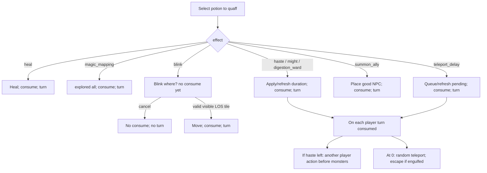

# Design: More potion effects

| Field | Value |
|-------|-------|
| **Date** | 2026-07-09 |
| **Status** | **Locked** — designer answers recorded; coding awaits PR1 authorization |
| **Change** | `add-potion-effects` |
| **Spec targets** | `inventory-items`, `equipment-catalog`, `data/SCHEMA.md`; `ui-layout` (status rows); `save-load` (player effects); light `digestion` / `vore` for ward + teleport escape |

---

## Overview

Extend potions from **heal-only** to named magical effects, all via existing **quaff (`q`)** (blink uses a post-quaff “Blink where?” targeting flow). Thin **player temporary-effect** layer for haste, might, digestion ward, and delayed teleport.

**Scrolls:** out. Magical effects are potions only.

**Examine copy:** utilitarian, clear about *what* it does, **no numbers** in examine text (durations/bonuses are mechanical, not prose).

**Display names:** plain (`potion of might`, etc.).

---

## Resolved decisions

| # | Topic | Decision |
|---|--------|----------|
| 1 | Teleport delay | **3–5** player turns (inclusive random) |
| 2 | Re-quaff teleport while pending | **Refresh** countdown (new 3–5 roll) |
| 3 | Teleport while engulfed | **Teleport escape** — fires and removes player from predator when countdown hits 0 |
| 4 | Teleport landing | **Player-walkable land only**; not occupied by another NPC; runes / items / macguffins OK (normal step-on after); **not** deep water / invalid for ground player |
| 5 | Blink range | Tile must be within **current LOS** |
| 6 | Blink visibility | Tile must be **currently visible** (`visible`, not merely explored) |
| 7 | Blink consume | **Only on successful blink**. Flow: choose drink → “Blink where?” → confirm valid tile → move + consume. Cancel → no move, no consume, no turn |
| 8 | Haste model | **Extra player action** before monster phase while Fast remains |
| 9 | Haste duration | **10** turns (default stock) |
| 10 | Haste + rest | **Yes** — more player turns ⇒ more rest heal ticks (same heal per turn; accelerated subjective time) |
| 11 | Acc/dam | **One** potion of might |
| 12 | Might numbers | **+5 min / +5 max damage**, accuracy **+0.15**, duration **10** turns |
| 13 | Summon pool | All **good** entities with `spawn.weight > 0` and depth-eligible; **weighted**; fully data-driven (future dragon knight at depth 20 works without code) |
| 14 | Summon fail | Try **hard**: adjacent → expanding distance → any legal tile nearest player. Consume on fail only if **zero** legal tiles map-wide (should not happen in real gens) |
| 15 | Ally cap | **None** |
| 16 | Magic mapping | Explore **entire** tile array (`explored[:] = True`); no free LOS |
| 17 | Cancel potion | **No** |
| 18 | Digestion ward | **Yes** — stock name **potion of antacid** (vore humor); effect id `digestion_ward`; **20** turns; **nullifies digestion damage and digestion strikes** |
| 19 | Veto extras | No cancel, levitation, detect monsters, berserk, invis, HoT (heal-over-time) |
| 20 | Naming | Plain “potion of …” |
| 21 | Examine | Utilitarian, no numbers |

---

## Current baseline (code facts)

| Piece | Today |
|-------|--------|
| Potion load | `effect` must be `"heal"`; `heal_amount` required |
| Quaff | Heal only |
| NPC Fast | Doubles world-phase steps |
| Player turn | Action → world phase |
| Map | `explored` vs `visible` |
| Digestion | Tick deals damage (armor `digestion_ac`) then increments `DigestionStrikes` |

---

## Architecture

### Potion definition shape

`effect: string` dispatch. Effect-specific fields:

| Field | Effects |
|-------|---------|
| `heal_amount` | `heal` (required) |
| `duration_turns` | `haste`, `might`, `digestion_ward` (stock defaults **20** / 10 / 20) |
| `accuracy_bonus` | `might` (stock 0.15) |
| `min_damage_bonus` / `max_damage_bonus` | `might` (stock 5 / 5) |
| `delay_min_turns` / `delay_max_turns` | `teleport_delay` (stock 3 / 5) |

Unknown `effect` → **load fail**.

### PlayerEffects (player component)

| Field | Role |
|-------|------|
| `haste_turns` | remaining; while &gt; 0 player is Fast |
| `might_turns` | remaining |
| `might_accuracy_bonus` | snapshot from potion that applied/refreshed |
| `might_min_damage_bonus` / `might_max_damage_bonus` | snapshot |
| `digestion_ward_turns` | remaining; full immunity to dig dmg + strikes |
| `teleport_pending_turns` | `None` or countdown |

**Refresh rules:** re-applying the same buff sets duration to the potion’s `duration_turns` (or max(remaining, new) — **lock: set to potion duration** for simplicity, matching “refresh” for teleport as new roll). Teleport: new random 3–5.

**Tick:** once per **player turn consumed** (including rest turns and extra haste actions). Decrement buffs; then if teleport pending hits 0, fire teleport.

**Haste loop (2 player : 1 monster):**  
`player action → tick` → if remaining `haste_turns` is **odd**, skip monster phase (extra player action); if **even** or expired, run monsters.  
So monsters do **not** freeze for the whole buff — they act once per two hasted player turns.

**Might:** `effective_fighter()` adds might bonuses while `might_turns > 0`.

**Digestion ward:** in `apply_player_digestion_tick` (and any NPC→player dig path that damages/strikes the player): if ward active, **no HP damage and no strike increment** (still engulfed; struggle/escape rules unchanged). Log at most a soft “ward holds” if needed (avoid spam — prefer silent or rare).

**Teleport fire:**

1. Build candidates: in-bounds, **land walkable for player**, not blocked by another `BlocksMovement` entity (player’s own tile excluded as destination unless only option — prefer any other). Rune/item/macguffin tiles allowed.
2. Pick uniform random candidate; set position; clear engulfed/predator links if any (**escape**); recompute FOV; log.
3. If engulfed and somehow no tile: still clear pending and log failure (pathological).

**Blink validity:** `game_map.visible[y,x]` and in FOV/LOS (visible already implies current LOS in this engine) and player-walkable land and unoccupied. Cursor cannot confirm otherwise.

**Summon:**

1. Pool = good + weight &gt; 0 + depth in [min,max] + terrain can exist on land (v1 land-focused; skip water-only goods unless tile is water and they need it — stock knight is land).
2. Weighted choice.
3. Placement: increasing Chebyshev (or BFS distance) from player; first free legal tile wins; if none adjacent, keep expanding to map diameter; last resort full scan for nearest legal.
4. `spawn_entity_by_id(..., floor_depth=D, roll_prefix=False)`.
5. Always consume potion after attempt; fail message only if zero tiles.

### Save / load

Additive player fields; missing → zero/None.

### Status corner

While active, compact rows without full formula dump, e.g. `Fast`, `Might`, `Ward`, `Tele?` (pending) — duration numbers in UI **OK** (examine text stays number-free). Designer can tone labels in implementation.

### Messages

- Plain logs: drank, blinked, teleported, summoned, mapped, ward holds, etc.
- Examine: e.g. might → “Heightens battle prowess for a short time.”; ward → “Shields the drinker from digestive harm for a time.”; teleport → “Causes a delayed displacement through space.”; etc.

---

## Stock catalog (plain names)

| id | display_name | effect | Stock params (not in examine) |
|----|--------------|--------|-------------------------------|
| `healing_potion` | healing potion | `heal` | existing |
| `greater_healing` | greater healing potion | `heal` | existing |
| `power_healing` | power healing potion | `heal` | existing |
| `potion_of_teleportation` | potion of teleportation | `teleport_delay` | delay 3–5 |
| `potion_of_blinking` | potion of blinking | `blink` | — |
| `potion_of_haste` | potion of haste | `haste` | **20** turns |
| `potion_of_might` | potion of might | `might` | +0.15 acc, +5/+5 dam, 10 turns |
| `potion_of_alliance` | potion of alliance | `summon_ally` | — |
| `potion_of_discovery` | potion of discovery | `magic_mapping` | — |
| `potion_of_antacid` | potion of antacid | `digestion_ward` | 20 turns; examine utilitarian, no numbers |

Spawn: all new `spawn_min: 0`; weights/depths tuned in content PR so heals remain common early; discovery/blink earlier; might/haste/tele mid; alliance/ward mid–deep. Exact numbers in PR6 playtest.

---

## Edge cases

| Case | Rule |
|------|------|
| Blink cancel | No consume, no turn |
| Blink no valid tiles in FOV | Can open modal; cannot confirm until valid under cursor; cancel free |
| Double haste quaff | Refresh to 20 |
| Buff expires | Caution (yellow) log line per effect |
| Might + gear + runes | All stack in `effective_fighter` |
| Ward + armor digestion_ac | Ward wins (full nullify); armor irrelevant while active |
| Teleport escape | Same cleanup as successful struggle escape regarding Engulfed / predator prey refs (reuse existing escape helpers if any) |
| Haste + rest | Each rest step is a player turn; haste may grant extra actions between monster phases per loop design — implement so rest remains responsive and heal rate scales with turns taken |
| Summon surrounded | Expand outward until placement |

---

## Performance

- Magic map: one full-array write.  
- Teleport candidates: collect walkable land tiles once at fire (or sample with rejection).  
- Summon: distance rings from player; worst-case full map once.  
- No per-frame buff work.

---

## Testing

- Fixture potions per effect; no live weight oracles.  
- Heal regression; mapping explored vs visible; might numbers; haste extra action; tele 3–5 + engulfed escape; blink cancel/success; summon weighted good + placement; ward blocks dig dmg and strikes for 20; save/load.  
- Manual checklist per PR.

---

## PR plan

| PR | Scope |
|----|--------|
| **PR0** | Design lock (this doc) + AGENTS pointer + coding auth |
| **PR1** | `PlayerEffects`, tick, save/load, status rows, haste extra-action hook (haste may be test-only until PR2 stock) |
| **PR2** | Effect dispatch: heal + `magic_mapping` + `haste` + `might` + `digestion_ward` |
| **PR3** | `teleport_delay` + escape |
| **PR4** | `blink` modal flow |
| **PR5** | `summon_ally` |
| **PR6** | Stock `potions.json` + specs + examine strings + spawn tune |
| **PR7** | Full suite + archive |

---

## Out of scope

Scrolls; ID system; cancel/levitation/detect/berserk/invis/HoT; NPC-wide status framework; ally cap; numeric examine text.
