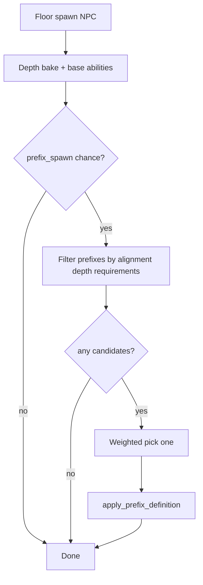

# Design: Extra NPC prefixes beyond Elite

**Status:** Design complete (2026-07-11). Awaiting explicit PR1 authorization before implementation.

**Terminology:** defeated, stunned, digested.

---

## Shipped baseline

| Piece | Today |
|-------|--------|
| Data | `data/npc_prefixes.json` — stock `elite` only |
| Roll | `try_roll_prefix()` — chance from difficulty `prefix_spawn`, then weighted pick |
| Eligibility | Alignment + depth window + `weight > 0` |
| Apply | Flat `stat_bonuses` on depth-baked `Fighter` / `DigestionStats`; rename; `NpcPrefix` component |
| Abilities | Species `abilities[]` only — prefixes cannot grant abilities yet |
| Spawn order | Depth bake → base `Abilities` from definition → optional prefix |

Elite reference flats: `max_hp +4`, `ac +1`, `accuracy +0.05`, `min_damage +1`, `max_damage +1`, `digestion_damage_per_tick +1`.

---

## Roll model — filter, then pick once

Per floor-population NPC:

1. Species chosen as today.
2. Depth-scaling bake into `Fighter` / digestion.
3. Base `Abilities` from `entities.json`.
4. **Prefix chance roll** — unchanged (`prefix_spawn` on active difficulty).
5. If success: build **candidate list** = prefixes passing global eligibility **and** `requirements` for this `EntityDefinition`.
6. If candidate list empty → **no prefix** (opportunity wasted; spawn bare).
7. Else: **one** weighted `rng.choices()` among candidates.
8. Apply chosen prefix (stats + ability grants + rename).

No reroll loop. Filtering before pick is equivalent and bounded.

---

## Schema extensions — `npc_prefixes.json`

`schema_version` stays **1** (additive fields on prefix rows).

### New optional fields on `prefixes[]`

| Field | Type | Meaning |
|-------|------|---------|
| `grant_abilities` | string[] | Ability tokens appended at apply time (e.g. `["Slow"]`, `["PreferVore"]`). Parsed via `parse_abilities()`; merged into existing `Abilities` or creates component. |
| `requirements` | object | Entity-aware gate; **all** sub-conditions must pass. Omitted = no extra gate. |

### `requirements` object

| Key | Type | Meaning |
|-----|------|---------|
| `ability_families` | string[] | Host must have ≥1 ability matching a family token. Families: `RangeN`, `SmiteN`, `RangedVoreN` (match `Range2`…`Range9`, etc.), or exact fixed ids (`Hands`, `Slow`, …). |

Load errors: unknown requirement keys; empty `ability_families` array; unknown family token strings.

**Note:** No `vore_capable` gate — stock prefixes are evil-only and all evil NPCs are vore-capable.

**Not in v1:** `include_entity_ids` / `exclude_entity_ids` (add when a content need appears).

### `stat_bonuses` — new key

| Key | Type | Meaning |
|-----|------|---------|
| `ranged_accuracy` | float | Additive to `Fighter.ranged_accuracy` only. Does **not** change melee `accuracy`. |

Existing `accuracy` behavior **unchanged**: still adds to melee `Fighter.accuracy`, and to ranged accuracy **only when** the species definition already has `ranged_min_damage > 0` and `ranged_max_damage > 0` (Elite compatibility).

---

## Apply order and ability merge

`apply_prefix_definition()` extended:

1. Apply stat flats (including `ranged_accuracy`) to `Fighter` / `DigestionStats`.
2. If `grant_abilities` non-empty: parse tokens, merge with existing `Abilities.parsed` (species first, then prefix grants), re-collapse `SmiteN` / `RangeN` / `RangedVoreN` families per load rules, write `Abilities` component.
3. Rename + `NpcPrefix` component (unchanged).

**Stacking:** Granted abilities follow `openspec/specs/npc-abilities/spec.md` (e.g. duplicate `Slow` is harmless; `Slow` + `Fast` uses shipped precedence).

**Save/load:** Baked `Fighter` stats and merged `Abilities` persist in snapshot. `NpcPrefix.prefix_id` persists. Unknown prefix id on load → soft-drop name only (existing behavior; stats/abilities not reverted).

---

## Prefix specifications (stock intent)

Initial numeric values are **starting tuning** in PR2 JSON; designer adjusts weights and flats without code changes.

### Elite *(unchanged row)*

- **Requirements:** none.
- **Grants:** none.
- **Stats:** existing stock flats.

### Brute

- **Display:** `Brute ` → `Brute wolf`
- **Grants:** `Slow`
- **Stats (starting):** `min_damage +2`, `max_damage +2`, `accuracy -0.10`
- **Requirements:** none
- **Fantasy:** slow, hard-hitting inaccuracy — rewards kiting and consumables vs raw HP.

### Berserk

- **Display:** `Berserk `
- **Grants:** none
- **Stats (starting):** `min_damage +2`, `max_damage +2`, `max_hp -3`
- **Requirements:** none
- **Fantasy:** glass cannon — dies faster if focused, hurts more if ignored.

### Veteran

- **Display:** `Veteran `
- **Grants:** none
- **Stats (starting):** `max_hp +2`, `ac +1`, `min_damage +1`, `max_damage +0` (strictly smaller than Elite on HP/damage/accuracy/digestion)
- **Requirements:** none
- **Fantasy:** “noticeably tougher” without Elite spike.

### Starving

- **Display:** `Starving `
- **Grants:** `PreferVore`
- **Stats (starting):** `max_hp -2`
- **Requirements:** none (evil-only pool; all evil NPCs are vore-capable)
- **Fantasy:** fragile predator that **always** commits to vore when legal — consumable sink at low HP.

### Sniper

- **Display:** `Sniper `
- **Grants:** none
- **Stats (starting):** `ranged_accuracy +0.10`
- **Requirements:** `ability_families: ["RangeN"]` — must have `Range2`…`Range9` on species; **`SmiteN`-only species excluded**
- **Fantasy:** deadlier Path shooters; never on obligatory melee species.

### Bloated

- **Display:** `Bloated `
- **Grants:** `Slow`
- **Stats (starting):** `max_hp +4`
- **Requirements:** none
- **Fantasy:** slow sponge — opposite tempo to Berserk.

---

## Weight pool

All seven prefixes (`elite` + six new) share one eligible pool per evil spawn when prefix chance succeeds. Each row’s `weight` is independent and mod-tunable.

**Starting suggestion (PR2):** equal `weight: 1` on all seven unless playtest dictates otherwise. Designer adjusts in JSON — no code coupling.

`prefix_spawn` curves in `depth_scaling.json` are **unchanged** unless playtest requests a bump (separate JSON edit in PR2).

---

## Implementation map

| Area | Change |
|------|--------|
| `src/data/npc_prefix_registry.py` | `PrefixRequirements`, `grant_abilities`, `ranged_accuracy` on bonuses |
| `src/data/npc_prefix_loader.py` | Parse/validate new fields |
| `src/spawn.py` | `eligible_for_entity()` filter; ability merge in `apply_prefix_definition`; `ranged_accuracy` apply |
| `data/npc_prefixes.json` | Six new rows + weights |
| `data/SCHEMA.md` | Document fields |
| `tests/` | Filter gates, grants, sniper/starving negatives, save round-trip |

---

## Resolved decisions

| # | Decision |
|---|----------|
| 1 | Filter-then-roll, not reroll loop |
| 2 | Empty candidate list → no prefix |
| 3 | `ability_families: ["RangeN"]` for Sniper; not `SmiteN` |
| 4 | `ranged_accuracy` stat key — melee `accuracy` untouched for Sniper |
| 5 | Evil-only; supplement Elite via weights |
| 6 | No pure-weak prefixes |

---

## Risks

| Risk | Mitigation |
|------|------------|
| Starving + PreferVore too oppressive | Lower `weight`; tune `max_hp` penalty in JSON |
| Shallow floors see few gated candidates | Acceptable — melee-only species still get Brute/Berserk/Veteran/Bloated/Elite |
| Prefix soft-drop leaves baked grants | Document; unchanged from Elite era |