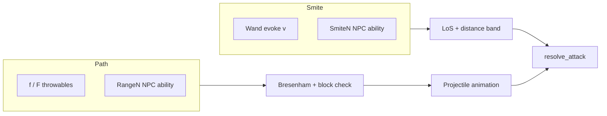

# Design: Thrown weapons and ranged pathing

| Field | Value |
|-------|-------|
| **Date** | 2026-07-10 |
| **Status** | Locked — awaiting PR1 authorization |
| **Change** | `add-thrown-weapons-and-ranged-pathing` |

---

## Overview

Three coupled systems:

1. **Smite targeting** — rename today’s `RangeN` abilities to `SmiteN`; wands stay on Smite (magic arcs overhead, ignores intermediates).
2. **Path targeting** — new `RangeN` abilities and player throwables; Bresenham beam with alignment blocks and first-valid-fighter hit (Option A).
3. **Throwables** — consumed stackable ammo, `f` quick-throw / `F` manual pick, melee-like accuracy bonus on player stats.

---

## Resolved decisions

| # | Topic | Decision |
|---|--------|----------|
| 1 | Ammo | Always consumed; `stack_count` decrements; empty slot cleared |
| 2 | Player targets | Evil-only (`NPCAlignment.EVIL`) |
| 3 | Throwable stats | `PLAYER_ACCURACY + accuracy_bonus`; item `min_damage` / `max_damage` |
| 4 | Player throw range | Any evil in **player LoS**; **adjacent throws allowed** |
| 5 | NPC Path range | Chebyshev `[2, N]`; distance 1 → **melee only** (not obligated — Coward flee still legal) |
| 6 | NPC Smite range | Unchanged `[2, N]` + LoS |
| 7 | Beam hit | First `Fighter` along path that shooter may damage; may differ from cursor target |
| 8 | Same-alignment on path | **Cancel shot** before firing |
| 9 | Player blocked path | *"Something is in the way."* — no turn |
| 10 | Player empty target | *"There's no target there."* — no turn |
| 11 | Player throw miss | *"Your throw misses the {target}."* |
| 12 | NPC Smite logs | *"{actor} smites {target} …"* |
| 13 | NPC Path logs | *"{actor} shoots {target} …"* (existing shoot templates, Path-only) |
| 14 | Wands | Stay **Smite**; evil-only; wand `range` field unchanged |
| 15 | Controls | **`f`** — auto highest `max_damage` throwable → target step; **`F`** — pick modal |
| 16 | Starter | Slot `c`: **5 rocks** (`stack_count: 5`) |
| 17 | Mod compat | **None** — clean `RangeN` → `SmiteN` rename in data/tests |
| 18 | Animation | Brief projectile glyph along beam; FOV-gated; same turn as resolve |
| 19 | Content cuts | No sling stone, weighted bolt, hand axe; use **throwing axe** |
| 20 | Javelin vs spear | Separate ids — melee `spear` in `weapons.json`; throwable `javelin` consumed |
| 21 | Erratic + ranged | **Do not combine.** Erratic action plans bypass normal chase/ranged engagement; `RangeN` / `SmiteN` on an Erratic entity will not fire. Thematically intentional — erratic creatures melee and dart, not aimed shots. |

### Highest-damage auto-pick (`f`)

Among occupied throwable slots with `stack_count > 0`, select by:

1. Highest `max_damage` from definition
2. Tie: highest `min_damage`
3. Tie: earliest inventory letter (`a` before `b`)

Then skip the pick modal and open the **target cursor** (same as post-pick wand step). If no throwables: *"You have nothing to throw."* (exact string in spec). If no valid evil targets after selection: *"No valid targets in range."* (wand parity).

---

## Ranged targeting

### Smite (`Smite2`…`Smite9`)

**Semantics:** If shooter has LoS to target and Chebyshev distance ∈ `[2, N]`, attack resolves on the **intended** target. Entities between shooter and target are ignored.

**Used by:** `SmiteN` NPC abilities, wand `magic_missile` evoke.

**Logs:** `npc_smites_target`, `npc_smites_target_no_damage`, `npc_smites_at_target_miss` in `messages.py`. Retire use of `npc_shoots_*` for Smite.

**AI:** Unchanged from today’s ranged engagement — LoS + distance; no path simulation; walk closer when no shot.

### Path (`Range2`…`Range9` + player throwables)

**Line trace:** `tcod.los.bresenham` from shooter tile toward intended target tile.

**Tiles considered:** Start at shooter; walk toward target **excluding shooter origin**; stop at first blocking condition.

**Blocking terrain:** Wall, closed door — line cannot reach target → no valid shot.

**Pre-fire alignment check:** If any tile on the line (before the intended target cell) contains a `Fighter` that the shooter **must not damage** (same-alignment block table), **cancel** the shot:

| Shooter | Blocks path |
|---------|-------------|
| Player | Good, Neutral |
| Evil | Evil |
| Good | Good, Player, Neutral |

Player cancel: *"Something is in the way."*

**On fire (beam):** Walk the line; **first `Fighter`** encountered that the shooter **may** damage receives the attack (hit/miss/damage via `resolve_attack`). Intended cursor target may not be struck if another valid target stands in front.

**NPC distance:** Chebyshev ∈ `[2, N]` for Path ability; at distance 1, use melee (or flee / other non-ranged intents — not forced to melee for Coward).

**Player throwables:** No Chebyshev cap beyond **player LoS** (`can_see` / FOV); **distance 1 allowed**.

**Stunned 0 HP prey:** Not shot; predators close for melee (unchanged).

### Shared combat

- `resolve_attack()` for hit and damage.
- Player hits: `fire_player_combat_targeted()` (rest-under-attack gate).
- Knockback / Lifedrain hooks apply on Path hits same as today’s ranged hits (vector along beam).
- Engulfed targets not valid.

---

## Player throw flow

| Key | Action | Turn |
|-----|--------|------|
| `f` | Auto-pick best throwable → target cursor → confirm | Yes on resolve |
| `F` | Throwable pick modal → target cursor → confirm | Yes on resolve |

**Target cursor:** Same UX as wand evoke — map cursor only, no centered modal. Cycle all in-LoS fighters; only **evil** NPCs are valid confirm targets.

| Confirm on | Result |
|------------|--------|
| Evil with clear Path | Resolve beam; consume 1 stack |
| Good / Neutral | *"Not the best target."* — reset, no turn |
| Empty / no `Fighter` | *"There's no target there."* — no turn |
| Evil but path blocked | *"Something is in the way."* — no turn |

**Hit logs:** Reuse player hit templates or add throw-specific lines; miss uses *"Your throw misses the {target}."*

**Engulfed:** Pack blocked — *"You cannot reach your pack while engulfed."*

**Inspect / examine:** Floor examine and `i` detail show damage, accuracy bonus, stack count.

---

## Throwable data (`throwables.json`)

### Required fields

| Field | Type |
|-------|------|
| `id` | string |
| `display_name` | string |
| `glyph` | string (1 char) |
| `fg` | [r, g, b] |
| `examine` | string |
| `min_damage` | int |
| `max_damage` | int |
| `accuracy_bonus` | number |
| `spawn_weight` | number ≥ 0 |
| `spawn_min_depth` | int |
| `spawn_max_depth` | int |

No `range` field (player = full LoS). No durability/charges.

### Instance shape

`InventoryItemInstance`: `category: THROWABLE`, `stack_count` (default 1 on floor pickup). Stacks merge on pickup like potions.

### Spawn pool

Unified floor item pool with weapons/armor/potions/wands — same depth filter and `MAX_FLOOR_ITEM_PLACEMENTS` cap.

### Starter loadout

| Slot | Item | Notes |
|------|------|-------|
| `a` | dagger | wielded (unchanged) |
| `b` | robes | worn (unchanged) |
| `c` | rock × 5 | throwable |

Extend `apply_starter_loadout()` in `src/systems/inventory.py`.

---

## Stock throwable catalog (depth 1–20)

Names are standalone objects — not launcher ammunition.

| id | display_name | Depth window | Role |
|----|--------------|--------------|------|
| `rock` | rock | 1–3 | Starter + common |
| `brick` | brick | 2–6 | Early blunt upgrade |
| `dart` | dart | 3–8 | Accurate, light |
| `throwing_knife` | throwing knife | 5–11 | Mid damage |
| `throwing_axe` | throwing axe | 6–12 | Heavy hit |
| `shuriken` | shuriken | 8–14 | High accuracy |
| `javelin` | javelin | 10–16 | High damage |
| `chakram` | chakram | 12–18 | Deep accuracy/damage |
| `ceramic_pot` | ceramic pot | 14–20 | Deep slow blunt |

Exact numbers JSON-tunable; tests use fixtures — never pin live balance.

---

## NPC Path AI (`RangeN`)

### Target selection

Reuse alignment pipelines (`pick_evil_ranged_target`, `pick_good_ranged_target`) with additional filter:

`path_shot_valid(shooter, intended_target)` — bresenham path has no same-alignment blockers **and** beam can reach a damageable fighter.

Among survivors in `[2, N]` with LoS, pick **nearest** Chebyshev (tie random).

### No valid shot

| Alignment | Behavior |
|-----------|----------|
| **Evil** | **Kite:** prefer Chebyshev distance **N** (step away if too close, closer if too far, else explore/chase) |
| **Good** | If player visible and within **N** tiles: maintain **1–2 tiles** from player while seeking a shot; else chase visible evils |

Smite NPCs (`SmiteN`): keep today’s “no shot → walk toward target” without path checks.

### Content: fox archer

- `abilities: ["Range5"]`
- Keep existing `ranged_*` stats on entity definition

---

## Projectile animation

**Trigger:** After Path attack confirms (player throw or NPC `RangeN` shot), before or interleaved with log lines.

**Render:**

- Path shots use a fixed **cyan `*`** glyph for all shooters (NPC and player throw).
- Animate along bresenham tiles shooter → impact.
- **FOV-gated:** skip when off-screen.
- **Duration:** engine constant (~150–300 ms total or 1–3 frames per tile); not data-driven.
- **Turn model:** resolves same player/NPC turn; animation is cosmetic blocking on render loop only (do not delay world phase).

**Module:** `src/systems/projectile_anim.py` (or `src/ui/projectile_anim.py`) + hook from `engine` render path.

---

## Code touch map (by PR)

| Area | Files (indicative) |
|------|---------------------|
| Ability rename | `ability_parser.py`, `abilities.py`, `save/codec.py`, `data/SCHEMA.md`, `data/Readme.txt`, tests |
| Path core | `src/systems/ranged_path.py` (new), `combat.py` |
| NPC AI | `abilities.py`, `ai/visit.py`, `ai/movement.py` |
| Messages | `messages.py` — smite vs shoot split; player throw miss |
| Throwables | `throwables.json`, `item_loaders.py`, `item_registry.py`, `components.py`, `spawn.py`, `inventory.py` |
| Player input | `item_modals.py`, `engine_input.py`, `help_overlay.py` |
| Animation | `projectile_anim.py`, `engine.py` render |
| Content | `entities.json` (fox archer), `equipment-catalog` spec draft |

---

## Save compatibility

- New `ItemCategory.THROWABLE` — enum name in save codec; old saves without throwables load fine.
- Ability token rename: no migration (game not live); update all test harness `Range2` → `Smite2` where Smite intended.

---

## Testing strategy

| Layer | Approach |
|-------|----------|
| Parser | `Smite2`/`Range2` parse; duplicate collapse per token family |
| Path | Unit tests: bresenham block, ally cancel, beam hits front evil, wall block |
| Messages | Exact strings for smite/shoot/throw miss/blocked |
| Player `f`/`F` | Headless engine: pick best damage, modal override, stack consume |
| NPC AI | Arena tests: ally blocks shot; kite step; good stays near player |
| Animation | Smoke test optional; manual FOV check on checklist |
| Fixtures | Minimal throwables in test helpers — not live `data/` balance |

Run targeted pytest per PR; full suite per `AGENTS.md` on final acceptance.

---

## PR plan

See `tasks.md`. One PR at a time per `AGENTS.md`.

---

## References

- `openspec/specs/inventory-items/spec.md` — wand evoke UX template
- `openspec/specs/npc-abilities/spec.md` — current `RangeN` (to become Smite + Path)
- `src/systems/wand_evoke.py` — target cursor builder
- `map_gen.py` — existing `tcod.los.bresenham` usage