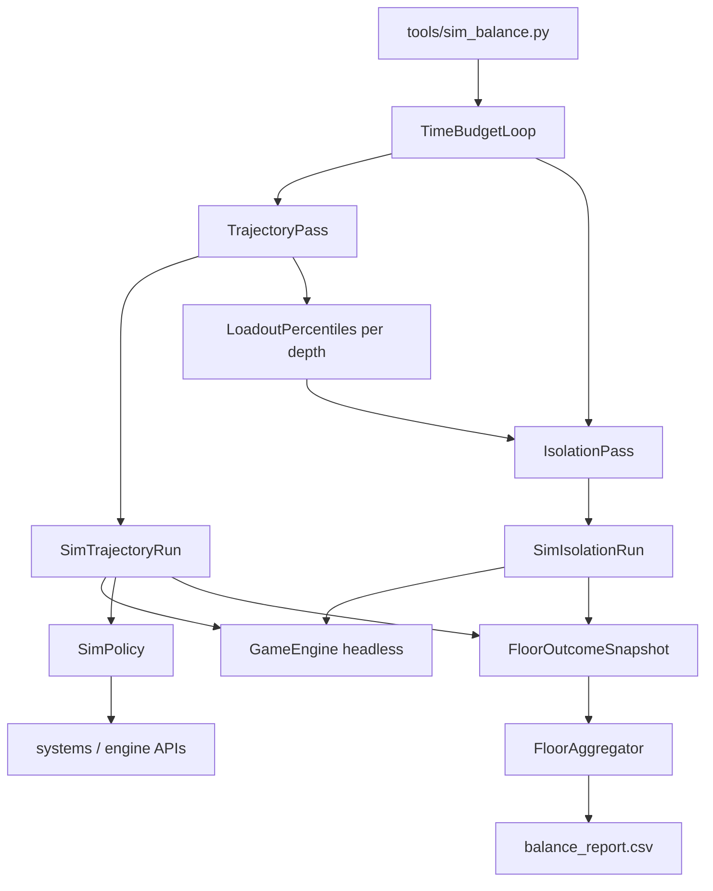

# Design: Balance difficulty analyzer (hybrid)

| Field | Value |
|-------|-------|
| **Date** | 2026-07-11 |
| **Status** | **Active** — designer-approved Option 4 (hybrid) |
| **Change** | `add-balance-simulator` |

---

## Overview

A headless **play simulator** drives `GameEngine` turn-by-turn through a **policy layer** (`src/sim/`). Unlike the deferred 2026-07-10 design (median depth / ending histogram), success is defined by **per-floor difficulty telemetry** for depths **1–20**, with:

- **Trajectory analysis** — full runs from floor 1; score each floor visit with the loadout the bot actually carried in.
- **Isolation analysis** — floor-only runs with loadout injected from trajectory percentiles at floor entry.

CLI: `tools/sim_balance.py` — time-budgeted batch runs, CSV primary output.



---

## Resolved decisions

| # | Topic | Decision |
|---|--------|----------|
| 1 | Primary metric | Per-floor difficulty + variance for floors **1–20** |
| 2 | Analysis modes | **Hybrid**: trajectory pass then isolation pass (same CLI invocation) |
| 3 | Time budget | Adjustable `--seconds` (default **300**); run as many simulations as fit; **checked every player turn** so a single run cannot exceed the pass deadline |
| 4 | Time split | **70%** trajectory / **30%** isolation by default; `--trajectory-fraction` override (0–1) |
| 5 | Data source | Stock **`data/` only** — `load_entity_registry(path=None)` etc. with **mods disabled** for sim (explicit sim flag, not user settings) |
| 6 | Difficulty selection | One mode per invocation: `--difficulty easy\|normal\|hard\|nightmare` (default **normal**) |
| 7 | Execution model | Headless `GameEngine(save_coordinator=None)`; no `tcod.context`; no render loop |
| 8 | Action path | Direct system/engine calls; **not** synthetic `KeyDown` through `handle_event` |
| 9 | Macguffins | **Out of scope** — bot never pursues macguffin victory |
| 10 | Floor rune quota | `engine.runes_per_floor()`; descend when **this floor's** collected count ≥ quota **unless** bailing |
| 11 | Bail for stairs | **Really bad** situation: policy switches goal to stairs; may descend below quota |
| 12 | Consumables | Use **early** when situation could become lethal (conservative) |
| 13 | Rest | `try_rest_until_healed_or_danger` when hurt and rest system reports safe **start**; ~10% imperfection skip when HP ≥ 70% |
| 14 | Stunned | **Immediate** heal potion or teleport potion; if neither available, policy treats as doomed (no "stunned as setback") |
| 15 | Sharks / aquatic | **Avoid** — flee when visible aquatic evil within threat radius; never intentional bump-attack |
| 16 | Gear | Pick up visible weapon/armor/potion/wand; wield/wear if **strictly better** by simple stat compare |
| 17 | Composite score | Derived column; export **all** component stats regardless |
| 18 | Upgrade penalties | Penalize **failure to improve** weapon/armor vs floor entry — **same weight** whether upgrade was on floor and missed or never spawned; spawn/take stats exported for diagnosis only |
| 19 | Output | **Compare-sheet CSV** default (`metric`, `label`, one column per run); optional `--curve-output` wide table; optional `--jsonl` deferred |
| 20 | Comparison workflow | `--append` adds next column to same compare sheet; `--label` names each run column; `meta.data_fingerprint` row flags incompatible diffs |
| 21 | Turn cap | Safety `max_turns` per run (default **50_000**) |
| 22 | Test fixtures | Unit tests may use minimal maps; **simulator never loads fixture JSON** for entities/items in production paths |
| 23 | Seed calibration | Pinned test seeds and CSV interpretation live in **`openspec/specs/balance-simulator/spec.md`** (2026-07-12 overnight scan: normal **23**, easy **25** / **4242**; avoid placement-failed seeds e.g. **2–13**, **7**) |
| 24 | Stock “normal” baseline | **Not calibrated** as of PR2 sign-off (2026-07-12): no recent balance pass; wolf ranged disabled after prior tuning made combat too harsh. Sim `--difficulty normal` reflects current `data/`, not a designer-locked target curve. Re-baseline before treating `traj_*` / digest rates as gospel. |

---

## Difficulty model

### Per run-floor event

Recorded when the player **descends** from floor *d* or is **digested** on floor *d*.

| Outcome | `event_score` (0–100) |
|---------|------------------------|
| Digested on this floor | **100** |
| Otherwise | Weighted sum below, capped at **99** |

**Sacrifice weights** (v1 constants in `src/sim/scoring.py`; tunable after designer review):

| Component | Max contribution | Notes |
|-----------|------------------|-------|
| Runes missed | 30 | `(quota - runes_this_floor) / quota * 30` |
| Consumables spent | 25 | heal 8, might 6, haste 5, teleport 4, wand evoke 2 each (cap 25) |
| Upgrade not improved | 20 | weapon and armor vs floor-entry snapshot; half max each (10 per slot). Applies whether a better item **spawned and was missed** or **never spawned** |
| Early bail flag | +10 overlay | Descended with `< quota` **and** `bail_for_survival` policy flag set |

**Not penalized:** allies; monsters defeated count.

### Aggregate per floor

Across all run-floor events in a pass (trajectory or isolation):

| Stat | Meaning |
|------|---------|
| `difficulty_mean` | Mean of per-event `event_score` |
| `difficulty_median` | Median |
| `difficulty_p10`, `difficulty_p90` | Percentile band |
| `difficulty_stdev` | Standard deviation |
| `digest_rate` | Fraction ending in digestion on this floor |
| `runs_reached` | Denominator for trajectory; isolation uses `iso_runs` |

**Interpretation:** `digest_rate` near 1.0 ⇒ difficulty near 100 regardless of other columns. Designer inspects components when mean and digest_rate diverge.

---

## Per-floor metrics (export all)

### Trajectory columns (`traj_*`)

| Column | Type | Description |
|--------|------|-------------|
| `floor` | int | 1–20 |
| `traj_runs_reached` | int | Runs that entered this floor |
| `traj_digest_rate` | float | Digested on floor / runs_reached |
| `traj_descend_rate` | float | Descended alive / runs_reached |
| `traj_difficulty_mean` | float | Composite |
| `traj_difficulty_median` | float | |
| `traj_difficulty_p10` | float | |
| `traj_difficulty_p90` | float | |
| `traj_difficulty_stdev` | float | |
| `traj_runes_0`…`traj_runes_3` | float | Fraction descended with N runes this floor (N = quota → `runes_full`) |
| `traj_early_bail_rate` | float | Descended below quota with bail flag |
| `traj_consumable_heal_mean` | float | Avg heal potions spent on floor |
| `traj_consumable_might_mean` | float | |
| `traj_consumable_haste_mean` | float | |
| `traj_consumable_teleport_mean` | float | |
| `traj_wand_evoke_mean` | float | |
| `traj_weapon_improve_rate` | float | Fraction of visits where wielded weapon strictly improved vs floor entry |
| `traj_armor_improve_rate` | float | Fraction where worn armor strictly improved vs floor entry |
| `traj_weapon_spawn_rate` | float | Fraction of visits where upgrade weapon spawned (diagnostic) |
| `traj_weapon_take_rate` | float | Taken / spawned when spawned (diagnostic) |
| `traj_armor_spawn_rate` | float | |
| `traj_armor_take_rate` | float | |
| `traj_digest_when_weapon_spawned` | float | Digest rate conditional on weapon spawned (variance diagnostic) |
| `traj_digest_when_weapon_not_spawned` | float | Digest rate when weapon never spawned (variance diagnostic) |
| `traj_stunned_events_mean` | float | Stunned occurrences before recovery/digestion |

### Isolation columns (`iso_*`)

Same metrics prefixed `iso_*`, with `iso_runs` instead of `runs_reached`. Loadout injected at floor entry (see below).

### Compare-sheet CSV (default)

Side-by-side layout for LibreOffice Calc / Excel:

| Column | Content |
|--------|---------|
| `metric` | Stable row key (`meta.timestamp`, `traj.f07.digest_rate`, `_section.traj`, …) |
| `label` | Human-readable row label (fixed across runs) |
| Run columns | One per analysis pass (`--label` or auto timestamp name) |

Metadata is **`meta.*` rows**, not comment headers. Section separator rows (`--- trajectory ---`, `--- isolation ---`) use empty values.

**Append:** `--append --output balance_compare.csv` adds a new run column; row order must match (same `floors_max`).

**Optional curve file:** `--curve-output path` writes the wide floor table (row = floor) for charting one run.

### Run metadata rows (`meta.*`)

| Row key | Description |
|---------|-------------|
| `meta.timestamp` | ISO-8601 UTC |
| `meta.difficulty_id` | |
| `meta.seconds_budget` | |
| `meta.trajectory_seconds` | Actual wall time used |
| `meta.isolation_seconds` | |
| `meta.trajectory_runs` | Count of completed/partial trajectory runs |
| `meta.isolation_runs_total` | Sum of iso runs across floors |
| `meta.data_fingerprint` | Hash of stock `data/` contents (comparison validity) |

---

## Trajectory pass

### Turn loop

Same structure as deferred design:

1. Terminate if `game_over.active` (digested) or `floor_depth > 20` or turn cap.
2. Modal babysitter (vore, digestion, game-over, ground pickup take-all).
3. Rest session advance if active.
4. `SimPolicy.decide(engine)` → execute → consume turn.
5. On floor transition or digestion: emit `FloorOutcomeSnapshot`.

### Per-floor tracking state

At floor entry, snapshot:

- `loadout_at_entry` — weapon tier (min+max damage sum), armor AC, consumable counts by category
- `floor_runes_at_start = run_stats.runes_collected`
- `consumables_at_start` — inventory tallies
- `upgrade_weapon_spawned`, `upgrade_armor_spawned` — set true when a strictly-better item **visible on floor** at least once

During floor:

- Increment consumable spend counters when bot quaffs/evokes.
- Track `stunned_events` when player gains `Stunned` tag.

On floor exit (descend or digest):

- `runes_this_floor = run_stats.runes_collected - floor_runes_at_start`
- `bail_for_survival` — policy set flag when descending below quota due to threat/HP policy
- `weapon_improved`, `armor_improved` — wielded/worn gear strictly better than `loadout_at_entry` (scoring uses these; spawn flags are diagnostic only)

### Loadout bank (feeds isolation)

After trajectory pass, for each floor *d* ∈ [1, 20], aggregate `loadout_at_entry` from all trajectory visits to floor *d*:

| Field | Aggregation |
|-------|-------------|
| Weapon | Median of `(min_damage + max_damage)` of wielded weapon |
| Armor | Median `ac_bonus` |
| Consumables | Median count per category (heal, might, haste, teleport, wand charges) |

Stored in `LoadoutProfile` per depth. If `traj_runs_reached < 5` for a floor, fall back to **previous floor's** profile (floor 1 uses starter loadout).

---

## Isolation pass

### Purpose

Measure floor *d* difficulty for a **typical** player who reached that depth — ignoring the specific scars of any single run — while still simulating map gen, spawns, and loot chaos.

### Sim-only floor entry

Add `src/sim/floor_entry.py` with **`start_isolation_floor(engine, *, depth, seed, loadout: LoadoutProfile)`**:

1. `new_game(seed=seed)` or reset via `skip_new_game=True` path.
2. Apply `loadout` to player inventory (wield/wear closest items by stat compare from **stock item registry** — sim helper, not player-facing).
3. Set `engine.floor_depth = depth`.
4. Generate dungeon + spawn population/runes for `depth` using engine's existing `_spawn_floor_population_and_runes` path (may require thin `initialize_floor_isolation` hook on `GameEngine` delegating to `engine_floor`).
5. Place player at `enter_xy`.
6. Run policy until descend, digest, or turn cap → one `FloorOutcomeSnapshot`.

**Seeds:** `isolation_seed = hash(base_seed, depth, iso_run_index)` for variety.

### Time allocation across floors

Remaining isolation time is split **evenly** across floors 1–20 (each floor gets `iso_seconds / 20`). Within a floor slice, run as many isolation simulations as fit.

If trajectory produced zero runs to floor 20, isolation still runs using extrapolated loadout profiles.

---

## Policy layer

### Priority order (when not modal-blocked, not resting, not stunned-recovery)

| Priority | Condition | Action |
|----------|-----------|--------|
| 0 | `Stunned` on player | Quaff heal if HP ≤ max; else teleport; else **WAIT** (doomed) |
| 1 | `bail_active` or really bad threat | BFS to stairs; descend when on stairs tile |
| 2 | Hurt + safe rest start | `try_rest_until_healed_or_danger` |
| 3 | Lethal-risk threat | Consumable (heal → wand → might/haste) |
| 4 | Visible floor loot (weapon/armor/potion/wand) | BFS to nearest |
| 5 | Visible uncollected rune | BFS to nearest |
| 6 | Visible non-aquatic evil adjacent | Attack |
| 7 | Visible aquatic evil within radius 6 | Flee |
| 8 | Quota met | BFS to stairs |
| 9 | Default | Explore frontier |

### Really bad / bail

Set `bail_for_survival` when **any**:

- `hp < 0.25 * max_hp` and no heal potion and `visible_evil_count >= 1`
- `visible_evil_count >= 3`
- `adjacent_evil_count >= 2` and no consumable left that policy would use

While bailing, skip rune/loot goals unless adjacent pickup is free (designer-tunable v1: **skip** — straight to stairs).

### Threat / consumable (lethal-risk)

Fire when **any**:

- `visible_evil_count >= 2`
- `adjacent_evil_count >= 1` and `hp < 0.5 * max_hp`
- `hp < 0.35 * max_hp` and `visible_evil_count >= 1`

Response order: heal → wand (non-shark target) → might/haste.

### Shark / aquatic

Aquatic evil = `entity_type_id == "shark"` **or** `MobilityType.AQUATIC` on evil NPC.

### Equipment compare

Same as deferred design:

- **Weapon better:** higher `(min_damage + max_damage)`, tiebreak `accuracy_bonus`.
- **Armor better:** higher `ac_bonus`.

### Imperfection

~10% skip optional rest when `hp >= 0.7 * max_hp`; random BFS tie-break among equidistant goals.

---

## Package layout

| Path | Role |
|------|------|
| `src/sim/runner.py` | `SimTrajectoryRun`, `SimIsolationRun`, turn loop, termination |
| `src/sim/policy.py` | Priority-ordered `decide(engine) -> SimAction` |
| `src/sim/navigation.py` | BFS goals: explore, rune, stairs, flee, loot |
| `src/sim/perception.py` | Visible evils, sharks, threats, floor item scan |
| `src/sim/inventory_policy.py` | Pickup, equip, consumable use |
| `src/sim/modals.py` | Vore/digestion/game-over; ground pickup all |
| `src/sim/floor_entry.py` | Isolation floor bootstrap + loadout injection |
| `src/sim/snapshots.py` | `FloorOutcomeSnapshot`, `LoadoutProfile` |
| `src/sim/scoring.py` | Per-event and aggregate scoring |
| `src/sim/aggregator.py` | `FloorAggregator` — percentiles, conditional rates |
| `src/sim/stats.py` | Time-budget loop, CSV writer, metadata |
| `src/sim/data_loader.py` | Stock-only registry load (mods off) |
| `tools/sim_balance.py` | CLI |

### Engine hooks (minimal)

Prefer sim helpers calling existing `engine_floor` / `engine` methods. If isolation cannot be done without a one-line delegate, add:

- `GameEngine.initialize_isolation_floor(depth, loadout)` → `engine_floor.initialize_floor_isolation(...)`

No gameplay behavior change when not invoked from sim.

---

## CLI

```text
python tools/sim_balance.py [options]

Options:
  --difficulty {easy,normal,hard,nightmare}   default: normal
  --seconds SECONDS                           default: 300
  --trajectory-fraction FLOAT                 default: 0.7
  --output PATH                               default: balance_compare.csv
  --format {compare,wide}                     default: compare
  --append                                    append run column to existing compare sheet
  --label TEXT                                column header for this run
  --curve-output PATH                         optional wide floor-curve CSV
  --jsonl PATH                                optional per-event log (deferred)
  --max-turns INT                             default: 50000
  --seed INT                                  optional RNG root; else random
  --floors-max INT                            default: 20
  --trajectory-only                           skip isolation pass
```

### Example

```text
python tools/sim_balance.py --label baseline --output balance_compare.csv
python tools/sim_balance.py --label wolf_buff --append --output balance_compare.csv
python tools/sim_balance.py --curve-output baseline_curve.csv --seconds 60
```

---

## Testing strategy

| Layer | Approach |
|-------|----------|
| Scoring | Unit test `event_score` for digest / full clear / partial sacrifices |
| Snapshots | Floor counter: runes, consumables, upgrade flags |
| Navigation | BFS goals on toy `GameMap` |
| Policy | Stunned → heal; bail → stairs goal; shark flee |
| Trajectory smoke | One seeded run records ≥1 floor snapshot |
| Isolation smoke | `start_isolation_floor` at depth 3 completes without exception |
| Aggregation | Percentile math on fixed fixture snapshots |
| Live data smoke | Trajectory run on stock data reaches depth ≥2 within turn cap (pinned seed after calibration) |

Tests in `tests/test_sim_*.py`. **Not** a CI gate on runtime.

---

## Performance notes

- NPC AI dominates turn cost (same as `profile_turn.py`).
- Rest batches many turns per policy call — speeds sim.
- Trajectory runs that die early are cheap; deep runs cost more — time budget self-balances.
- Isolation runs are shorter (single floor) — many samples per floor slice.
- Expect minutes, not seconds, for default 300s budget — acceptable per designer.

---

## Risks and mitigations

| Risk | Mitigation |
|------|------------|
| Thin data at floor 18–20 | Report `traj_runs_reached`; designer increases `--seconds` |
| Bot too weak/strong vs human | Stable policy → relative CSV diffs still valid; document as instrument |
| Isolation loadout mismatch | Median from trajectory; fallback chain to shallower floors |
| Survivor bias in trajectory | Expected; isolation pass compensates for intrinsic floor difficulty |
| Private engine APIs | Thin public wrappers only if imports break |
| Composite weights wrong | Export all components; weights in one module for easy tuning |

---

## PR plan

### PR1 — Runner shell, snapshots, time budget, CSV skeleton

**Files:** `src/sim/runner.py`, `src/sim/modals.py`, `src/sim/snapshots.py`, `src/sim/stats.py`, `src/sim/data_loader.py`, `tools/sim_balance.py`, `tests/test_sim_runner.py`

- Headless trajectory loop with turn cap and termination
- `FloorOutcomeSnapshot` recording (stub zeros for policy gaps)
- Time-budget loop (trajectory-only stub)
- CSV writer with column headers (empty iso columns)
- Stock-only data load
- Modal babysitter + engulfed struggle stub

**Depends on:** none

---

### PR2 — Navigation, rune quota, descend, shark flee

**Files:** `src/sim/navigation.py`, `src/sim/perception.py`, `src/sim/policy.py`, `tests/test_sim_navigation.py`

- BFS explore / rune / stairs / loot goals
- Per-floor rune counter; descend when quota met
- Shark flee; basic movement `try_action`

**Depends on:** PR1

---

### PR3 — Threat, consumables, rest, stunned, bail

**Files:** `src/sim/inventory_policy.py`, `src/sim/policy.py`, `tests/test_sim_threat.py`

- Lethal-risk consumable use
- Rest integration + imperfection roll
- Stunned immediate heal/teleport
- Bail-for-stairs + `bail_for_survival` flag

**Depends on:** PR2

---

### PR4 — Loot, equip, upgrade spawn/take tracking

**Files:** `src/sim/inventory_policy.py`, `src/sim/snapshots.py`, `tests/test_sim_equip.py`

- Visible loot priority
- Strict-better equip
- `upgrade_weapon_spawned` / `upgrade_armor_spawned` / taken tracking

**Depends on:** PR3

---

### PR5 — Trajectory aggregation, scoring, full CSV

**Files:** `src/sim/scoring.py`, `src/sim/aggregator.py`, `src/sim/stats.py`, `tests/test_sim_scoring.py`, `tests/test_sim_aggregator.py`

- `event_score` + aggregate percentiles
- All `traj_*` columns populated
- Loadout bank extraction for isolation
- Floors 1–20 filter

**Depends on:** PR4

---

### PR6 — Isolation pass + iso CSV columns

**Files:** `src/sim/floor_entry.py`, `engine_floor.py` (or sim-only hook), `src/sim/runner.py`, `src/sim/stats.py`, `tests/test_sim_isolation.py`

- `start_isolation_floor` + loadout injection
- Isolation time slice across floors
- All `iso_*` columns populated
- `--trajectory-only` flag

**Depends on:** PR5

---

### PR7 — Spec, checklists, acceptance prep

**Files:** `openspec/specs/balance-simulator/spec.md`, `testing-checklists.md`, `testing-checklist-pr7.md`

- Behavioral requirements
- Cross-reference from `balance` spec
- Manual validation steps for designer

**Depends on:** PR6

---

## Key decisions (rationale)

1. **Hybrid in one CLI** — Designer gets trajectory + isolation without orchestrating two tools; Excel compares both column groups.
2. **Time budget not run count** — Hardware varies; designer adjusts `--seconds` freely.
3. **Stock data only** — Reproducible baseline; mods would muddy balance diffs.
4. **All stats exported** — Composite score is provisional until weights are playtest-tuned.
5. **Trajectory-first time split** — Isolation needs loadout bank from trajectory (70/30 default).
6. **Stunned = emergency** — Matches designer: 0 HP is near-digestion without immediate out.
7. **Bail is valid play** — Missing runes must not be treated as bot failure.
8. **Upgrade penalty is outcome-based** — No improvement vs floor entry costs the same whether loot RNG failed or the bot skipped a visible upgrade; conditional digest/spawn columns remain for variance diagnosis.

---

## Open questions

None — designer Q&A complete (2026-07-11). Composite weight constants are v1 placeholders; tune after first CSV review.

**Mid-design update (2026-07-11):** Upgrade sacrifice uses **outcome-based** scoring (`weapon_improved` / `armor_improved` vs floor entry). Missed visible upgrade and never-spawned upgrade share the same penalty weight.