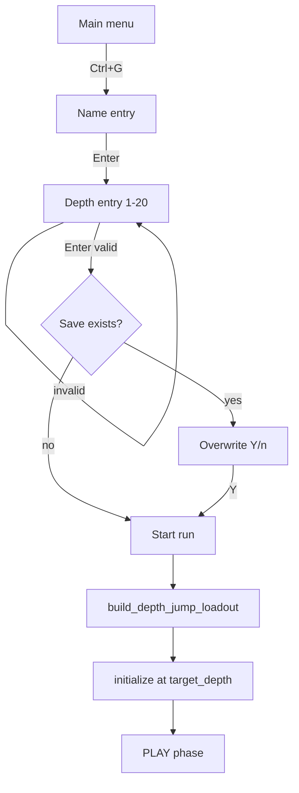

# Design: Start at depth (secret menu)

| Field | Value |
|-------|-------|
| **Date** | 2026-07-12 |
| **Status** | Approved — designer answers incorporated (2026-07-12) |
| **Change** | `add-depth-jump-start` |

---

## Overview

A hidden **Ctrl+G** chord on the main menu opens name entry, then depth entry (1–20). Confirming starts a run on that floor with inventory and rune progression synthesized from item and rune registries at **`loot_depth = target_depth - 1`**.



---

## Resolved decisions

| # | Topic | Decision |
|---|--------|----------|
| 1 | Trigger | **Ctrl+G** on main menu only |
| 2 | Name | Reuse `NameEntryState` / `resolve_display_name` |
| 3 | Depth cap | **1–20** inclusive; stock cap in `depth_jump_start.json` |
| 4 | Invalid depth | Show **"Please input an integer from 1 to 20"**; keep buffer editable |
| 5 | Loot reference depth | **`target_depth - 1`** for items; runes simulate floors **1 … target_depth - 1** |
| 6 | Depth 1 | **Identical to normal New Game** — route to `_start_new_game`, no `level_warped` |
| 7 | Data source | Active registries via existing loaders (**mods included**) |
| 8 | Item eligibility | `spawn_min_depth ≤ depth ≤ spawn_max_depth` and `spawn_weight > 0` |
| 9 | Rune eligibility | `min_depth ≤ depth ≤ max_depth` and `weight > 0` |
| 10 | “Strongest” weapon / throwable | Max **`min_damage`**, then **`max_damage`**, then **`accuracy_bonus`**; remaining ties → **random** among equals |
| 11 | “Strongest” armor | Max **`ac_bonus`**; ties → random among equals |
| 12 | Empty eligible pool | Omit that category |
| 13 | Throwable stack | **5** copies (config `throwable_stack_count`) |
| 14 | Potions / wands | **3** each, weighted random with **duplicates OK** |
| 15 | Simulated runes | Per prior floor `f`: `n = randint(ceil(runes_per_floor × 2/3), runes_per_floor)` using `engine.runes_per_floor()`; each pick weighted from `eligible_at_depth(f)`; apply via `apply_rune_effect` |
| 16 | Rune stat tracking | Increment `run_stats.runes_collected` per simulated rune |
| 17 | Past runs | **`level_warped = true`** on run metadata → **skip** past-runs append; null/false records normally |
| 18 | Save overwrite | Same **Y/n** prompt as New Game |
| 19 | Cancel | **Escape** on name or depth → main menu |
| 20 | Seed | Random like normal New Game |

---

## Data: `depth_jump_start.json`

New file under `data/`. Loader follows existing item-loader patterns. Modding: **whole-file replace** (add to modding spec on ship).

| Field | Type | Stock | Meaning |
|-------|------|-------|---------|
| `schema_version` | int | `1` | |
| `max_target_depth` | int | `20` | Upper bound for depth entry validation |
| `throwable_stack_count` | int ≥ 0 | `5` | Stack size for strongest throwable |
| `potion_count` | int ≥ 0 | `3` | Weighted random potion grants |
| `wand_count` | int ≥ 0 | `3` | Weighted random wand grants |
| `simulated_runes_min_numerator` | int ≥ 0 | `2` | Per-floor sim count low bound = `ceil(runes_per_floor × num/den)` |
| `simulated_runes_min_denominator` | int ≥ 1 | `3` | Denominator for min fraction (stock **⅔**) |

**Not** hardcoded in Python: counts, depth cap, error message text stays in UI code (designer-specified exact string).

---

## Loadout algorithm

`build_depth_jump_loadout(player, *, target_depth, rng, registry, rune_registry, difficulty_id) → int`

Returns simulated rune count for `run_stats`.

### 1. Resolve depths

Depth **1** never calls this builder (normal New Game). For **target_depth ≥ 2**:

```
loot_depth = target_depth - 1
```

### 2. Eligible pools at `loot_depth`

Filter each category from `ItemRegistry` / throwables using spawn depth + weight (reuse spawn helpers or shared `eligible_items_at_depth`).

### 3. Best equipment

- **Weapon:** argmax by `(min_damage, max_damage, accuracy_bonus)`; wield in slot `a`.
- **Armor:** argmax by `ac_bonus`; wear in slot `b`.
- **Throwable:** argmax by same tuple as weapon; slot `c` with `throwable_stack_count`.

Ties on all keys: **random** pick among tied ids (`rng.choice`).

### 4. Consumables

For `potion_count` / `wand_count`: weighted random with replacement from eligible pools; assign first free inventory letters after `c`. Wands get `charges_start`; potions stack in one slot per roll (separate slots if letters available).

### 5. Simulated runes

```
total = 0
for floor in range(1, loot_depth + 1):
    eligible = rune_registry.eligible_at_depth(floor)
    if not eligible:
        continue
    base = runes_per_floor  # difficulty-aware
    low = ceil(base * min_num / min_den)
    n = rng.randint(low, base) if base > 0 else 0
    for _ in range(n):
        defn = weighted_choice(eligible, weights)
        apply_rune_effect(player, defn.effect, rune_pieces_multiplier=...)
        total += 1
return total
```

Use `random.Random` seeded from the run seed (or a derived sub-seed) so loadout is reproducible per seed.

### 6. HP after runes

After max-HP runes, set `fighter.hp = fighter.max_hp` (fresh run).

---

## UI

### Depth entry screen

New `src/depth_entry.py` mirroring `name_entry.py`:

- Prompt: `Enter starting depth (1–20):` (max from config at runtime)
- Buffer: digits only; backspace; Enter confirms; Escape cancels
- On Enter: parse int; if outside `[1, max_target_depth]`, set `error_message = "Please input an integer from 1 to 20"` (use config max in validation; message text fixed per designer spec when max is 20)

### App phases

Add `AppPhase.DEPTH_ENTRY`. Flow:

`MENU` → (Ctrl+G) → `NAME_ENTRY` with `pending_depth_jump = True` → `DEPTH_ENTRY` → (optional overwrite) → depth **1** → normal new game; depth **2–20** → `_start_depth_jump_game(...)` with `level_warped=True`.

Normal **New Game** path unchanged.

### Main menu input

`handle_main_menu_event`: if Ctrl+G → return new `MenuAction.DEPTH_JUMP` (or handle in `app.py` before menu handler).

---

## Engine integration

### New init path

`initialize_floor_new_at_depth(engine, *, target_depth, seed, log_session_milestones=True)` in `engine_floor.py`:

- Same regen/retry loop as `initialize_floor_new`, but `engine.floor_depth = target_depth` before spawn.
- `spawn_player` → `apply_starter_loadout` replaced by `build_depth_jump_loadout` when `target_depth > 1`.

`GameEngine.new_game(..., start_depth: int = 1)` optional parameter; depth-jump path passes `start_depth`.

### App start

`_start_depth_jump_game(display_name, target_depth, console)` mirrors `_start_new_game`, then calls `engine.new_game(start_depth=target_depth)`.

---

## Code layout

| Module | Role |
|--------|------|
| `src/depth_entry.py` | Depth input UI + validation |
| `src/depth_jump_loadout.py` | Pure loadout builder (testable) |
| `src/data/depth_jump_start_loader.py` | JSON config |
| `src/spawn.py` or `src/items/eligibility.py` | Shared `eligible_*_at_depth` (extract from spawn if useful) |
| `src/app.py` | Phase wiring, Ctrl+G, start hook |
| `src/menu.py` | `is_ctrl_g` helper |

Reuse weapon/armor compare tuples from `src/sim/inventory_policy.py` **or** extract shared `src/items/compare.py` to avoid sim↔game coupling (prefer extract if touch is small).

---

## Testing

| Area | Tests |
|------|--------|
| Eligibility | Changing `spawn_max_depth` in fixture JSON changes granted weapon |
| Strength | Known weapon ordering at depth 9 grants expected ids |
| Depth 1 | Starter loadout, zero simulated runes |
| Depth 20 | Uses depth-19 pools |
| Rune sim | Mock registry: correct call count / progression fields |
| Depth entry | 0, 21, `abc` rejected with exact message; 10 accepted |
| Menu | Ctrl+G enters flow; Escape returns |

Pin **fixture JSON** in tests — never assert on live `data/` balance numbers.

---

## Risks

| Risk | Mitigation |
|------|------------|
| Inventory overflow (>26 items) | Cap consumable grants by free slots; document in spec |
| Modded empty pools | Graceful omit; depth 1 fallback |
| `apply_rune_effect` piece banks | Use real API; test one multi-piece rune |
| Save format | No new save fields; `start_depth` only affects init |

---

## Manual testing (PR1)

See `testing-checklist-pr1.md` (to be written at implementation).