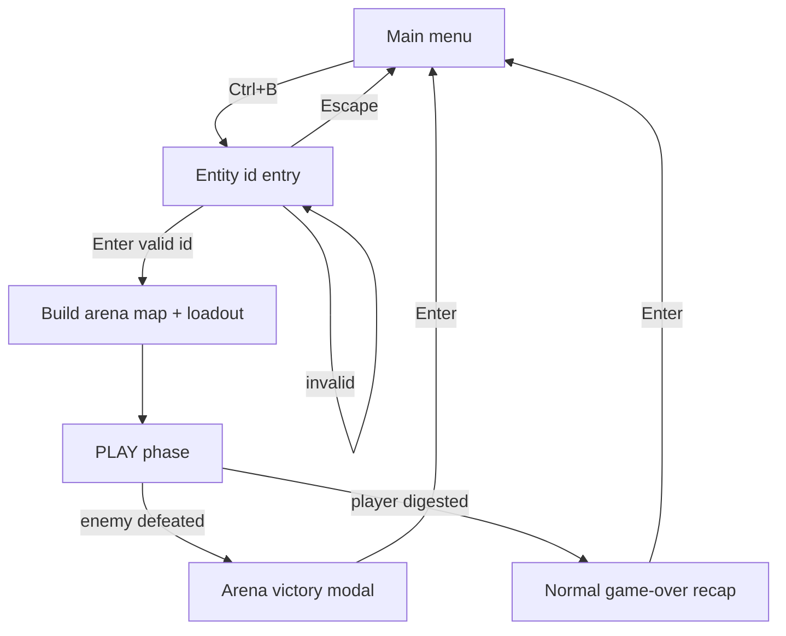
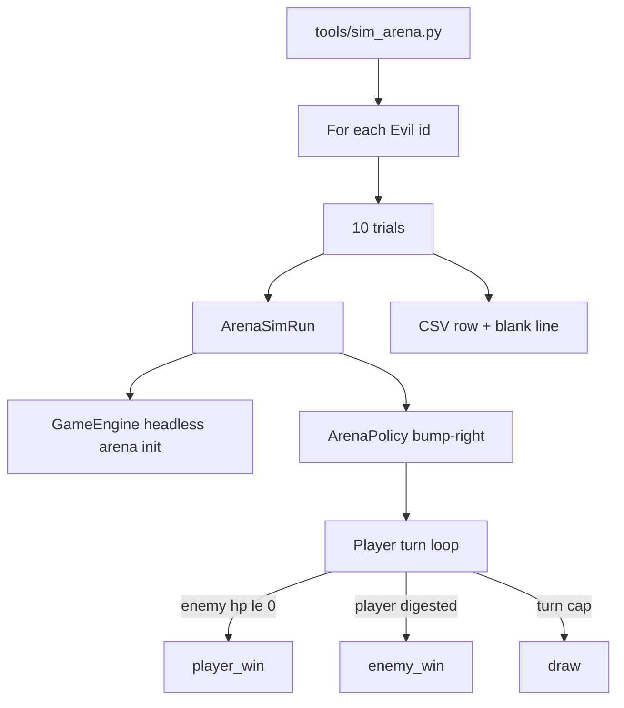

# Design: 1v1 arena

| Field | Value |
|-------|-------|
| **Date** | 2026-07-15 |
| **Status** | Approved — designer answers incorporated (2026-07-15) |
| **Change** | `1v1-arena` |

---

## Overview

A hidden **Ctrl+B** chord on the main menu opens an **entity-id entry** screen. Confirming a valid **Evil** id starts a **1×10 hallway duel**: player at the far left, chosen enemy at the far right, loadout synthesized from the depth-jump algorithm at **`loot_depth = spawn.min_depth − 1`**. The fight runs under the player's **Options → Difficulty** setting; the status corner shows **Depth = spawn.min_depth**.

Arena runs are **out-of-band**: no autosave, Ctrl+S shows `"Game saved."` but does not persist, `level_warped = true` suppresses Past Runs. Victory shows a short modal and returns to the main menu; digestion uses the normal game-over recap (still no Past Runs).

A follow-up headless tool **`tools/sim_arena.py`** runs **10 trials per Evil entity** with a minimal bump-right bot and exports CSV for balance review.

---

## Resolved decisions

| # | Topic | Decision |
|---|--------|----------|
| 1 | Trigger | **Ctrl+B** on main menu only |
| 2 | Player name | Fixed **`Player`** — no name-entry step |
| 3 | Save / autosave | **No persistence** in arena; skip all `SaveCoordinator` enqueue/write; **Ctrl+S** still posts **`"Game saved."`** (no-op) |
| 4 | Save overwrite prompt | **None** — arena is separate from the save slot |
| 5 | `level_warped` | **`true` from arena start** → skip Past Runs append on digestion game-over |
| 6 | Entity eligibility (interactive) | **All Evil ids** in the active entity registry (**mods included**); **`spawn.weight` ignored** (forced spawn) |
| 7 | `placeholder` field | **Ignored** — no gameplay effect today; not used for filtering |
| 8 | Id matching | **Case-sensitive** exact id |
| 9 | Invalid id error | **`"Unknown entity id."`** |
| 10 | Non-evil id error | **`"That entity is not Evil alignment."`** |
| 11 | Entity list UI | **Display-only** reference in **three columns**; player **must type** id in text box; maximize list area (entry field may sit low on screen) |
| 12 | List ordering | **Alphabetical** by entity id |
| 13 | Cancel | **Escape** → main menu |
| 14 | Arena geometry | **1 tile wide × 10 long** playable hallway; **solid walls** on top and bottom |
| 15 | Spawn positions | Player **`x=0`**, enemy **`x=9`** (zero-indexed), shared center **`y`** row |
| 16 | Aquatic enemy | **One `DEEP_WATER` tile** under the enemy at the right end |
| 17 | Flyers | **No special casing** — existing flyer rules in 1-wide hall |
| 18 | Enemy prefix | **Never roll** — deterministic base stats |
| 19 | Enemy depth scaling | Bake stats at **`spawn.min_depth`** using **current difficulty** profile |
| 20 | Displayed depth | Status corner **`floor_depth = spawn.min_depth`** |
| 21 | Player loadout | Reuse **`apply_depth_jump_loadout(..., target_depth=spawn.min_depth)`** — same rules as Ctrl+G depth-jump |
| 22 | `min_depth == 1` | **Starter loadout** (depth-jump depth-1 behavior) |
| 23 | Difficulty | **Options → Difficulty** at arena start (same as normal play) |
| 24 | Victory | **Immediate freeze** on enemy defeat; modal **`You have defeated the {enemy name}!`** (`entity_log_name` style); **Enter** → main menu |
| 25 | Victory condition | Enemy **`hp <= 0`** from **any source** (melee, thrown, wand, vore struggle, etc.) |
| 26 | Player loss | **Digested only** for scoring; **stunned is not game-over** — play continues (player may use items) |
| 27 | Digestion flow | **Normal game-over / recap** presentation; Enter → main menu via existing dismiss path; **no Past Runs** |
| 28 | Past Runs | **`level_warped` skip is sufficient** (designer term: Past Runs ≈ high-score table) |
| 29 | PR order | **PR1** interactive arena; **PR2** headless bot + live spec |
| 30 | Live spec id | **`1v1-arena`** → `openspec/specs/1v1-arena/spec.md` on ship |

### Headless bot (`tools/sim_arena.py`)

| # | Topic | Decision |
|---|--------|----------|
| 31 | CLI | **`python tools/sim_arena.py`** — separate from `sim_balance.py` |
| 32 | Data | **Honor enabled mods** (user mod settings / active registries) |
| 33 | Difficulty | **`--difficulty`** default **`normal`**; one of `easy\|normal\|hard\|nightmare` |
| 34 | Entity set | **All Evil ids** in active registry (including **`spawn.weight == 0`**) |
| 35 | Trials | **10 per entity** |
| 36 | Policy | **No consumables**; (1) bump / move into nearest visible Evil, else (2) **move right** (acceptable while engulfed) |
| 37 | Seed | **Random by default**; report seed in output metadata; optional **`--seed`** |
| 38 | Turn cap | **1000** player turns per trial |
| 39 | Player win | Enemy defeated |
| 40 | Enemy win | Player **digested** (all Evil vore stunned prey — anomalies may stalemate) |
| 41 | Draw | Turn cap with **no winner**; consumes **one of 10 trials**; **no win increment**; **no HP sample** |
| 42 | CSV wins | **`player_wins`** and **`enemy_wins`** integers (0–10); **`player_wins + enemy_wins ≤ 10`**; gap implies draws |
| 43 | CSV HP | **`player_win_hp_remaining`** — avg player HP% (**`hp/max_hp×100`**) across **player-win** trials only; **`enemy_win_hp_remaining`** — avg enemy HP% across **enemy-win** trials only; omit or leave blank when divisor is 0 |
| 44 | CSV layout | **Compare sheet** (`metric` column + one column per run); repeated per-entity metric rows; `--append` adds columns like `balance_compare.csv` |
| 45 | Execution | Headless `GameEngine(save_coordinator=None)`; reuse **`src/sim/modals.py`** babysitter for vore/digestion prompts |

---

## Arena map

New helper `build_arena_map(*, aquatic_enemy: bool) -> GameMap`:

| Property | Value |
|----------|-------|
| Width | **10** playable floor tiles (plus wall border as needed) |
| Walkable row | Single **FLOOR** row, `y = center` |
| Walls | **WALL** tiles above and below the walkable row |
| Explored | **Entire map explored** at start |
| Aquatic | If enemy is aquatic (`mobility == aquatic` or `spawn_requires_water`), set **`(9, center)`** to **`DEEP_WATER`** before spawning the enemy |

No stairs, doors, items, floor runes, macguffins, or random population.

---

## Loadout and depth

For enemy definition `E` with `d = E.spawn.min_depth`:

| `d` | Player gear |
|-----|-------------|
| **1** | `apply_starter_loadout` |
| **≥ 2** | `apply_depth_jump_loadout(player, target_depth=d, ...)` — simulates runes on floors `1 … d−1` |

Engine state for arena:

| Field | Value |
|-------|-------|
| `arena_mode` | `true` |
| `arena_enemy_id` | chosen id (for victory copy / tests) |
| `level_warped` | `true` |
| `floor_depth` | `d` (display + enemy scaling reference) |

---

## Enemy spawn

`spawn_from_definition(...)` at `(9, center)`:

- `floor_depth = spawn.min_depth`
- `difficulty_id` = engine difficulty
- `roll_prefix = False`
- `arm_spawn_freeze = True` (optional — prevents AI freeze edge cases if needed)

Use forced spawn by id (not procedural weight tables).

---

## UI: entity entry

New `src/entity_entry.py` (mirrors `name_entry.py` / `depth_entry.py`):

| Element | Behavior |
|---------|----------|
| Prompt | e.g. `Enter entity id:` |
| Text buffer | Printable id characters; backspace; **Enter** confirms; **Escape** cancels |
| Error line | Shown below buffer when validation fails |
| Id list | All Evil ids, **sorted**, rendered in **three columns** over remaining vertical space |
| Selection | **Display only** — no list navigation |

Validation on Enter:

1. Exact id lookup in active registry (case-sensitive).
2. If missing → `"Unknown entity id."`
3. If `alignment != evil` → `"That entity is not Evil alignment."`
4. Else → start arena.

New `AppPhase.ENTITY_ENTRY`. Flow:

`MENU` → (Ctrl+B) → `ENTITY_ENTRY` → (Enter valid) → `_start_arena_game(...)` → `PLAY`.

---

## Save isolation

When `engine.arena_mode` is true:

| Hook | Behavior |
|------|----------|
| `SaveCoordinator.on_play_enter` | **No-op** |
| `on_player_turn_end` | **No-op** |
| `on_descend_floor` | **No-op** (descent unreachable in arena anyway) |
| `save_now` (Ctrl+S) | Return **`true`** without writing; still log `"Game saved."` |
| `queue_background_save` (Ctrl+Q) | **No-op** or skip enqueue (quit confirm may still appear — arena has no save to flush) |

Do **not** delete or overwrite the player's existing autosave slot when entering or leaving arena.

---

## Victory and defeat

### Victory (enemy defeated)

Subscribe (or check in existing `on_entity_defeated` handler) when `arena_mode` and defeated entity is the arena enemy:

1. Set `engine.arena_victory_active = True` (or equivalent) — **block further player commands**.
2. Auto-resolve / skip unrelated modals.
3. App draws arena victory modal: **`You have defeated the {name}!`** using the enemy's log display name (e.g. rat → `"You have defeated the rat!"`).
4. **Enter** → `_return_to_menu()`; tear down engine / arena flags.

### Defeat (digested)

Use existing digestion → game-over → recap chain. `finalize_game_over(..., level_warped=True)` skips Past Runs. Recap dismiss → main menu (existing `RECAP_DISMISSED` path).

---

## Headless bot architecture

**`ArenaPolicy`** (new, in `src/sim/` or `src/arena/`):

1. If nearest visible **Evil** in FOV → move to bump attack (reuse sim perception / navigation helpers where practical).
2. Else → move **right** `(+1, 0)`; valid even if engulfed.

**No** potion, wand, rest, or throw unless bump path implies melee.

**`ArenaSimRun`** initializes the same map/loadout/spawn path as interactive arena (shared `initialize_arena` function).

### Compare-sheet CSV

| Column | Content |
|--------|---------|
| `metric` | Meta rows (`meta.seed`, `meta.difficulty_id`, `meta.trials_per_entity`, `meta.max_turns`), then per entity the six field names (`enemy_id` … `enemy_win_hp_remaining`), blank row, repeat |
| Run columns | One per invocation; `--append` adds the next column |

Stdout still prints `seed: <n>` for the run.

---

## Code layout

| Module | Role |
|--------|------|
| `src/entity_entry.py` | Entity id input UI + three-column list render |
| `src/arena_map.py` | `build_arena_map` |
| `src/arena.py` | `initialize_arena(engine, entity_id, ...)` — map, player, enemy, loadout |
| `src/menu.py` | `is_ctrl_b` |
| `src/app.py` | Ctrl+B, `ENTITY_ENTRY` phase, `_start_arena_game`, victory modal |
| `src/engine.py` | `arena_mode`, `arena_enemy_id`, `arena_victory_active` flags |
| `src/save/coordinator.py` | Respect `arena_mode` no-op hooks |
| `src/sim/arena_policy.py` | Headless bump-right policy (PR2) |
| `src/sim/arena_runner.py` | Single trial loop (PR2) |
| `tools/sim_arena.py` | CLI + CSV export (PR2) |

Reuse: `apply_depth_jump_loadout`, `spawn_from_definition`, `entity_log_name`, `src/sim/modals.py` babysitter.

---

## Testing

| Area | PR | Tests |
|------|-----|-------|
| Entity validation | PR1 | Unknown id, good/neutral rejected with exact messages |
| Entity list | PR1 | Evil ids only; includes weight-0 evil |
| Map geometry | PR1 | Player/enemy coords; aquatic water tile |
| Loadout depth | PR1 | `min_depth` 1 → starter; `min_depth` N → depth-jump at N |
| `level_warped` | PR1 | No past-runs append on arena digestion |
| Victory modal | PR1 | Enemy defeat freezes play; copy includes name |
| Save no-op | PR1 | Ctrl+S message without file write; no autosave enqueue |
| Arena policy | PR2 | Bump visible evil; else move right; no consumables |
| Sim scoring | PR2 | Wins, draws, HP averages; `player_wins + enemy_wins` ≤ 10 |
| Turn cap | PR2 | 1000-turn draw increments trial without win |

Pin **fixture JSON** in tests — never assert on live `data/` balance numbers.

---

## Risks

| Risk | Mitigation |
|------|------------|
| Enemy without vore stalls bot | Document as anomaly; draw at turn cap; wins columns won't sum to 10 |
| Full-map systems assume stairs/macguffins | Arena init skips population; block descent |
| `on_entity_defeated` fires for wrong entity | Tag arena enemy entity; only victory when that entity is defeated |
| Engulfed player moving right | Explicitly allowed per designer |
| Mod empty evil registry | Empty list + validation error on any entry |

---

## Manual testing

See `testing-checklist-pr1.md` / `testing-checklist-pr2.md` (written at implementation).