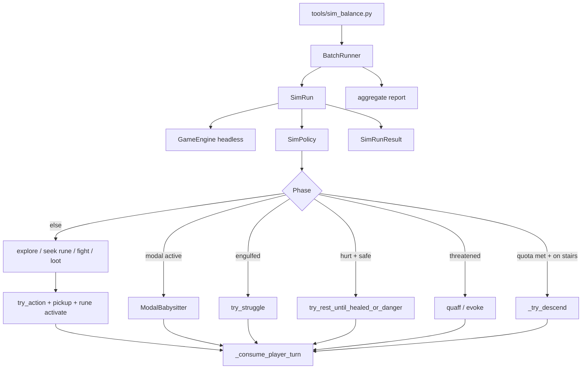

# Design: Balance play simulator

| Field | Value |
|-------|-------|
| **Date** | 2026-07-10 |
| **Status** | **Deferred** — design locked 2026-07-10; implementation paused by designer |
| **Change** | `add-balance-simulator` |
| **Spec targets** | New `balance-simulator`; light touch `balance` (cross-reference only) |

---

## Overview

A **headless play simulator** drives `GameEngine` turn-by-turn through a **policy layer** (`src/sim/`) that calls existing movement, combat, inventory, rest, and floor systems directly. A CLI entry point (`tools/sim_balance.py`) runs single or batch simulations in the background, emitting per-run and aggregate statistics for balance review.

The bot is intentionally **imperfect** — tie-break randomness, no macguffin hunt, no door tactics — but follows clear priorities: **stay healthy**, **collect runes**, **use resources when outnumbered**, **avoid sharks**, **descend when the floor quota is met**.

---

## Resolved decisions

| # | Topic | Decision |
|---|--------|----------|
| 1 | Execution model | Headless `GameEngine(save_coordinator=None)`; no `tcod.context`; no render loop |
| 2 | Action path | Direct system/engine calls (`try_action`, `quaff_potion_from_slot`, `_wield_from_slot`, etc.); **not** synthetic `KeyDown` through `handle_event` |
| 3 | Live data | Default loaders with `path=None` — core `data/` + **enabled mods** from user settings (same as New Game) |
| 4 | Test fixtures | Unit tests may use minimal maps; **the simulator itself never loads fixture JSON for entities/items** |
| 5 | Default difficulty | **Normal**; CLI `--difficulty` overrides per run/batch |
| 6 | Macguffins | **Out of scope** — bot descends for depth/rune metrics until stunned or digested |
| 7 | Engulfed player | **Struggle every turn** (direction toward nearest walkable escape if multiple; else random legal direction) |
| 8 | Floor rune quota | Use `engine.runes_per_floor()` (respects difficulty override); descend when **this floor's** collected count ≥ quota |
| 9 | Shark policy | **Avoid** — do not bump-attack sharks; path away when a visible shark is within threat radius; other evils may be fought |
| 10 | Multi-threat consumables | When **≥2 visible evil** NPCs (or ≥2 adjacent evil), freely quaff heal/might/haste and evoke wands before melee |
| 11 | Rest priority | Rest (`try_rest_until_healed_or_danger`) whenever HP &lt; max, not stunned/engulfed, and rest system reports safe start |
| 12 | Gear upgrades | Pick up visible floor items in weapon/armor/potion/wand categories; wield/wear if **strictly better** by simple stat compare |
| 13 | Imperfection | ~10% chance to skip optional rest when HP ≥ 70%; random BFS tie-break among equal-distance goals; no ally/command tactics |
| 14 | Output | Per-run JSON lines + optional batch summary (median depth, p10/p90, ending histogram, mean runes) |
| 15 | Turn cap | Safety `max_turns` per run (default 50_000) to catch infinite loops in development |

---

## Current baseline (code facts)

| Piece | Today |
|-------|--------|
| Engine bootstrap | `GameEngine()` calls `new_game()`; `skip_new_game=True` for controlled setup |
| Headless turns | `tools/profile_turn.py` calls `_consume_player_turn()` without a window |
| Rest sync API | `try_rest_until_healed_or_danger` — documented for tests/tooling |
| Pathfinding | `map_gen.bfs_path_distances_from_mask`, `stairs_positions`, `game_map.explored` |
| Rune tracking | `RunStats.runes_collected` cumulative; per-floor delta tracked in sim state |
| Live registries | `load_entity_registry(path=None)` layers mods; `item_registry()`, `default_depth_scaling_config()` |
| Shark identity | `entities.json` id `shark`, `mobility: aquatic`, `spawn_requires_water: true` |
| Modal blockers | Vore, digestion, game over, inventory, ground pickup, macguffin confirm |
| Effective stats | `inventory.effective_fighter(player)` for compare-after-equip |

---

## Architecture



### Package layout

| Path | Role |
|------|------|
| `src/sim/runner.py` | `SimRun`, turn loop, termination, `SimRunResult` dataclass |
| `src/sim/policy.py` | Priority-ordered `choose_action(engine) -> SimAction` |
| `src/sim/navigation.py` | BFS goals: unexplored frontier, visible runes, stairs, flee-from-shark |
| `src/sim/inventory_policy.py` | Pickup triage, equip-compare, consumable use |
| `src/sim/modals.py` | Advance vore/digestion/game-over; auto-confirm ground pickup all |
| `src/sim/perception.py` | Visible evils, shark detection, threat counts, floor item scan |
| `src/sim/stats.py` | Per-run metrics + batch aggregation |
| `tools/sim_balance.py` | CLI: `--seed`, `--runs`, `--difficulty`, `--output`, `--max-turns` |

### Turn loop (one iteration)

1. **Terminate check** — `game_over.active` → record ending and stop.
2. **Modal babysitter** — if vore/digestion/game-over modal active → advance one segment (Enter equivalent via `advance_vore_modal` / `advance_digestion_modal`); ground pickup → take all; skip macguffin confirm (never triggered — bot does not activate macguffins).
3. **Rest in progress** — if `rest_session.active`, call `advance_rest_frame` until frame finished (sync batched turns).
4. **Policy** — `SimPolicy.decide(engine)` returns action kind:
   - `REST`, `MOVE`, `ATTACK` (via `try_action` direction), `DESCEND`, `STRUGGLE`, `USE_CONSUMABLE`, `EQUIP`, `WAIT`.
5. **Execute** — call the underlying system function; on success that consumes a player turn (or rest batch).
6. **Floor transition** — on descend, reset per-floor rune counter snapshot.

### Navigation and goals (priority order)

When not resting, threatened, or modal-blocked:

| Priority | Goal | Method |
|----------|------|--------|
| 1 | Visible floor loot (weapon/armor/potion/wand) | BFS to nearest visible `InventoryItem` on ground |
| 2 | Visible uncollected rune | BFS to nearest visible `FloorRune` entity |
| 3 | Visible evil (not shark) adjacent | `try_action` toward that tile (attack) |
| 4 | Visible shark within radius 6 | BFS **away** (maximize distance from shark) |
| 5 | Quota met | BFS to nearest `STAIRS_DOWN` tile |
| 6 | Default | BFS to nearest `explored` frontier tile (explored adjacent to unexplored) |

One step per turn: take the **first step** on the chosen BFS path. Random tie-break when multiple goals equidistant.

### Floor rune quota

```text
on floor enter:  floor_runes_at_start = run_stats.runes_collected
each turn:       floor_runes = run_stats.runes_collected - floor_runes_at_start
descend when:    floor_runes >= engine.runes_per_floor() AND player on stairs tile
```

Stock Normal = 3 runes/floor; Easy/Hard/Nightmare overrides apply automatically via `engine.runes_per_floor()`.

### Threat and consumables

**Threatened** when any of:

- `visible_evil_count >= 2`
- `adjacent_evil_count >= 2`
- `player.hp < 0.4 * player.max_hp` and `visible_evil_count >= 1`

**Response order** (each step tries at most one; reckless use OK):

1. Quaff best healing potion if `hp < 0.6 * max_hp`.
2. Evoke wand at nearest visible evil (not shark if another evil exists).
3. Quaff might or haste if threatened and potion available.
4. Quaff summon-ally potion if threatened and no good ally adjacent (optional v1 — defer if complex).

Wand targeting reuses `build_evoke_targets` + `confirm_wand_evoke` with nearest-evil index.

### Shark avoidance

A **shark** is any visible entity where `entity_type_id == "shark"` **or** `MobilityType.AQUATIC` on an evil NPC.

- Never `try_action` into a shark tile intentionally.
- If the only visible evil is a shark, flee (priority 4) rather than attack.
- If shark and other evil both visible, fight the non-shark; flee only when shark is the primary adjacency threat.

### Equipment comparison

**Weapon strictly better** if `(min_damage + max_damage)` greater than current wielded, breaking ties by `accuracy_bonus`.

**Armor strictly better** if `ac_bonus` greater than current worn.

After floor pickup (automatic on step) or explicit pickup, call `_wield_from_slot` / `_wear_from_slot` when the new item wins compare. Drop old gear only via implicit swap (no drop logic in v1).

### Rest policy

Before navigation each turn:

- If `hp == max_hp` → skip rest.
- If engulfed or stunned → skip rest (handle struggle/stun separately).
- If `hp < max_hp` and rest would start (`begin_rest_until_healed_or_danger` not blocked) → rest unless imperfection roll skips and `hp >= 0.7 * max_hp`.
- Use synchronous `try_rest_until_healed_or_danger` (consumes many turns in one policy call — acceptable for sim speed).

### Engulfed / vore modal

- **Vore modal active** → `advance_vore_modal` each turn until segment clears (babysitter).
- **Engulfed, no modal** → `try_struggle` toward best escape direction; always consumes turn.
- No vore initiation by the bot (player never seeks adjacent predator bump for vore).

### Live data loading

On sim startup (once per process):

1. Load settings via `SettingsStore` (user data dir) for `difficulty_id` default and enabled mods.
2. Call `load_entity_registry()` / `item_registry()` / `default_depth_scaling_config()` with default paths — **no explicit fixture path**.
3. Construct `GameEngine(difficulty_id=cli_or_settings, save_coordinator=None)`.
4. `new_game(seed=seed)` — full map gen, spawn, rune placement identically to New Game.

**Mod fingerprint** is not gated for sim (no save); mod load errors surface to stderr and abort the run if registry load fails (same as game would at startup).

### Output schema (`SimRunResult`)

| Field | Type | Notes |
|-------|------|-------|
| `seed` | int | |
| `difficulty_id` | str | |
| `ending` | str | `stunned`, `digested`, `cap_turns`, etc. |
| `depth_reached` | int | `floor_depth` at end |
| `runes_collected` | int | cumulative |
| `monsters_defeated` | int | |
| `turns_played` | int | `player_turn_count` |
| `hp_at_end` | int | |

Batch summary adds percentiles and histogram keyed by `ending`.

### CLI sketch

```text
python tools/sim_balance.py --runs 100 --difficulty normal --output results.jsonl
python tools/sim_balance.py --seed 42            # single run, print summary
python tools/sim_balance.py --runs 500 --jobs 4  # optional parallel by seed (PR5)
```

Runs as a normal Python background process; no window focus required.

---

## Testing strategy

| Layer | Approach |
|-------|----------|
| Navigation | Unit test BFS goal pick on toy `GameMap` |
| Equip compare | Unit test weapon/armor ordering |
| Shark flee | Spawn shark in isolated map; assert policy direction increases distance |
| Smoke | One seeded headless run completes ≥10 turns without exception |
| Stall guard | Policy returns WAIT at most N consecutive times before assert (dev test) |
| Live data smoke | Single run with `path=None` loaders reaches depth ≥2 on fixed seed (flaky guard: seed pinned in test after calibration) |

**Regression:** existing `pytest` suite unchanged; sim tests in `tests/test_sim_*.py`.

---

## Performance notes

- NPC AI dominates turn cost (same as `profile_turn.py`).
- Rest batches many turns per policy call — **speeds up** sim vs one-key-per-turn.
- Batch 100 runs × ~2000 turns ≈ few minutes serial; optional `--jobs` in PR5 for parallelism.
- Not a CI gate.

---

## Risks and mitigations

| Risk | Mitigation |
|------|------------|
| Bot stalls in corner / door | Turn cap + consecutive-WAIT detector; tune exploration goal |
| Private modal helpers change | Sim imports from `item_modals` — if needed, expose thin public wrappers in PR4 |
| Difficulty rune override ≠ 3 | Use `engine.runes_per_floor()` not hardcoded 3 |
| Modded entities break threat heuristics | Type-id-agnostic alignment + mobility checks; shark by id **or** aquatic |
| Sim diverges from real play | Acceptable for balance trends; document as approximate |

---

## PR Plan

### PR1 — Runner shell, modal babysitter, stats export

**Files:** `src/sim/runner.py`, `src/sim/modals.py`, `src/sim/stats.py`, `tools/sim_balance.py`, `tests/test_sim_runner.py`

- Headless `SimRun` loop with turn cap and termination
- Modal advance (vore, digestion, game-over dismiss)
- Engulfed struggle stub (random direction)
- `SimRunResult` + single-seed CLI
- **No navigation policy yet** — WAIT/spin stub replaced in PR2

**Depends on:** none

---

### PR2 — Navigation, rune quota, descend

**Files:** `src/sim/navigation.py`, `src/sim/perception.py`, `src/sim/policy.py`, `tests/test_sim_navigation.py`

- BFS explore / rune seek / stairs
- Per-floor rune counter; descend when quota met
- Basic `try_action` move into unexplored
- Shark flee direction (distance increase)

**Depends on:** PR1

---

### PR3 — Combat threat + consumables + rest priority

**Files:** `src/sim/inventory_policy.py` (consumables only), `src/sim/policy.py`, `tests/test_sim_threat.py`

- Visible/adjacent evil counting
- Multi-threat wand + potion use
- `try_rest_until_healed_or_danger` integration
- Imperfection skip rest roll

**Depends on:** PR2

---

### PR4 — Loot pickup and equipment upgrades

**Files:** `src/sim/inventory_policy.py` (equip), `tests/test_sim_equip.py`

- Visible loot goal (priority over generic explore)
- Weapon/armor strict-compare equip after pickup
- Ground pickup modal auto-take-all path

**Depends on:** PR3

---

### PR5 — Batch harness and aggregate reports

**Files:** `src/sim/stats.py`, `tools/sim_balance.py`, `tests/test_sim_batch.py`

- `--runs N` with seed sequence
- JSONL per-run output + stdout summary table
- Optional `--jobs` multiprocessing
- `testing-checklist-pr5.md` for designer manual validation

**Depends on:** PR4

---

### PR6 — Spec and archive prep

**Files:** `openspec/specs/balance-simulator/spec.md`, `testing-checklists.md`

- Behavioral requirements for simulator
- Cross-reference from `balance` spec
- Final acceptance checklist

**Depends on:** PR5

---

## Key Decisions

1. **Direct API over synthetic input** — faster, easier to test, matches `profile_turn.py` / rest tooling pattern; tiny divergence from keypath is acceptable for aggregate stats.

2. **`src/sim/` package** — keeps bot logic out of `GameEngine` and `app.py`; game code unchanged except optional tiny public wrappers if private imports prove fragile.

3. **Dynamic rune quota** — `engine.runes_per_floor()` not literal 3; keeps sim valid across difficulty edits.

4. **Shark by id + aquatic mobility** — future-proofs modded water predators without hardcoding only `shark`.

5. **Normal default difficulty** — matches stock balance baseline; CLI override for sweeps.

6. **Struggle always when engulfed** — maximizes escape data; does not model player accepting digestion.

7. **No macguffin pursuit** — simpler policy and metrics focused on floor progression (designer choice).

8. **Enabled mods included** — sim reflects what the designer actually plays with; document seed + mod set when comparing runs.

---

## Open Questions

None — all resolved in designer Q&A (2026-07-10).