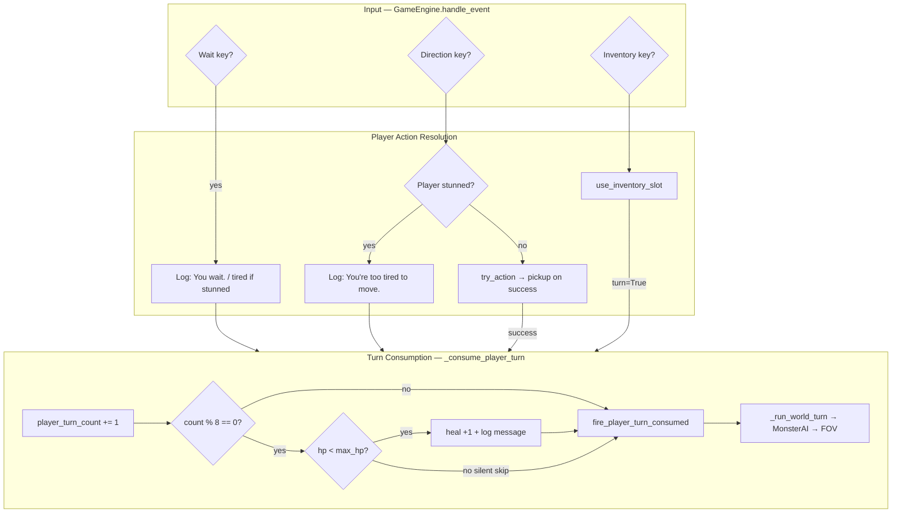

# Design: Enhancements 1 — Wait, Natural Regen, Stunned Turn Pass

| Field | Value |
|-------|-------|
| **Author** | Systems Design |
| **Date** | 2026-06-29 |
| **Status** | Revised (review addressed 2026-06-29) |
| **Change** | `openspec/changes/add-enhancements-1/` |
| **Spec target** | `openspec/specs/enhancements-1/spec.md` |
| **Prerequisite** | Core roguelike v1 shipped (`openspec/specs/core-roguelike/spec.md`) |
| **Blocks** | None — ships **before** on-hold vore module (`openspec/changes/add-vore-mechanics/`) |

---

## Overview

This change adds three quality-of-life combat-recovery mechanics on top of the shipped core loop:

1. **Pass/wait turn** — player explicitly ends their turn via **numpad 5** or **period** (`.`), logging a message and running the world phase.
2. **Passive natural recovery** — **1 HP every 8 player turns**, using existing `heal()` and `sync_stunned_state()` so stunned players can eventually recover without potions.
3. **Stunned movement consumes a turn** — pressing a movement key while stunned shows **"You're too tired to move."** and **advances the world phase** (replacing the current silent no-op gate).

These features partially implement the **stunned pass-turn module** deferred in the vore design (`openspec/changes/add-vore-mechanics/design.md`, §Deferred: stunned action module). Only **movement** is in scope here; inventory while stunned remains per core spec AC6.

---

## Background & Motivation

### Current state (verified in codebase)

**Turn loop** (`src/engine.py`):

```text
Input → [StunnedGate on movement only] → try_action / use_inventory_slot → _run_world_turn → MonsterAI → FOV
```

| Action | Turn consumed? | Notes |
|--------|----------------|-------|
| Successful move / bump attack | Yes | `try_action` returns `True` → pickup → `_run_world_turn()` |
| Wall-blocked move / out-of-bounds | No | `try_action` / `try_move` return `False` |
| Movement while stunned | **No** | Engine gate at line 99: `Stunned not in self.player.tags` — key ignored silently |
| `try_action` while stunned | No | `combat.py` lines 93–94 return `False` |
| Inventory use (incl. while stunned) | Yes (if slot non-empty) | `use_inventory_slot` returns `True` → `_run_world_turn()` |
| Empty inventory slot | No | `slot_empty` message, no world phase |
| Unrecognized keys | No | — |
| Wait / pass | **Not implemented** | Numpad 5 absent from `DIRECTION_KEYS` (`src/input_handlers.py`) |

There is **no `turn_count`** anywhere in the repo today. Passive regeneration does not exist.

**Stunned recovery path today**: potion only (`HEALTH_POTION_HEAL = 10` in `src/constants.py`), or debug key **S** (`_toggle_stunned_debug`). A stunned player with no potions and no wait key is effectively soft-locked until a monster bumps them (no damage at 0 HP) or the player discovers debug **S**.

**Tests** (`tests/test_acceptance.py`): 10 passing. `test_ac6_stunned_and_potion_while_stunned` asserts `try_action` returns `False` when stunned (direct API call, not engine input). Core spec scenario *"Stunned player cannot move or attack"* expects **no turn advance** — this change **supersedes** that scenario for movement input routed through the engine.

**Vore on hold**: `openspec/changes/add-vore-mechanics/` explicitly deferred stunned pass-turn ("not enough energy to move" on any action). This enhancements change delivers the **movement slice** now with copy **"You're too tired to move."** so vore can later extend inventory/pass-turn without reworking turn accounting.

### Pain points

1. No way to **pass time** while kiting monsters or recovering off-combat.
2. Stunned at 0 HP with empty inventory is **unwinnable** without debug tooling.
3. Stunned movement is a **silent no-op** — poor feedback and blocks natural-regen pacing.

---

## Goals & Non-Goals

### Goals

- Add **wait keys**: numpad **5**, **period**, and **`H`** — always available, including while stunned.
- Add **keyboard movement** via **`TYUGHJBNM`** (cardinals + diagonals; `H` is wait only, not movement).
- Define and implement **player turn counter** with a single consumption helper used by all turn-advancing paths.
- Apply **natural regen**: `+1 HP` on every **8th** player turn when `hp < max_hp`; silent at full HP.
- Route stunned movement through engine: message + turn consumption + world phase.
- Reuse `heal()` / `sync_stunned_state()` from `src/systems/combat.py` for regen (clears `Stunned` when HP > 0).
- Add `openspec/specs/enhancements-1/spec.md` and `openspec/changes/add-enhancements-1/` artifacts.
- Extend automated tests in `tests/test_enhancements_1.py` (engine input harness); keep `test_ac6` as core API-only contract.
- Add **`on_player_turn_consumed`** event hook (`src/events.py`, PR4) — fires after each consumed player turn so future systems (e.g. vore digestion timers) can tick without importing engine internals.
- Update README controls table.

### Non-Goals

- Stunned **inventory** pass-turn — only **movement** wastes a turn while stunned; potions OK; empty slots message-only (core AC6).
- Vore, engulfed, digestion, or any `src/vore*` modules.
- Save/load of turn counter.
- Regen tuning UI, difficulty modes, or class-based recovery.
- Changing wall-blocked movement to consume turns.
- HUD turn counter, on-screen controls legend, regen visual flash.
- Classic vi-keys (`hjkl yubn`) — replaced by **`TYUGHJBNM`** layout (no inventory overlap).

---

## Proposed Design

### High-level flow



### Player turn definition

A **player turn** is one input-driven action after which the **world phase** runs (`_run_world_turn`).

| Input / path | Counts as player turn? | After this change |
|--------------|------------------------|-------------------|
| Wait (`KP_5`, `.`) | **Yes** | New |
| Successful move or bump attack | Yes | Unchanged |
| Movement while stunned | **Yes** | **Changed** (was No) |
| Movement blocked by wall/OOB | No | Unchanged |
| Inventory use with item in slot | Yes | Unchanged (incl. while stunned) |
| Empty inventory slot | No | Unchanged |
| Debug **R** / **S** | No | Unchanged |
| Escape quit | N/A | Unchanged |

**Regen cadence**: `player_turn_count` increments **once per consumed turn**, then regen is evaluated. Natural recovery fires when `player_turn_count % NATURAL_REGEN_EVERY_N_PLAYER_TURNS == 0` **after** increment.

- First regen tick: turn **8** (not turn 0 at `new_game`).
- Counter resets to **0** at the **start** of `new_game()` — required because debug **R** calls `new_game()` without reconstructing the engine (`engine.py:88–90`). Also set `self.player_turn_count = 0` in `__init__`.
- Counter is **not** incremented on invalid/no-op inputs.

### Constants (`src/constants.py`)

```python
NATURAL_REGEN_HP = 1
NATURAL_REGEN_EVERY_N_PLAYER_TURNS = 8
```

### Turn consumption helper (`src/engine.py`)

Centralize duplicated `_run_world_turn()` calls:

```python
def new_game(self, *, seed: int | None = None) -> None:
    ...
    self.player_turn_count = 0  # reset on R-key regen and __init__ path
    ...

def _consume_player_turn(self) -> None:
    """Advance player turn counter, apply natural regen, fire hook, run world phase."""
    if self.player is None:
        return
    self.player_turn_count += 1
    self._apply_natural_regen()
    fire_player_turn_consumed(self.player)
    self._run_world_turn()

def _apply_natural_regen(self) -> None:
    if self.player is None:
        return
    if self.player_turn_count % NATURAL_REGEN_EVERY_N_PLAYER_TURNS != 0:
        return
    fighter = self.player.components.get(Fighter)
    if fighter is None or fighter.hp >= fighter.max_hp:
        return  # no heal, no message
    healed = heal(self.player, NATURAL_REGEN_HP)
    if healed > 0:
        self.message_log.add(messages.natural_regen(healed))
```

**Regen at max HP**: no `heal()` call, **no log message** (mirrors `potion_no_effect` policy but without messaging).

**Regen clearing stunned**: `heal()` calls `sync_stunned_state()` — when `fighter.hp` goes from 0 → 1, `Stunned` tag is discarded. No extra engine logic required.

### Wait / pass turn

### Keyboard movement (`TYUGHJBNM`)

Always-on letter movement in addition to arrows and numpad. Does not overlap inventory `a`–`z`.

```text
T   U     diagonal up (NW, NE)
  Y       north
G H J     west, WAIT, east
  N       south
B   M     diagonal down (SW, SE)
```

```python
# src/input_handlers.py — merged into DIRECTION_KEYS lookup
KEYBOARD_DIRECTION_KEYS: Final[dict[KeySym, tuple[int, int]]] = {
    KeySym.y: (0, -1),   # Y north
    KeySym.n: (0, 1),    # N south
    KeySym.g: (-1, 0),   # G west
    KeySym.j: (1, 0),    # J east
    KeySym.t: (-1, -1),  # T NW
    KeySym.u: (1, -1),   # U NE
    KeySym.b: (-1, 1),   # B SW
    KeySym.m: (1, 1),    # M SE
}
# DIRECTION_KEYS = {**arrow/numpad map**, **KEYBOARD_DIRECTION_KEYS}
```

`H` is **not** in `DIRECTION_KEYS` — it is a wait key only.

### Wait keys

```python
WAIT_KEYS: Final[frozenset[KeySym]] = frozenset({
    KeySym.KP_5,
    KeySym.PERIOD,
    KeySym.h,  # H — same cell as wait in TYUGHJBNM layout
})
```

**Engine handler** — wait `case` **after** quit/debug (`R`, `S`), **before** inventory and direction keys. `H`/`h` ∉ `INVENTORY_KEYS`; `KP_5` and `PERIOD` ∉ movement/inventory maps.

```python
case tcod.event.KeyDown(sym=sym) if sym in WAIT_KEYS:
    if self.player is not None:
        if Stunned in self.player.tags:
            self.message_log.add(messages.stunned_too_tired_to_move())
        else:
            self.message_log.add(messages.player_wait())
        self._consume_player_turn()
```

**Copy while conscious**: `messages.player_wait()` → **"You wait."**

**Copy while stunned** (UX #1 approved): wait keys log **"You're too tired to move."** — same as stunned movement. Wait does not change position but **does** advance regen counter.

### Stunned movement

**Remove** engine gate `Stunned not in self.player.tags` on the direction-key branch.

**Replace** with explicit stunned branch:

```python
case tcod.event.KeyDown(sym=sym) if sym in DIRECTION_KEYS:
    if self.player is not None:
        if Stunned in self.player.tags:
            self.message_log.add(messages.stunned_too_tired_to_move())
            self._consume_player_turn()
        elif try_action(
            self.world,
            self.game_map,
            self.player,
            DIRECTION_KEYS[sym],
            self.message_log,
        ):
            pos = self.player.components[Position]
            pickup_items_at(self.world, self.player, pos.x, pos.y, self.message_log)
            self._consume_player_turn()
```

**Copy**: `messages.stunned_too_tired_to_move()` → **"You're too tired to move."**

**Keep** `try_action` stunned guard (`return False`) for direct system calls and existing unit-style tests — engine is the authority for stunned **input** turn consumption.

**Bump-attack while stunned**: movement keys only; stunned player cannot reach `try_action` attack path. No attack, no position change — only tired message + turn.

### Inventory while stunned (unchanged)

Per core spec AC6 and user scope:

- Potion use still advances turn via existing inventory branch calling `_consume_player_turn()` (refactored from `_run_world_turn()`).
- Empty slot still does not advance turn.
- No new "too tired" message on inventory keys.

**Spec non-requirement** (capture in `enhancements-1/spec.md`): inventory keys while stunned SHALL NOT show the tired message; empty slots SHALL NOT consume a turn — prevents scope creep during PR4.

### Messages (`src/messages.py`)

| Function | String |
|----------|--------|
| `player_wait()` | `"You wait."` |
| `stunned_too_tired_to_move()` | `"You're too tired to move."` |
| `natural_regen(amount: int)` | `"You recover {amount} HP naturally."` |
| `no_longer_stunned()` | `"You are no longer stunned."` |

Terminology: **recover** / **stunned** — no die/kill/death.

### Event hook (`src/events.py`, PR4)

Mirrors existing hook pattern:

```python
on_player_turn_consumed: list[Callable[[Entity], None]] = []

def fire_player_turn_consumed(entity: Entity) -> None:
    for callback in on_player_turn_consumed:
        callback(entity)
```

Called from `_consume_player_turn` after regen, before `_run_world_turn`. No default subscribers. **Purpose:** any module can react to “a player turn just finished” without the engine calling vore/combat code directly — e.g. on-hold vore digestion timers, future hunger, or achievements.

**Regen clears stunned** (UX #3 approved): after `heal()` in `_apply_natural_regen`, if the player had `Stunned` before heal and no longer does, log `messages.no_longer_stunned()`.

### API / interface changes

| Surface | Change |
|---------|--------|
| `GameEngine` | `player_turn_count: int` (init `0`, reset in `new_game`) |
| `GameEngine._consume_player_turn()` | New private method |
| `GameEngine._apply_natural_regen()` | New private method |
| `input_handlers.WAIT_KEYS` | New export |
| `messages.*` | Three new functions |
| `constants` | Two new integers |
| `events.on_player_turn_consumed` | New hook list + `fire_player_turn_consumed(entity)` |
| `render_hud` | Optional short controls legend line (UX #9) |
| `try_action` | **No change** (stunned still returns `False`) |

### Data model changes

None. No new ECS components. Turn counter is engine session state only.

### Interaction with future vore module

| Topic | Enhancements 1 | Future vore |
|-------|----------------|-------------|
| Stunned movement message | "You're too tired to move." | May unify with engulfed struggle routing |
| Stunned inventory pass-turn | Not implemented | Deferred vore module may add |
| `player_turn_count` | Used for regen | Vore can read same counter for timed effects |
| Wait key | Global | Should remain unless modal blocks input |

When vore ships, `test_ac8_no_vore_module` remains valid — no vore package added here.

**Vore integration routing** (when `add-vore-mechanics` resumes): add `Engulfed` input branch **above** stunned tired branch; **do not** reintroduce the silent stunned gate (`Stunned not in self.player.tags`). Use `on_player_turn_consumed` for digestion timer hooks. Harmonize message strings (*"too tired"* vs *"don't have enough energy"*) when the full stunned pass-turn module lands.

---

## Alternatives Considered

### 1. Regen based on world ticks (monster-inclusive)

Increment a counter inside `_run_world_turn` regardless of who acted.

**Rejected**: User requirement is **"every 8 player turns"**. Monster-only phases would skew pacing. Player-indexed counter matches roguelike "rest turn" expectations.

### 2. Change `try_action` to consume stunned turns internally

Return `True` when stunned to signal turn consumed.

**Rejected**: Blurs combat system vs input policy; monsters calling `try_action` never hit player stunned branch. Engine-level routing keeps combat pure and matches how inventory already bypasses `try_action`.

### 3. Regen at start of turn vs end of turn

Apply heal before vs after monster phase.

**Selected: before monster phase** (inside `_consume_player_turn`, before `_run_world_turn`). Player gains 1 HP then monsters act — slightly more forgiving when escaping on regen tick. Alternative (regen after monsters) is harsher; no user preference stated.

### 4. Separate `pass_turn` system module

New `src/systems/recovery.py` owning counter + regen.

**Rejected for v1**: Only two functions and one counter; `GameEngine` already owns turn orchestration. Extract later if vore adds digestion timers sharing the same clock.

---

## Security

Not applicable — offline single-player game with no network surface. No new file I/O or user data.

---

## Observability

- **Message log**: wait, tired, and natural regen events are player-visible.
- **Debug**: existing **S** stun toggle unchanged; optional future HUD turn counter (see optional UX #2).
- **Tests**: assert `player_turn_count`, message strings, and monster position changes after stunned move.

---

## Rollout Plan

1. Merge PRs in order (see §PR Plan) — each keeps `pytest tests/test_acceptance.py` green; `test_ac6` unchanged (core API only).
2. Publish `openspec/specs/enhancements-1/spec.md` when implementation completes.
3. Archive change to `openspec/changes/archive/YYYY-MM-DD-add-enhancements-1/` after acceptance.
4. **On enhancements merge — update vore cross-doc** (on-hold `openspec/changes/add-vore-mechanics/design.md`):
   - Stunned-only table row (`design.md` ~L555): change *"Blocked; no turn consumed"* → *"Blocked; turn consumed with tired message"*.
   - Engine routing snippet (~L510): replace `elif Stunned not in self.player.tags` with **Engulfed check first**, then stunned tired branch, then `try_action`.
   - §Deferred stunned action module: note movement slice shipped by enhancements-1; inventory pass-turn still deferred.
   - Keep inventory-while-stunned allowed until/unless a future full pass-turn module ships.
5. **PR4 core spec touch** (`openspec/specs/core-roguelike/spec.md`):
   - Glossary (L18): soften *"cannot act until healed above 0"* → *"cannot move or attack until HP > 0; may wait, use items, or pass time via movement keys (see enhancements-1)"*.
   - Stunned-movement scenario (L184–189): add pointer — *"Superseded by enhancements-1: stunned movement consumes a turn with tired message."*
   - Full core rewrite not required; enhancements-1 spec remains authoritative for wait/regen/stunned-movement turns.

---

## Open Questions

1. **Natural regen message on stunned recovery** — when regen brings HP 0→1, log both `"You recover 1 HP naturally."` and rely on `sync_stunned_state` (no separate "no longer stunned" message). **Proposed**: single regen message only; HUD drops `STUNNED` indicator.
2. **Regen + potion same turn** — if player drinks potion on turn 8, counter increments once; regen runs once. No double-dip unless both paths increment (they share one `_consume_player_turn`). **Resolved** by design.
3. **Core spec delta PR** — **Resolved**: PR4 updates glossary + stunned-movement scenario pointer (see Rollout Plan §5). Full core rewrite deferred.

---

## References

| Resource | Path |
|----------|------|
| Turn loop | `src/engine.py` — `handle_event`, `_run_world_turn` |
| Input maps | `src/input_handlers.py` — `DIRECTION_KEYS`, `INVENTORY_KEYS` |
| Combat / heal | `src/systems/combat.py` — `heal`, `sync_stunned_state`, `try_action` |
| Core spec | `openspec/specs/core-roguelike/spec.md` |
| Vore deferred pass-turn | `openspec/changes/add-vore-mechanics/design.md` §Deferred: stunned action module |
| Acceptance tests | `tests/test_acceptance.py` |
| Player defaults | `Fighter(hp=30, max_hp=30, ...)` in `GameEngine._spawn_player` |

---

## Key Decisions

| Decision | Rationale |
|----------|-----------|
| **`player_turn_count` on `GameEngine`** | No ECS component needed; counter resets per dungeon; matches session-scoped `message_log`. |
| **`_consume_player_turn()` centralizes world phase** | Eliminates duplicate `_run_world_turn()` calls; guarantees regen runs on every consumed turn including wait and stunned move. |
| **Regen every 8 turns, +1 HP, silent at max** | User-specified constants; avoids log spam at full health; parallels potion no-effect behavior without message. |
| **Wait works while stunned** | Enables intentional recovery; stunned wait uses same tired message as movement (UX #1). |
| **`TYUGHJBNM` keyboard movement** | Roguelike-friendly layout without conflicting with inventory `a`–`z`; `H` doubles as wait (UX #5). |
| **"You are no longer stunned." on regen wake** | Clear feedback when natural regen brings HP above 0 (UX #3). |
| **Stunned movement handled in engine, not `try_action`** | Preserves combat API for AI/tests; only player input policy changes. |
| **Message: "You're too tired to move."** | User-specified copy; distinct from deferred vore string "don't have enough energy" — can harmonize when vore integrates. |
| **Inventory while stunned unchanged** | User scope + core AC6; avoids scope creep into full stunned pass-turn module. |
| **Regen before monster phase** | Gives player HP before taking monster hits on the same tick; supports stunned recovery fantasy. |
| **Ship before vore** | Unblocks stunned recovery without modal/engulfed complexity; vore design already deferred this slice. |
| **`on_player_turn_consumed` in PR4** | Core extension point for per-turn hooks; zero behavior when unsubscribed (UX #14). |
| **No HUD legend / turn counter** | UX #2 and #9 vetoed; controls documented in README only. |
| **Core spec glossary tweak in PR4** | Avoids dual-authority confusion between "cannot act" and wait-while-stunned. |

---

## PR Plan

### PR 1: Turn infrastructure

| Field | Value |
|-------|-------|
| **Title** | `feat: add player turn counter and _consume_player_turn helper` |
| **Depends on** | — |
| **Files** | `src/engine.py`, `src/constants.py` |
| **Description** | Add `player_turn_count`, reset at start of `new_game()` (covers **R**-key path) and `__init__`, introduce `_consume_player_turn()` wrapping existing `_run_world_turn()`. Refactor inventory branch to call `_consume_player_turn()` instead of `_run_world_turn()` directly. Movement branch unchanged behavior. Constants added but regen not wired yet. **Note:** counter increments from PR1 but has **no player-visible effect** until PR3 wires regen — not a bug during staged review. |

### PR 2: Wait / pass turn

| Field | Value |
|-------|-------|
| **Title** | `feat: wait keys and TYUGHJBNM keyboard movement` |
| **Depends on** | PR 1 |
| **Files** | `src/input_handlers.py`, `src/messages.py`, `src/engine.py`, `tests/test_enhancements_1.py` (new) |
| **Description** | `WAIT_KEYS` (numpad 5, `.`, `H`); `KEYBOARD_DIRECTION_KEYS` merged into `DIRECTION_KEYS`. Wait: "You wait." when conscious, tired message when stunned. Tests: wait, stunned wait, TYUGHJBNM move, 8-dir coverage. |

### PR 3: Natural regen

| Field | Value |
|-------|-------|
| **Title** | `feat: passive 1 HP regen every 8 player turns` |
| **Depends on** | PR 1 |
| **Files** | `src/engine.py`, `src/messages.py`, `tests/test_enhancements_1.py` |
| **Description** | `_apply_natural_regen()` in consumption path; log *"You are no longer stunned."* when regen clears stunned. Tests: 8 waits heal 1; max HP silent; stunned 0→1 clears tag + wake message. |

### PR 4: Stunned movement + spec + docs + polish hooks

| Field | Value |
|-------|-------|
| **Title** | `feat: stunned movement consumes turn; add enhancements-1 spec` |
| **Depends on** | PR 2, PR 3 (organizational **feature completeness** — stunned movement technically needs only PR1; PR2/PR3 need not block a stunned-movement prototype) |
| **Files** | `src/engine.py`, `src/messages.py`, `src/events.py`, `tests/test_enhancements_1.py`, `README.md`, `openspec/specs/enhancements-1/spec.md`, `openspec/specs/core-roguelike/spec.md` (glossary + scenario pointer) |
| **Description** | Remove stunned movement gate; tired message + turn. `on_player_turn_consumed` hook. Keep `test_ac6` API-only. OpenSpec + README (TYUGHJBNM, wait keys). No HUD legend (UX #9 vetoed). |

---

## Optional UX Enhancements — stakeholder decisions (2026-06-29)

| # | Item | Decision |
|---|------|----------|
| 1 | Stunned wait uses tired message | **Include** — *"You're too tired to move."* (not *"You wait."*) |
| 2 | HUD turn counter / regen hint | **Veto** |
| 3 | Message when regen clears stunned | **Include** — *"You are no longer stunned."* |
| 4 | Stunned inventory pass-turn | **Veto** — only movement wastes turn; potions OK; empty slot message-only |
| 5 | Keyboard movement | **Include** — **`TYUGHJBNM`** layout (`H` = wait) |
| 6 | Repeat last action on 5/`.` | **Veto** |
| 7 | Faster regen when waiting | **Veto** |
| 8 | Regen scales with missing HP | **Veto** |
| 9 | On-screen controls legend | **Veto** — README only |
| 10 | Auto-wait when stunned | **Veto** |
| 11 | Bump-wall while stunned passes turn | **Keep as-is** — engine stunned branch before `try_action` |
| 12 | Rest-until-healed (`Z`) | **Defer** |
| 13 | Visual flash on regen | **Veto** |
| 14 | `on_player_turn_consumed` hook | **Include** — per-turn callback for future modules (vore timers, etc.) |

---

## Spec sketch (`enhancements-1`)

Requirements to capture in `openspec/specs/enhancements-1/spec.md`:

### Requirement: Pass Turn

Player SHALL pass their turn using numpad **5**, **period**, or **`H`**. Conscious wait logs *"You wait."* Stunned wait logs *"You're too tired to move."* Monsters SHALL act afterward.

### Requirement: Natural Recovery

Every **8** player turns, if player HP is below max, the player SHALL recover **1** HP with message *"You recover 1 HP naturally."* At max HP, no recovery and no message.

### Requirement: Stunned Movement Turn

When stunned, pressing a movement key SHALL NOT move or attack but SHALL log *"You're too tired to move."* and advance the world phase.

### Requirement: Player Turn Accounting

Player turn counter SHALL increment only on: wait, successful move/attack, stunned movement attempt, successful inventory use.

### Non-Requirement: Inventory While Stunned (scope guard)

Inventory keys while stunned SHALL NOT show the tired message. Empty inventory slots SHALL NOT consume a turn. Successful item use while stunned SHALL continue to advance the world phase per core AC6.

---

## Test harness

No existing test calls `GameEngine.handle_event` or synthesizes `tcod.event.KeyDown`. All engine-level coverage lives in **`tests/test_enhancements_1.py`** with a shared helper:

```python
import tcod.event
from tcod.event import KeySym

from src import messages
from src.components import AI, Fighter, Position, Stunned
from src.engine import GameEngine


def _press(engine: GameEngine, sym: KeySym) -> bool:
    """Simulate KeyDown; return True if handle_event requests quit."""
    return engine.handle_event(tcod.event.KeyDown(sym=sym))


def test_stunned_movement_consumes_turn() -> None:
    engine = GameEngine()
    player = engine.player
    assert player is not None
    fighter = player.components[Fighter]
    fighter.hp = 0
    player.tags.add(Stunned)

    # Direct API: combat layer unchanged
    from src.systems.combat import try_action
    assert not try_action(engine.world, engine.game_map, player, (1, 0), engine.message_log)

    # Engine input: turn consumed, tired message, no position change
    origin = player.components[Position]
    _press(engine, KeySym.RIGHT)
    assert engine.player_turn_count == 1
    assert player.components[Position] == origin
    assert messages.stunned_too_tired_to_move() in engine.message_log.lines()
```

**Observing turn consumption:** prefer `engine.player_turn_count`; optionally snapshot a visible monster's `Position` before/after when LOS chase is deterministic, or assert `fire_player_turn_consumed` fired via test callback registration.

**`test_ac6` policy:** keep `tests/test_acceptance.py::test_ac6_stunned_and_potion_while_stunned` focused on core API (`try_action` → `False`, potion heals). Add optional one-line comment pointing to `test_enhancements_1.py` for engine stunned-movement behavior.

---

## Test plan

| Test | File | Asserts |
|------|------|---------|
| `test_wait_advances_turn` | `test_enhancements_1.py` | After wait, `player_turn_count == 1`, monster position may change |
| `test_wait_while_stunned` | `test_enhancements_1.py` | Stunned + wait → count increments, `"You wait."` in log |
| `test_natural_regen_on_turn_8` | `test_enhancements_1.py` | Damage player, 8 waits → HP +1, regen message |
| `test_natural_regen_silent_at_full_hp` | `test_enhancements_1.py` | 8 waits at max HP → no regen message, HP unchanged |
| `test_natural_regen_no_early_tick` | `test_enhancements_1.py` | 7 waits → no regen |
| `test_new_game_resets_turn_counter` | `test_enhancements_1.py` | Wait N times, press R (`new_game`), assert `player_turn_count == 0` |
| `test_stunned_movement_consumes_turn` | `test_enhancements_1.py` | `_press` direction while stunned → tired message, count +1; `try_action` still False |
| `test_stunned_regen_recovers` | `test_enhancements_1.py` | Stunned 0 HP, 8 waits → HP 1, `Stunned` cleared |
| `test_stunned_regen_monster_same_tick` | `test_enhancements_1.py` | **QA edge:** stunned 0 HP, 8th turn regen heals to 1, monsters act same tick — may re-stun; counter keeps advancing; recovery remains viable over subsequent turns |
| `test_on_player_turn_consumed_fires` | `test_enhancements_1.py` | Register callback; wait once; assert fired with player entity |
| `test_ac6_stunned_and_potion_while_stunned` | `test_acceptance.py` | Unchanged core API contract |

---

## README update (PR 4)

```markdown
| Key | Action |
|-----|--------|
| Arrows / numpad (except 5) | Move / bump attack |
| Numpad 5 / `.` | Wait (pass turn) |
| a–z | Use inventory slot |
| Escape | Quit |
| R | New dungeon |
| S | Debug: toggle stunned |
```

---

*End of design document.*