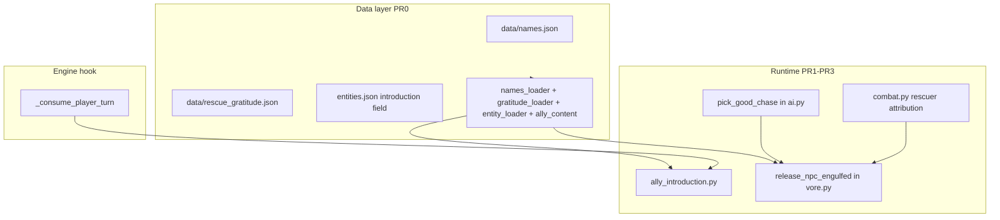
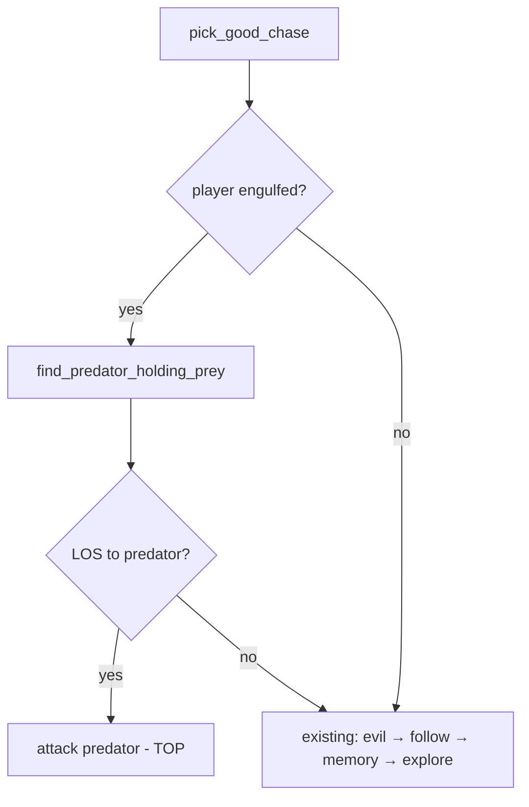
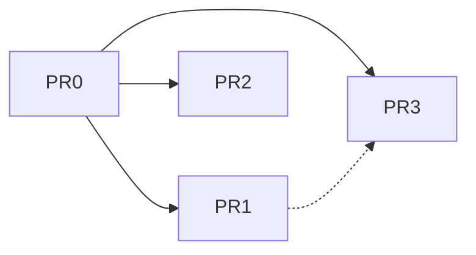

# Design: Ally Improvement

**Change id:** `add-ally-improvement`  
**Design work id:** `6c35498a`  
**Status:** Draft for review  
**Depends on:** `enhancements-3` (good AI, rescue), `enhancements-2` (`ProperName`, `entity_log_name`), `npc-data` (`entities.json`, `SpeciesId`), `digestion` / `vore` (engulf, `release_npc_engulfed`)

---

## Overview

This change improves **good ally** interactions in three ways:

1. **Name introductions** — unnamed good NPCs adjacent to the player introduce themselves once per run when the coast is clear (no evil visible to either party).
2. **Player-engulfed rescue priority** — all good NPCs globally prioritize attacking the predator currently holding the player when they have LOS to that predator.
3. **Player rescue gratitude** — when the **player** defeats a predator holding **good** prey, the freed ally adds a gratitude line in addition to the existing rescue log.

**Command Allies** (shout Follow / Attack) is **deferred** to a later change; resolved decisions are recorded in `openspec/changes/deferred-add-command-allies/`.

**Terminology:** defeated, stunned, digested — never kill/die/death (`openspec/config.yaml`).

---

## Background & Motivation

Today, knights spawn without `ProperName`, logs use `"the knight"`, and allies feel anonymous. Good AI already chases visible evil, follows the player, and knights can free engulfed allies by bump-attacking holding predators (`test_knight_rescues_engulfed_rabbit` in `tests/test_enhancements_3.py`), but:

- There is no dynamic naming or introduction flavor.
- When the **player** is engulfed, `pick_good_chase()` skips follow (`player_engulfed=True`) and falls through to memory/explore — allies do not prioritize the engulfing predator.
- `release_npc_engulfed()` logs only `messages.npc_freed_from_predator`; no thank-you line when the player is the rescuer.

This module adds personality and smarter rescue behavior without expanding input/command surfaces.

---

## Goals & Non-Goals

### Goals

| # | Goal |
|---|------|
| G1 | Good entities only (not neutral rabbit, not evil) receive a one-time runtime `ProperName` from `data/names.json` when introduction conditions are met. |
| G2 | Introduction lines come from per-entity `introduction` arrays in `entities.json` with `{name}` substitution. |
| G3 | Good AI globally elevates the player's engulfing predator to top attack priority while predator is visible and player remains engulfed. |
| G4 | Player-initiated predator defeats that free good prey emit an extra gratitude log line from `data/rescue_gratitude.json`. |
| G5 | All new log lines use standard NPC FOV gating (`entity_visible_to_player`). |
| G6 | Incremental, independently testable PRs per `openspec/WORKFLOW.md`. |

### Non-Goals

| # | Non-goal |
|---|----------|
| N1 | **Command Allies** (keys 1/2, Follow/Attack shout) — deferred. |
| N2 | Neutral or evil naming introductions. |
| N3 | Gratitude when an NPC (e.g. knight) rescues another NPC. |
| N4 | Gratitude when freeing **neutral** prey (rabbit). |
| N5 | Changing on-screen rescue mechanics (`release_npc_engulfed` placement, `VoreMercy`). |
| N6 | Retroactive naming for entities that already have `ProperName` from `entities.json` `proper_name` at spawn. |

---

## Proposed Design

### Architecture



New code is concentrated in:

- `src/data/names_loader.py` / `src/data/names_registry.py`
- `src/data/rescue_gratitude_loader.py` / `src/data/rescue_gratitude_registry.py`
- `src/systems/ally_introduction.py`
- Small edits to `entity_loader.py`, `ai.py`, `vore.py`, `combat.py`, `engine.py`

---

## Feature 1: Good Entity Name Introductions

### Eligibility (all must hold)

| Check | Implementation |
|-------|----------------|
| Good alignment | `_npc_alignment(entity) == Alignment.GOOD` |
| No `ProperName` yet | `entity.components.get(ProperName) is None` (includes never-introduced entities; excludes spawn-time `proper_name`) |
| Adjacent to player | `is_adjacent(player_pos, entity_pos)` — Chebyshev distance 1 (`src/systems/vore.py`) |
| Not stunned | `Stunned not in entity.tags` |
| Player not engulfed | `Engulfed not in player.tags` — allies do not introduce while the player is being swallowed |
| No evil visible to player | `_player_has_visible_evil(game_map, world)` → `False` (see Evil visibility below) |
| No evil in entity's LOS | Reuse `_visible_good_evils(entity, world, game_map)` → empty |
| Once per entity | Assigning `ProperName` permanently marks introduction done |

**Alignment scope:** Knights today are the only good spawn (`data/entities.json`). Logic is generic for any future good `SpeciesId` (e.g. summoned good entities).

### Timing

Run **`try_good_introductions()`** once per consumed player turn, **after** the player action resolves and **before** the world phase.

**Exact hook order** in `GameEngine._consume_player_turn()` (`src/engine.py`):

1. `skip_world = self._maybe_apply_player_digestion()`
2. `self._apply_natural_regen()`
3. `self._update_fov()` — refresh player FOV before eligibility checks
4. `try_good_introductions(...)` — **always** runs (even when `skip_world=True`)
5. `fire_player_turn_consumed(self.player)`
6. `if not skip_world: self._run_world_turn()`

`skip_world=True` (player digestion modal) still runs introductions on step 4; only step 6 is skipped. Introductions therefore run **before** `fire_player_turn_consumed` and **before** `_run_world_turn`, never on monster turns.

### Evil visibility (player vs ally)

| Party | Helper | Rule |
|-------|--------|------|
| Player | `_player_has_visible_evil(game_map, world)` | After `_update_fov()`, any evil entity with `Position` on a `game_map.visible` tile blocks introduction |
| Good ally | `_visible_good_evils(entity, world, game_map)` | Existing AI LOS via `_has_los` / `can_see` — unchanged |

Do **not** use `can_see` for the player's evil-clear check; use post-FOV `game_map.visible` so the gate matches what the player can see on screen.

### Processing order

Iterate eligible good entities sorted by `(y, x, id)` — same stable ordering as `_sorted_monsters()` in `src/systems/ai.py`. Multiple entities may introduce on the same turn if all qualify.

### Name assignment

1. Resolve `entity_type_id(entity)` via `src/systems/naming.py` (`SpeciesId.id` fallback to display name).
2. Look up name pool in `data/names.json` keyed by entity id (e.g. `"knight": ["Sir Aldric", "Sir Gareth", ...]`).
3. `rng.choice(pool)` — duplicates across entities are allowed.
4. `entity.components[ProperName] = ProperName(name=chosen)`.

If the entity id has no pool or an empty array at runtime: **skip introduction** for that entity (no `ProperName`, no log). The entity remains eligible on a later turn if conditions improve.

### Introduction log line

1. Load `introduction: tuple[str, ...] | None` from `EntityDefinition` (parsed in PR0).
2. If `introduction is None` (field omitted): **skip introduction entirely** — no `ProperName`, no log (per K2).
3. If both name pool and introduction lines are present: `rng.choice(pool)` → assign `ProperName`; pick random template; substitute `{name}` with the chosen proper name (verbatim, no article).
4. Log only if `entity_visible_to_player(game_map, entity)` (standard NPC visibility).

**K2 rule (single path):** both `names.json` pool **and** non-empty `introduction` lines are required. Missing either → no name, no log; retry when eligible.

Example `entities.json` entry for knight:

```json
"introduction": [
  "I am {name}, sworn to aid you.",
  "I am {name}. The wolves won't have you while I stand."
]
```

### API sketch — `src/systems/ally_introduction.py`

```python
def try_good_introductions(
    world: Registry,
    game_map: GameMap,
    player: Entity,
    message_log: MessageLog,
    *,
    rng: random.Random,
    entity_registry: EntityRegistry,
    names_registry: NamesRegistry,
) -> None:
    """Assign ProperName and log introduction for eligible adjacent good allies."""
```

---

## Feature 2: Player-Engulfed Rescue Priority

### Behavior

For **every** good NPC each monster turn, when `Engulfed in player.tags`:

1. `predator = find_predator_holding_prey(world, player)` (`src/systems/vore.py`).
2. If `predator is not None` **and** `_has_los(game_map, monster_pos, predator_pos)`:
   - Return `(predator, None, "attack")` from `pick_good_chase()` — **before** visible-evil, follow, memory, explore.
3. If predator not in LOS, or player not engulfed, or player escaped on own: existing priority unchanged.

When player escapes (struggle, digestion modal, etc.), `player_engulfed` becomes `False` on the next `run_monster_turns()` — good AI reverts immediately.

### Movement

No new pathfinding. Reuse `_resolve_chase_direction()` with `chase_mode="attack"` targeting the predator entity. Holding predators do not move (`Predator` component branch in `run_monster_turns`); good allies path to predator tile and bump-attack — identical to knight freeing engulfed rabbit (`test_knight_rescues_engulfed_rabbit`).

### Priority diagram



### Code change — `pick_good_chase()` in `src/systems/ai.py`

Insert at top of function body (after `origin` / `state` setup):

```python
if player_engulfed:
    predator = find_predator_holding_prey(world, player)
    if predator is not None:
        predator_pos = predator.components[Position]
        if _has_los(game_map, origin, predator_pos):
            return predator, None, "attack"
```

`find_predator_holding_prey` is already imported in `ai.py` (line 48).

**Note:** Visible evils are **demoted** below rescue while player is engulfed and predator is visible — per user decision ("above nearest evil").

---

## Feature 3: Player Rescue Gratitude

### Trigger

When `release_prey_if_defeated_predator()` runs because an evil predator was reduced to 0 HP:

| Condition | Gratitude? |
|-----------|------------|
| Rescuer has `Player` tag | Yes (if prey good) |
| Rescuer is NPC (knight, etc.) | No |
| Prey alignment good | Yes |
| Prey alignment neutral | No |
| Prey alignment evil | N/A (evil not engulfed as prey in current design) |

**Player-initiated defeat** includes:

- Bump attack via `_perform_attack()` (called from `try_action()`) when `Player in attacker.tags`
- Wand via `perform_wand_attack()` (always player)
- Does **not** include NPC ranged/melee defeating predator (`perform_npc_ranged_attack`, NPC `_perform_attack`)

### Log behavior

Inside `release_npc_engulfed()`, after existing `messages.npc_freed_from_predator` when FOV gate passes:

1. If `rescuer is not None`, `Player in rescuer.tags`, and `_npc_alignment(prey) == Alignment.GOOD`:
2. Pick random line from `get_rescue_gratitude_registry()` via `pick_rescue_gratitude_line(registry, rng)`.
3. Substitute `{name}` with `entity_log_name(prey)` (ProperName if set, else `"the knight"` style).
4. Append to message log **in addition** to freed line (two lines, same visibility gate).

**Alignment gate:** neutral prey (e.g. rabbit) gets the freed line only — no gratitude. Evil prey is N/A in current engulf rules.

Same FOV gate as freed message:

```python
entity_visible_to_player(game_map, prey) or entity_visible_to_player(game_map, predator)
```

### Rescuer attribution and RNG — `src/systems/combat.py`

Extend all three defeat paths in `_perform_attack()`, `perform_npc_ranged_attack()`, and `perform_wand_attack()` to pass `rng` (already in scope) and optional `rescuer`:

```python
release_prey_if_defeated_predator(
    world, defender, game_map, message_log,
    rng=rng,
    rescuer=attacker if Player in attacker.tags else None,  # _perform_attack only
)
```

```python
release_prey_if_defeated_predator(
    world, defender, game_map, message_log,
    rng=rng,
    rescuer=None,  # perform_npc_ranged_attack — NPC never triggers gratitude
)
```

```python
release_prey_if_defeated_predator(
    world, defender, game_map, message_log,
    rng=rng,
    rescuer=player,  # perform_wand_attack — always player
)
```

Only `_perform_attack` (player bump via `try_action`) passes `rescuer=attacker` when `Player in attacker.tags`; all other attacker paths pass `rescuer=None`. **Always** pass `rng` so gratitude line pick and prey placement are seeded-testable.

### API change — `src/systems/vore.py`

```python
def release_prey_if_defeated_predator(
    world: Registry,
    predator: Entity,
    game_map: GameMap,
    message_log: MessageLog,
    *,
    rng: random.Random | None = None,
    rescuer: Entity | None = None,
) -> None: ...

def release_npc_engulfed(
    ...,
    rescuer: Entity | None = None,
) -> None: ...
```

Gratitude line picker in **`src/data/ally_content.py`** (introduction logic stays in `src/systems/ally_introduction.py`):

```python
def pick_rescue_gratitude_line(
    registry: RescueGratitudeRegistry,
    rng: random.Random,
) -> str:
    return rng.choice(registry.lines)

def format_rescue_gratitude(prey: Entity, template: str) -> str:
    return template.replace("{name}", entity_log_name(prey))
```

---

## Data Model Changes

### `data/names.json` (new)

```json
{
  "schema_version": 1,
  "names": {
    "knight": [
      "Sir Aldric",
      "Sir Gareth",
      "Sir Cedric",
      "Sir Rowan"
    ]
  }
}
```

| Field | Type | Rules |
|-------|------|-------|
| `schema_version` | int | Must be `1` |
| `names` | object | Keys = entity ids; values = non-empty `string[]` |

Loader: strict — unknown top-level keys error; missing entity id at runtime → skip introduction for that entity.

### `data/rescue_gratitude.json` (new)

```json
{
  "schema_version": 1,
  "lines": [
    "{name} thanks you for the rescue!",
    "Thank you, says {name}.",
    "{name} nods gratefully."
  ]
}
```

| Field | Type | Rules |
|-------|------|-------|
| `schema_version` | int | Must be `1` |
| `lines` | `string[]` | Non-empty; `{name}` optional placeholder |

### `data/entities.json` — new optional field

| Field | Type | Rules |
|-------|------|-------|
| `introduction` | `string[]` | Optional; `{name}` placeholder supported |

**Parse semantics** (mirror `_parse_phase_lines` in `entity_loader.py`):

| JSON | `EntityDefinition.introduction` | Runtime |
|------|----------------------------------|---------|
| Field omitted | `None` | Skip introduction (no name, no log) |
| `"introduction": []` | — | `EntityLoadError` — must be non-empty string array |
| `"introduction": ["", ...]` | — | `EntityLoadError` — each entry must be a non-empty string |
| `"introduction": ["I am {name}.", ...]` | `tuple[str, ...]` | Eligible when name pool also present |

Add to `_ENTITY_TRAITS` in `src/data/entity_loader.py`; parse via new `_parse_introduction(raw, entity_id)`.

### Components

No new ECS components. `ProperName` remains the sole runtime name marker.

### Registries / caching

Module-level lazy singletons in loader modules (mirror `get_narrative_index()` / `reset_narrative_index()` in `src/data/narrative_index.py`):

| Module | Getter | Reset (tests / hot-reload) |
|--------|--------|----------------------------|
| `src/data/names_loader.py` | `get_names_registry()` | `reset_names_registry()` |
| `src/data/rescue_gratitude_loader.py` | `get_rescue_gratitude_registry()` | `reset_rescue_gratitude_registry()` |

Each getter lazily calls `load_*_registry()` on first access. `load_*_registry(path=...)` remains the parse entry point for tests with fixture paths. PR0 implements getters and reset hooks; data tests call `reset_*()` in setup/teardown.

**`EntityRegistry` wiring:** `load_entity_registry()` has no global cache today (same as `descend_floor()` in `engine.py`). PR1/PR3 pass `load_entity_registry()` into `try_good_introductions()`; no `GameEngine` field required. Names and gratitude use cached getters only.

---

## API / Interface Changes

| Surface | Change |
|---------|--------|
| `pick_good_chase(..., player_engulfed)` | New first-priority branch for engulfing predator |
| `release_prey_if_defeated_predator(..., rescuer=None)` | Optional rescuer for gratitude |
| `release_npc_engulfed(..., rescuer=None)` | Optional rescuer; extra log line |
| `GameEngine._consume_player_turn()` | Calls `try_good_introductions()` |
| `EntityDefinition` | `introduction` field |
| New loaders | `load_names_registry()`, `get_names_registry()`, `load_rescue_gratitude_registry()`, `get_rescue_gratitude_registry()` |

No public CLI or input binding changes in this change.

---

## Alternatives Considered

| Alternative | Why rejected |
|-------------|--------------|
| `Introduced` tag separate from `ProperName` | Redundant — `ProperName` assignment is the once-per-run marker |
| Introduction on monster turn | Player-adjacency is a player-proximity event; monster turn would miss "player walks adjacent" moment cleanly |
| Rescue priority only for knights in LOS of player | User specified **all good entities globally** |
| Gratitude for neutral rabbit | User limited to **good prey only** |
| Global single name pool | User required per-entity-id pools in `names.json` |
| Merge gratitude into `npc_freed_from_predator` string | User asked for line **in addition** to existing message |

---

## Security & Privacy

Not applicable — local single-player game data; no network or PII.

---

## Observability

- New log lines only (introduction, gratitude); no metrics.
- Loader warnings: follow existing `LoadWarnings` pattern for unknown keys in `entities.json`; standalone JSON files use strict parse errors.

---

## Rollout Plan

See **PR Plan** below. Spec updates land in **PR3** (or PR3 + archive acceptance). Full `pytest tests/` on final acceptance PR only.

Per-PR manual checklists: `openspec/changes/add-ally-improvement/testing-checklist-pr0.md` through `testing-checklist-pr3.md`.

---

## Open Questions

**None — all resolved.**

| # | Topic | Decision |
|---|-------|----------|
| Q1 | Introduction alignment scope | Good only |
| Q2 | Evil-clear rule | Both player and good entity must have no evil in respective LOS |
| Q3 | Adjacency metric | Chebyshev 1 |
| Q4 | Stunned allies | Cannot introduce while stunned |
| Q5 | Rescue priority scope | All good entities; top priority above evil |
| Q6 | Rescue chase condition | Only while predator visible and player engulfed |
| Q7 | Gratitude rescuer | Player only; not knight-rescues-knight |
| Q8 | Gratitude prey | Good only; not neutral rabbit |
| Q9 | Wand kills | Count as player-initiated defeat |
| Q10 | Command Allies | Deferred — see `deferred-add-command-allies` |

---

## References

| Resource | Path |
|----------|------|
| Good AI | `src/systems/ai.py` — `pick_good_chase()`, `_visible_good_evils()` |
| Rescue today | `src/systems/vore.py` — `release_npc_engulfed()`, `find_predator_holding_prey()` |
| Combat defeat | `src/systems/combat.py` — `_perform_attack()` / `try_action()`, `perform_wand_attack()` |
| Naming | `src/systems/naming.py` — `entity_log_name()`, `entity_type_id()` |
| Components | `src/components.py` — `ProperName`, `SpeciesId`, `NPCAlignment` |
| FOV | `src/systems/fov.py` — `entity_visible_to_player()`, `FOV_RADIUS = 10` |
| Enhancements 3 spec | `openspec/specs/enhancements-3/spec.md` — Rescue Engulfed Allies |
| Enhancements 2 spec | `openspec/specs/enhancements-2/spec.md` — ProperName / log names |
| Knight rescue test | `tests/test_enhancements_3.py` — `test_knight_rescues_engulfed_rabbit` |
| Workflow | `openspec/WORKFLOW.md` |

---

## Key Decisions

| # | Decision | Rationale |
|---|----------|-----------|
| K1 | `ProperName` assignment marks introduction complete | No extra component; matches enhancements-2 model |
| K2 | Require both `names.json` pool **and** `introduction` lines | Avoid silent naming without player-facing flavor |
| K3 | Introduction check before world phase with fresh FOV | Correct adjacency/visibility after player move |
| K4 | Player-engulfed rescue outranks visible evil | User explicit priority |
| K5 | Pass `rescuer` into vore release chain | Minimal combat changes; gratitude stays in `release_npc_engulfed` |
| K6 | Gratitude is second log line, same FOV gate | User: "in addition to" freed message |
| K7 | New spec `openspec/specs/ally-improvement/spec.md` | Clean capability boundary; enhancements-3 stays historical |
| K8 | Command Allies deferred to `deferred-add-command-allies` | Narrowed module scope per user |
| K9 | No introductions while player is `Engulfed` | Allies don't chat during swallow; player can't meaningfully receive introductions |
| K10 | Gratitude helpers in `src/data/ally_content.py` | Separates data picking from `ally_introduction.py` runtime logic |

---

## PR Plan

One PR at a time per `openspec/WORKFLOW.md`. Targeted tests per PR; full suite on final acceptance only.

### PR0 — Data layer

**Depends on:** none

| File | Action |
|------|--------|
| `data/names.json` | Create with knight name pool |
| `data/rescue_gratitude.json` | Create with sample gratitude lines |
| `data/entities.json` | Add `introduction` arrays for `knight` |
| `src/data/names_registry.py` | New frozen registry type |
| `src/data/names_loader.py` | Parse `names.json`; `get_names_registry()` + `reset_names_registry()` |
| `src/data/rescue_gratitude_registry.py` | New frozen registry type |
| `src/data/rescue_gratitude_loader.py` | Parse `rescue_gratitude.json`; `get_rescue_gratitude_registry()` + `reset_rescue_gratitude_registry()` |
| `src/data/entity_registry.py` | Add `introduction` field |
| `src/data/entity_loader.py` | `_parse_introduction()`; add to `_ENTITY_TRAITS` |
| `data/SCHEMA.md` | Document three data surfaces |
| `tests/test_ally_improvement_data.py` | Loader/schema tests; singleton reset hooks; `introduction` parse rules (omitted / empty / invalid) |

**Manual checklist:** `python -m src.main` boots; no behavior change. See `testing-checklist-pr0.md`.

---

### PR1 — Name introduction runtime

**Depends on:** PR0

| File | Action |
|------|--------|
| `src/systems/ally_introduction.py` | `try_good_introductions()`, `_player_has_visible_evil()`, introduction flow |
| `src/engine.py` | Hook in `_consume_player_turn()` per exact order above; pass `load_entity_registry()`, `get_names_registry()`, `self.rng` |
| `tests/test_ally_introduction.py` | Adjacency, stunned skip, player-engulfed skip, evil blocking (player `game_map.visible` + ally LOS), FOV gate, once-per-run, `{name}` sub |

**Manual checklist:** Walk adjacent to knight with no wolves visible → introduction line + proper name in subsequent logs. See `testing-checklist-pr1.md`.

---

### PR2 — Player-engulfed rescue AI priority

**Depends on:** PR0 (no hard dep on PR1)

| File | Action |
|------|--------|
| `src/systems/ai.py` | `pick_good_chase()` rescue-first branch |
| `tests/test_ally_rescue_priority.py` | Good knight chases engulfing predator over visible wolf; reverts when player escapes; no chase without LOS |

**Manual checklist:** Get engulfed with knight and wolf visible; knight paths toward holding predator. See `testing-checklist-pr2.md`.

---

### PR3 — Player rescue gratitude + spec

**Depends on:** PR0; soft dep PR1 (gratitude uses `entity_log_name` with ProperName)

| File | Action |
|------|--------|
| `src/systems/vore.py` | `rescuer` param; good-alignment gate; gratitude log in `release_npc_engulfed` |
| `src/systems/combat.py` | Pass `rng` + `rescuer` from `_perform_attack` / wand paths |
| `src/data/ally_content.py` | `pick_rescue_gratitude_line()`, `format_rescue_gratitude()` |
| `openspec/specs/ally-improvement/spec.md` | New capability spec |
| `tests/test_ally_rescue_gratitude.py` | Player frees knight → freed + gratitude (seeded line); knight frees knight → freed only; neutral prey → freed only |
| Change archive | `acceptance-report.md`, move to `archive/YYYY-MM-DD-add-ally-improvement/` |

**Manual checklist:** Defeat wolf holding knight as player → two log lines; knight defeats wolf → one line. See `testing-checklist-pr3.md`.

---

### PR dependency graph



PR1 and PR2 may ship in either order after PR0.

---

## Tests (targeted)

| Test file | PR | Assert |
|-----------|-----|--------|
| `test_ally_improvement_data.py` | PR0 | JSON parse; `introduction` omitted/empty/invalid; singleton getters + `reset_*()` |
| `test_ally_introduction.py` | PR1 | ProperName once; stunned/evil/adjacency/FOV gates; **player engulfed → no introduction** |
| `test_ally_rescue_priority.py` | PR2 | `pick_good_chase` predator priority; LOS/exhaust cases |
| `test_ally_rescue_gratitude.py` | PR3 | Player rescuer → gratitude (seeded `rng`); NPC rescuer → no gratitude; neutral prey → no gratitude |

Harness patterns: reuse `spawn_test_npc`, `carved_collinear`, `engulf_npc`, `update_fov` from existing enhancement tests.

**`spawn_test_npc` (PR1):** extend with optional `species_id: str | None = None`; when set, add `SpeciesId(id=species_id)` so `entity_type_id()` resolves for name-pool lookup (production spawn always sets `SpeciesId`).

---

## Spec placement

Create **`openspec/specs/ally-improvement/spec.md`** in PR3 with requirements:

- Good ally name introduction
- Player-engulfed rescue AI priority
- Player rescue gratitude

Cross-reference `enhancements-2` (naming), `enhancements-3` (rescue baseline), `npc-data` (entity data).

---

## Deferred: Command Allies

Recorded in `openspec/changes/deferred-add-command-allies/` — not implemented in this change.