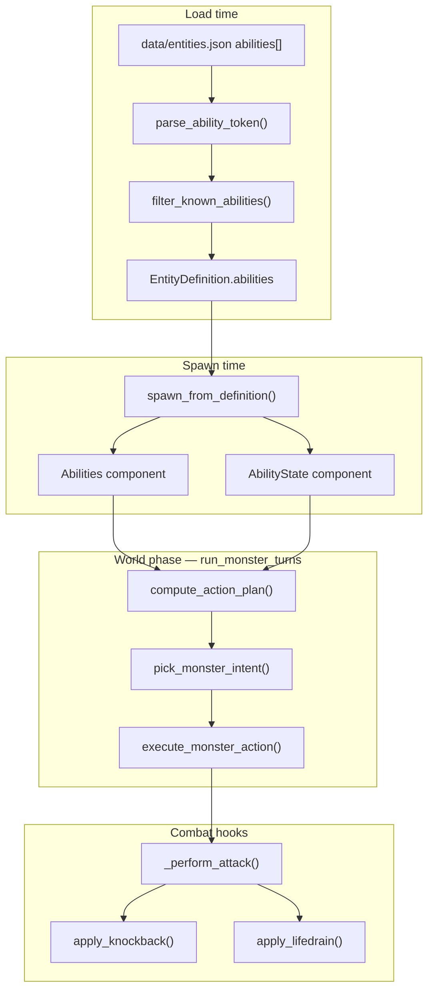
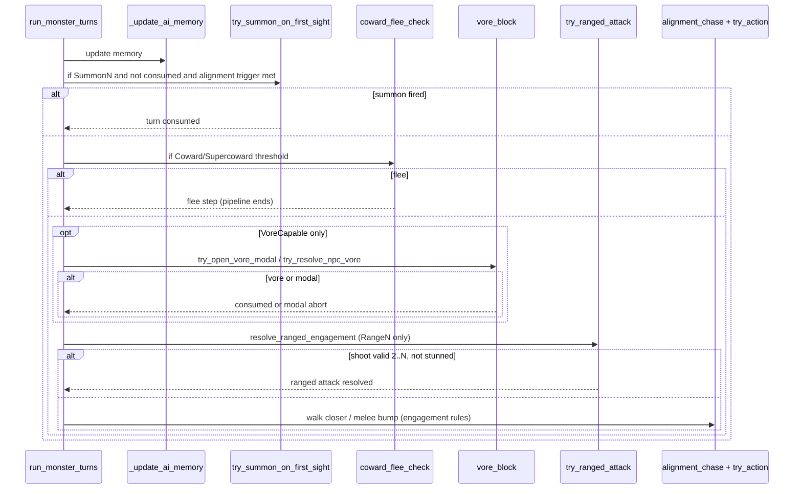
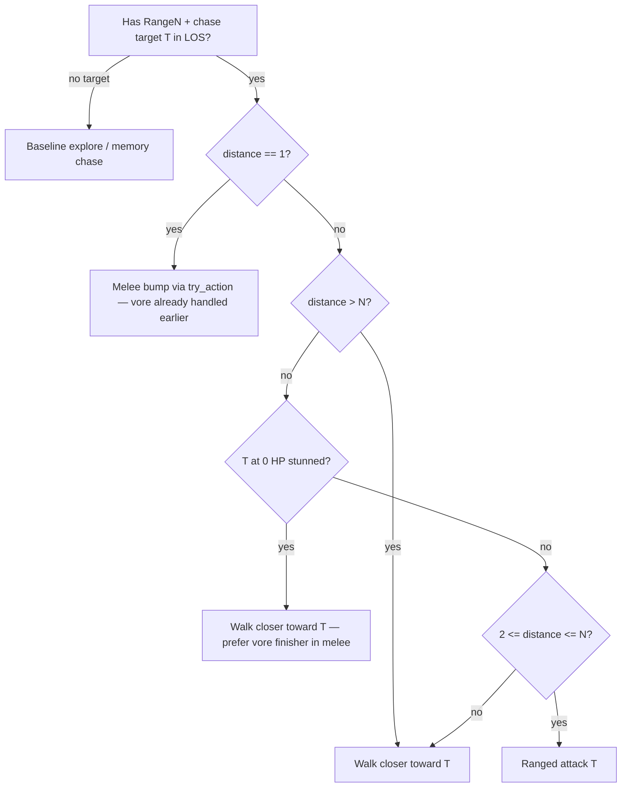

# Design: NPC Abilities

| Field | Value |
|-------|-------|
| **Author** | Systems Design |
| **Date** | 2026-07-02 |
| **Status** | Approved (revised post re-review pass 3) |
| **Change** | `openspec/changes/add-npc-abilities/` |
| **Spec target** | `openspec/specs/npc-abilities/spec.md` (new) |

---

## Overview

NPC species in `data/entities.json` already declare an `abilities[]` array, but `src/data/abilities.py` has an empty `IMPLEMENTED_ABILITIES` set and `spawn_from_definition()` never materializes abilities onto runtime entities. Evil baseline AI (wander → chase → bump-attack → vore) in `src/systems/ai.py` is alignment-driven and identical for every evil species regardless of data.

This change introduces a **modifier framework** where each ability string deviates from baseline alignment behavior at well-defined integration points: turn budgeting in `run_monster_turns`, intent selection before chase, combat post-hooks in `_perform_attack`, and one-shot summon triggers on first sight. Each ability ships as its own PR; **wolf** is the manual playtest vehicle with exactly **one** ability active per PR.

---

## Background & Motivation

### Current state

| Area | Today |
|------|--------|
| Data | `EntityDefinition.abilities: tuple[str, ...]` loaded via `filter_known_abilities()` — unimplemented ids stripped with one-time warning |
| Spawn | `spawn_from_definition()` (`src/spawn.py:75–128`) sets combat/alignment/vore components; **no ability component** |
| Registry | `DOCUMENTED_ABILITIES` = `Range2`…`Range9`, `Fast`; `IMPLEMENTED_ABILITIES` = ∅ |
| AI | `run_monster_turns()` — one action per monster per world phase; evil uses `pick_evil_chase` → `try_action` (move/swap/bump) |
| Combat | `resolve_attack()` + `_perform_attack()` — adjacent bump only; FOV-gated NPC↔NPC log via `_npc_combat_visible_to_player()` |
| Ranged precedent | Player wands (`src/systems/wand_evoke.py`) — Chebyshev range + `can_see` LOS; reuse pattern for NPC `RangeN` |
| Vore | `try_open_vore_modal()` runs **before** chase/movement when adjacent and eligible; `try_resolve_npc_vore()` for NPC log-only vore — both before chase step; adjacent prey only (`chebyshev_distance == 1`) |
| Flee | Neutral evil-flee via `_choose_flee_direction()` — maximize Chebyshev distance from threat |

### Pain points

1. **Data lies to modders** — `abilities: ["Range3"]` in JSON warns and does nothing.
2. **No extension point** — adding queen-bee summon or coward wolves requires editing core `ai.py` branches.
3. **No test harness** — `spawn_test_npc()` builds minimal NPCs without `Abilities` component or `spawn_wolf_with_abilities()` helper; wolf in `entities.json` has `"abilities": []`.

### User goal

Implement **nine ability families** (7 fixed ids + parameterized `RangeN` + parameterized `SummonN`), one PR each, wolf as playtest target, following `openspec/WORKFLOW.md` one-PR-at-a-time discipline.

---

## Goals & Non-Goals

### Goals

- Parse ability tokens: `RangeN` (numeric), `SummonN <entity_id>` (count + registry id), and fixed ids (`Coward`, `Fast`, …).
- Attach parsed abilities + mutable runtime state to spawned entities.
- Integrate modifiers without breaking evil/good/neutral priority specs (`enhancements-3`, `npc-data`). **Abilities apply to all alignments** — vore steps are conditional no-ops for non-`VoreCapable` entities.
- Preserve FOV-gated NPC combat/vore/summon logs (project convention).
- **Ability activation logs** — distinct message-log lines when Summon, RangeN, Knockback, or Lifedrain activate within player FOV (see § Ability activation logs).
- Use defeated/stunned/digested terminology throughout.
- Ship `openspec/specs/npc-abilities/spec.md`; slim `npc-data` out-of-scope note remains valid.
- PR0 bootstrap: change folder + framework scaffold (no individual ability behavior).

### Non-Goals

- Player abilities or item `abilities[]` handlers (inventory-items spec defers `RangeN` on gear).
- New species beyond reusing existing `entities.json` ids for summon targets (e.g. `rabbit`).
- Hot-reload abilities mid-run.
- AI profile overrides via reserved `ai_profile` trait.
- Balancing wolf stats for each ability showcase.

### Alignment-aware ability integration

Abilities are **alignment-compatible**. Turn-budget modifiers (`Fast`, `Slow`, `Erratic`) and combat hooks (`Knockback`, `Lifedrain`) apply to any NPC with `abilities[]` regardless of alignment. Intent modifiers (`Coward`, `RangeN`, `SummonN`) integrate into a **single shared intent pipeline** that branches on alignment for targeting and chase, while **vore steps are optional**:

```text
VoreCapable in entity.tags  →  run try_open_vore_modal / try_resolve_npc_vore
otherwise                   →  skip vore block entirely (not an error; good/neutral never vore)
```

Existing vore guards already enforce this (`should_attempt_vore` checks `VoreCapable` and rejects good/neutral predators in `src/systems/vore.py`). The pipeline may call vore helpers unconditionally for simplicity — they return immediately on ineligible entities — or gate on `VoreCapable` for clarity. **Coward flee does not depend on vore capability:** on a good knight with `Coward`, flee short-circuits the pipeline before the (skipped) vore block and before ranged/chase; no special casing required.

**Wolf playtest protocol unchanged** — wolf is evil and used for per-PR manual verification. Automated tests SHOULD include at least one good or neutral entity per ability class where alignment affects behavior (e.g. `Coward` on knight, `Summon1` on good entity vs evil trigger).

---

## Proposed Design

### Architecture



### Ability token grammar

| Pattern | Regex / rule | Parsed type |
|---------|----------------|-------------|
| `Range2` … `Range9` | `^Range([2-9])$` | `RangeAbility(distance: int)` |
| `Summon1 rabbit` | `^Summon(\d+)\s+(\S+)$` | `SummonAbility(count: int, entity_id: str)` — `entity_id` must exist in registry |
| Fixed ids | exact match | `Coward`, `Supercoward`, `Erratic`, `Slow`, `Fast`, `Knockback`, `Lifedrain` |

**Load rules (parser-driven gating):**

1. `parse_ability_token(raw)` attempts parse. `None` → unknown token → `warn_unknown_ability`, strip.
2. Parsed ability kind must be in `IMPLEMENTED_KINDS` (e.g. `RangeAbility`, `SummonAbility`, `CowardAbility`, …). Kind not implemented → `warn_unimplemented_ability` (documented-but-not-yet-coded), strip.
3. Implemented kinds → kept on `EntityDefinition.abilities` as **raw strings** (modder-facing form unchanged); parsed at spawn into `Abilities.parsed: tuple[ParsedAbility, ...]`.
4. **Summon** additionally validates `entity_id` against entity registry at load; invalid id → `EntityLoadError` (fail fast).
5. Duplicate tokens on one entity → load warning, keep first (deterministic). **Exception — `RangeN`:** multiple `Range2`…`Range9` tokens on one entity collapse to a single token with **max N** and one duplicate warning (e.g. `["Range2", "Range5"]` → effective `Range5` at load). Other duplicate fixed ids still keep-first.

**`DOCUMENTED_ABILITIES` (PR0):** expand to all v1 tokens — `Range2`…`Range9`, `Fast`, `Slow`, `Erratic`, `Coward`, `Supercoward`, `Knockback`, `Lifedrain`, plus pattern note for `SummonN <id>`. Used only for warning message tier ("documented but unimplemented" vs "unknown token"); implementation status comes from `IMPLEMENTED_KINDS`, not exact-string membership.

**`filter_known_abilities()` rewrite (PR0):** parse each raw token, then filter by `IMPLEMENTED_KINDS`. Parameterized tokens (`Summon1 rabbit`, `Summon2 rabbit`) share one kind (`SummonAbility`) — no per-combo enumeration in `IMPLEMENTED_ABILITIES`.

### Runtime components

```python
# src/components.py (new)

@attrs.define(frozen=True)
class Abilities:
    """Parsed ability modifiers from entity definition."""
    parsed: tuple[ParsedAbility, ...]


@attrs.define
class AbilityState:
    """Mutable per-instance ability state."""
    summon_consumed: bool = False
    erratic_index: int = 0   # 0=move, 1=attack, 2=move (resets each world-phase visit)
    plan_step_index: int = 0  # intra-call step cursor; reset at visit start + modal abort + visit end (not persisted across modal dismiss)
```

`AbilityState` is created empty on **every** `spawn_from_definition()` spawn (ability-less stock entities included). `Abilities` is attached only when `definition.abilities` is non-empty and at least one parsed kind is implemented.

**Test spawn contract:** `run_monster_turns` unconditionally reads `monster.components[AbilityState].plan_step_index`. Every NPC spawn path must attach empty `AbilityState`:

- `spawn_from_definition()` — production path (above).
- `spawn_test_npc()` (`src/systems/ai.py:894–926`) — minimal test NPCs used by `test_enhancements_3.py`, `test_digestion.py`, and other suites; PR0 attaches `AbilityState()` here (no `Abilities` unless caller adds abilities separately).
- `spawn_wolf_with_abilities()` in `map_test_helpers.py` — ability-focused harness; attaches `AbilityState` + parsed `Abilities` when non-empty.

**Query helpers** (`src/systems/abilities.py`):

```python
def has_ability(entity: Entity, kind: type[ParsedAbility]) -> bool: ...
def get_ability(entity: Entity, kind: type[ParsedAbility]) -> ParsedAbility | None: ...
def max_range(entity: Entity) -> int | None: ...  # highest RangeN if multiple (see stacking)
```

### Turn budgeting and action plans

`run_monster_turns()` refactors each monster iteration into:

```text
for i, monster in enumerate(_sorted_monsters(world)):
    if i < resume_monster_index: continue
    if not eligible(monster): continue
    monster.components[AbilityState].plan_step_index = 0  # reset at visit start (symmetric with erratic_index)
    plan = compute_action_plan(monster, player_turn_count)
    for step_index, step in enumerate(plan.steps):
        if step_index < monster.components[AbilityState].plan_step_index: continue
        if step.kind == SKIP: continue
        if step.kind == FLEE: ...
        if step.kind == RANGED_ATTACK: ...
        if step.kind == SUMMON: ...
        if step.kind == MOVE_OR_BUMP: ...  # existing chase + try_action path
        if step.kind == ATTACK: ...        # Erratic sub-step 1 — full evil pipeline
        if try_open_vore_modal(...) returned True:
            monster.components[AbilityState].plan_step_index = 0  # zero before modal abort exit
            break inner + outer (see vore section)
        if step.consumed_turn: break
    monster.components[AbilityState].plan_step_index = 0  # reset after visit completes (idempotent)
```

| Ability | Actions per world phase | Plan shape |
|---------|-------------------------|------------|
| *(none)* | 1 | `[MOVE_OR_BUMP]` |
| `Fast` | 2 | `[MOVE_OR_BUMP, MOVE_OR_BUMP]` — independent intent each step |
| `Slow` | 0 or 1 | skip when `player_turn_count % 2 == 1` (global parity; see below) |
| `Erratic` | 3 | `[MOVE, ATTACK, MOVE]` — fixed order, see below |
| Others | 1 | modifier overlays on `MOVE_OR_BUMP` / combat |

#### Slow turn phase (global parity)

**Model:** global `player_turn_count` parity only — **no per-entity `slow_skip` toggle**.

| `player_turn_count % 2` | Slow monster |
|-------------------------|--------------|
| `0` (even) | Acts normally (full plan) |
| `1` (odd) | Entire world-phase visit skipped — plan is `[SKIP]` |

Stunned monsters skip the visit entirely (no parity evaluation). Vore miss-resume does **not** increment `player_turn_count`, so parity is unchanged across modal interrupt — the same odd/even phase applies on resume.

**PR9 test matrix (exact turns):** wolf with `Slow` at `(0,0)`, player at `(5,5)`:

| `player_turn_count` | Wolf acts? |
|---------------------|------------|
| 0 | Yes |
| 1 | No |
| 2 | Yes |
| 3 | No |

#### Ability stacking precedence

Composition order in `compute_action_plan()`:

```text
1. Slow gate       → if Slow and player_turn_count % 2 == 1: [SKIP]
2. Erratic shape  → if Erratic: base = [MOVE, ATTACK, MOVE]; else base = [MOVE_OR_BUMP]
3. Fast multiplier → if Fast: concatenate base plan twice
4. Step execution  → shared intent pipeline (alignment-aware); Coward/RangeN/Summon apply inside steps
```

| Combination | Result |
|-------------|--------|
| `Slow` + `Fast` | **Slow wins** on odd turns (`[SKIP]`); on even turns, `[MOVE_OR_BUMP, MOVE_OR_BUMP]` |
| `Slow` + `Erratic` | Odd: `[SKIP]`; even: `[MOVE, ATTACK, MOVE]` |
| `Fast` + `Erratic` | `[MOVE, ATTACK, MOVE, MOVE, ATTACK, MOVE]` — 6 steps (full Erratic cycle twice) |
| `Fast` + `Erratic` + `Slow` | Odd: `[SKIP]`; even: 6-step Fast×Erratic plan |
| `Erratic` + `RangeN` | ATTACK sub-step runs full pipeline including ranged |
| `Coward` + `Supercoward` | **Supercoward wins** — flee at any HP while alive |
| `Coward` + `RangeN` | Coward flee before engagement; if fighting, engagement AI (shoot in `[2,N]` or close) |
| Multiple `RangeN` tokens | Load rule #5 collapses to **max N** before spawn; `max_range()` reads single effective token |

v1 manual wolf tests remain single-ability. Automated combinatorial coverage: **Fast+Slow** (PR10), **Fast+Erratic** (PR10 after PR8), tiered Range (PR1).

#### Multi-step + vore modal

`try_open_vore_modal()` today returns `True` and exits the entire `run_monster_turns` call. Multi-step plans preserve shipped vore v1 interrupt semantics (`src/engine.py:414`, `tests/test_vore_turn_order.py`, `openspec/specs/vore/spec.md`):

1. **Modal opened mid-plan** → abort all remaining `plan.steps` for that monster within the current `run_monster_turns` call; **zero `plan_step_index` before returning** (same call site as `break inner + outer`); return with `resume_monster_index = i` (current monster, not advanced). `plan_step_index` is not persisted across modal dismiss — a later world phase (next player turn after miss, or any future visit by the same monster) must start from step 0.
2. **Vore hit / digest** → monster visit ends; resume advances to `i + 1` on next `run_monster_turns` call (unchanged vore v1 behavior).
3. **Vore miss (player escapes)** → miss **wastes the attempting monster's turn** per vore spec. Engine sets `resume_monster_index = i + 1` before re-calling `run_monster_turns` (`engine.py:414`); monster `i` does **not** act again in the same world phase. No replan, no replay of Fast/Erratic sub-steps after miss.
4. **`plan_step_index` lifecycle** — reset to 0 at **visit start** (before `compute_action_plan`, symmetric with `erratic_index`); zero again on modal abort (rule 1); zero again after visit completes (idempotent). Within a single `run_monster_turns` call, `resume_monster_index` stays at `i` between sub-steps until the visit ends or a modal opens. Cross-modal resume is engine-owned.

**Tests:** PR0 headless test — Fast wolf, mock `try_open_vore_modal` True on step 1 → assert no step 2, `resume_monster_index == i`, `plan_step_index == 0` after abort. PR8 — adjacent Erratic wolf (step 0 suppressed), sub-step 1 opens modal before bump. PR10 — Fast wolf opens modal on first sub-step; on miss-resume assert step 2 does **not** run and opener `not in acted` (parity with `test_miss_resumes_at_next_monster_index`). PR10 — Fast wolf opens modal on step 1, miss resolves, **next player turn** asserts both Fast steps execute from step 0 (no stale `plan_step_index`). `tests/test_vore_turn_order.py` must remain green through PR0/PR10 refactors.

**Erratic semantics:**

- Sub-step 0 (`MOVE`): **suppressed** only when predator has `VoreCapable` **and** is adjacent (`chebyshev_distance == 1`) to a vore-eligible prey per baseline evil rules. Good/neutral Erratic entities skip this suppression (they do not vore). Otherwise **must move** if any legal direction exists — alignment-aware chase/explore helpers (see below).
- Sub-step 1 (`ATTACK`): runs the **shared intent pipeline** (same as `MOVE_OR_BUMP`).
- Sub-step 2 (`MOVE`): same helpers as sub-step 0.
- `erratic_index` resets to 0 at start of each monster's world-phase visit.

### Shared intent pipeline (all alignments)

Order inside each `MOVE_OR_BUMP` step (and inside Erratic `ATTACK` sub-step). Vore block runs only for `VoreCapable` predators; good/neutral entities flow through summon → coward → ranged → alignment chase without entering vore.



#### Alignment branches (baseline chase after abilities)

| Alignment | Chase helper | Hostile targets for RangeN / Coward threat |
|-----------|--------------|---------------------------------------------|
| **Evil** | `pick_evil_chase` + `try_action` | Player + good NPCs (primaries); neutrals secondary for ranged only |
| **Good** | `pick_good_chase` + `try_action` (no player attack) | Visible evil NPCs only |
| **Neutral** | Flee evil if baseline requires; else explore — **Coward/Supercoward override** flee threshold (see below) | Visible evil NPCs (threat for Coward); RangeN may target evil at range if neutral has attack capability via bump path |

**Neutral + Coward interaction:** Baseline neutral unconditionally flees visible evil when `HP > 0`. A neutral with `Coward` flees only below 50% HP (less aggressive above half). A neutral with `Supercoward` matches baseline flee-at-any-HP while alive. Document as ability **replacing** default flee policy when present.

#### RangeN

##### Distance rule (hard)

Ranged attacks are valid **only** when Chebyshev distance is in **`[2, N]`** (strictly **more than 1 tile**, at most `N`). Distance 1 is **always melee** (bump / vore). Distance `> N` never shoots — entity walks closer.

##### Ranged combat resolution

- Uses `Fighter.ranged_accuracy`, `ranged_min_damage`, `ranged_max_damage` (see Data Model).
- Same hit/damage formulas as melee (`npc-data` spec), substituting ranged attacker stats.
- Public `try_ranged_attack(attacker, defender, ...) -> bool` — returns whether a shot was attempted (consumes turn on attempt, including miss).
- Internal `perform_ranged_attack(...)` applies damage with **ranged-specific log lines** (see § Ability activation logs).

##### Ranged engagement AI

Entities with `RangeN` use **`resolve_ranged_engagement()`** after the vore block and before the generic chase step. It picks the **same chase target** as baseline alignment AI (nearest hostile, frustration rules, tiered evil primaries — unchanged). Given current target `T` with LOS:



**Priority summary (normative):**

1. **Engage visible target** — reuse alignment target pick (`pick_evil_target`, `pick_good_chase`, etc.); nearest-valid-target tie-break unchanged.
2. **Adjacent (`distance == 1`)** — melee bump and vore odds only; **never shoot**.
3. **`distance > N`** — walk closer (chase step).
4. **Target at 0 HP stunned** (`hp == 0` and `Stunned` tag, or player at 0 HP) — walk closer; **never shoot** (close for vore finisher / melee).
5. **`2 <= distance <= N`**, target not stunned-at-0 — **shoot**.

**Explicit prohibitions (user requirements):**

| Prohibited | Rule |
|------------|------|
| Shoot adjacent target | `distance == 1` → melee only |
| Shoot stunned 0-HP target | `is_stunned_prey(T)` → chase closer, no `try_ranged_attack` |
| Shoot distant target while nearer valid target exists | Target pick runs **before** engagement; nearest hostile wins (existing tiered evil behavior) |

**`is_stunned_prey(entity)`:** `Fighter.hp == 0` and (`Stunned` in tags or `Player` in tags). Evil NPCs at 0 HP are defeated/removed — not stunned prey.

**Target selection for shooting** (alignment-aware, only candidates passing distance + stunned checks):

- **Evil (tiered):** visible primaries (player + good) in `[2, N]` with LOS first; else neutrals in `[2, N]`. Nearest within tier. A primary at distance 3 beats a neutral at distance 2.
- **Good:** visible evil in `[2, N]`; never player.
- **Neutral:** visible evil in `[2, N]` (defensive); never player.

If no shoot-valid candidate but a chase target exists, fall through to walk-closer (steps 3–4).

#### SummonN

- **Trigger:** first time monster gains LOS to an alignment-appropriate hostile:
  - **Evil:** player or good NPC (`_visible_primary_hostiles`)
  - **Good:** evil NPC (`_visible_good_evils`)
  - **Neutral:** evil NPC (`_visible_evils`) — same threat set as flee
- **Effect:** spawn `count` entities via `spawn_entity_by_id(world, entity_id, x, y)` on distinct valid adjacent tiles (Chebyshev 1), chosen **at random** from the set of legal adjacent tiles (RNG-seeded per summon); if fewer than `count` tiles available, spawn as many as possible.
- **One-shot:** set `AbilityState.summon_consumed = True` even if zero spawns (failed placement still burns ability — avoids infinite retries).
- **Log:** FOV-gated activation line when summon fires — see § Ability activation logs.

#### Coward / Supercoward

- **Threshold:**
  - `Coward`: flee when `hp * 2 < max_hp` (strictly below half — at exactly 50% HP with even `max_hp`, Coward does **not** trigger).
  - `Supercoward`: flee whenever a legal flee step exists, regardless of HP (while alive).
- **Threat source (alignment-aware):**
  - **Evil:** nearest visible primary hostile (player or good NPC).
  - **Good:** nearest visible evil NPC.
  - **Neutral:** nearest visible evil NPC.
- **Behavior:** after summon check, **before the vore block / ranged / chase**, if threshold met and a visible threat exists, `_choose_flee_direction` away from threat. Flee consumes the turn and ends the pipeline for that step.
- **Vore-independent:** Entities without `VoreCapable` (good knights, neutral rabbits) never attempt vore; coward flee simply ends the step before ranged and alignment chase. Wording like "skips vore" applies only to evil predators that *could* otherwise vore.
- **Blocked:** no legal flee step → fall through to vore block (if `VoreCapable`), ranged, then alignment baseline chase.
- **Good example:** `Coward` knight below 50% HP flees visible wolf instead of pursuing — no vore involved.
- **Neutral example:** `Coward` rabbit above 50% HP does **not** flee (overrides baseline unconditional flee); below 50% flees like baseline.

#### Knockback

- Hook at end of `_perform_attack()` when `hit and damage > 0` and attacker has `Knockback`.
- Direction: **away from attacker** along attack vector — for bump attacks use `direction` delta; for ranged use `sign(target - attacker)` on each axis (Chebyshev-friendly single-step push).
- Destination must pass `can_entity_enter_tile()` for **defender** and `can_move_to()` without `blocked_tiles` override.
- If destination occupied or illegal → no-op (damage still applied); **no knockback log** when push fails.
- **Cannot push into deep water** if defender mobility is `GROUND` (same as voluntary entry rules).
- **Log:** separate FOV-gated line when push **succeeds** — see § Ability activation logs (in addition to normal damage line from combat).

#### Lifedrain

- After damage applied in `_perform_attack()`, `heal(attacker, damage)` using existing `combat.heal()` when `damage > 0`.
- **Log:** FOV-gated activation line when healing is applied — see § Ability activation logs.

### Interaction matrix

| System | Interaction |
|--------|-------------|
| Player vore modal | `try_open_vore_modal` before chase; aborts `run_monster_turns` mid-plan; resume rules above |
| NPC vore | `try_resolve_npc_vore` after player modal check; adjacent only |
| Digestion / Predator | Holding predators unchanged — `Predator` branch short-circuits before abilities |
| NPC swap | Unchanged; ability steps use `try_action` |
| Stunned | Stunned monsters skip entire world-phase visit (no Slow parity eval) |
| Engulfed prey | Hidden from AI targeting (unchanged) |
| Good/neutral entities | Full ability support; vore block skipped (`VoreCapable` absent); targeting/chase use alignment branches |
| Player FOV | All new combat/summon/flee logs follow `_npc_combat_visible_to_player` / `entity_visible_to_player` |

### Wolf playtest protocol

During development, **`data/entities.json` wolf `abilities` holds exactly one token** — the ability under test for the active PR. Previous PR ability is removed when the next PR starts (not cumulative). This isolates manual verification.

**Final acceptance PR** restores wolf to `"abilities": []` unless user chooses a showcase set (Open Question #8).

Example progression:

| PR | wolf `abilities` |
|----|------------------|
| PR0 | `[]` (scaffold only) |
| PR1 | `["Range2"]` |
| PR2 | `["Range3"]` |
| PR3 | `["Range5"]` (proves generalized parser; not cumulative with 2/3) |
| … | single token each |
| PR13 | `[]` (default revert) |

### Spec placement

Create **`openspec/specs/npc-abilities/spec.md`** as the behavioral home for all ability requirements. Update **`openspec/specs/npc-data/spec.md`** out-of-scope bullet to link to `npc-abilities`. **`enhancements-3`** remains the baseline evil AI spec; `npc-abilities` documents **deltas** only.

### Ability activation logs (FOV-gated)

Several abilities emit a **dedicated activation line** in the scrolling message log when the player can see the event. This is in addition to (not a replacement for) normal combat damage/defeat lines where applicable.

**FOV rule:** Same helpers as existing NPC combat — `_npc_combat_visible_to_player(game_map, attacker, defender)` for combat-derived logs; `entity_visible_to_player(game_map, summoner)` for summon (summoner must be in FOV).

**Templates** live in `src/messages.py`, filled via `entity_log_name()` / identity resolver. Examples below use wolf; any species works.

| Ability | When to log | Message template (stock examples) |
|---------|-------------|----------------------------------|
| **SummonN** | Summon ability fires (first hostile LOS) and summoner in player FOV | *"The wolf summons aid!"* |
| **RangeN** | Ranged attack attempt resolves (hit or miss) and combat visible | Hit (player): *"The wolf shoots you for {damage} damage."* — Miss (player): *"The wolf shoots at you but misses."* — Hit (NPC): *"The wolf shoots {target} for {damage} damage."* — Miss (NPC): *"The wolf shoots at {target} but misses."* — No damage on hit: *"The wolf shoots {target} but deals no damage."* |
| **Knockback** | After successful damage, defender **actually moved** one tile | Player: *"You are knocked back!"* — NPC: *"{Target} is knocked back!"* (sentence-start capitalization on target) |
| **Lifedrain** | After `heal()` applied with `damage > 0` and combat visible | *"The wolf appears healthier."* |

**No activation log (v1):** `Coward`, `Supercoward`, `Erratic`, `Slow`, `Fast` — behavior is visible through movement/turn cadence; matches silent neutral flee for coward types.

**Implementation notes:**

- Ranged attacks **do not** use `messages.actor_hits_target` — always use ranged shoot templates above.
- Knockback log is a **second line** after the damage line when push succeeds.
- Lifedrain log is a **second line** after the damage line when healing occurs.
- Summon logs once per activation, not per spawned entity.
- PRs add message helpers and pytest asserts for FOV gating (in FOV → line present; out of FOV → absent).

```python
# src/messages.py (new helpers — illustrative)
def npc_summons_aid(actor: str) -> str: ...
def npc_shoots_target(actor: str, target: str, damage: int) -> str: ...
def npc_shoots_target_no_damage(actor: str, target: str) -> str: ...
def npc_shoots_at_target_miss(actor: str, target: str) -> str: ...
def player_knocked_back() -> str: ...
def target_knocked_back(target: str) -> str: ...
def npc_appears_healthier(actor: str) -> str: ...
```

### Observability

| Event | Visibility |
|-------|------------|
| Summon activation | Message log if summoner in player FOV |
| Ranged hit/miss | Dedicated shoot line if `_npc_combat_visible_to_player` |
| Knockback (push succeeded) | Second line after damage if combat visible |
| Lifedrain (heal applied) | Second line after damage if combat visible |
| Coward / Supercoward flee | No log (matches neutral flee — silent movement) |
| Erratic / Slow / Fast | No activation log |
| Load warnings | stdout once per unknown/unimplemented ability per session |

No metrics infrastructure; manual playtest + pytest.

---

## API / Interface Changes

### Module ownership (`ability_parser.py` vs `abilities.py`)

| Module | Owns |
|--------|------|
| `src/data/ability_parser.py` | `ParsedAbility` union, `RangeAbility`, `SummonAbility`, fixed-id ability types, `parse_ability_token()`, `parse_abilities()` |
| `src/data/abilities.py` | `DOCUMENTED_ABILITIES`, `IMPLEMENTED_KINDS`, `filter_known_abilities()`; re-exports parser symbols |
| `src/data/warnings.py` | `warn_unknown_ability()`, `warn_unimplemented_ability()` — called from `filter_known_abilities()` |
| `src/data/entity_loader.py` | Calls rewritten `filter_known_abilities()`; summon `entity_id` validation on load (PR4) |

**Public import path for spawn/tests:** `from src.data.abilities import parse_abilities, IMPLEMENTED_KINDS` — `abilities.py` re-exports parser symbols. Tests may import types from `ability_parser` directly.

### `src/data/abilities.py`

```python
IMPLEMENTED_KINDS: frozenset[type[ParsedAbility]]  # grows one kind per PR

DOCUMENTED_ABILITIES: frozenset[str]  # fixed ids; SummonN documented in SCHEMA

def filter_known_abilities(raw: Iterable[str]) -> tuple[str, ...]: ...
# parse each token → drop if parse fails or kind not in IMPLEMENTED_KINDS
```

### `src/systems/abilities.py` (new)

```python
def compute_action_plan(entity: Entity, player_turn_count: int) -> ActionPlan: ...
def execute_monster_intent(monster, step, ...) -> IntentResult: ...  # shared pipeline; alignment branches inside
def resolve_ranged_engagement(monster, ...) -> EngagementResult: ...  # shoot | close | melee per rules above
def is_stunned_prey(entity: Entity) -> bool: ...
def is_ranged_distance(distance: int, max_n: int) -> bool: ...  # 2 <= d <= N
def try_ranged_attack(attacker, defender, ...) -> bool: ...
def perform_ranged_attack(attacker, defender, ...) -> AttackResult: ...  # uses Fighter ranged_* stats
def try_summon_on_first_sight(...) -> bool: ...                   # alignment-aware trigger
def should_coward_flee(entity: Entity) -> bool: ...
def coward_flee_threat(entity, world, game_map, player) -> Entity | None: ...  # alignment-aware
def apply_knockback(...) -> None: ...
```

### `src/systems/ai.py`

- Extract `_execute_monster_action(monster, step: ActionStep, ...)` from inline body.
- `run_monster_turns` accepts optional `player_turn_count: int` (threaded from `engine.py`).
- Track `AbilityState.plan_step_index` for intra-call step skipping only; reset at visit start, on modal abort, and after visit completes; `resume_monster_index` remains engine-owned (`src/engine.py`).
- `spawn_test_npc()` — attach empty `AbilityState()` on every test NPC (mirror `spawn_from_definition()` contract).

### `src/spawn.py`

```python
# spawn_from_definition() addition after Fighter setup:
entity.components[AbilityState] = AbilityState()
if definition.abilities:
    parsed = parse_abilities(definition.abilities)
    if parsed:
        entity.components[Abilities] = Abilities(parsed=parsed)
```

### `src/data/entity_loader.py`

- PR0: wire `filter_known_abilities()` rewrite (parse-then-filter by kind).
- PR4: after parse, validate `SummonAbility.entity_id` exists in registry; raise `EntityLoadError` on miss.

### `src/systems/combat.py`

- `resolve_ranged_attack(attacker_fighter, defender_fighter, rng)` — uses `ranged_accuracy` / `ranged_min_damage` / `ranged_max_damage`.
- `_perform_attack(..., attack_vector: tuple[int, int] | None = None, *, use_ranged_stats: bool = False)` for knockback direction + stat selection.
- Optional post-damage hooks: `on_attack_hit(attacker, defender, damage, ...)`.

### `src/components.py` — `Fighter`

```python
@attrs.define
class Fighter:
    # ... existing melee fields ...
    ranged_accuracy: float
    ranged_min_damage: int
    ranged_max_damage: int
```

Populated at spawn from `ranged_*` JSON fields, defaulting to melee values when omitted.

---

## Data Model Changes

### `data/entities.json` — ranged combat stats

Entities with a `RangeN` ability need **separate ranged combat stats** alongside melee `accuracy` / `min_damage` / `max_damage`. Add three optional fields per entity:

| Field | Type | Role |
|-------|------|------|
| `ranged_accuracy` | number | Hit roll for ranged attacks (same formula as melee `accuracy`) |
| `ranged_min_damage` | int | Lower bound on ranged damage roll |
| `ranged_max_damage` | int | Upper bound on ranged damage roll |

**Load rules:**

- Fields are **optional** on all entities. When omitted, spawn copies melee `accuracy` / `min_damage` / `max_damage` into ranged slots (backward-compatible for non-ranged species).
- When an entity has an implemented `RangeN` token after load, loader emits a **one-time warning** if any ranged field was omitted (recommends explicit values for mod clarity). Gameplay still uses melee fallbacks.
- PR1+ wolf entries with `RangeN` SHALL set explicit ranged stats in `entities.json` for playtest tuning.

**Runtime:** `Fighter` gains `ranged_accuracy`, `ranged_min_damage`, `ranged_max_damage` (always populated at spawn). `resolve_ranged_attack()` uses ranged fields; bump/melee continues using base `accuracy` / `min_damage` / `max_damage`.

**Example (wolf Range2 playtest — values tunable):**

```json
"accuracy": 1.0,
"min_damage": 6,
"max_damage": 6,
"ranged_accuracy": 1.0,
"ranged_min_damage": 4,
"ranged_max_damage": 4,
"abilities": ["Range2"]
```

### `data/entities.json` — other

- Wolf `abilities` toggled per PR (see protocol above).
- Summon PRs may add a non-wolf entry later (e.g. `queen_bee`) — out of scope until species exists; tests use wolf summoning `rabbit` with `"Summon1 rabbit"`.

### `data/SCHEMA.md`

- Document ability token grammar, ranged stat fields, and reference `npc-abilities` spec.

### No JSON schema version bump

Ability strings remain `string[]`; new optional stat fields are additive.

---

## Alternatives Considered

### 1. Per-ability ECS tags (`Range2Tag`, `FastTag`, …)

**Pros:** Maximum query ergonomism. **Cons:** Combinatorial explosion, spawn bloat, poor fit for `RangeN` parameterization. **Rejected** — single `Abilities` component with parsed union types.

### 2. Subclass AI profiles in data (`ai_profile: "coward_wolf"`)

**Pros:** Simple to read in JSON. **Cons:** Duplicates alignment system, doesn't compose (`Fast` + `Coward`). **Rejected** — modifier array matches existing `entities.json` shape.

### 3. Implement all abilities in one PR

**Pros:** Less churn in `ai.py`. **Cons:** Violates workflow, hard to bisect, manual test surface too large. **Rejected** per user requirement.

### 4. Cumulative wolf abilities during dev

**Pros:** Regression spot-check earlier abilities. **Cons:** Interaction explosions (Fast + Erratic + Range3), ambiguous manual attribution. **Rejected** — single ability per PR; automated tests carry regression.

### 5. Collapse PR1–PR3 (Range2/Range3/RangeN) into fewer PRs

**Pros:** Less throwaway code (`test_npc_abilities_range2.py`, `range3.py` superseded by `rangen.py`). **Cons:** Violates one-ability-per-PR workflow; harder to bisect first ranged integration. **Rejected** — user requires separate PR1, PR2, PR3. **Accepted workflow cost:** PR1–PR2 helpers are intentionally narrow smoke tests; PR3 generalizes and registers `Range4`–`Range9`. Duplicate test files are deleted or consolidated in PR3, not maintained long-term.

---

## Security & Privacy Considerations

Single-player local game; no auth or PII. Summon validates `entity_id` against registry to avoid arbitrary string injection into spawn path. No network surface.

---

## Rollout Plan

1. **PR0** — `openspec/changes/add-npc-abilities/` artifacts + framework (no gameplay).
2. **PR1–PR12** — one ability each; targeted pytest; manual wolf checklist per PR.
3. **PR13** — `npc-abilities` spec, `npc-data` cross-link, wolf revert, archive change, full test suite, acceptance criteria.

**Rollback:** Each PR is independently revertible. Framework PR0 is dependency for all; ability PRs only add handlers + `IMPLEMENTED_KINDS` entries.

**Feature flag:** None — abilities active only when listed in data and implemented kind registered.

### Acceptance criteria (PR13)

| Criterion | Verification |
|-----------|--------------|
| `openspec/specs/npc-abilities/spec.md` complete | Spec review checklist in `acceptance-report.md` |
| Full pytest green | `pytest` CI / local full suite |
| Vore turn-order regression | `tests/test_vore_turn_order.py` green — miss → `resume_monster_index = i+1`, opener skipped; hit skips remainder; post-miss next player turn starts at index 0 |
| Stock entities zero load warnings | Boot game + load all `entities.json` entries |
| Wolf `abilities: []` restored | `data/entities.json` + manual baseline evil playtest |
| enhancements-3 parity for ability-less wolf | `test_enhancements_3.py` + PR13 smoke |
| Good/neutral ability smoke | At least one automated test per alignment-affected ability (e.g. coward knight) |
| All Open Questions resolved or deferred with sign-off | Table in spec / acceptance report |
| Per-PR testing checklists archived | `openspec/changes/add-npc-abilities/testing-checklists.md` |

---

## Open Questions

| # | Question | Resolution |
|---|----------|------------|
| 1 | **Coward/Supercoward flee direction** | Reuse `_choose_flee_direction` maximizing Chebyshev distance from alignment threat (evil: player/good; good/neutral: evil); memory fallback per alignment `AIState` fields |
| 2 | **Erratic: does vore count as "attack"?** | **Yes** for `VoreCapable` evil — ATTACK sub-step runs full pipeline; good/neutral skip vore block |
| 3 | **Fast + Slow on same entity** | **Slow wins** on odd `player_turn_count`; Fast applies only on even turns |
| 4 | **Summon placement** | Adjacent Chebyshev-1 tiles, **random** choice among legal adjacent tiles; partial spawn OK *(user confirmed 2026-07-02)* |
| 5 | **Range: turn consumed with no shoot?** | **No** — walk closer via engagement AI; consume only when `try_ranged_attack` fires in `[2, N]` |
| 6 | **Knockback direction** | Away from attacker along attack vector (bump direction or ranged axis sign) |
| 7 | **Ability stacking on one entity** | Stacking precedence table (Slow → Erratic → Fast); v1 wolf tests single-ability; combinatorial tests for Fast+Slow, Fast+Erratic, tiered Range |
| 8 | **Wolf after all PRs** | Revert to `[]`; optional showcase bundle deferred to user |
| 9 | **Coward vs vore priority** | **Flee before vore** on `VoreCapable` evil only; good/neutral never enter vore block *(user confirmed 2026-07-02)* |
| 10 | **Range2 + Range3 duplicate tokens** | Load rule #5 special-case: collapse duplicate `RangeN` to **max N** with warning |
| 11 | **Good/neutral ability compatibility** | Shared pipeline with alignment branches; `VoreCapable` gates vore; coward threat/target sets per alignment *(user confirmed 2026-07-02)* |
| 12 | **Ranged engagement priority** | See RangeN § Ranged engagement AI — shoot only `[2,N]`, never adjacent or stunned 0 HP; walk closer otherwise *(user confirmed 2026-07-02)* |
| 13 | **Ranged stat fields in entities.json** | `ranged_accuracy`, `ranged_min_damage`, `ranged_max_damage` optional; melee fallback at spawn *(user confirmed 2026-07-02)* |

---

## References

| Doc / code | Relevance |
|------------|-----------|
| `openspec/WORKFLOW.md` | One PR at a time, manual checklists |
| `openspec/specs/npc-data/spec.md` | Combat stats, ignore-unknown, abilities out-of-scope |
| `openspec/specs/enhancements-3/spec.md` | Evil AI priority baseline |
| `openspec/specs/vore/spec.md` | Vore eligibility, adjacency |
| `openspec/changes/archive/2026-07-01-add-npc-data-driven/design.md` | Ability registry pattern |
| `src/systems/ai.py` | `run_monster_turns`, flee/chase |
| `src/systems/combat.py` | `_perform_attack`, `resolve_attack` |
| `src/systems/wand_evoke.py` | Chebyshev + LOS ranged precedent |
| `src/data/entity_loader.py` | `filter_known_abilities` integration |
| `tests/test_enhancements_3.py` | AI test patterns |
| `tests/test_npc_data_pr1.py` | Unknown ability warning test |

---

## Risks

| Risk | Severity | Mitigation |
|------|----------|------------|
| `run_monster_turns` refactor regressions | High | Extract `_execute_monster_action` without behavior change in PR0; attach `AbilityState` in `spawn_test_npc()`; existing `test_enhancements_3.py` must pass before PR1 |
| Vore modal + multi-step resume bugs | High | Align with shipped vore v1 miss semantics (`engine.py`, `test_vore_turn_order.py`); PR0/PR8/PR10 modal-on-step-1 tests; PR13 gates full `test_vore_turn_order.py` |
| Erratic triple-step ordering bugs | Medium | Dedicated headless tests; ATTACK uses full pipeline incl. `try_open_vore_modal` |
| Ranged + vore double potency | Medium | Engagement AI: adjacent melee/vore; stunned 0 HP → close not shoot; shoot only in `[2, N]` |
| Ranged shoots stunned prey | Medium | `is_stunned_prey` gate + PR1 tests: wolf closes on 0 HP knight, does not shoot |
| Summon placement flooding | Low | Cap by adjacent tile count; one-shot consumed |
| Fast doubles vore attempts | Medium | Each sub-step runs full intent pipeline — document that Fast can attempt two actions; test explicitly |
| Knockback into illegal tiles | Low | No-op push; unit tests for water/mobility |
| Ability stacking surprises | Medium | Precedence table + combinatorial tests for Fast+Slow, Fast+Erratic |

---

## Key Decisions

| # | Decision | Rationale |
|---|----------|-----------|
| 1 | **Single `Abilities` + `AbilityState` components** | Composable modifiers without tag explosion |
| 2 | **Parse at spawn, not each turn** | Ability sets are static per instance |
| 3 | **PR0 framework before any ability** | Shared parser, components, `compute_action_plan` shell |
| 4 | **One wolf ability per PR (non-cumulative)** | Isolated manual verification per workflow |
| 5 | **New `npc-abilities` spec** | Keeps `npc-data` stable; clear modder docs |
| 6 | **Ranged uses wand LOS/Chebyshev pattern** | Proven, consistent geometry |
| 7 | **Summon validates entity id at load** | Fail fast vs silent runtime no-op |
| 8 | **Parser-driven `IMPLEMENTED_KINDS` gating** | Supports parameterized `SummonN <id>` without enumerating combos |
| 9 | **Knockback hooks in `_perform_attack`** | All hit paths (bump + ranged) share hook |
| 10 | **Slow uses global `player_turn_count % 2 == 1` skip** | Deterministic across stun/resume; no per-entity toggle |
| 11 | **PR13 restores wolf `abilities: []`** | Production wolf stays baseline evil unless user overrides Q8 |
| 12 | **Alignment-aware shared pipeline** | All alignments use abilities; vore steps conditional on `VoreCapable`; coward/range/summon use alignment-specific threat/target sets *(user confirmed 2026-07-02)* |
| 13 | **Erratic: suppress step-0 MOVE when adjacent to vore-eligible primary hostile; ATTACK = full evil pipeline** | Preserves adjacent `try_open_vore_modal` before bump (baseline parity) *(user confirmed 2026-07-02)* |
| 17 | **Coward flee overrides vore (evil only)** | On `VoreCapable` evil, flee runs before vore attempts. Good/neutral cowards never hit vore code — flee simply precedes ranged/chase *(user confirmed 2026-07-02)* |
| 18 | **Summon placement is random among legal adjacent tiles** | Simpler than deterministic ordering; partial spawn when space tight *(user confirmed 2026-07-02)* |
| 19 | **FOV-gated activation logs for Summon, RangeN, Knockback, Lifedrain** | Player-visible feedback when abilities fire; distinct templates (shoot / knocked back / healthier / summons aid); coward and turn-budget abilities stay silent *(user confirmed 2026-07-02)* |
| 20 | **Separate `ranged_*` entity stats + engagement AI** | Ranged uses dedicated accuracy/damage; shoot only in `[2, N]`; adjacent melee; stunned 0 HP → close for vore; nearest-target priority preserved *(user confirmed 2026-07-02)* |
| 14 | **Vore miss-resume matches shipped vore v1** | Miss wastes opener's turn (`resume_monster_index = i+1`); no replan or sub-step replay in same world phase |
| 15 | **Universal `AbilityState` on all spawn paths** | `spawn_from_definition()` + `spawn_test_npc()` + `spawn_wolf_with_abilities()` — avoids `KeyError` in `run_monster_turns` |
| 16 | **`plan_step_index` reset at visit start + modal abort** | Not persisted across modal dismiss; symmetric with `erratic_index` visit-start reset |

---

## PR Plan

Ordered for one-PR-at-a-time workflow per `openspec/WORKFLOW.md`. Targeted `pytest` each PR; full suite on PR13 only.

### PR0 — OpenSpec bootstrap + ability framework scaffold

| Field | Value |
|-------|-------|
| **Title** | `docs(openspec): bootstrap add-npc-abilities + ability framework` |
| **Files** | `openspec/changes/add-npc-abilities/{proposal.md, design.md, tasks.md}`, `testing-checklist-pr0.md` … `testing-checklist-pr13.md` stubs, `openspec/WORKFLOW.md` pointer; `src/data/ability_parser.py` (new), `src/data/entity_loader.py` (`filter_known_abilities` rewrite, `RangeN` duplicate collapse), `src/data/warnings.py` (`warn_unimplemented_ability()`), `src/systems/abilities.py` (new, stubs), `src/components.py` (`Abilities`, `AbilityState`), `src/data/abilities.py` (`DOCUMENTED_ABILITIES` expansion, `IMPLEMENTED_KINDS`, re-exports), `src/spawn.py` (attach `AbilityState` on all spawns; `Abilities` when non-empty), `src/systems/ai.py` (`spawn_test_npc()` attach empty `AbilityState`; `plan_step_index` reset at visit start + modal abort), `src/engine.py` (reference — vore miss `resume_monster_index += 1` unchanged), `tests/test_ability_parser.py`, `tests/map_test_helpers.py` (`spawn_wolf_with_abilities`), `tests/test_vore_modal_multistep.py` (modal mid-plan abort scaffold), `tests/test_vore_turn_order.py` (must stay green) |
| **Dependencies** | None |
| **Description** | Change folder before code. Parser + parse-then-filter loader + `warn_unimplemented_ability` + components + spawn wiring (`AbilityState` on every spawn including `spawn_test_npc()`). `compute_action_plan` returns single `MOVE_OR_BUMP` step (no behavior change). `IMPLEMENTED_KINDS` empty. Wolf stays `[]`. `plan_step_index` reset at visit start and on modal abort. Vore-modal mid-plan abort scaffold; miss-resume defers to shipped `engine.py` semantics. |
| **Manual test** | `python -m src.main` — wolves behave as today; no load warnings for stock entities |

### PR1 — Range2

| Field | Value |
|-------|-------|
| **Title** | `feat(abilities): Range2 ranged attack for NPCs` |
| **Files** | `src/systems/abilities.py`, `src/systems/ai.py`, `src/systems/combat.py`, `src/data/abilities.py`, `src/data/entity_loader.py`, `src/data/entity_registry.py`, `src/components.py` (`Fighter.ranged_*`), `src/spawn.py`, `src/messages.py`, `data/entities.json` (wolf `["Range2"]` + `ranged_*` stats), `data/SCHEMA.md`, `tests/test_npc_abilities_range2.py`, `openspec/changes/.../testing-checklist-pr1.md` |
| **Dependencies** | PR0 |
| **Description** | Register `RangeAbility`. Add `ranged_accuracy` / `ranged_min_damage` / `ranged_max_damage` to data + `Fighter`. Implement `resolve_ranged_engagement()` (adjacent melee, stunned 0 HP → close, shoot only in `[2, N]`). Tiered nearest targeting. Tests: wolf shoots at 2, not at 1; wolf closes on stunned 0 HP knight instead of shooting; primary at 3 preferred over neutral at 2. |
| **Manual test** | At 2 tiles: shoot log with ranged damage; adjacent: bump only; stunned knight at 0 HP in range: wolf walks in, no shoot |

### PR2 — Range3

| Field | Value |
|-------|-------|
| **Title** | `feat(abilities): Range3 ranged attack` |
| **Files** | Same modules as PR1, `data/entities.json` (wolf `["Range3"]`), `tests/test_npc_abilities_range3.py` |
| **Dependencies** | PR1 |
| **Description** | Extend ranged helper to distance 3; wolf playtest token swap. |
| **Manual test** | Wolf hits at 3 tiles; does not hit at 4 |

### PR3 — RangeN generalization

| Field | Value |
|-------|-------|
| **Title** | `feat(abilities): generalized RangeN (2–9)` |
| **Files** | `src/data/ability_parser.py`, `src/systems/abilities.py`, `src/data/abilities.py` (`Range4`–`Range9` kinds), `data/entities.json` (wolf `["Range5"]` showcase), `tests/test_npc_abilities_rangen.py` (consolidate/supersede range2/3 tests) |
| **Dependencies** | PR2 |
| **Description** | Single code path parameterized by N; register all `Range2`…`Range9`. Wolf uses `Range5` to prove general case. |
| **Manual test** | Wolf damages at 5 tiles LOS; not at 6 |

### PR4 — Summon1

| Field | Value |
|-------|-------|
| **Title** | `feat(abilities): Summon1 entity spawn on first sight` |
| **Files** | `src/systems/abilities.py`, `src/systems/ai.py`, `src/spawn.py`, `src/data/abilities.py`, `src/data/entity_loader.py` (summon `entity_id` validation), `data/entities.json` (wolf `["Summon1 rabbit"]`), `tests/test_npc_abilities_summon1.py`, `src/messages.py` (`npc_summons_aid`) |
| **Dependencies** | PR0 |
| **Description** | Register `SummonAbility` kind. One-shot summon 1 `rabbit` on first hostile LOS; `AbilityState.summon_consumed`. FOV-gated log *"The wolf summons aid!"* Load-time `EntityLoadError` on bad entity id. |
| **Manual test** | Approach wolf in LOS — log shows summon line; one rabbit appears adjacent; second approach later does not summon again |

### PR5 — SummonN

| Field | Value |
|-------|-------|
| **Title** | `feat(abilities): SummonN count parameter` |
| **Files** | Parser + summon helper, `data/entities.json` (wolf `["Summon2 rabbit"]`), `tests/test_npc_abilities_summonn.py` |
| **Dependencies** | PR4 |
| **Description** | Generalize count; spawn up to N on valid adjacent tiles. |
| **Manual test** | Wolf summons two rabbits when space allows |

### PR6 — Coward

| Field | Value |
|-------|-------|
| **Title** | `feat(abilities): Coward flee below 50% HP` |
| **Files** | `src/systems/abilities.py`, `src/systems/ai.py`, `data/entities.json` (wolf `["Coward"]`), `tests/test_npc_abilities_coward.py` |
| **Dependencies** | PR0 |
| **Description** | Flee when `hp * 2 < max_hp`; blocked → fight. Test boundary: `hp * 2 == max_hp` does not flee. Automated: coward **knight** below 50% flees wolf (no vore path exercised). |
| **Manual test** | Weaken wolf (F2 debug); wolf retreats when path exists |

### PR7 — Supercoward

| Field | Value |
|-------|-------|
| **Title** | `feat(abilities): Supercoward flee at any HP` |
| **Files** | Coward helpers extended, `data/entities.json` (wolf `["Supercoward"]`), `tests/test_npc_abilities_supercoward.py` |
| **Dependencies** | PR6 |
| **Description** | Flee at any HP while alive if legal flee step exists. |
| **Manual test** | Full-HP wolf flees player on sight |

### PR8 — Erratic

| Field | Value |
|-------|-------|
| **Title** | `feat(abilities): Erratic move-attack-move pattern` |
| **Files** | `src/systems/abilities.py`, `src/systems/ai.py`, `data/entities.json` (wolf `["Erratic"]`), `tests/test_npc_abilities_erratic.py` |
| **Dependencies** | PR0 |
| **Description** | Three sub-steps: MOVE (suppressed when adjacent to vore-eligible primary hostile; else chase/explore/wander), ATTACK (full pipeline incl. `try_open_vore_modal`), MOVE. Adjacent-vore + vore-modal-on-ATTACK tests. |
| **Manual test** | Observe wolf moving, attacking, moving in one player turn cycle |

### PR9 — Slow

| Field | Value |
|-------|-------|
| **Title** | `feat(abilities): Slow skip every other turn` |
| **Files** | `src/systems/abilities.py`, `src/systems/ai.py`, `src/engine.py` (pass `player_turn_count`), `data/entities.json` (wolf `["Slow"]`), `tests/test_npc_abilities_slow.py` |
| **Dependencies** | PR0 |
| **Description** | Skip entire visit when `player_turn_count % 2 == 1`. Test turns 0–3 explicitly. |
| **Manual test** | Wolf acts every other player turn |

### PR10 — Fast

| Field | Value |
|-------|-------|
| **Title** | `feat(abilities): Fast double action per turn` |
| **Files** | `src/systems/abilities.py`, `src/systems/ai.py`, `src/engine.py` (vore miss resume unchanged), `data/entities.json` (wolf `["Fast"]`), `tests/test_npc_abilities_fast.py`, `tests/test_vore_turn_order.py` (must stay green; miss does not replay plan) |
| **Dependencies** | PR0 |
| **Description** | Two `MOVE_OR_BUMP` steps per world phase. Fast+Slow combinatorial test. Vore modal on step 1 aborts step 2. Miss-resume: opener skipped (`not in acted`), no step-2 replay — aligns with `test_miss_resumes_at_next_monster_index`. |
| **Manual test** | Wolf moves twice or attacks twice when adjacent |

### PR11 — Knockback

| Field | Value |
|-------|-------|
| **Title** | `feat(abilities): Knockback on hit` |
| **Files** | `src/systems/combat.py`, `src/systems/abilities.py`, `src/messages.py` (knockback templates), `data/entities.json` (wolf `["Knockback"]`), `tests/test_npc_abilities_knockback.py` |
| **Dependencies** | PR0 (PR1+ if testing ranged knockback optional) |
| **Description** | Push defender 1 tile along attack vector on successful damage. FOV-gated second line: *"You are knocked back!"* / *"{Target} is knocked back!"* only when push succeeds. |
| **Manual test** | Wolf bump pushes you back — damage line then knockback line in log |

### PR12 — Lifedrain

| Field | Value |
|-------|-------|
| **Title** | `feat(abilities): Lifedrain heal on damage dealt` |
| **Files** | `src/systems/combat.py`, `src/messages.py` (`npc_appears_healthier`), `data/entities.json` (wolf `["Lifedrain"]`), `tests/test_npc_abilities_lifedrain.py` |
| **Dependencies** | PR0 |
| **Description** | Heal attacker by damage dealt (cap at max_hp). FOV-gated second line: *"The wolf appears healthier."* when heal applies. |
| **Manual test** | Damage wolf then let it hit you — wolf HP increases; log shows healthier line |

### PR13 — Spec, acceptance, wolf revert, archive

| Field | Value |
|-------|-------|
| **Title** | `docs(openspec): npc-abilities spec and archive change` |
| **Files** | `openspec/specs/npc-abilities/spec.md`, `openspec/specs/npc-data/spec.md` (link), `data/SCHEMA.md`, `data/entities.json` (wolf `[]`), `openspec/changes/add-npc-abilities/testing-checklists.md`, `acceptance-report.md`, archive folder |
| **Dependencies** | PR1–PR12 |
| **Description** | Live spec, resolved Open Questions table, full pytest suite, acceptance criteria verification, archive per workflow. |
| **Manual test** | Stock wolf baseline evil; spot-check one ability via `spawn_wolf_with_abilities` if desired |

---

## Test strategy (per PR)

| PR | Automated focus |
|----|-----------------|
| PR0 | Parser token cases; parse-then-filter loader; `RangeN` duplicate collapse (`Range2`+`Range5`→5); `warn_unimplemented_ability`; spawn attaches `AbilityState` on all spawns (`spawn_from_definition` + `spawn_test_npc`); `spawn_wolf_with_abilities` harness; `plan_step_index` reset at visit start + modal abort; vore-modal mid-plan abort stub; `test_vore_turn_order.py` green |
| PR1–PR3 | Engagement AI: shoot at 2 not 1; close when `d > N`; close not shoot on stunned 0 HP; tiered nearest; ranged_* stats in damage roll; FOV shoot logs |
| PR4–PR5 | First LOS spawns N entities; second turn does not; invalid entity id fails load; summon log in/out of FOV |
| PR6–PR7 | HP threshold flee; boundary `hp*2==max_hp` no flee (Coward); Supercoward at full HP; **knight** `Coward` flees evil without vore regression |
| PR8 | Three sub-steps; step-0 suppressed when adjacent to vore-eligible primary; ATTACK opens `try_open_vore_modal` when adjacent |
| PR9–PR10 | Turn count 0–3 (Slow); Fast two steps; Fast+Slow combo; vore modal aborts second Fast step; miss-resume skips opener (no plan replay); post-miss next player turn runs both Fast steps from step 0 |
| PR11 | Bump + optional ranged knockback tiles; knockback log only when push succeeds (second line after damage) |
| PR12 | `heal` amount == damage dealt; healthier log when heal applies |
| PR13 | Full suite green; `test_vore_turn_order.py` green; acceptance criteria table |

**Harness:**

- `src/systems/ai.py` — `spawn_test_npc()` attaches empty `AbilityState()` on every minimal test NPC (dominant path for `test_enhancements_3.py`, `test_digestion.py`, etc.).
- `tests/map_test_helpers.py` — `spawn_wolf_with_abilities(world, x, y, abilities: list[str])` ensures `AbilityState` (and parsed `Abilities` when non-empty) on wolf test entities post-`spawn_entity_by_id("wolf", ...)`.